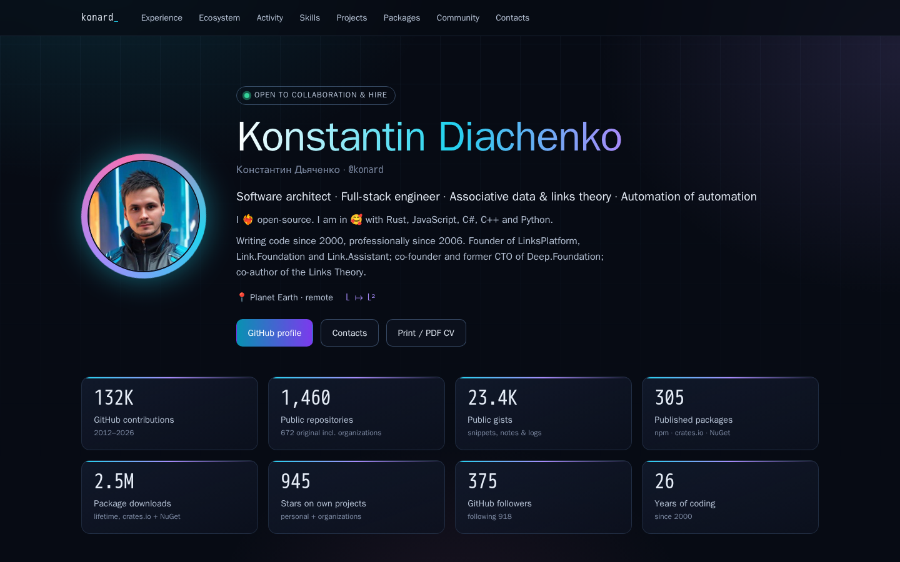
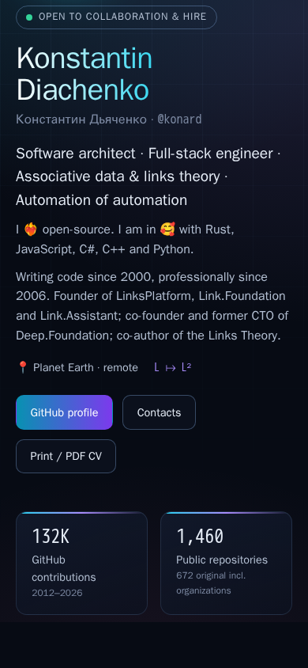
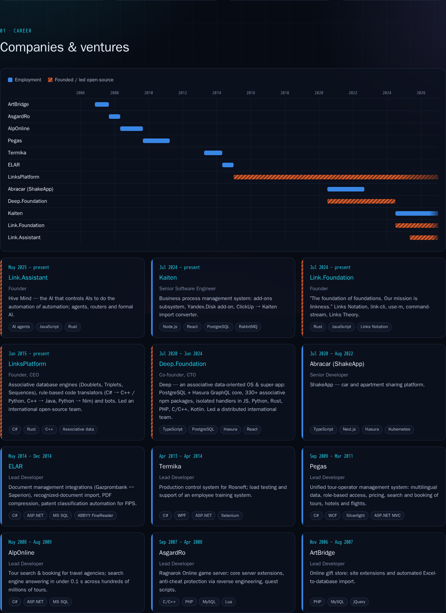
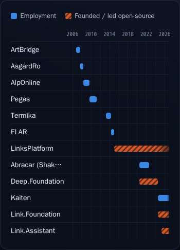

# Case study: issue #1 — personal website as public biography & CV

- Issue: https://github.com/konard/konard.github.io/issues/1
- Pull request: https://github.com/konard/konard.github.io/pull/2
- Site: https://konard.github.io (GitHub Pages, `main` branch, `/docs` folder)
- Data snapshot date: 2026-10-16

## 1. The issue

> We need to make my own personal website as public biography and CV.
> We should collect all public information about me, and organize it to list of projects I worked in,
> list of companies I worked in, all my social medias, list of programming languages i worked with,
> list of technologies I worked with and so on (all usual useful sections).
>
> It should have nice futuristic look and we should use not boring lists, but actual infographic,
> so it will quickly allow to show everything about me.
>
> We need to collect data related about the issue to this repository, make sure we compile that data
> to `./docs/case-studies/issue-{id}` folder, and use it to do deep case study analysis (also make sure
> to search online for additional facts and data), list of each and all requirements from the issue,
> and propose possible solutions and solution plans for each requirement (we should also check known
> existing components/libraries, that solve similar problem or can help in solutions).
>
> Please plan and execute everything in this single pull request […]

The issue had no comments when this study was written.

## 2. Folder contents

| Path | What it is |
|---|---|
| [`data/web-research.md`](data/web-research.md) | Online research: work history, education, location, publications, talks, Stack Overflow, registries, profiles, technologies, achievements, and a list of conflicts and unknowns. Every fact has a source URL and a confidence level. |
| [`data/github-user.json`](data/github-user.json), [`data/github-orgs.json`](data/github-orgs.json), [`data/github-social-accounts.json`](data/github-social-accounts.json), [`data/orgs-other.json`](data/orgs-other.json) | GitHub REST API snapshots of the profile, organizations and social accounts. |
| `data/org-*.json`, `data/repos-*.json` | Organization metadata and the public repositories of `konard`, `linksplatform`, `deep-foundation`, `link-foundation` and `link-assistant`. |
| [`data/github-contributions.json`](data/github-contributions.json) | Yearly contribution totals (GraphQL `contributionsCollection`, 2012–2026). |
| [`data/profile-readme.md`](data/profile-readme.md) | The owner's GitHub profile README (https://github.com/konard/konard). |
| [`data/npm-packages.json`](data/npm-packages.json), [`data/crates.json`](data/crates.json), [`data/nuget-packages.json`](data/nuget-packages.json) | Package registry snapshots (npm, crates.io, NuGet). |
| [`data/stackoverflow-user.json`](data/stackoverflow-user.json) | Stack Exchange API: profile, badges, top tags, top answers, associated accounts. |
| [`screenshots/`](screenshots) | Screenshots of the built site (desktop 1440×900, mobile 390×844). |

The raw data is turned into the site's data by these scripts:

- [`experiments/collect-github-data.sh`](../../../experiments/collect-github-data.sh) and [`experiments/collect-contributions.sh`](../../../experiments/collect-contributions.sh) refresh the GitHub snapshots with `gh api`.
- [`scripts/build-data.js`](../../../scripts/build-data.js) (`npm run build:data`) aggregates the snapshots into [`src/data/github.json`](../../../src/data/github.json). A test checks that the committed file matches the script's output.
- [`src/data/profile.js`](../../../src/data/profile.js) holds the hand-curated facts: career, education, skills, publications, contacts and featured projects. Each fact comes from `web-research.md`.

## 3. Key facts found

| Area | Facts (2026-10-16 snapshot) |
|---|---|
| Identity | Konstantin Diachenko (Константин Дьяченко, also spelled Dyachenko); handles `konard` and `drakonard`. GitHub account since 2012. Writing code since 2000, professionally since 2006. |
| Companies | ArtBridge (2006–07), AsgardRo (2007–08), AlpOnline (2008–09), Pegas (2009–11), Termika (2013–14), ELAR (2014), Abracar / ShakeApp (2020–22), Kaiten (2024–present). |
| Founded / led | LinksPlatform (2015–present), Deep.Foundation (co-founder and CTO, 2020–2024), Link.Foundation (2024–present), Link.Assistant (2025–present). |
| GitHub | 1,460 public repositories (672 original non-fork repositories across the personal account and the 4 organizations), about 945 stars on the original repositories, about 132K contributions (2012–2026), 21 primary languages. |
| Packages | npm: 213 packages, about 204K downloads per month. crates.io: 34 crates, about 549K downloads. NuGet (LinksPlatform): 58 packages, about 1.9M downloads. |
| Community | Stack Overflow: 3,134 reputation, 38 silver and 28 bronze badges, since 2011. 4 Habr articles on the Links Theory and Deep.Foundation (2023–2026). A YouTube channel. CodersRank top 1%. |
| Education | Self-taught. NRNU MEPhI (Faculty of Cybernetics, not completed). MIREA distance learning center (not completed). |
| Social | GitHub, Telegram, X/Twitter, LinkedIn, YouTube, Habr, Habr Career, VK, Discord, Stack Overflow, CodersRank, npm, crates.io, NuGet, email. |

## 4. Requirements

| # | Requirement (from the issue text) | Type |
|---|---|---|
| R1 | Build a personal website that serves as a public biography and CV. | Product |
| R2 | Collect all public information about the owner. | Research |
| R3 | Section: projects the owner worked on. | Content |
| R4 | Section: companies the owner worked at. | Content |
| R5 | Section: all social media. | Content |
| R6 | Section: programming languages. | Content |
| R7 | Section: technologies. | Content |
| R8 | "And so on": every other usual CV section (bio, contacts, education, publications, achievements, …). | Content |
| R9 | A nice futuristic look. | Design |
| R10 | Use real infographics instead of boring lists, so everything can be grasped quickly. | Design |
| R11 | Compile the collected data into `./docs/case-studies/issue-1`. | Process |
| R12 | Deep case-study analysis, including online search for more facts. | Process |
| R13 | List every requirement from the issue. | Process |
| R14 | Propose possible solutions and solution plans for each requirement. | Process |
| R15 | Check existing components and libraries that solve similar problems. | Process |
| R16 | Do everything in this single pull request. | Process |

Implicit requirements found during the analysis:

| # | Requirement | Why |
|---|---|---|
| I1 | The site must actually deploy to GitHub Pages. | Nothing had ever been deployed: the Pages API reports `status: "errored"` and `source: main:/docs`, but `main` had no `docs/` folder. The workflow was broken (section 7). |
| I2 | Deploying must not delete this case study. | The original deploy step ran `rm -rf docs`, which would have wiped `docs/case-studies`. |
| I3 | The site must be accessible, responsive and printable. | A CV is often read on a phone and printed or saved as PDF. Infographics must not rely on color alone. |
| I4 | The data must be reproducible and kept in sync. | Numbers change daily, so a script must be able to regenerate them, and tests must catch drift. |

## 5. Solutions per requirement

| # | Options considered | Chosen solution | Where |
|---|---|---|---|
| R1 | (a) Keep the existing Create React App and write the site. (b) Migrate to Astro or Next.js static export. (c) Use a portfolio template such as gitprofile or developerFolio. | **(a)**. The repository is already a React 19 + react-scripts app with a Pages workflow, so a migration would add risk without benefit for one static page. Templates were rejected for the reasons in section 6. | `src/App.js` |
| R2 | (a) Live API calls from the browser at page load. (b) Snapshot the data into the repository, with a build step. | **(b)**. Snapshots are reviewable and versioned, the site loads quickly, and there are no API rate limits or CORS issues. The GitHub REST/GraphQL, npm, crates.io, NuGet and Stack Exchange APIs were queried, plus web research (Habr, Habr Career, CodersRank, Telegram, YouTube). | `data/`, `experiments/`, `scripts/build-data.js` |
| R3 | A plain list; a grid of cards; a bubble or treemap chart. | A grid of **featured project cards** that can be filtered by language. Each card has a star bar scaled to the most-starred project, plus the language and creation year. Star counts come from `github.json`, which also holds the 40 most-starred repositories. | `src/components/Projects.js` |
| R4 | A vertical text timeline (e.g. react-chrono); a Gantt chart. | A **Gantt-style career timeline**: one row per company or venture, with years on the x-axis. Employment and open-source ventures differ by solid vs. hatched fill as well as color. Below the chart are **position cards** (role, period, summary, stack), newest first. | `src/components/Timeline.js` |
| R5 | A list of links; an icon grid. | A **contact grid** with an icon badge, network name and handle for each of 15 profiles. All links use `rel="noopener noreferrer me"`. | `src/components/Contacts.js` |
| R6 | A donut chart; horizontal bars. | **Horizontal bars** of repositories per primary language, with the top 10 plus "Other". Bars read more accurately than donut slices for 10+ categories. Favorite languages are starred. | `src/components/LanguagesChart.js` |
| R7 | A tag cloud; a grouped chip matrix. | A **grouped technology matrix**: 8 categories (languages, formats, databases, frameworks, .NET, DevOps, tools, domains), with favorite languages highlighted. | `src/components/Skills.js` |
| R8 | — | **Hero** with bio, an "open to work" badge and a print/PDF button. **Stat tiles** with 8 headline numbers. **Ecosystem orbit map** of the GitHub organizations. **Contributions per year** chart with a log/linear toggle. **Package registry** panels with top-package bars. **Stack Overflow** tag bars. **Publications**, **education**, **highlights**, and the owner's **problem-solving algorithm**. | `src/components/*` |
| R9 | A 3D background (react-three-fiber); particles (tsParticles); a CSS-only treatment. | **CSS only**: dark "deep space" palette, a cyan/violet/pink neon gradient, an animated grid, a rotating conic ring around the avatar, a glitch-style title, glassy panels and monospace accents. Animations are disabled under `prefers-reduced-motion`. No WebGL, so it stays fast on phones. | `src/index.css`, `src/App.css` |
| R10 | Chart libraries (section 6) or hand-written SVG/CSS. | **Hand-written SVG and CSS charts** that follow one data-viz method: one validated categorical palette checked against the dark surface, thin marks, legends whenever there are ≥2 series, tooltips on hover **and** keyboard focus, a table view for the contributions chart, and hatched textures as a second encoding. | `src/components/*Chart.js`, `EcosystemMap.js`, `Timeline.js`, `Registries.js`, `Tooltip.js` |
| R11 | — | All raw snapshots and the research notes are in `docs/case-studies/issue-1/data`. | this folder |
| R12 | — | `data/web-research.md` (online search) and this document. | this folder |
| R13 | — | Section 4 of this document. | this file |
| R14 | — | This section, plus the plans in section 8. | this file |
| R15 | — | Section 6 of this document. | this file |
| R16 | — | Everything is in PR #2. | — |
| I1, I2 | — | The workflow was rewritten. Pull requests now run tests and a build. On `main`, the build is copied into `docs/` while `docs/case-studies` is kept. | `.github/workflows/github-pages.yml`, `src/workflow.test.js` |
| I3 | — | Semantic landmarks, a single page with an anchor navbar, focusable chart marks with `aria-label`s, and responsive layouts (checked at 1440px and 390px with no horizontal overflow). A print stylesheet turns the page into a light, one-column CV. | `src/App.css` |
| I4 | — | `npm run build:data` regenerates `github.json`. `src/data/data.test.js` fails if the committed JSON differs from the script output, if a featured project is missing, or if dates are malformed. | `scripts/`, `src/data/data.test.js` |

## 6. Existing components and libraries

Star counts and activity come from the GitHub API on 2026-10-16.

### Chart libraries

| Library | Stars | License | Fit for this site |
|---|---|---|---|
| [d3/d3](https://github.com/d3/d3) | ~114K | ISC | The most flexible option, but low-level. Its scale and shape helpers would only replace about 20 lines of arithmetic here. |
| [chartjs/Chart.js](https://github.com/chartjs/Chart.js) | ~68K | MIT | Renders to canvas, so marks are not DOM nodes and are harder to make keyboard-accessible or style with CSS. |
| [apache/echarts](https://github.com/apache/echarts) | ~68K | Apache-2.0 | Very capable, but heavy (hundreds of KB) for 5 small charts. |
| [recharts/recharts](https://github.com/recharts/recharts) | ~28K | MIT | Good React API for bar and line charts. No Gantt chart or orbit map, and about 100 KB+ gzipped with D3 modules. |
| [airbnb/visx](https://github.com/airbnb/visx) | ~21K | MIT | Low-level React + D3 primitives. A good choice if the charts grow. |
| [plouc/nivo](https://github.com/plouc/nivo) | ~14K | MIT | Ready-made calendar, bump and treemap charts. Theming its dark mode to match the site would be about as much work as the hand-written SVG. |

**Decision:** hand-written SVG and CSS. The whole app is **72.6 KB gzipped JS + 5 KB CSS**, every mark is a DOM element that can be styled, focused and tested with Testing Library, and the visual language stays consistent. visx or Recharts would be the natural upgrade path for more complex charts.

### Timelines and activity calendars

| Library | Stars | Notes |
|---|---|---|
| [prabhuignoto/react-chrono](https://github.com/prabhuignoto/react-chrono) | ~4.2K | Vertical, horizontal and tree timelines with cards. It shows sequence but not duration or overlap. Overlap matters here: LinksPlatform runs alongside Abracar and Deep.Foundation. |
| [stephane-monnot/react-vertical-timeline](https://github.com/stephane-monnot/react-vertical-timeline) | ~1.2K | The classic alternating vertical timeline. It has the same "list in disguise" problem. |
| [grubersjoe/react-activity-calendar](https://github.com/grubersjoe/react-activity-calendar) | ~0.6K | A GitHub-style heatmap. It needs daily data. This site uses yearly totals, because 2025–2026 dominate and a log scale reads better as bars. |

**Decision:** a custom Gantt chart, because overlapping periods are the point of the career story, followed by detail cards.

### Profile and portfolio generators

| Project | Stars | Notes |
|---|---|---|
| [anuraghazra/github-readme-stats](https://github.com/anuraghazra/github-readme-stats) | ~80K | Dynamic SVG cards for READMEs, served from a Vercel API. It covers GitHub only, not companies, registries or publications, and it depends on an external service. |
| [vn7n24fzkq/github-profile-summary-cards](https://github.com/vn7n24fzkq/github-profile-summary-cards) | ~3.7K | Generates SVG cards in a GitHub Action. Same GitHub-only scope. |
| [arifszn/gitprofile](https://github.com/arifszn/gitprofile) | ~2.3K | A React portfolio that syncs from a GitHub username. It is the closest match, but fetches GitHub at runtime, is limited to the user's own repositories (not 4 organizations), and has a generic look. |
| [saadpasta/developerFolio](https://github.com/saadpasta/developerFolio) | ~6.6K | A portfolio template. GPL-3.0, and not actively maintained. |
| [jsonresume/resume-schema](https://github.com/jsonresume/resume-schema) | ~2.4K | A standard JSON schema for CVs, with many themes. |

**Decision:** none of these is reused directly, but two ideas were adopted:

- the snapshot-based approach of the summary-cards Action (data is generated, not fetched live);
- a JSON-Resume-like data shape in `src/data/profile.js` (basics, work, education, skills, publications, profiles), which could be exported to `resume.json` later (section 8).

### Visual effects

| Library | Stars | Notes |
|---|---|---|
| [pmndrs/react-three-fiber](https://github.com/pmndrs/react-three-fiber) | ~33K | A 3D background would be very "futuristic", but costs more than 150 KB and battery life on phones. |
| [tsparticles/tsparticles](https://github.com/tsparticles/tsparticles) | ~9K | Particle backgrounds, about 30 KB+. |

**Decision:** CSS gradients, an animated grid and a conic ring give the same look for 0 KB of JS.

## 7. CI and deploy root causes

On `main`, GitHub Pages had never deployed anything. The original workflow (`.github/workflows/github-pages.yml` as of `main` commit `117f247`) had four independent defects:

1. **Invalid YAML.** The step name `Deploy: Copy build to docs folder and commit` contains an unquoted `: `, so GitHub rejected the file. Run [38958801553](https://github.com/konard/konard.github.io/actions/runs/38958801553) failed with "This run likely failed because of a workflow file issue" (log in [`ci-logs/`](../../../ci-logs)). Fix: quote the name. `src/workflow.test.js` now parses every workflow with js-yaml.
2. **Nonexistent dependency.** `package.json` had `"overrides": {"@testing-library/react": "^19.0.0"}`, but that package has no version 19 (the latest is 16.x), so `npm ci` and `npm install` could not resolve it. Fix: remove the override and add `@testing-library/react@16.3.3` with `@testing-library/dom` as devDependencies.
3. **Broken build.** `src/index.js` imported `./reportWebVitals`, which requires `web-vitals`. That package was never installed, so `react-scripts build` failed with "Can't resolve 'web-vitals'". Fix: drop the unused import.
4. **The deploy would delete docs.** `rm -rf docs` would erase `docs/case-studies`. In addition, it used Node 14, which is end-of-life, and the `actions/*@v3` actions, which run on the deprecated Node 16 runtime. It also ran only on pushes to `main`, so pull requests were never tested. Fix: Node 20, `actions/*@v4`, `npm ci`, a `test` job for pull requests and `main`, and a deploy job that only replaces build output and keeps `docs/case-studies`.

## 8. Assumptions, conflicts and future work

Where sources conflict, these choices were made. They are easy to change in `src/data/profile.js`.

| Topic | Conflict | Choice on the site |
|---|---|---|
| Location | Moscow (Habr, CodersRank) vs. "Goa, India" (Stack Overflow) vs. "Planet Earth" (GitHub) | "Planet Earth · remote", which follows the owner's GitHub profile and their open-to-remote status. |
| Deep.Foundation start | Jul 2020 (CodersRank) vs. Sep 2022 (Habr Career); the GitHub org was created Mar 2020 | Jul 2020 (2020-07). |
| Abracar end | Aug 2022 (Habr Career) vs. Feb 2023 (CodersRank) | Aug 2022, from the more detailed source. |
| MEPhI dates | Sep 2007 – Jan 2008 vs. Dec 2006 – Dec 2007 | 2007–2008, no degree. |
| Link.Assistant start | The org was created Nov 2025, but its earliest repositories date from May 2025 | May 2025. |
| Contributions | Collected with an authenticated token, so they may include private contributions that are shown on the public graph only as counts | Labeled "GitHub contributions". Re-run `experiments/collect-contributions.sh` with any token to refresh. |
| Repositories | 1,460 public repositories include forks and hundreds of auto-generated `log-tmp-*solution-draft-log*` repositories | The stat tile shows 1,460 with "672 original incl. organizations". The charts use the 672 original repositories only. |
| Downloads | npm reports monthly downloads, while crates.io and NuGet report lifetime totals | The "downloads" tile sums only the lifetime totals (crates.io + NuGet, about 2.5M). npm is shown per month in its own panel. |
| Discord | `https://discord.com/users/drakonard` (from the owner's profile README) uses a username, while Discord profile URLs normally use numeric IDs | Kept as written by the owner. Replace it with the numeric ID if it does not resolve. |

Not found online (details in `data/web-research.md`, section 10): conference talks, peer-reviewed papers, and the contents of the LinkedIn and VK profiles (they block automated fetches).

Possible next steps:

1. **Scheduled data refresh.** A weekly GitHub Action could run the `experiments/*.sh` collectors and `npm run build:data`, then open a PR. This needs a token secret for GraphQL contributions.
2. **JSON Resume export.** Generate `resume.json` from `profile.js`, so the CV can be rendered by any JSON Resume theme or imported elsewhere.
3. **Localization.** Most sources are in Russian, so a Russian version of the CV could be added.
4. **Custom domain.** GitHub Pages supports one through a `CNAME` file in `public/`.

## 9. Screenshots

| Desktop | Mobile |
|---|---|
|  |  |
|  |  |

Section screenshots:

- [ecosystem](screenshots/section-ecosystem.png)
- [activity](screenshots/section-activity.png)
- [skills](screenshots/section-skills.png)
- [projects](screenshots/section-projects.png)
- [packages](screenshots/section-packages.png)
- [community](screenshots/section-community.png)
- [method](screenshots/section-method.png)
- [contacts](screenshots/section-contacts.png)
- [full page](screenshots/desktop-full.png)
