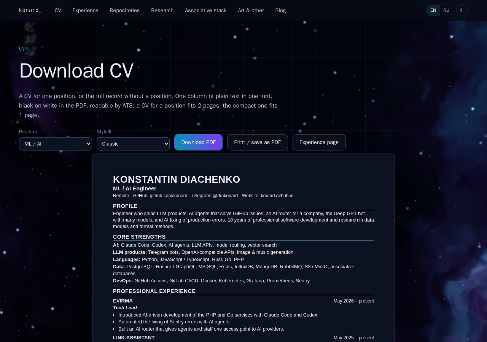
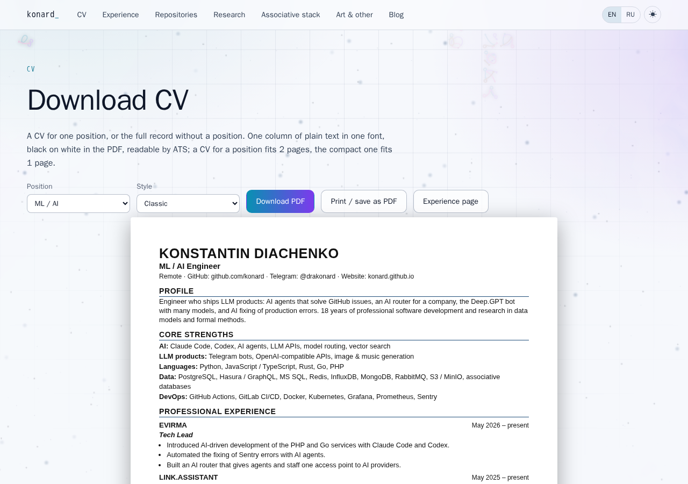
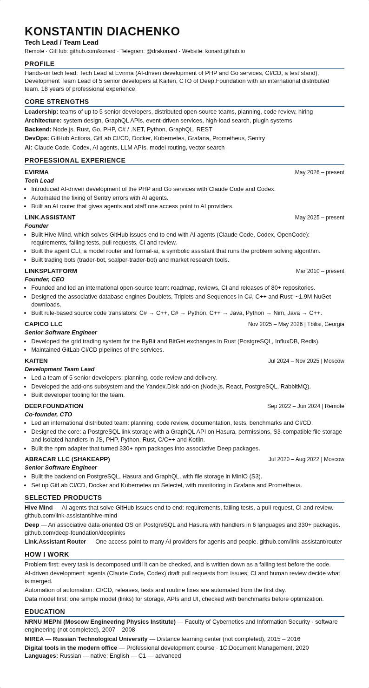
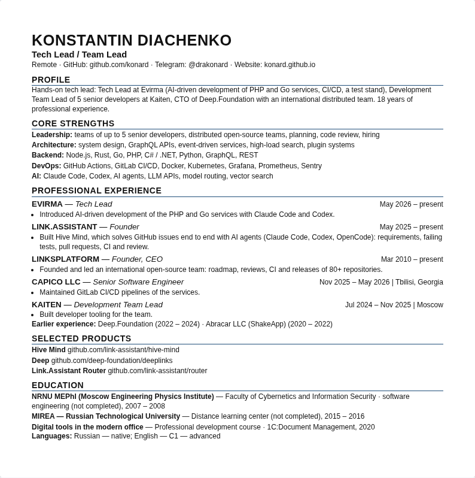
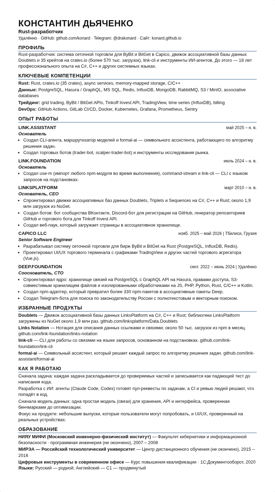
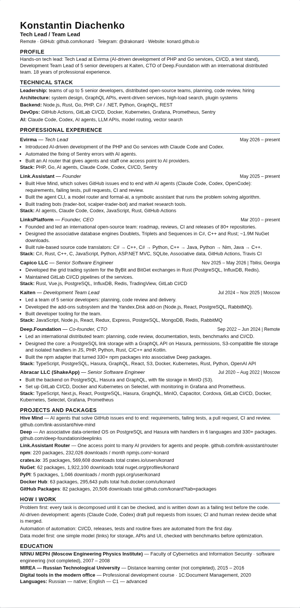
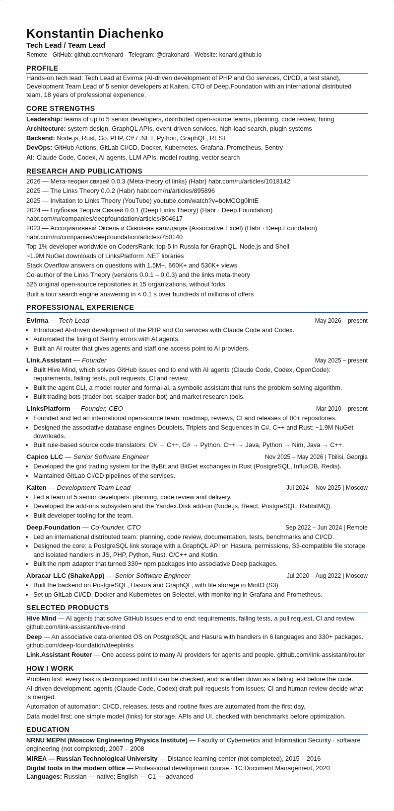
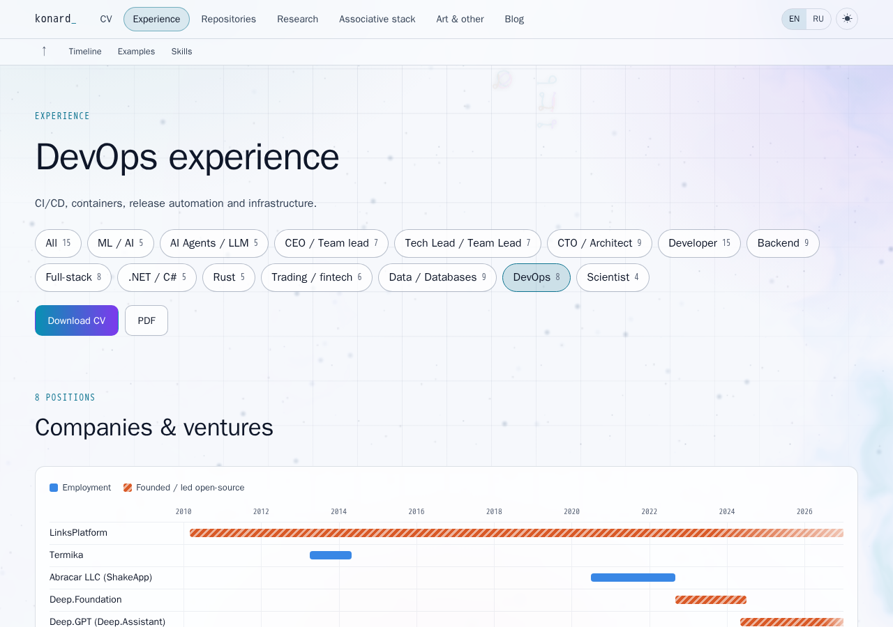
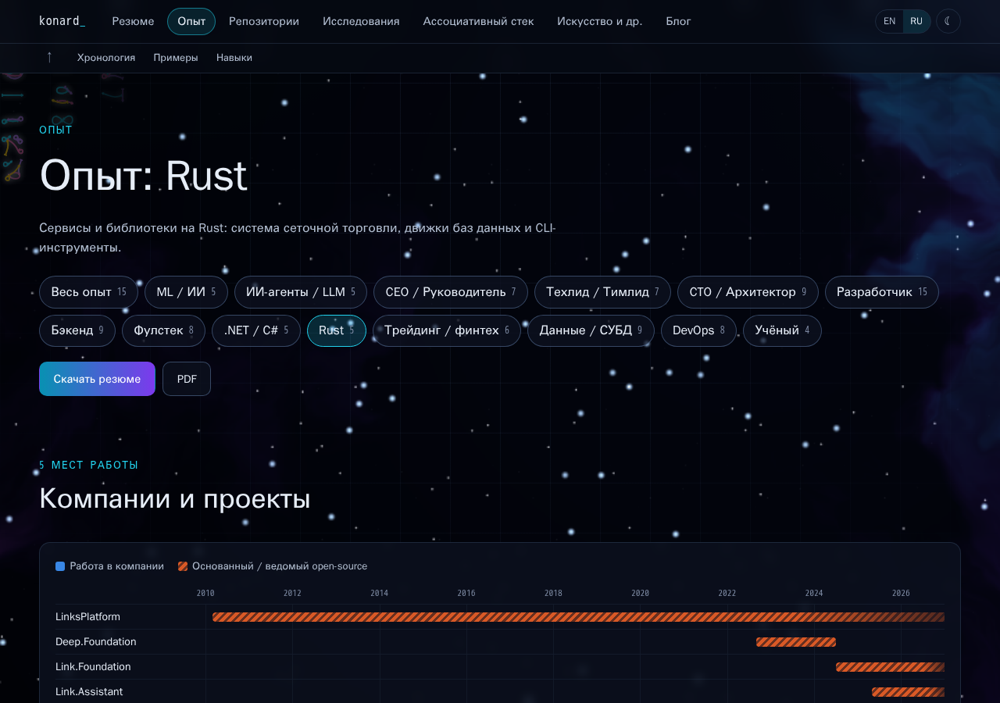
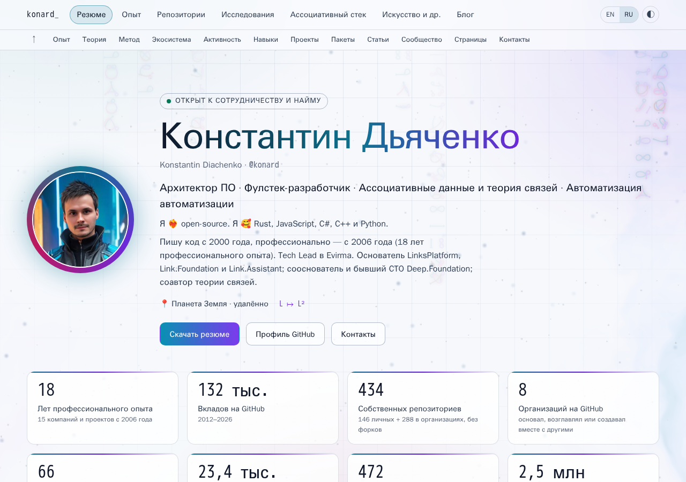

# Case study: issue #11 — experience synced with hh.ru, a CV per position in EN/RU, light/dark themes and PDF styles

- Issue: https://github.com/konard/konard.github.io/issues/11
- Pull request: https://github.com/konard/konard.github.io/pull/12
- Builds on: [issue #9](../issue-9/README.md), [issue #7](../issue-7/README.md), [issue #1](../issue-1/README.md)
- Data snapshot date: 2026-10-22 (the hh.ru resume was last updated 2026-10-12)

## 1. The issue

The full issue text is in [`data/issue-11.json`](data/issue-11.json). It has no comments. In short:

1. Bring every job on the site in line with the hh.ru CV:
   - add Evirma and Capico;
   - fix Kaiten, Deep.Foundation, ArtBridge and the other jobs listed in the issue's table.
2. The site is the full record and the hh.ru CV is a subset of it. LinksPlatform stays 2010 – present.
3. Add a "Download CV" action on the home page and on the experience page. It gives a CV tailored to the selected position, or all experience when no position is selected.
   - The PDF is ATS-readable, at most 2 pages when tailored, and has no private data.
4. At least 3 CV styles: classic, compact, technical, and optionally academic.
5. Add new positions: Tech Lead, CTO, Backend, Full-stack, .NET, Rust, AI Agents, Trading, Data.
6. Light and dark themes with auto-detection and a remembered switch. The PDF is always light.
7. English and Russian for the whole site and the CV, with auto-detection, a remembered switch and `?lang=`.
8. Tests for:
   - data completeness;
   - both languages present for every text;
   - a CV render for every style, language and position.

## 2. Sources

| Source                                                                                         | What it gave                                                       |
| ---------------------------------------------------------------------------------------------- | ------------------------------------------------------------------ |
| The issue's comparison table (hh.ru, updated 2026-10-12, compared with LinkedIn on 2026-10-22) | Dates, titles, achievements and stacks of every job                |
| [`data/hh-resume-public.txt`](data/hh-resume-public.txt)                                       | The public header of the hh.ru resume: 18 years, the 2020 course   |
| Habr Career (`src/data/habr.json`, collected for issue #7)                                     | The Termika load-testing line                                      |
| `src/data/repositories.json`                                                                   | Links to products and packages (the technical CV checks they exist) |

The phone, the birth date, the salary and the email from hh.ru are left out on purpose. The site and the CVs never show them, and a test fails if they appear (`src/cv/cv.test.jsx`).

## 3. Decisions and assumptions

- **The data split.**
  - Jobs moved from `profile.js` to [`src/data/experience.js`](../../../src/data/experience.js). Each job has:
    - `{ en, ru }` texts;
    - its real title;
    - `start` and `end`;
    - an optional `employment` period;
    - tags and roles;
    - bullets with `topics`.
  - Positions are in [`src/data/positions.js`](../../../src/data/positions.js). Each one selects its jobs, bullet topics, skills, products and practices.
- **LinksPlatform** runs from March 2010 to the present on the site. Only its `employment` period (2015-01 – 2020-06, the gap it fills on hh.ru) counts towards the total, so the total agrees with hh.ru.
- **18 years.** `experienceMonths` merges the overlapping employment periods from ArtBridge (Nov 2006) onwards; `yearsText` turns the total into "18 years" or "18 лет". The total is not hard-coded, so it grows on its own (a test checks 21 and 22 years).
- **Deep.Foundation** starts in September 2022, as on hh.ru. The summary says the open-source work began in 2020, alongside Abracar.
- **Termika.**
  - The title is ".NET Programmer", as on hh.ru.
  - Production Control for Rosneft and the OLIMPOKS certification system come from LinkedIn.
  - Selenium load testing is in neither hh.ru nor LinkedIn. It is on Habr Career, so it is kept as one bullet that names its source, with the `devops` topic.
- **Legal names in Russian:** ООО «Абракар», АО «ЭЛАР», ЗАО «Термика». In English they are Abracar, ELAR and Termika. A test checks the Russian names.
- **Titles.** Every job uses its real title (Tech Lead, Development Team Lead, Programmer, Web Developer…) on the site and in the CV, instead of "Lead Developer" for every job.

## 4. The CV

Every CV comes from one function, [`buildCv({ role, style, lang })`](../../../src/cv/buildCv.js), and is rendered by [`CvDocument`](../../../src/cv/CvDocument.jsx):

- on the `/cv/?role=…&style=…&lang=…` page;
- on the "Download CV" buttons of the home and experience pages.

There are 15 positions, 4 styles and 2 languages, so 120 CVs.

| Style     | What it is                                                                                                                                                                                                |
| --------- | --------------------------------------------------------------------------------------------------------------------------------------------------------------------------------------------------------- |
| Classic   | Name in capitals, title, location and contacts. Then Profile, Core strengths, Professional experience (company in capitals, dates and location on the right, a role line, bullets), Selected products, How I work, Education |
| Compact   | One page: the 5 most recent jobs with one bullet each. Earlier jobs go into one "Earlier experience" line                                                                                                  |
| Technical | Stack groups, a `Stack:` line per job, and projects with links to their repositories and packages (npm, crates.io, NuGet)                                                                                  |
| Academic  | Research and publications first, Links Theory highlights, then experience                                                                                                                                  |

All styles share one column, one font (Arial / Liberation Sans) and one accent color, with black text on white in print. They contain no tables, images or SVG.

### Fitting 2 pages

The Developer position has 14 jobs, which made 3 pages. Even with one bullet per old job it was still about 2 pages.

The rule now: a position with more than 10 jobs lists the jobs that ended before 2015 in the "Earlier experience" line, e.g. "ELAR (2014) · … · ArtBridge (2006 – 2007)". With this rule the longest tailored CV takes 1.78 pages. The full record (no position) keeps every job with its bullets and has no page limit; it takes 3 pages.

### The PDF pipeline

[`scripts/build-cv-pdf.mjs`](../../../scripts/build-cv-pdf.mjs) (`npm run build:cv`) does this:

1. Serves the build with `vite preview`.
2. Opens each of the 120 CV pages in headless Chromium with the light color scheme and the print media.
3. Saves each one as A4, the same as the browser's "Save as PDF".
4. Writes them to `build/cv/pdf/konstantin-diachenko-<position>-<style>-<lang>.pdf`, the targets of the "Download PDF" links.

The deploy workflow runs it after `npm run build` and before the Pages artifact is uploaded. The script fails the run when:

- a tailored CV has more than 2 pages, or a compact CV more than 1;
- a PDF has no text layer (no `/ToUnicode` maps);
- any part of the CV is positioned or floated (see below).

### Finding: positioned bullets break the ATS reading order

The first PDFs extracted (pypdf, [`experiments/cv-pdf-text.py`](../../../experiments/cv-pdf-text.py)) with every bullet of the page after the last job, separated from the job it belongs to.

The cause was the custom bullet, an `li::before` with `position: absolute`. Chrome paints positioned elements in a later layer, and the PDF content stream follows paint order. As a result an ATS reading the text stream saw all the job headings first and all the achievements afterwards.

The fix is plain `list-style: disc` markers. `positionedParts()` now fails the build if any part of a CV is positioned again; unit tests are in `src/cv/pdfChecks.test.js`.

Result: in the extracted text each job's bullets now follow its heading. This was checked by hand on samples of every style; `positionedParts` guards the cause in all 120 PDFs. The script also checks every PDF in both languages for:

- the contacts and the section headings;
- the experience coming before the education;
- no phone, email, birth date or salary.

## 5. Themes and languages

[`src/i18n/prefs.js`](../../../src/i18n/prefs.js) holds two small stores.

**Language:**

- Resolved in this order: `?lang=`, then the remembered choice, then `navigator.languages`.
- Set on `<html lang>`.
- Changed by the EN/RU switch in the top bar, which also updates the URL.

**Theme:**

- Resolved in this order: the remembered choice, then `prefers-color-scheme`.
- Applied before the first paint by a small inline script injected into every page, so there is no flash.
- The switch cycles system → light → dark.

The CV preview follows the theme on screen. Print and the PDFs are always black on white.

## 6. Requirement → implementation → test

| Requirement                                                     | Implementation                                                                                                  | Test                                                                                                    |
| --------------------------------------------------------------- | --------------------------------------------------------------------------------------------------------------- | ------------------------------------------------------------------------------------------------------- |
| Evirma, Capico; Kaiten, Deep.Foundation, ArtBridge… fixed       | `src/data/experience.js`                                                                                        | `experience.test.js` › "the facts from the hh.ru CV are on the site"                                    |
| Every hh.ru detail, LinksPlatform 2010 – present, 18 years      | `experience.js` (`employment`, `experienceMonths`, `yearsText`)                                                 | `experience.test.js` › hh.ru facts, 18 years, education and languages                                   |
| Data completeness (role, dates, summary, tags)                  | `experience.js`                                                                                                 | `experience.test.js` › "every job is complete", "a job without … fails the check"                       |
| Both languages for every text                                   | `{ en, ru }` texts across the data and the pages                                                                | `experience.test.js` › "every text has English and Russian"; `App.test.jsx` › "is translated to Russian" |
| CV download for all experience and each position, EN and RU     | `src/cv/*`, `src/pages/CvPage.jsx`, the buttons in `Hero.jsx` and `ExperiencePage.jsx`                          | `cv.test.jsx` (120 renders, CV page), `App.test.jsx` › "links the CV and every position"                |
| 3+ styles, a clean PDF of at most 2 pages                       | `src/pages/cv.css`, `scripts/build-cv-pdf.mjs`, the deploy workflow                                             | `npm run build:cv` (page limits, text layer, no positioned parts), `pdfChecks.test.js`, `workflow.test.js` |
| No private data                                                 | `cvContacts`: GitHub, Telegram, website                                                                         | `cv.test.jsx` (phone, email, birth date and salary patterns)                                            |
| New positions on the experience page                            | `src/data/positions.js`, `ExperiencePage.jsx`                                                                   | `experience.test.js` › "the old roles stay and the new positions are added"                             |
| Light/dark with auto-detection and a switch; the PDF is light   | `prefs.js`, `:root[data-theme='light']` styles, `cv.css`                                                        | `prefs.test.jsx` › theme; `build-cv-pdf.mjs` prints with `colorScheme: 'light'`                         |
| EN/RU with auto-detection, a switch and `?lang=`                | `prefs.js`, `PrefSwitches.jsx`                                                                                        | `prefs.test.jsx` › language detection, switches                                                         |

## 7. Screenshots

They are made by [`experiments/theme-screenshots.mjs`](../../../experiments/theme-screenshots.mjs) and [`experiments/cv-screenshots.mjs`](../../../experiments/cv-screenshots.mjs) from `npm run build`.

| CV page, dark theme                            | CV page, light theme                             |
| ---------------------------------------------- | ------------------------------------------------ |
|  |  |

| Classic (Tech Lead, EN)                         | Compact (Tech Lead, EN)                         | Classic (Rust, RU)                           |
| ----------------------------------------------- | ----------------------------------------------- | -------------------------------------------- |
|        |        |  |

| Technical (Tech Lead, EN)                       | Academic (Tech Lead, EN)                        |
| ----------------------------------------------- | ----------------------------------------------- |
|    |      |

| Experience page with the CV buttons (DevOps, light)                     | Experience page in Russian (Rust, dark)                                     |
| ----------------------------------------------------------------------- | --------------------------------------------------------------------------- |
|        |        |

The home page with Russian and the light theme auto-detected (no stored choice, `ru-RU` browser, light system theme):



Every page in both themes is in `screenshots/theme-<page>-<light|dark>.png`.

## 8. How to check

```bash
npm ci
npm run test:ci                 # 341 tests, including the 120 CV renders
npm run build && npx playwright install chromium && npm run build:cv -- --verbose
python3 -m venv /tmp/pdfvenv && /tmp/pdfvenv/bin/pip install pypdf
/tmp/pdfvenv/bin/python -I experiments/cv-pdf-text.py build/cv/pdf/*.pdf   # reading order and key facts
```
