# Case study: issue #13 — the rain on Safari, settings, two new skins, real references, the full associative stack and the R → R² notation

- Issue: https://github.com/konard/konard.github.io/issues/13
- Pull request: https://github.com/konard/konard.github.io/pull/14
- Builds on: [issue #11](../issue-11/README.md), [issue #9](../issue-9/README.md), [issue #7](../issue-7/README.md), [issue #1](../issue-1/README.md)
- Data snapshot date: 2026-10-21 (repositories), 2026-10-23 (`link-foundation/lfs`, added for this issue)

## 1. The issue

The full issue text is in [`data/issue-13.json`](data/issue-13.json). It has no comments. Its screenshot, taken in Safari, is [`screenshots/issue-reported.png`](screenshots/issue-reported.png). The issue asks for these changes:

1. The matrix rain is sometimes scaled up too much after a refresh or a click on a menu item.
2. A link in the footer to a settings page:
   - every background animation option can be configured;
   - the preview is instant, in the background of the same page;
   - the choice is saved in localStorage.
3. UI skins: a liquid glass skin, in the spirit of Apple's, with lots of configuration.
4. A futuristic, angular skin like [konard/immortality](https://github.com/konard/immortality), also with lots of configuration.
5. A "Show only real references" option in "Every configuration of 1–4 links":
   - it leaves out every combination that has 0;
   - links refer only to real links (each other or themselves);
   - the default stays the same.
6. Expand the associative tech stack with all projects of linksplatform, link-foundation and link-assistant. The stack starts from the meta-theory of link-foundation.
7. Make L → L² configurable to R → R² "and so on", as in the latest draft of the links meta-theory. The default stays L → L², as in the previous English draft.

| #   | Requirement           | Where                                                                                                          | Verified by                                                        |
| --- | --------------------- | -------------------------------------------------------------------------------------------------------------- | ------------------------------------------------------------------ |
| 1   | Rain scaling          | [`src/visuals/size.js`](../../../src/visuals/size.js), `rain.js`, `nebula.js`                                  | `src/components/visuals.test.jsx`, `experiments/rain-scale.mjs`    |
| 2   | Settings page         | [`src/settings/`](../../../src/settings), [`src/pages/SettingsPage.jsx`](../../../src/pages/SettingsPage.jsx)  | `src/settings/settings.test.js`, `src/pages/settings.test.jsx`     |
| 3   | Liquid glass skin     | [`src/skins.liquid.css`](../../../src/skins.liquid.css), `LiquidRefraction.jsx`                                | `src/skins.test.jsx`                                               |
| 4   | Futuristic skin       | [`src/skins.future.css`](../../../src/skins.future.css), [`src/skins.palettes.css`](../../../src/skins.palettes.css) | `src/skins.test.jsx`                                          |
| 5   | Only real references  | [`src/links/configurations.js`](../../../src/links/configurations.js), `NetworkGallery.jsx`                    | `src/links/links.test.js`, `src/components/visuals.test.jsx`       |
| 6   | Associative stack     | [`src/data/stack.js`](../../../src/data/stack.js), [`AssociativePage.jsx`](../../../src/pages/AssociativePage.jsx) | `src/pages/pages.test.jsx`                                     |
| 7   | L → L² or R → R²      | [`src/links/notation.js`](../../../src/links/notation.js), [`src/data/theory.js`](../../../src/data/theory.js) | `src/links/notation.test.jsx`                                      |

## 2. The rain scaled up too much (root cause)

The reported screenshot shows the rain glyphs and the stars blurred and several times too large. In Safari this happens on some loads only.

**The cause.**

- Both background canvases (the rain and the universe) took their size from CSS once, at start, and then only listened to the window `resize` event.
- WebKit may run `<script type="module">` before the stylesheet is applied ([WebKit bug 261655](https://bugs.webkit.org/show_bug.cgi?id=261655)). At that moment a canvas still has the default size of 300×150 CSS pixels, so the bitmap is made 300 pixels wide.
- When the stylesheet arrives, the canvas grows to the size of the window. The window itself did not change, so no `resize` event comes, and the 300-pixel bitmap is stretched over the screen: ×4.27 on a 1280-pixel window.
- A refresh or a click on a menu item loads a new page, which is why it shows up there and not every time: the result depends on whether the cached stylesheet wins the race.

**Reproduction.**

- [`experiments/rain-scale.mjs`](../../../experiments/rain-scale.mjs) loads the built site in Chromium and, with `late`, attaches the stylesheet only after the scripts ran, as Safari does.
- It prints the ratio between the CSS size and the bitmap of each canvas.
- Before the fix the rain and the universe were "stretched ×4.27" on load, after a menu click and after a reload. After the fix the ratio is ×1.

**The fix.**

- [`src/visuals/size.js`](../../../src/visuals/size.js) adds `watchSize(element, onResize)`: a `ResizeObserver` on the canvas itself, plus the window `resize` event for changes of `devicePixelRatio`.
- `rain.js` and `nebula.js` use it and skip redrawing when the size did not change, so the first report of the observer does not clear the picture.
- `src/components/visuals.test.jsx` grows a canvas from 300×150 to the window size without a window event and checks that the bitmap follows.

| Before (late stylesheet, ×4.27)                         | After (×1)                                         |
| ------------------------------------------------------- | -------------------------------------------------- |
|  | 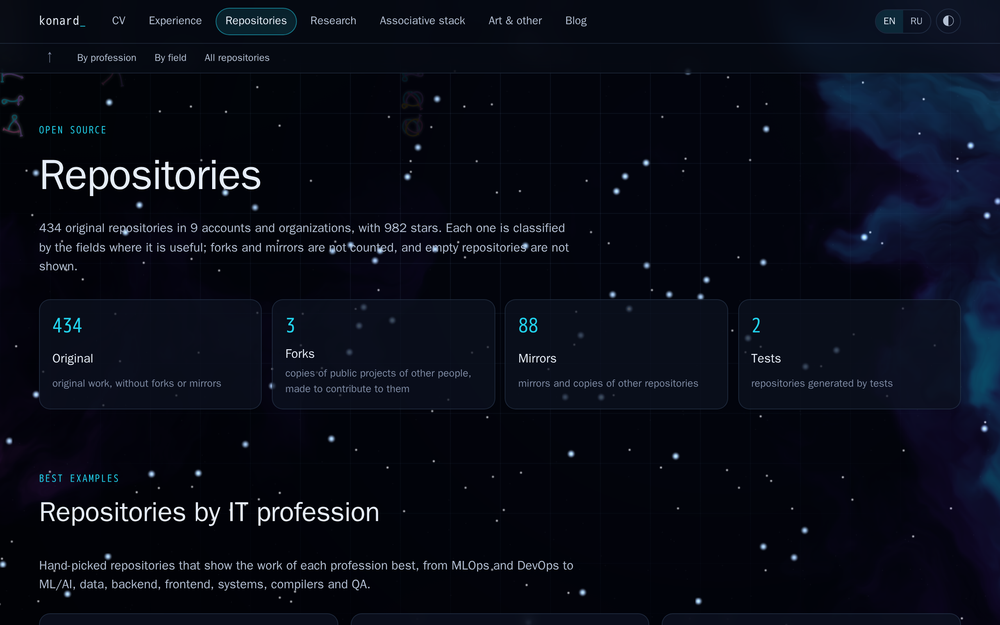    |

## 3. Settings

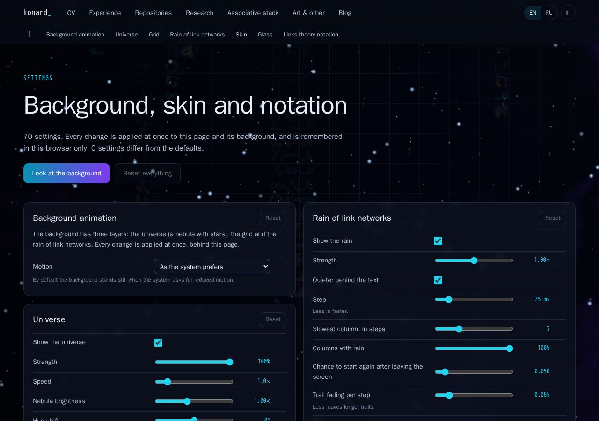

**The store** ([`src/settings/`](../../../src/settings)):

- `schema.js` describes 70 settings in 9 sections:

  | Section                  | Settings |
  | ------------------------ | -------- |
  | Background animation     | 1        |
  | Universe                 | 11       |
  | Grid                     | 5        |
  | Rain of link networks    | 14       |
  | Skin                     | 1        |
  | Glass                    | 4        |
  | Liquid glass             | 16       |
  | Futuristic               | 17       |
  | Links theory notation    | 1        |

- Every setting has a default, a range or a list of choices, and English and Russian labels.
- `apply.js` checks the stored values (numbers are clamped, choices must be listed, colours must be `#rrggbb`). It puts them on `<html>`: numbers and colours become CSS variables, and switches and choices become `data-` attributes.
- `store.js` saves only the values that differ from the defaults, in `localStorage` under `settings`. A better default chosen later still reaches everyone who did not change that setting. Other open tabs follow through the `storage` event.
- The same check and apply code is inlined into a script that runs before the first paint (`vite.config.js`), so a chosen skin never flashes the default one.

**The page** `/settings/`:

- It is linked from the footer of every page.
- Every change is applied at once: the page itself and its background are the preview.
- The universe, the grid and the rain read the settings while they run, so nothing restarts.
- "Look at the background" hides the page for a moment.
- Reset works for a single setting, a section or everything.
- The changes can be copied as JSON and loaded back, to send a set of defaults.

**Choices.**

- The defaults are exactly the values the site used before. Nothing changes for a visitor until they change something.
- Settings are per browser, and the page says so.

## 4. Skins

`skin.name` is `glass` (the existing skin and the default), `liquid` or `futuristic`. The glass skin's opacity, blur, bar and radius became settings too.

**Liquid glass** ([`src/skins.liquid.css`](../../../src/skins.liquid.css)) has 16 settings:

- blur, saturation, brightness, tint colour and level, radius;
- light on the edges, edge width, depth, shadow and sheen;
- floating panels and capsule buttons;
- refraction through an SVG displacement filter ([`LiquidRefraction.jsx`](../../../src/components/LiquidRefraction.jsx)), with its strength and detail. The filter works only where `backdrop-filter: url()` is supported (Chromium). Other browsers keep the blur.

| Dark                                          | Light                                           |
| --------------------------------------------- | ----------------------------------------------- |
| 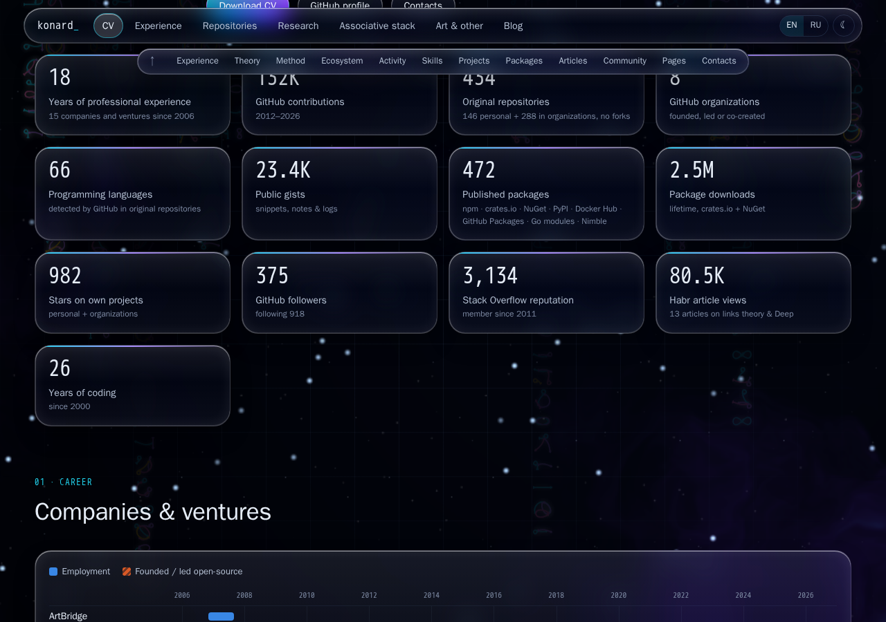 |  |

**Futuristic** ([`src/skins.future.css`](../../../src/skins.future.css), [`src/skins.palettes.css`](../../../src/skins.palettes.css)) follows the HUD style of konard/immortality. It has 17 settings:

- 12 palettes: mission, tron, ares, clu, athena, aphrodite, poseidon, soulextract, glitchy, amber, matrix and monochrome (contrast checked by `experiments/future-palettes.mjs`);
- 8 frames: corners, chamfer, octagon, kranox, bracket, lines, underline and plain, with the cut and corner sizes;
- 9 surfaces: gradient, glass, frosted, solid, transparent, steel, carbon, holographic and blueprint, with opacity and blur;
- border, accent bar, glow, display and body fonts, letter case, spacing, title style, hover effect and scanlines.

| Dark                                             | Light                                              | Settings                                                 |
| ------------------------------------------------ | -------------------------------------------------- | -------------------------------------------------------- |
| 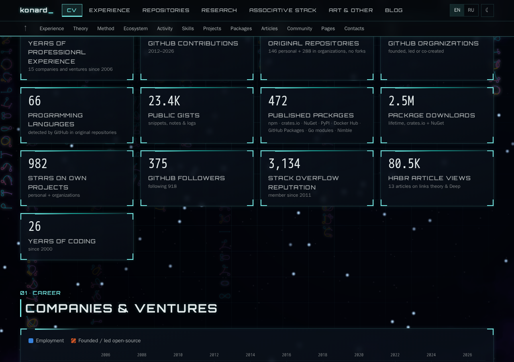 | 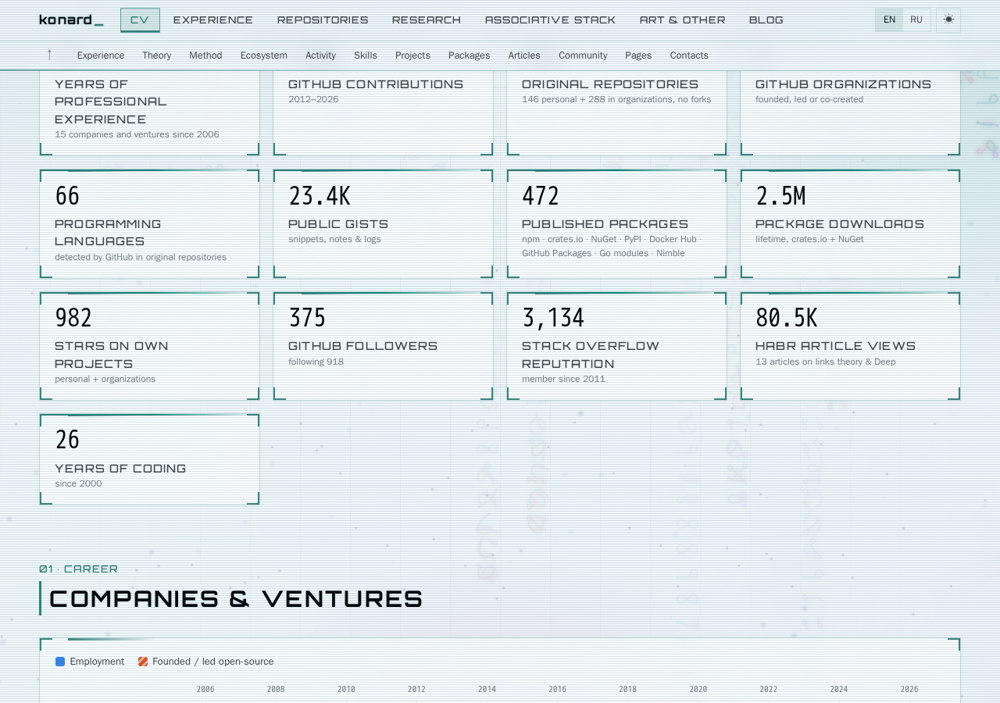 | 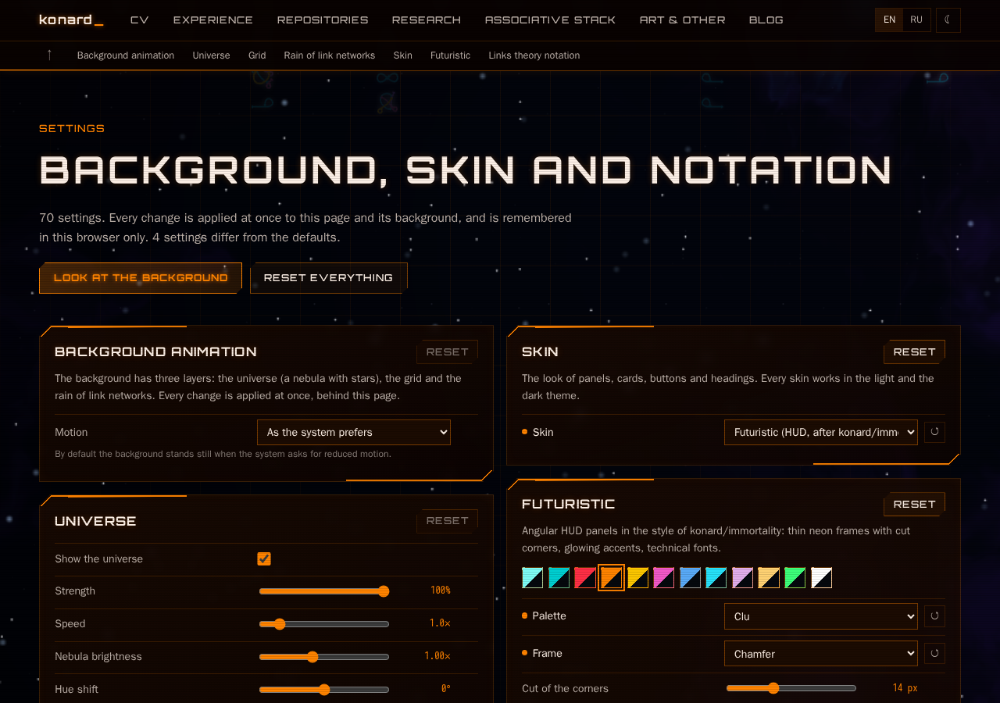 |

The frames chamfer, octagon, kranox and bracket are in `screenshots/skin-future-*.png`.

## 5. Only real references

A network of N links writes each link as a source and a target. With the zero link ("nothing"), each of the 2N digits is one of 0…N: (N+1)^(2N) networks. With only real references, the digits are 1…N: N^(2N) networks.

| Links | Default (with 0) | Only real references |
| ----- | ---------------- | -------------------- |
| 1     | 4                | 1                    |
| 2     | 81               | 16                   |
| 3     | 4,096            | 729                  |
| 4     | 390,625          | 65,536               |

- `codeAt`, `networkCount`, `classCount` and `representatives` in `src/links/configurations.js` take `{ real }`. The i-th real network is computed directly, without filtering.
- The button sits next to "One per renaming" and works with it. It is off by default.
- The rain can also use only real networks (`rain.real`, off by default).

| Default, 2 links (81)                                 | Only real references, 2 links (16)                 |
| ----------------------------------------------------- | -------------------------------------------------- |
| 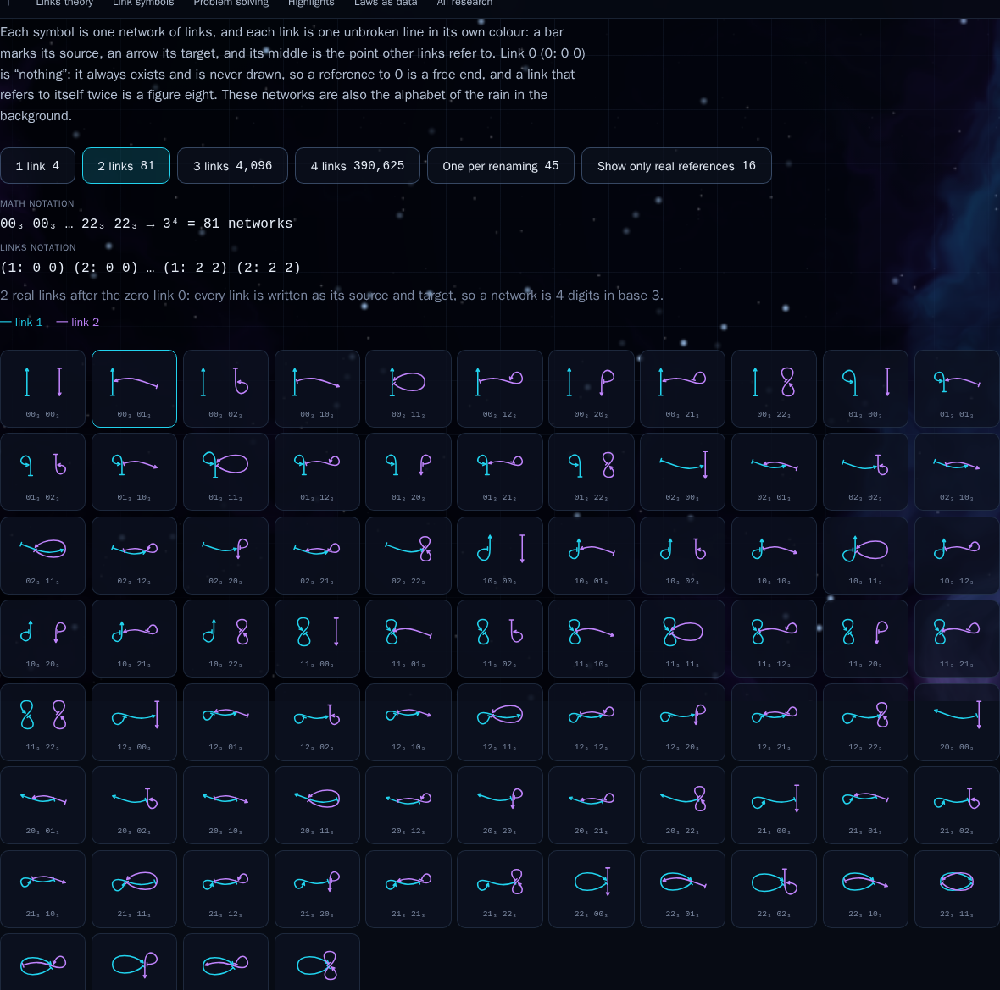   | 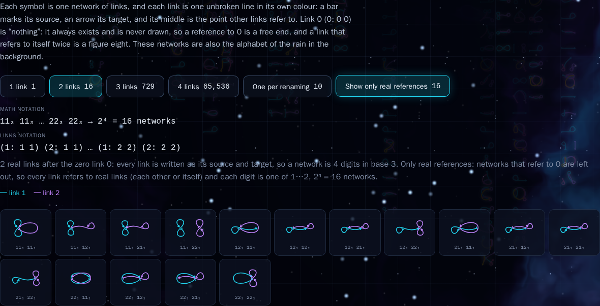   |

## 6. The associative stack

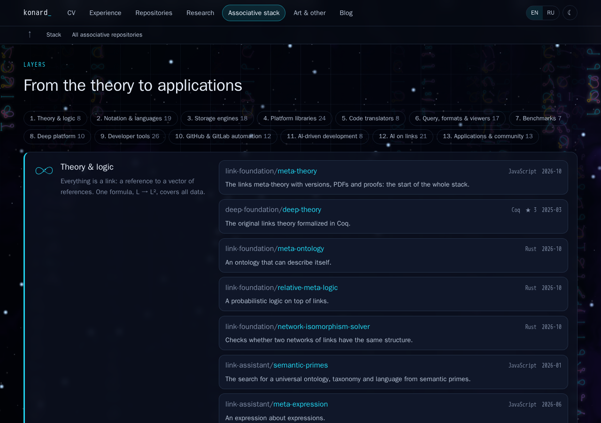

**Before:** 7 layers with 46 hand-picked repositories, drawn from AI at the top down to the theory.

**After:**

- [`src/data/stack.js`](../../../src/data/stack.js) has 13 layers and 191 repositories. Each has an English and a Russian note, written from its description or README.
- The page draws the layers in order, starting from the theory, and `link-foundation/meta-theory` is the first repository.
- An index above the layers links to each layer and shows how many repositories it has.

| #   | Layer                      | Repositories |
| --- | -------------------------- | ------------ |
| 1   | Theory & logic             | 8            |
| 2   | Notation & languages       | 19           |
| 3   | Storage engines            | 18           |
| 4   | Platform libraries         | 24           |
| 5   | Code translators           | 8            |
| 6   | Query, formats & viewers   | 17           |
| 7   | Benchmarks                 | 7            |
| 8   | Deep platform              | 10           |
| 9   | Developer tools            | 26           |
| 10  | GitHub & GitLab automation | 12           |
| 11  | AI-driven development      | 8            |
| 12  | AI on links                | 21           |
| 13  | Applications & community   | 13           |

**"All projects".** Every original repository of the three organizations is in exactly one layer:

- 76 from linksplatform (including the archived ones);
- 79 from link-foundation;
- 28 from link-assistant;
- plus 8 repositories of the Deep platform and the personal projects the stack grew from (6 of deep-foundation, 2 of konard, including konard/LinksPlatform).

A test fails if a new original repository of these organizations is not placed in a layer, or if a repository is listed twice.

**Not shown, on purpose** (as in issue #9):

- private repositories;
- forks;
- the 86 mirrors of deep-foundation in link-foundation;
- the 11 repositories that `excludedBecause` in `scripts/repositories.cjs` marks as empty (nothing but boilerplate: a README, a license, a `.gitignore`): link-assistant/support-bot; link-foundation/articles, deep-packages, examples, javascript-to-rust-translator, python-to-javascript-translator, roadmap and telegram-channels-listener; linksplatform/BareJS, BareNET and doublets-dev.

**New data.**

- `link-foundation/lfs` (Links File System, a file system whose metadata is a doublets store) was created on 2026-10-21, after the last collection.
- [`experiments/collect-repository.cjs`](../../../experiments/collect-repository.cjs) adds single repositories to the collected data.
- `collect-repository-health.cjs --only=…` adds their health facts without refreshing the other 735 repositories.
- The data rules in `scripts/repositories.cjs` now know "file system" (data and systems fields).

## 7. L → L² or R → R²

- Draft 0.0.2 of [link-foundation/meta-theory](https://github.com/link-foundation/meta-theory) (English) writes a link as L → L².
- The latest draft, 0.0.3, calls the elements references and writes R → R²:
  - Tₙ = Rⁿ;
  - L = R × Tₙ;
  - N²: R → R × R.
- `theory.notation` in the settings picks one of them. The default is `L`.

[`src/links/notation.js`](../../../src/links/notation.js):

- `{ L, R }` objects pick their form (the formulas of the theory).
- Free text is rewritten only where it has the formula L → L² or L ↦ L². Words like "Links" or "URL → URL²" stay as they are.
- Every place that shows the formula follows the setting: the theory, the footer motto, the hero, the stack, the projects, the timeline and the positions.

| L → L² (default, draft 0.0.2)                 | R → R² (draft 0.0.3)                          |
| --------------------------------------------- | --------------------------------------------- |
| 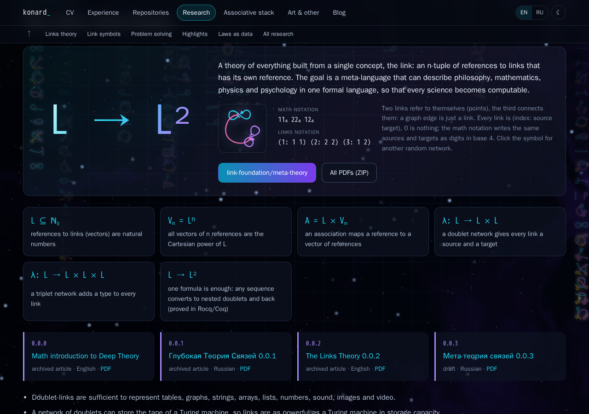     | 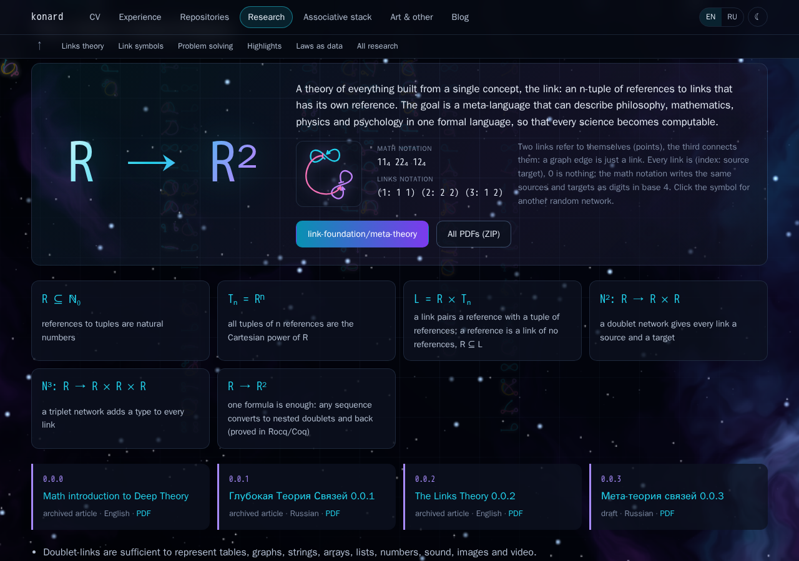     |

"And so on" is read as: the whole family of formulas changes together, not only the first one.

## 8. Tests and checks

- `npm run test:ci`: 430 tests in 16 files.
- New test files: `notation.test.jsx`, `settings.test.js`, `settings.test.jsx` and `skins.test.jsx`.
- Tests were added to `visuals.test.jsx`, `links.test.js` and `pages.test.jsx`.
- `npm run check` (ESLint, Prettier, the 1500-line limit and secretlint) and `npm run build` pass.
- Screenshots come from the built site:
  - `experiments/settings-shot.mjs <path> '<settings JSON>' <out.png> [light|dark] [scrollY|full] [width]`;
  - `experiments/gallery-real-shot.mjs`;
  - `experiments/rain-scale.mjs`.
