# Case study: issue #15 — new defaults, every setting applied, sound design, background layers, corners, presets, phones

- Issue: https://github.com/konard/konard.github.io/issues/15
- Pull request: https://github.com/konard/konard.github.io/pull/16
- Builds on: [issue #13](../issue-13/README.md) (the settings page and the skins), [issue #1](../issue-1/README.md)
- Reference project: [konard/immortality](https://github.com/konard/immortality) (the Unlicense), read at its `main` of 2026-10-24
- Data date: 2026-10-24

## 1. The issue

The full issue text is in [`data/issue-15.json`](data/issue-15.json). It has no comments. Its four screenshots are [`screenshots/issue-reported-1.png`](screenshots/issue-reported-1.png) to [`-4.png`](screenshots/issue-reported-4.png). The first three show the settings page; the fourth shows the Skin section out of place. The issue asks for these changes:

1. New defaults, given as JSON (universe, grid, rain and glass). "We need to double check that all settings are actually applied."
2. A setting for the padding or margin around each symbol of the matrix rain.
3. Fix the Skin block: it disappears when something else is selected, and it is not aligned. Check all other alignment issues across the site.
4. Fully support sound design and every other configuration option from the previous issues.
5. Polish the UI everywhere. Where a design change is questionable, add fine-grained settings.
6. More configuration for drawing the background, with configurable levels (issue #13 was "not fully delivered").
7. Detailed settings for each background layer:
   - different shapes of stars;
   - for dots, the size, colour and colour of glow;
   - effects that go vertically and horizontally;
   - several star backgrounds on top of each other, "so it will be possible to configure any artistic vision".
8. Load fast with the default settings, even over mobile internet, and look perfect on all screens, with a way to check it.
9. Futuristic frames:
   - lots of border configurations, such as missing borders on some corners, different cuts and rounded corners;
   - each corner configurable, with selection tiles that preview the corner.
10. Multiple presets, saved, "and so on".
11. Do better than [konard/immortality](https://github.com/konard/immortality), because these settings may later become a unified UI engine for all such projects.
12. Collect the data in `docs/case-studies/issue-15`, with a deep analysis, online research, every requirement, solution plans and known libraries.

| #   | Requirement                    | Where                                                                                                                                                                                             | Verified by                                                                                                    |
| --- | ------------------------------ | ------------------------------------------------------------------------------------------------------------------------------------------------------------------------------------------------- | -------------------------------------------------------------------------------------------------------------- |
| 1   | New defaults, all applied      | [`src/settings/schema.background.js`](../../../src/settings/schema.background.js), [`schema.skins.js`](../../../src/settings/schema.skins.js)                                                     | `src/settings/settings.test.js` (the JSON of the issue), [`src/settings/applied.test.js`](../../../src/settings/applied.test.js) |
| 2   | Space around rain symbols      | `rain.padding` in `schema.background.js`, [`src/visuals/rain.js`](../../../src/visuals/rain.js)                                                                                                  | `src/components/visuals.test.jsx`                                                                              |
| 3   | Skin block and alignment       | [`src/pages/SettingsPage.jsx`](../../../src/pages/SettingsPage.jsx), [`src/pages/settings.css`](../../../src/pages/settings.css), [`src/Layout.css`](../../../src/Layout.css)                     | `src/pages/settings.test.jsx`, [`experiments/settings-layout.mjs`](../../../experiments/settings-layout.mjs), [`experiments/responsive.mjs`](../../../experiments/responsive.mjs) |
| 4   | Sound design                   | [`src/sound/`](../../../src/sound), [`src/settings/schema.sound.js`](../../../src/settings/schema.sound.js), [`src/components/Sound.jsx`](../../../src/components/Sound.jsx)                     | `src/sound/sound.test.jsx`, `src/components/Sound.test.jsx`, [`experiments/sound-e2e.mjs`](../../../experiments/sound-e2e.mjs) |
| 5   | Polish, fine-grained settings  | [`src/skins.glass.css`](../../../src/skins.glass.css), `schema.skins.js`                                                                                                                         | `src/skins.test.jsx`, the screenshots below                                                                    |
| 6   | Background levels              | `schema.background.js`, [`src/visuals/nebula.js`](../../../src/visuals/nebula.js)                                                                                                                | `src/visuals/layers.test.jsx`                                                                                  |
| 7   | Per-layer settings             | [`src/settings/schema.layers.js`](../../../src/settings/schema.layers.js), [`src/visuals/stars.js`](../../../src/visuals/stars.js), [`src/visuals/beams.js`](../../../src/visuals/beams.js)       | `src/visuals/layers.test.jsx`                                                                                  |
| 8   | Fast on phones, every screen   | [`src/visuals/governor.js`](../../../src/visuals/governor.js), [`src/cv/paths.js`](../../../src/cv/paths.js), [`src/components/edges.js`](../../../src/components/edges.js)                       | `src/visuals/governor.test.js`, `src/components/edges.test.js`, [`experiments/perf-mobile.mjs`](../../../experiments/perf-mobile.mjs), `experiments/responsive.mjs` |
| 9   | Each corner, tiles             | [`src/skins.frames.js`](../../../src/skins.frames.js) → `src/skins.frames.css`, [`src/pages/CornerTiles.jsx`](../../../src/pages/CornerTiles.jsx)                                                | [`src/skins.frames.test.jsx`](../../../src/skins.frames.test.jsx), [`experiments/corner-zoom.mjs`](../../../experiments/corner-zoom.mjs) |
| 10  | Presets, saved                 | [`src/settings/presets.js`](../../../src/settings/presets.js), [`src/pages/Presets.jsx`](../../../src/pages/Presets.jsx)                                                                         | `src/settings/presets.test.js`, `src/pages/presets.test.jsx`, [`experiments/presets-e2e.mjs`](../../../experiments/presets-e2e.mjs) |
| 11  | Better than immortality        | all of the above                                                                                                                                                                                  | [section 12](#12-compared-with-konardimmortality)                                                              |
| 12  | Case study                     | this file, [`data/`](data), [`screenshots/`](screenshots)                                                                                                                                        | —                                                                                                              |

The commits of the pull request follow the same order: defaults → settings layout → glass → background → frames → sound → presets → phones → this case study.

## 2. The new defaults, and "all settings are actually applied"

**The defaults.** The 21 values of the issue are now the defaults: `nebula.*`, `grid.size`, `grid.period`, `rain.*` and `glass.*`. `src/settings/settings.test.js` holds the JSON of the issue as it was given. It checks that every key exists and that `DEFAULTS` equal it.

**The check.** A default that nothing reads looks like it works, but changing it does nothing. There are three ways a setting reaches the page:

- `apply.js` writes it as a CSS variable or an attribute of `<html>`, and a stylesheet uses it;
- the background scripts read it as an option (the nebula, stars, beams and rain);
- a component reads its key (the sound, the skins).

[`src/settings/applied.test.js`](../../../src/settings/applied.test.js) goes through all 251 settings:

- It reads every stylesheet and script of `src/`, leaving out the schema and the tests.
- It runs the option builders of the background layers and of the sound through a `Proxy`, which records every key they read.
- It fails for any setting that is not used in one of the three ways.
- It also checks itself: an invented `nebula.unread` must be reported, and a real `rain.step` must not.
- A second test checks every choice of every select: a choice must have a CSS rule for `[data-…='value']` or be read by a script. Choices that switch something off (`none`, `plain`) need no rule.

## 3. Space around rain symbols, and the rain glow on Retina screens

- `rain.padding` leaves free space on every side of a symbol inside its cell, from 0 to 16 pixels in steps of 0.5. More padding makes the symbols smaller and sparser. [`src/visuals/rain.js`](../../../src/visuals/rain.js) takes it off the cell before it draws a symbol.
- While checking the rain settings on a 2× screen, the glow turned out to be half as large as on a 1× screen. `shadowBlur` is in canvas pixels, not CSS pixels, so the glow is now multiplied by the device pixel ratio, like the font size already was. `src/components/visuals.test.jsx` checks the glow at ×1 and ×2.

## 4. The Skin block jumped and was misaligned (root cause)

The fourth screenshot of the issue shows the Skin section in the wrong column, with the tops of the columns uneven.

**The cause.**

- The settings page laid out its sections with CSS multi-column (`columns: 2`). The browser balances the columns by height, so the column of a section depends on the height of every section before it.
- The skin sections (glass, liquid, futuristic) have different heights. With glass, Rain was in the second column; with liquid and futuristic, it was in the first. So choosing another skin moved Rain to the other column, and every section after it moved too. Skin is one of those sections, so it "disappeared" from where the user had been looking.
- In WebKit it was worse: every section ended up in one column, and the tops of the columns were negative (−365 px and −579 px).

**Reproduction.** [`experiments/settings-layout.mjs`](../../../experiments/settings-layout.mjs) opens the settings page in Chromium, Firefox and WebKit with each skin. It prints the column of each section, the tops of the columns, and the sections that change their column between glass and liquid. The logs are in `data/`:

- [`layout-before-chromium.log`](data/layout-before-chromium.log): "sections that change their column between glass and liquid: rain".
- [`layout-before-webkit.log`](data/layout-before-webkit.log): one column, tops −365 and −579.
- [`layout-after-chromium.log`](data/layout-after-chromium.log), [`-firefox`](data/layout-after-firefox.log), [`-webkit`](data/layout-after-webkit.log): the same two columns in every browser and for every skin; tops equal; "none".

**The fix.**

- The page now has two fixed columns: motion, universe, grid, rain and share on the left; skin, the chosen skin, and theory on the right. A section never changes its column.
- Every row is one grid of label | control | value | reset, so controls and values line up across sections.
- In a section with tabs (sound, star layers), the settings shared by all tabs come before the tabs.

| Before, glass (Chromium)                                         | Before, liquid: Rain moved to the left                              | After, liquid                                                      |
| ---------------------------------------------------------------- | ------------------------------------------------------------------- | ------------------------------------------------------------------ |
| 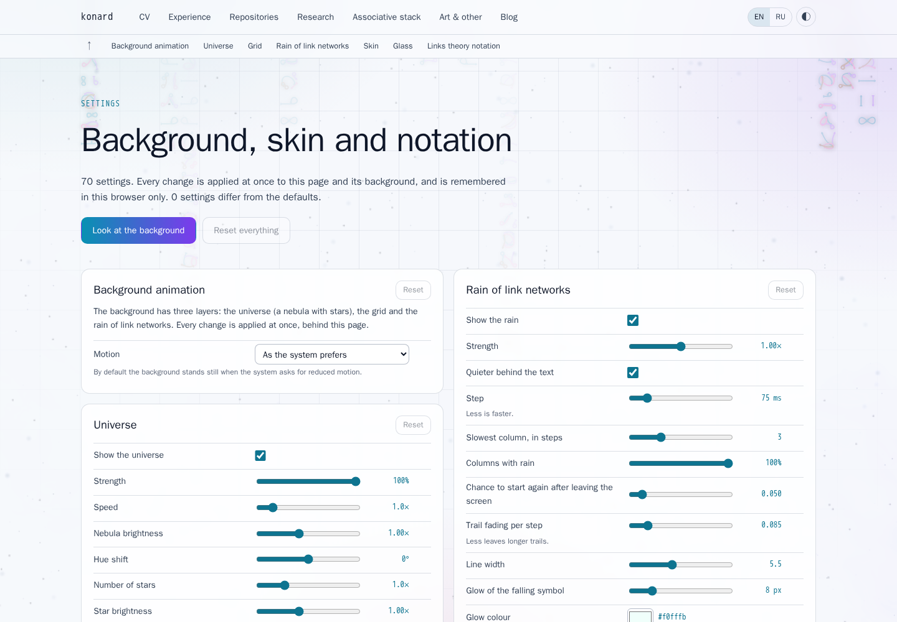  | 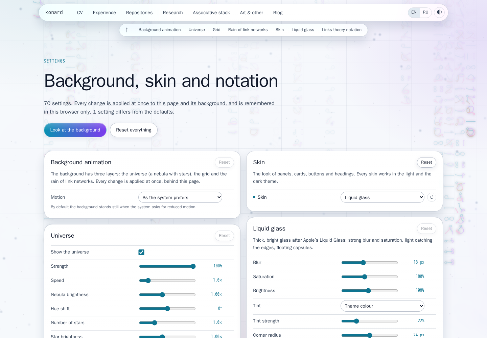   | 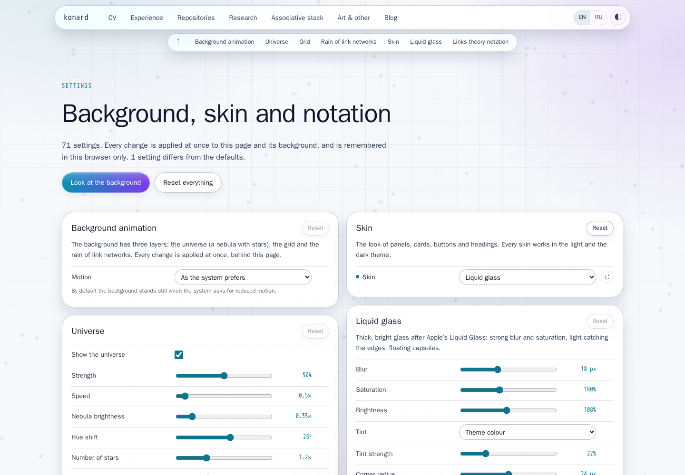    |

| Before, WebKit (one column)                               | After, WebKit                                           |
| --------------------------------------------------------- | ------------------------------------------------------- |
| 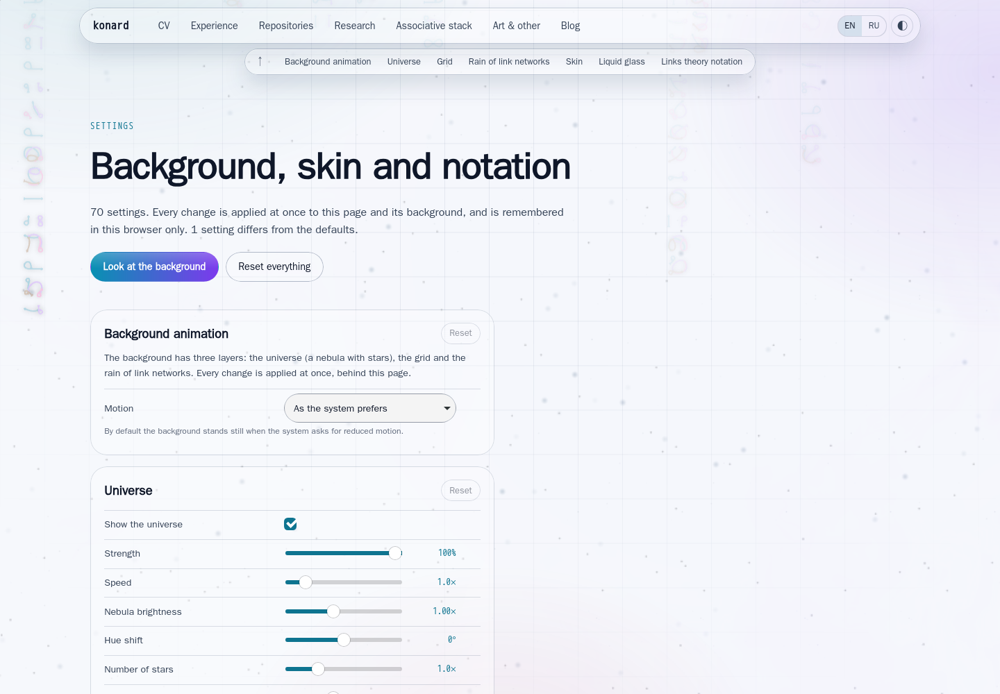  | 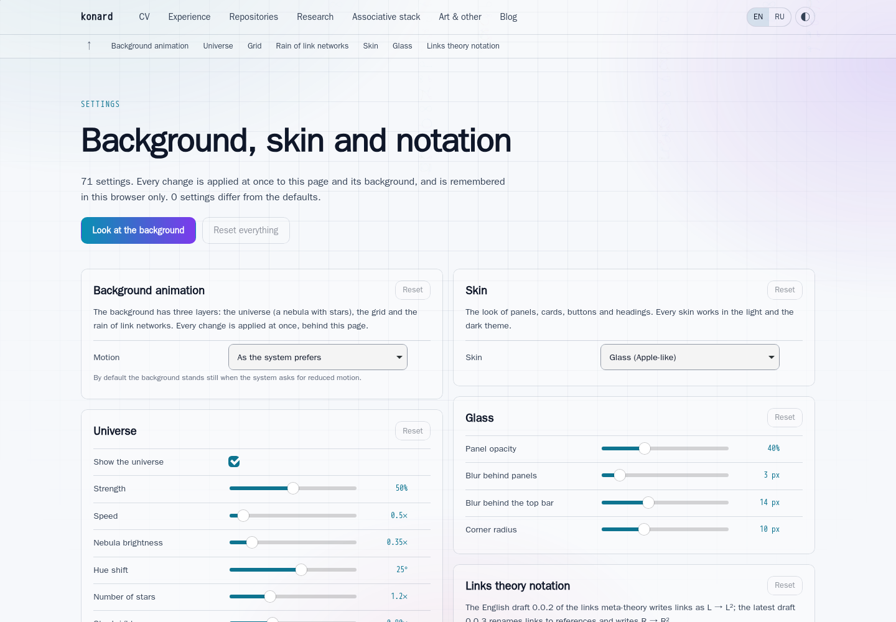  |

## 5. Polish: the glass skin

Two problems turned up while checking all panels with the glass skin:

- **Blue panels.** The saturation of the backdrop was a percent written as a plain number, so `saturate(100)` (×100, not 100%) painted the panels blue. Values above 2 are now divided by 100, and a test covers it.
- **Panels without blur.** Page cards, Habr cards, the language cloud and the theory panels had no blur. One rule now gives every panel the blur and the corner radius.

Where the look is a matter of taste, it got its own setting rather than a fixed choice: the colour behind panels, borders and lines, the shadow, and the light on the upper edge.

| Dark                                                  | Light                                                   |
| ----------------------------------------------------- | ------------------------------------------------------- |
| 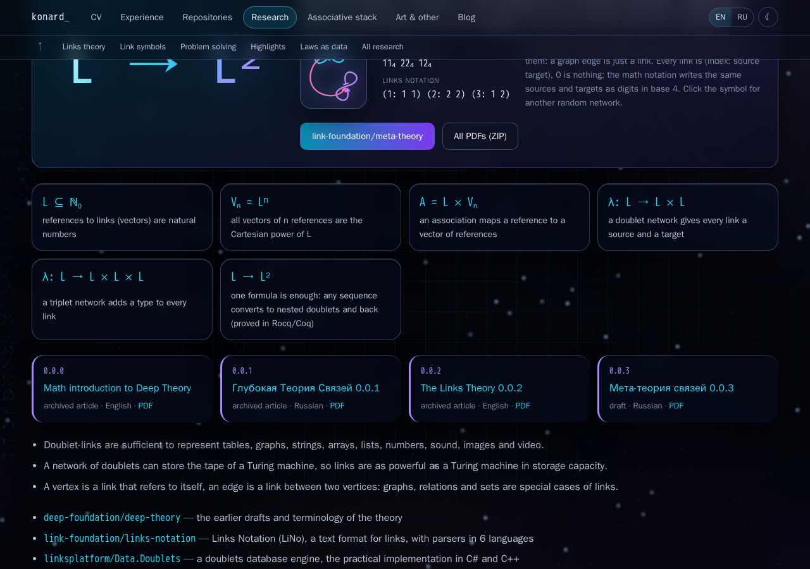     | 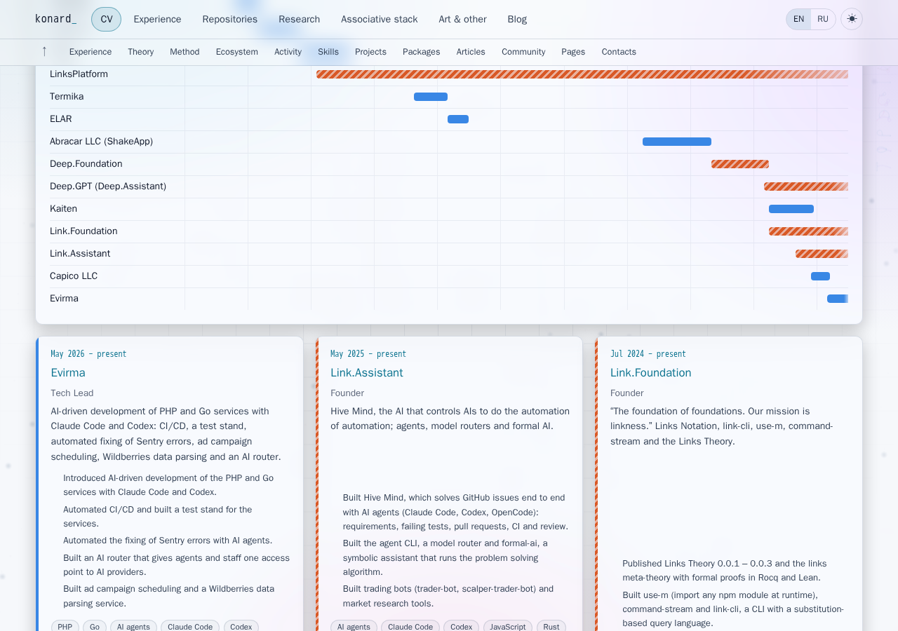     |

## 6. Background: levels and every layer

The background has five layers, from back to front. Each has a strength from 0 to 100%, and 0 also stops its work.

| Layer      | Settings                                                                                                                                                          |
| ---------- | ----------------------------------------------------------------------------------------------------------------------------------------------------------------- |
| Universe   | on, strength, speed, gas, hue, four colours, zoom, its own stars (amount, size, colour, brightness, twinkling), vignette, frames per second, resolution             |
| Star layers (1–4) | for each layer: on, number of stars, **shape** (12), size and size variety, colour and colour variety, brightness, **glow** and glow colour, twinkling speed and depth, rotation and spin, motion (still, drift, warp towards you, orbit) with its direction and speed, streaks, blending (normal, add light, screen); and frames per second for all star layers |
| Beams      | the "effects that go vertically and horizontally": light running along the grid lines; on, strength, number, direction (horizontal, vertical, both), both ways, snapped to the grid lines or anywhere, speed, length, width, style, colour, glow, pause between runs |
| Grid       | on, strength, size, period, **style** (lines, dashes, crosses, dots), marks, line width, colour, tint, fading                                                     |
| Rain       | strength, step, speeds, density, fade, line width, glow and glow colour, padding                                                                                  |

- The 12 star shapes are dot, soft, ring, square, diamond, cross, x, star4, star5, star6, sparkle and flare.
- [`src/visuals/stars.js`](../../../src/visuals/stars.js) draws each shape once into a sprite for its size, colour and glow, then stamps the sprites. A frame of 4 layers costs no more path drawing than one.
- Up to four star layers sit on top of each other, so the issue's "different number of stars backgrounds" can be combined, for example a slow layer of small dots under a fast warp of sparkles.
- The stars and beams code is loaded with `import()` only when that layer is on ([`src/components/Cosmos.jsx`](../../../src/components/Cosmos.jsx)), so the defaults do not download it.
- `src/visuals/layers.test.jsx` checks each layer: the options built from the settings, every shape, only the layers that are on, blending and glow, motion from frame to frame, beams on the grid lines, and that the layer code is loaded only when switched on.

| Star shapes                                   | Four star layers                              | Warp                                        |
| --------------------------------------------- | --------------------------------------------- | ------------------------------------------- |
| 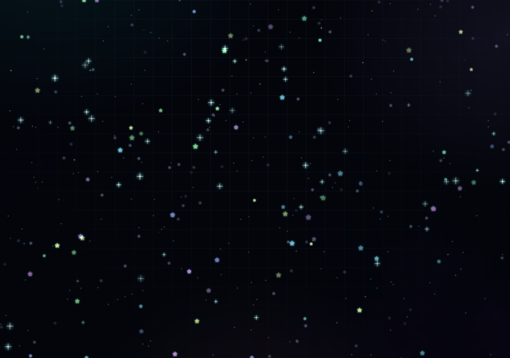   | 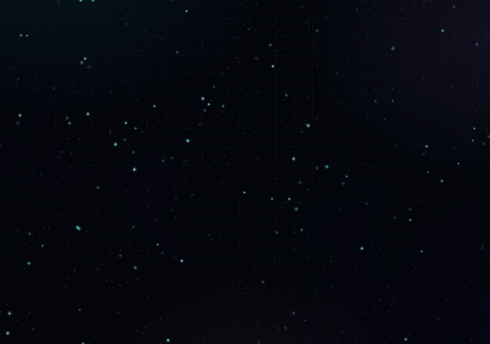   | 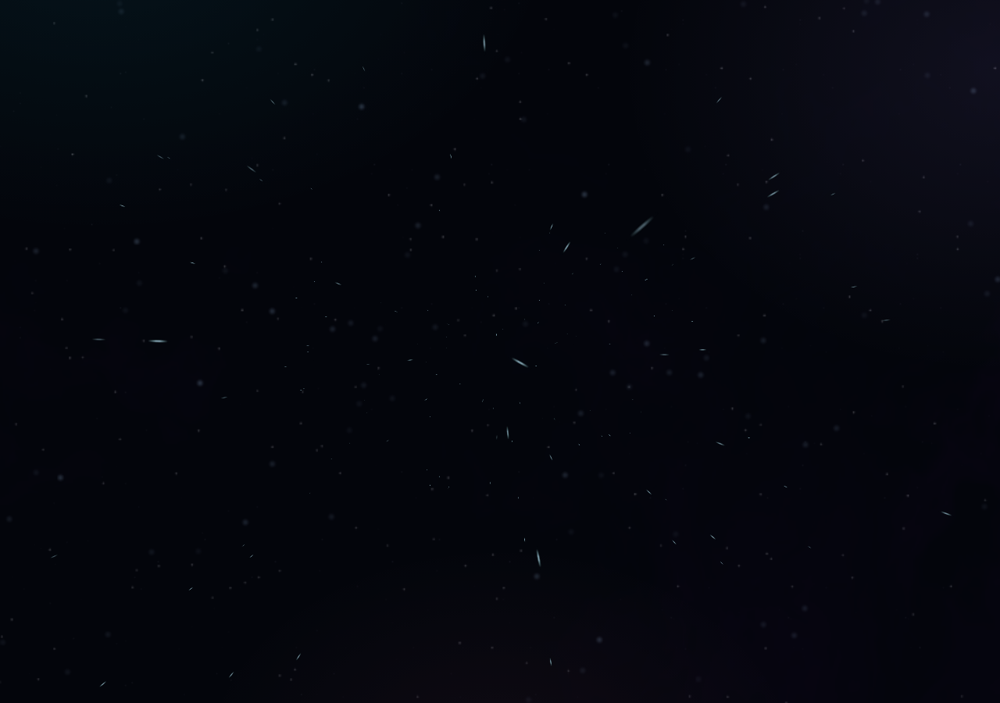          |

| Beams                               | Grid: crosses                                  | Grid: dashes                                  | Grid: dots                               |
| ----------------------------------- | ---------------------------------------------- | --------------------------------------------- | ---------------------------------------- |
| 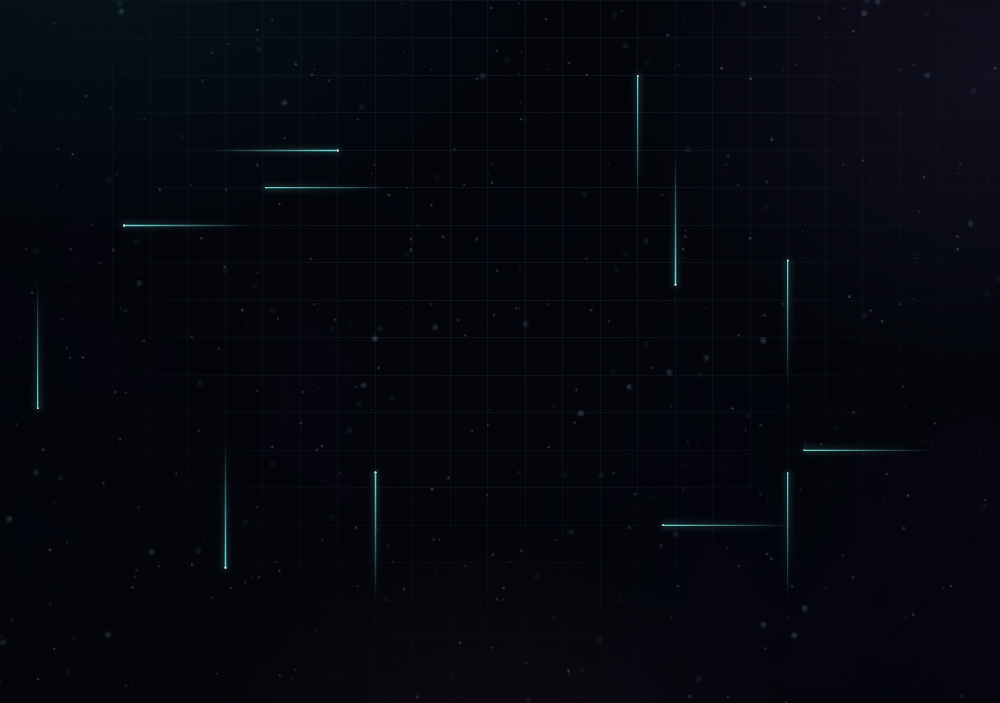     |        |         |        |

| Colours of the universe                              | Light theme                                       |
| ---------------------------------------------------- | ------------------------------------------------- |
| 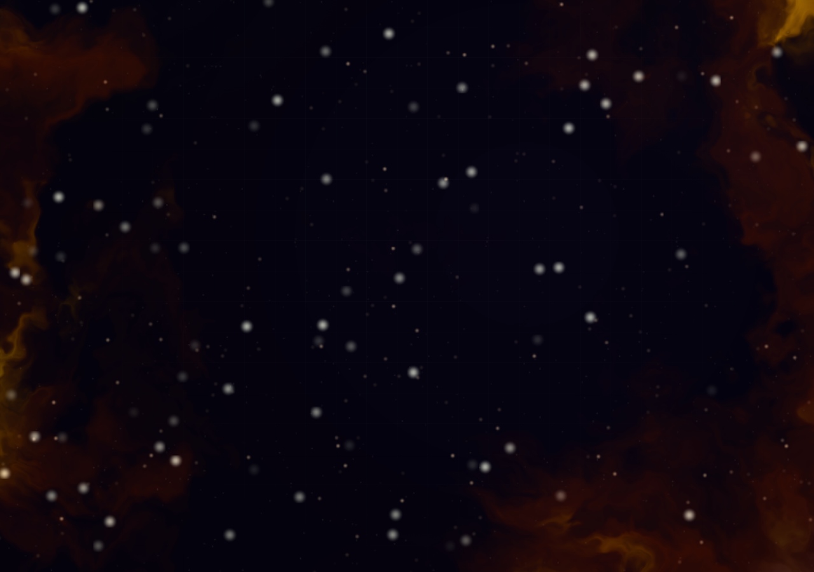 | 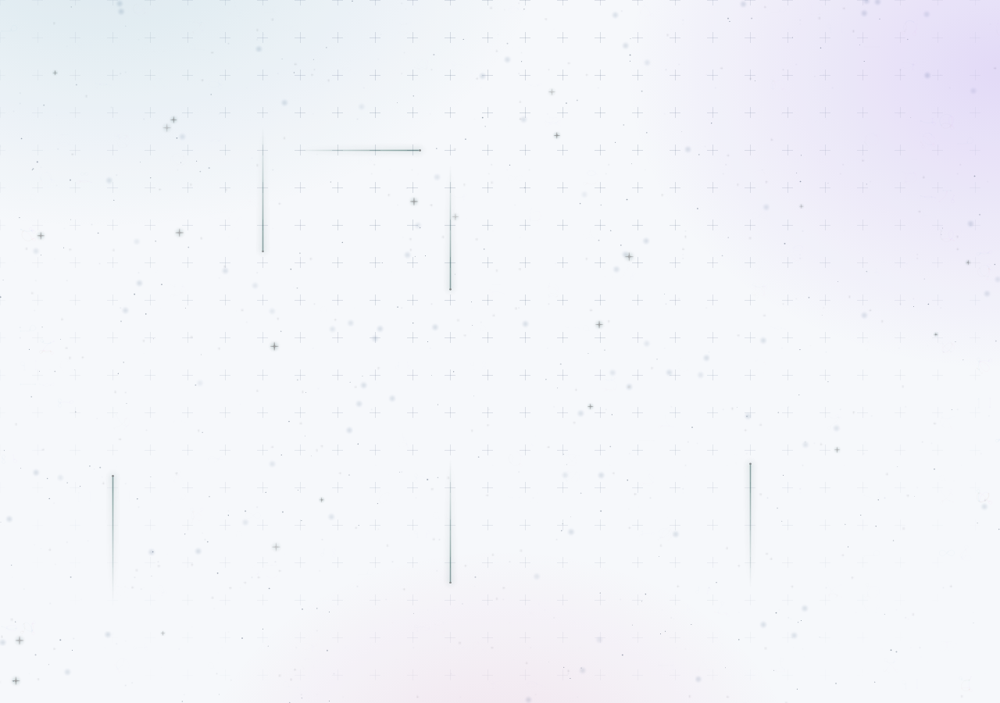 |

## 7. Futuristic frames: each corner on its own

- Each of the four corners of a panel has its own **shape**: square, cut, tall cut, wide cut, round, scoop or notch. It also has its own **line**: none (the "missing border" of the old skin), gap, line, accent or bracket. A size applies to all corners.
- The settings page shows a tile for every choice, drawn with the real shape and line in the current colours ([`src/pages/CornerTiles.jsx`](../../../src/pages/CornerTiles.jsx)).
- **How it is drawn.** [`src/skins.frames.js`](../../../src/skins.frames.js) generates `src/skins.frames.css` with `npm run build:frames`. Each shape is a `clip-path: polygon(...)` corner (round and scoop are approximated by arcs of points). Each line is a gradient image placed in that corner. The attributes `data-future-corner-tl`, `-tr`, `-br` and `-bl` choose the rules. `src/skins.frames.test.jsx` fails if the stylesheet is not up to date with the generator. It also checks the points of every shape (a round corner stays on its circle), the mirrored corners, and the tiles.
- **Why not CSS `corner-shape`.** `corner-shape` (keywords round, scoop, bevel, notch, square, squircle and `superellipse()`) does exactly this, but it is not Baseline. MDN marks it as limited availability, and only Chrome and Edge 139+ support it ([MDN](https://developer.mozilla.org/en-US/docs/Web/CSS/corner-shape), [Smashing Magazine, March 2026](https://www.smashingmagazine.com/2026/03/beyond-border-radius-css-corner-shape-property-ui/)). Polygons work in every browser today.

| Tiles, dark                                               | Tiles, light                                                | A custom frame on the home page                       | Zoomed corners                                    |
| --------------------------------------------------------- | ----------------------------------------------------------- | ----------------------------------------------------- | ------------------------------------------------- |
| 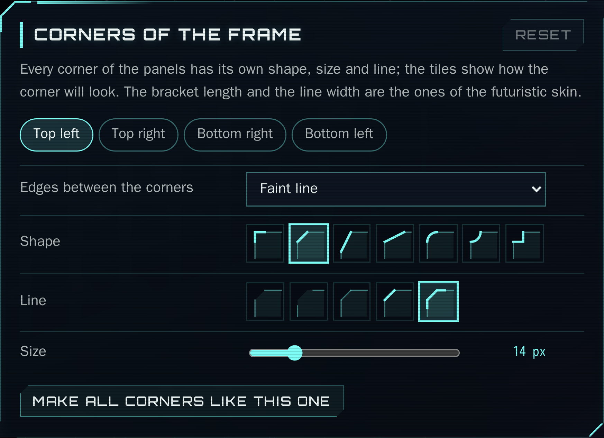   | 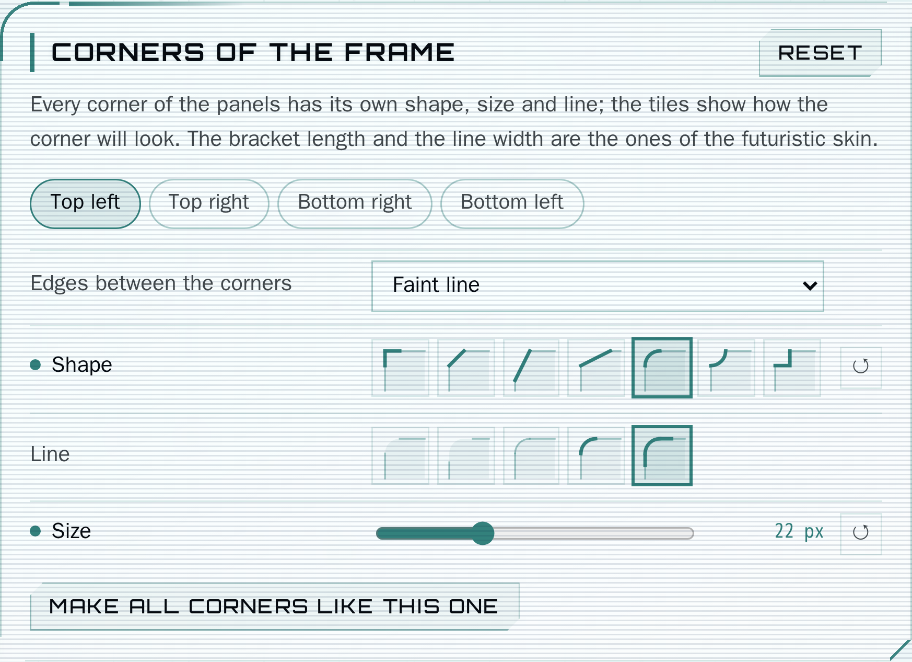   | 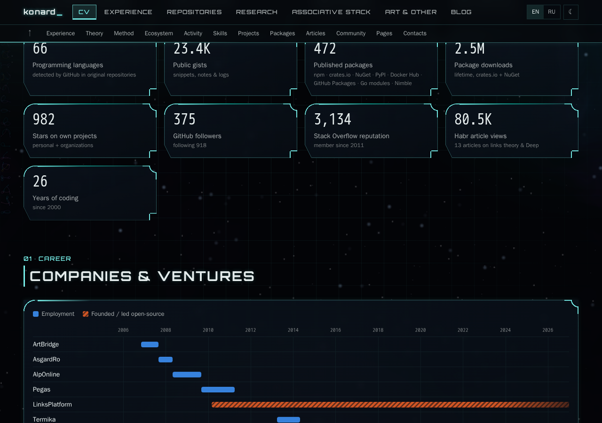    | 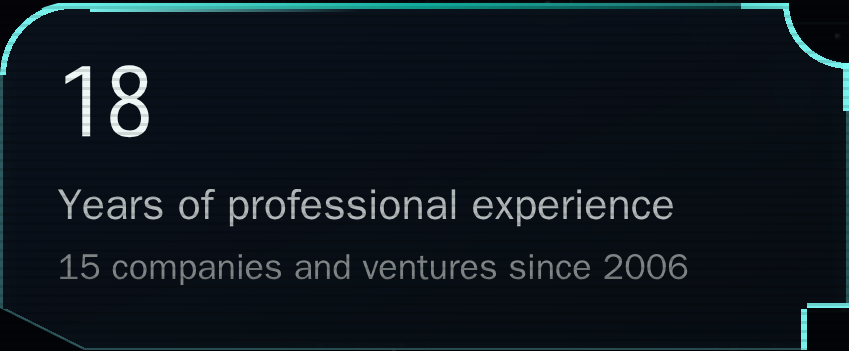       |

## 8. Sound design

- **31 synthesized sounds.** 26 come from [konard/immortality](https://github.com/konard/immortality) (the Unlicense): freq, filter, quartz, cobalt, comet, ion, halo, tide, mica, nova, zephyr, ember, prism, glacier, pulsar, orbit, vapor, cinder, tungsten, helix, drift, basalt, flint, opal, lumen, sonar, vesper and relay. 5 are new: raindrop, link, glass, warp and byte. All are made with Web Audio oscillators, noise and filters, so there are no files to download ([`src/sound/library.js`](../../../src/sound/library.js)).
- **Interactions.** There are 10: pointing at a link or button, pressing, switches, choices (tabs and sliders), moving over a chart, opening, closing, typing, switching the sound on, and messages. Each has up to four slots, each with a sound and a level. The slots play at random, in turn, or together ([`src/settings/schema.sound.js`](../../../src/settings/schema.sound.js), [`src/sound/interactions.js`](../../../src/sound/interactions.js)).
- **The whole mix.** Volume, tone, room echo and room size, pitch variation, stereo towards the pointer and its width, and the shortest gap between two sounds.
- **Controls.** A ▶ button for every sound. A sound switch in the top bar. Sound is off by default.
- **Cost.** The sound code is loaded only when sound is on (`src/components/Sound.jsx`).

**A click in mica (root cause).**

- [`experiments/sound-render.mjs`](../../../experiments/sound-render.mjs) renders each sound offline through the real mix and measures its peak and loudness ([`sound-levels.json`](sound-levels.json), after the fix). Mica peaked 15 times higher than it should.
- [`experiments/sound-isolate.mjs`](../../../experiments/sound-isolate.mjs) renders the voices of one sound one at a time. It traced the peak to the noise voice, at its first sample.
- The cause is that a `GainNode` starts at 1 and stays at 1 until its first scheduled event. One sample of full-scale noise got through before the envelope began.
- [`src/sound/engine.js`](../../../src/sound/engine.js) now sets `amp.gain.value = 0` before scheduling, and `src/sound/sound.test.jsx` checks that the gains of a played sound start silent.

| Sound settings, dark                                   | Light                                                    | Phone                                                      | Top bar, sound on                                |
| ------------------------------------------------------ | -------------------------------------------------------- | ---------------------------------------------------------- | ------------------------------------------------ |
| 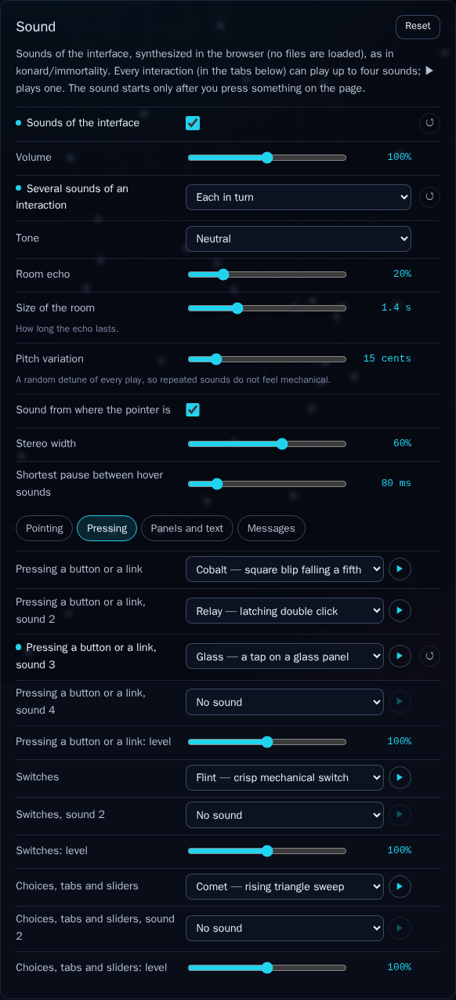     | 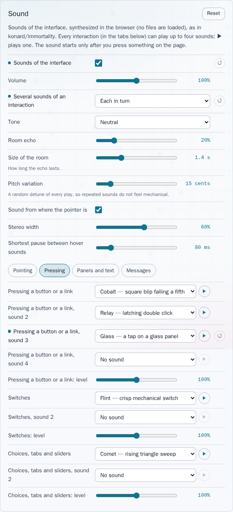     | 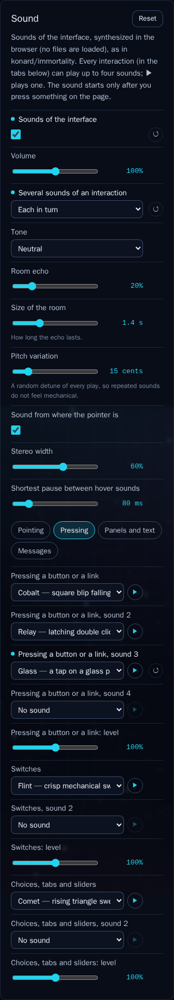      | 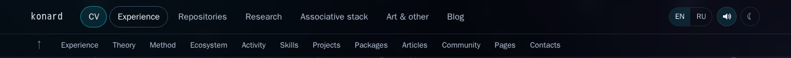      |

"All other configuration options from all previous issues" (issue #13): the settings of the universe, grid, rain, motion, the three skins, the notation and the theme are all still there. `applied.test.js` checks that every one of them is used.

## 9. Presets

- **Built-in presets.** 9 looks: Default, Calm, Matrix, Deep space, Warp, Neon HUD, Liquid, Blueprint, and Light and fast. Each tile shows a miniature drawn from the preset's own settings, not a screenshot.
- **Saved looks**, kept in this browser (`localStorage`):
  - save, apply, update, rename and delete;
  - copy as JSON and load in another browser;
  - synced between tabs by the `storage` event.
- **Random.** A random look leaves the sounds alone and is never heavier than the defaults: the number of things drawn, the frames per second and the resolution never go above their defaults.
- **Links.** A `#settings=` link carries the look. Opening it keeps the look it replaced as a saved look, "Before the link", and removes the hash, so a reload does not apply it again.
- **What a look never changes:** motion (reduced motion is an accessibility choice), volume and notation.
- **Cost.** `presets.js` is loaded with `import()` only on the settings page or with such a link.

| Presets, dark                               | Light                                        | Matrix applied                               | Saved looks                                 | Phone                                         |
| ------------------------------------------- | -------------------------------------------- | -------------------------------------------- | ------------------------------------------- | --------------------------------------------- |
| 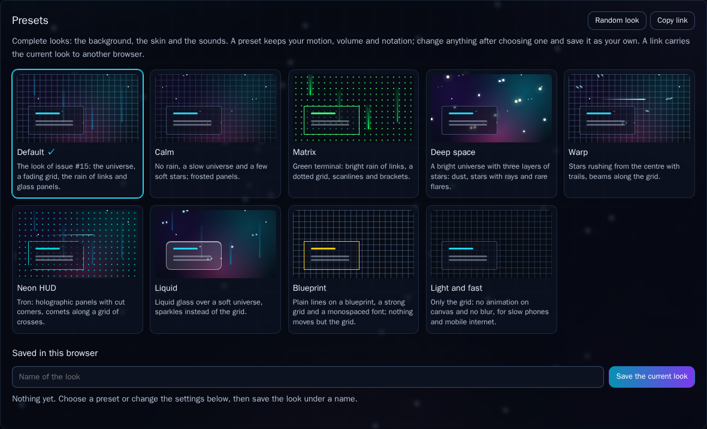    | 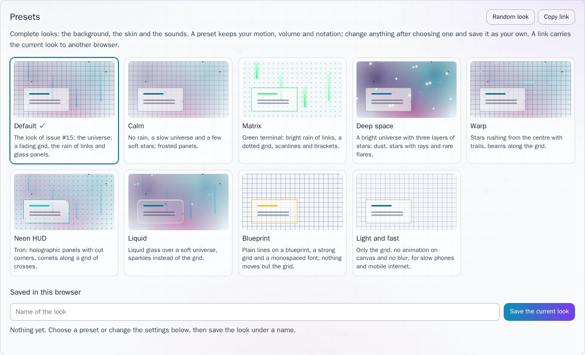      | 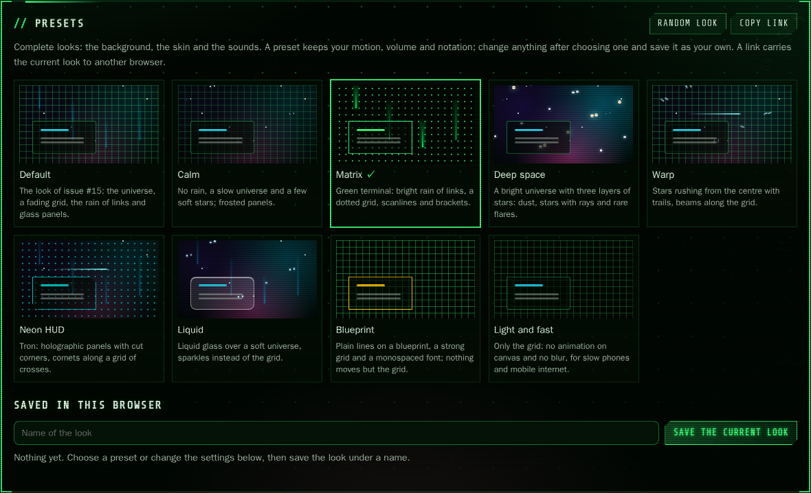    | 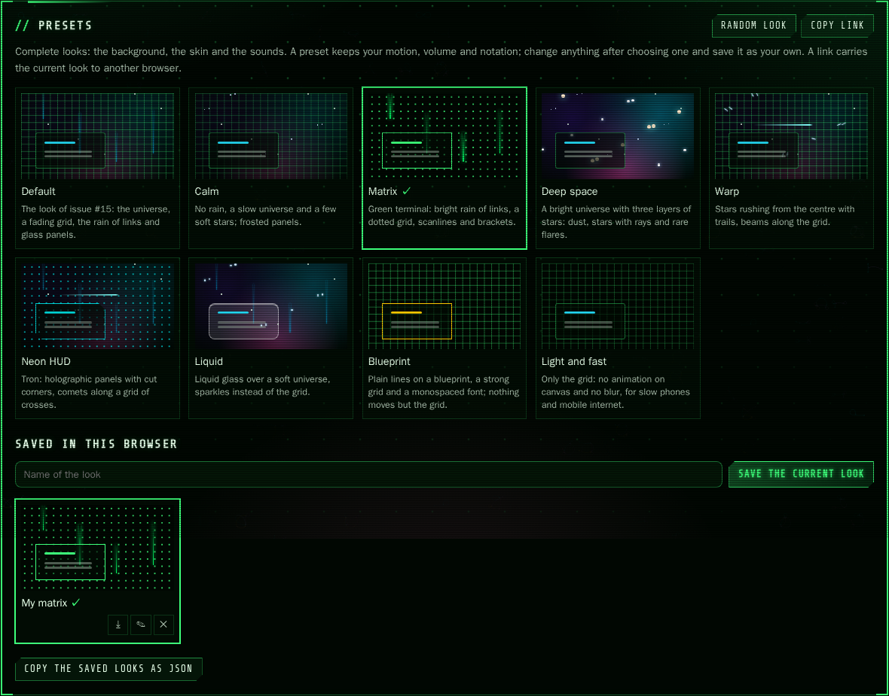     | 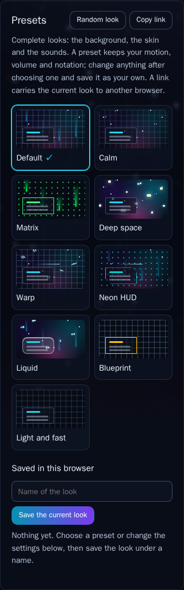    |

## 10. Fast on phones

**Measurement.** [`experiments/perf-mobile.mjs`](../../../experiments/perf-mobile.mjs) opens each page in Chromium as a phone: 412×915 at 2.625 device pixels per CSS pixel, a CPU four times slower, and slow 4G. It runs 3 times, waits 6 s, and records:

- the first contentful paint (FCP);
- the total time of long tasks (each over 50 ms, as [web.dev](https://web.dev/articles/optimize-long-tasks) defines them);
- the frames per second of the background;
- the bytes transferred.

The results are in [`data/perf-mobile-main.json`](data/perf-mobile-main.json) and [`data/perf-mobile-branch.json`](data/perf-mobile-branch.json). They are medians.

| Page        | FCP, main → branch (ms) | Long tasks, main → branch (ms) | Frames/s, main → branch | Transferred, main → branch (kB) |
| ----------- | ----------------------- | ------------------------------ | ----------------------- | ------------------------------- |
| `/`         | 2844 → 3056             | 5405 → 3359                    | 6 → 13                  | 204 → 217                       |
| `/settings/`| 1788 → 2052             | 5293 → 2817                    | 6 → 16                  | 126 → 128                       |
| `/art/`     | 2204 → 2416             | 5581 → 3005                    | 6 → 19                  | 168 → 161                       |
| `/blog/`    | 2108 → 2064             | 5527 → 3830                    | 7 → 15                  | 142 → 135                       |
| `/cv/`      | 1784 → 1864             | 5477 → 2836                    | 6 → 21                  | 135 → 150                       |

**What costs the most.** The same script with one layer switched off at a time showed:

- universe off: 25 frames/s and 903 ms of long tasks;
- motion off: 28 frames/s;
- rain, stars or blur off: no change.

The universe is a full-screen shader, so it is the layer to adapt.

**The fixes.**

- **The governor.** [`src/visuals/governor.js`](../../../src/visuals/governor.js) watches the gaps between animation frames. When most of the gaps in a window are over 45 ms, it first lowers the resolution of the universe (×0.7 per step, down to 40%), then halves its frames per second (down to 25%). Stars and beams only lower their frames per second, so the sprites stay sharp. It never goes above the settings, does not judge the first second, ignores gaps over 1 s (a hidden tab), and never comes back up, so a layer does not flicker between two sizes. `src/visuals/governor.test.js` covers it.
- **Smaller shared code.** The chunk shared by every page carried the career data, because the home page imported the CV builder only to make the links to the CVs. [`src/cv/paths.js`](../../../src/cv/paths.js) now makes those links without the builder, and the Layout chunk went from 111.5 to 90.8 kB gzip (91.2 kB with the top bar code of section 11).
- **Lazy loading.** Stars, beams, sound and presets are loaded with `import()` only when used.

**The result, stated plainly.** Long tasks are about 45% shorter and the background runs 2–3 times more frames per second. FCP did not improve: it is 80–260 ms later on four pages and 44 ms earlier on `/blog/`. The new settings add some JavaScript. The text is drawn by React after the scripts load, so FCP waits for them (see [section 14](#14-limits)).

## 11. Every screen

**The check.** [`experiments/responsive.mjs`](../../../experiments/responsive.mjs) runs 9 pages × 4 widths (360, 768, 1280, 1920) × 2 themes = 72 cases. For each case it checks that:

- nothing scrolls sideways;
- no element sticks out of the screen;
- the link of the current page is visible in the top bar;
- at least three page links are at least half visible.

It also saves the first screen of every page.

- **main**: 8 of 72 fail ([`data/responsive-main.log`](data/responsive-main.log)). At 360 px, the home page, `/research/` and `/blog/` show only two page links, and `/research/` and `/blog/` hide the current page. At 768 px, `/blog/` hides the current page. Both themes fail the same way.
- **this branch**: 72 of 72 pass ([`data/responsive-branch.log`](data/responsive-branch.log)).

**The cause.** On a phone the brand, the page links and the switches shared one row, so the page list got about one and a half links of width. The list scrolled, but it started at the first link, so a page further down the list was out of sight.

**The fixes.**

- Below 720 px the page links get their own row of the top bar.
- `centreCurrent()` scrolls the current page into the middle of the list ([`src/components/edges.js`](../../../src/components/edges.js)).
- A list fades only at an edge that has more links behind it (`data-more="left right"`, set on scroll and resize).
- The section links of a page stay on phones; before, only the ↑ button was left.
- The checkbox of the blog filter was stretched to the full width like the text inputs; now only the text inputs are.
- `src/components/edges.test.js` tests the marks, the centring and the cleanup.

| Top bar at 360 px: main (above) and this branch (below)                      | Blog filter at 360 px: main and this branch                                        |
| ---------------------------------------------------------------------------- | ---------------------------------------------------------------------------------- |
| 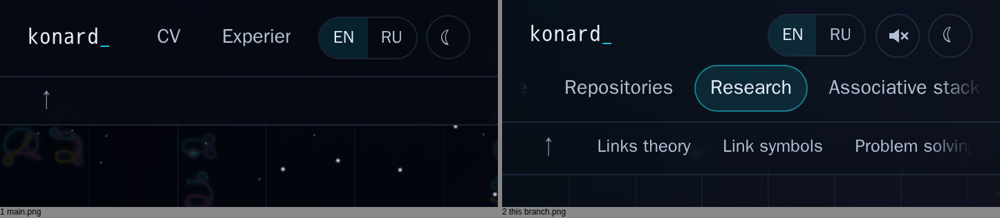             | 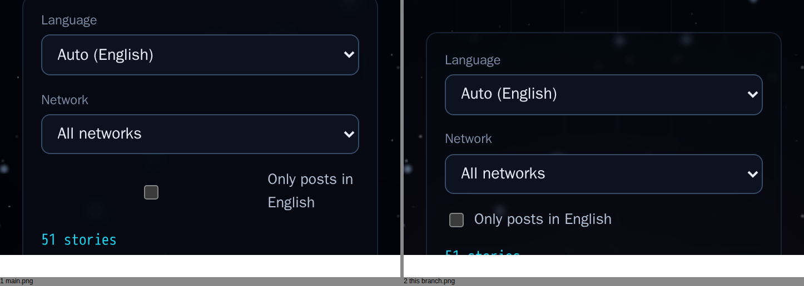          |

| Home, 360, dark                                    | Home, 360, light                                    | Research, 360                                          | Settings, 768                                           |
| -------------------------------------------------- | --------------------------------------------------- | ------------------------------------------------------ | ------------------------------------------------------- |
|       |       |       | 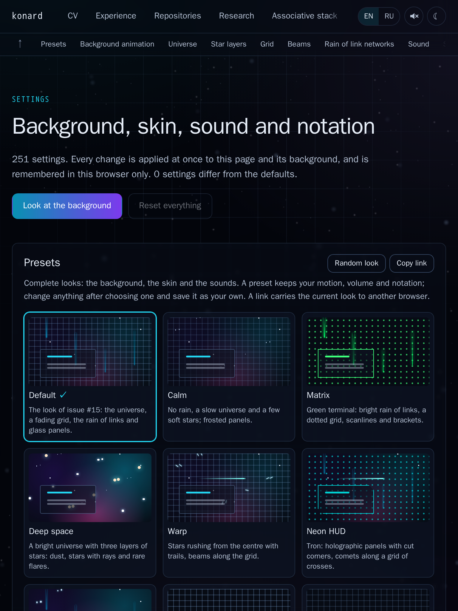       |

| Home, 1280                                         | Home, 1920                                          |
| -------------------------------------------------- | --------------------------------------------------- |
| 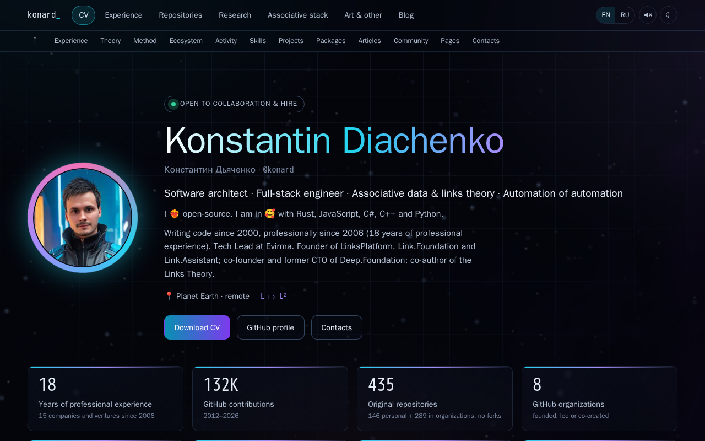     | 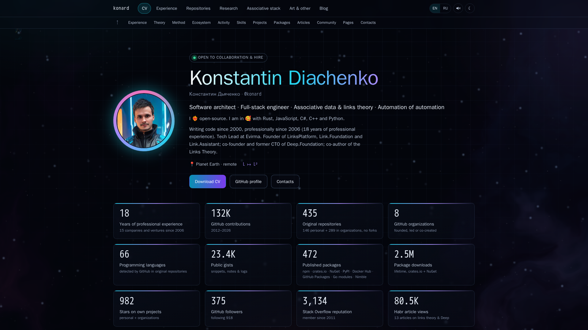      |

## 12. Compared with konard/immortality

[konard/immortality](https://github.com/konard/immortality) has a settings panel with:

- 12 presets: poseidon, mission, grid, ares, arwes, soulextract, glitchy, zknet, foundry, study, minimal and resonance;
- about 50 settings axes;
- a randomizer and share links;
- lists of sound effects.

| Area               | immortality                                       | This site after issue #15                                                                                       |
| ------------------ | ------------------------------------------------- | --------------------------------------------------------------------------------------------------------------- |
| Settings           | about 50 axes                                     | 251 settings, each checked to be applied by a test                                                              |
| Presets            | 12 built-in                                       | 9 built-in, with miniatures drawn from their settings                                                           |
| Saved looks        | none (only the current state)                     | named looks: save, update, rename, delete, JSON copy and load, synced between tabs                               |
| Share              | a link                                            | a `#settings=` link that keeps the look it replaced                                                             |
| Random             | a randomizer                                      | a random look never heavier than the defaults                                                                   |
| Frames             | a frame style for a whole panel, from a list      | each corner on its own: 7 shapes × 5 lines, with preview tiles                                                  |
| Background         | a set of animated backgrounds                     | five layers with strengths, up to four star layers with 12 shapes, beams, grid styles                           |
| Sound              | a list of effects per event                       | the same 26 effects plus 5, up to four per interaction with levels and play modes, room echo, stereo, ▶ for each |
| Cost on phones     | not measured                                      | measured (section 10), a governor, lazy code for every optional part                                            |
| Tests              | —                                                 | every setting applied, every choice styled, the frames stylesheet up to date, sound envelopes, presets          |

Its 12 presets are themes of its own app. They were not copied; the 9 here are built from the settings of this site.

## 13. Libraries and research

| Library or standard | What it does | Why it is not used here |
| --- | --- | --- |
| [augmented-ui](https://augmented-ui.com/docs/) (BSD-2) | Pure CSS cut corners and borders with 150+ custom properties | Very close to the frames of section 7. It is a whole styling system with its own markup (`data-augmented-ui`), and the shapes here also need round, scoop and per-corner lines with previews; 270 lines of generator gave exactly those. |
| CSS [`corner-shape`](https://developer.mozilla.org/en-US/docs/Web/CSS/corner-shape) | round, scoop, bevel, notch, squircle, superellipse() | Not Baseline (Chrome/Edge 139+ only). Polygons work everywhere; a later issue could switch when it is Baseline. |
| [Arwes](https://github.com/spaceblocks/arwes), [docs](https://arwes.dev/docs) | Futuristic frames (`@arwes/frames`) and sounds (`@arwes/bleeps`) | Still alpha; its frames are SVG drawn by JavaScript per panel, heavier than CSS. Used as a reference for the look. |
| [Tweakpane](https://tweakpane.github.io/docs/misc/) | A settings panel with `exportState()` / `importState()` | The idea of exporting a whole state is the same as the JSON of saved looks. The settings page is part of the site's design and translated (EN/RU), so it stays in React. |
| [lil-gui](https://discourse.threejs.org/t/lib-why-changed-dat-gui-to-lil-gui/62124), Leva | Debug panels (lil-gui replaced dat.gui; Leva is for React) | Same as Tweakpane: a developer panel, not a page for visitors. |
| [ZzFX](https://npmjs.com/package/zzfx) | Tiny (<1 kB) sound synth from parameter arrays | A good fit in size; the sounds of immortality were already written for Web Audio and are kept as they are, with their names. |
| [Howler.js](https://howlerjs.com/) | Plays audio files (7 kB gzip) | There are no audio files: every sound is synthesized. |
| [tsParticles](https://particles.js.org/guide/bundles) | Particles with shapes (star in slim, twinkle in full, a stars preset) | The slim bundle alone is larger than `stars.js`, and it has no grid beams, no link to the grid period, and no per-layer blending. |
| [web.dev: long tasks](https://web.dev/articles/optimize-long-tasks) | A long task is over 50 ms | The measure used in section 10. |

## 14. Limits

- **FCP.** The pages are rendered by React in the browser, so the first paint waits for the scripts. Pre-rendering the HTML at build time (SSG) would make FCP independent of the scripts, but that is a change of the build of every page, not of the settings. The long tasks and the frames per second, which the settings do control, are better.
- **The shader cost is measured in headless Chromium.** It draws with SwiftShader on the CPU, which overstates the cost of the universe compared with a phone's GPU. The numbers of section 10 compare main and this branch on the same setup, which is what they are for.
- **`corner-shape`** is not used until it is Baseline (section 7).

## 15. Reproduce

```bash
npm ci
npm run check            # eslint, prettier, the 1500-line limit, secretlint
npm run test:ci          # vitest: settings applied, layers, frames, sound, presets, governor, edges
npm run build
npx vite preview --port 4173 &
node experiments/settings-layout.mjs                 # columns of the settings page per skin and browser
node experiments/responsive.mjs /tmp/responsive      # 9 pages × 4 widths × 2 themes
node experiments/perf-mobile.mjs                     # phone measurement (BASE=... for another server)
node experiments/sound-render.mjs                    # levels of every sound
node experiments/presets-e2e.mjs                     # presets, saved looks and links in a browser
node experiments/sound-e2e.mjs                       # sound switch, ▶ buttons and interactions in a browser
node experiments/corner-zoom.mjs                     # zoomed corners of every shape
```

To compare with main, build main in a separate worktree, serve it on another port, and run the same scripts with `BASE=http://localhost:4174`.
