# Issue #17: edit, style and share a link network

[Issue #17](https://github.com/konard/konard.github.io/issues/17) asks for a
dedicated editor opened from any network in the gallery. The selected network,
its notations, the picture and its downloadable files must describe the same
configuration. The implementation is in
[PR #18](https://github.com/konard/konard.github.io/pull/18).

## Requirements and evidence

| Requirement | Implementation | Verification |
| --- | --- | --- |
| Open the clicked gallery network; show the small share icon on hover | `NetworkGallery` links each whole card to `/network/?code=…`; the separate share icon opens `#share`. CSS also reveals the icon on keyboard focus. The theory example has an editor link. | `network.test.jsx` checks the exact URLs. `network-e2e.mjs` clicks both links, checks the selected code and share-section scrolling, and checks hover and keyboard access. |
| Editable theory, N-ary number and links notation; arbitrary configurations | `NetworkEditor` synchronizes theory notation, pairs with base subscripts, the N-ary number, exact decimal index and links notation. A table edits references, adds/removes links, and steps, randomizes or canonicalizes networks. | Parser and page tests cover round trips, invalid input, references, insertion/removal and exact integers through 10¹⁸−1. Browser tests edit each required notation. |
| Configure the shapes and entry/departure angles | The existing gallery glyph renderer now accepts optional shape settings: fixed or mirrored endpoint angles, per-link source/target turns, lenses, curvature, free ends, loops, spacing, rotation and margins. | Existing glyph tests plus editor tests verify paths and turns. Browser tests change the fixed angle with the keyboard and apply a per-link turn. |
| Configure starts, ends, colours and other SVG details | Independent start/end/middle marker choices and sizes; arrow angles; line width, cap, join, dash, opacity and glow; built-in palettes, monochrome and per-link colours. | Glyph/style tests cover shapes and normalization; page tests edit individual colours, marker and turn settings; browser tests edit both endpoint markers. |
| Transparent or coloured backgrounds, optional card and border styles, plain black | Solid, transparent, linear and radial backgrounds; two colours/gradient angle; card fill/opacity, inset/radius; none/solid/dashed/dotted/double borders with colour/width. Presets include gallery, plain black, transparent, paper, blueprint, neon and social card. | SVG tests verify backgrounds, gradients, borders and glow. Browser tests verify plain black/no card, transparent/no rectangles, double borders and gradients. Actual PNG/WebP downloads retain transparent pixels. |
| Download SVG, PNG and other formats; share to social media | One standalone SVG supplies the preview and SVG/PNG/JPEG/WebP exports. `.lino`, image/SVG/link clipboard actions, native file sharing where supported, and ten social/email links are available. Image size, quality, caption and theory notation are configurable. URLs carry all image settings; up to 12 styles can be saved locally. | Browser tests inspect all five downloaded files, MIME signatures, dimensions and alpha. A fresh browser opens the URL and renders the same SVG. Unit tests check URL encoding, caption escaping and saved styles. |
| Experimental reduction of collisions by changing endpoint angles | An opt-in coordinate-descent solver samples Bézier lines, penalizes crossings and close lines away from intended joins, and tries bounded endpoint turns. The preview reports before/after costs. Turns can be applied to the editable table or cleared. | Unit tests check an improved example, non-increasing cost, symmetric crossing measurement and preservation when applied. The bounded experiment measures all 720 three-link equivalence classes. Browser tests compare the automatic and applied pictures. |

The gallery enumerates networks of one to four links. The editor supports any
reference configuration of one to nine links (references 0…n), including all
gallery networks. Nine is the current single-decimal-digit notation limit;
the N-ary base is n + 1. Invalid or incomplete text stays editable with an error
and does not replace the last valid network.

## Recovery and regressions

The owner asked to recover the interrupted session in
[this PR comment](https://github.com/konard/konard.github.io/pull/18#issuecomment-6386645676).
The authenticated session gist recorded the pushed editor implementation and an
unfinished layout fix. The previous workspace was unavailable, so that layout
change was reconstructed and verified here. The issue has no required sub-issues
or additional issue comments; PR conversation comments, inline comments and reviews
were also checked.

The remaining desktop bug was reproduced before the fix: scrolling to the style
controls moved the preview entirely above the viewport (top −968 px at a
1440 × 1000 viewport). Moving the style section inside the same grid column as
the other controls lets the sticky preview span the entire editor. The browser
regression now asserts that the preview remains wholly visible at those controls.
Playwright MCP was used for the original reproduction and the final visual check;
the reusable browser suite also records screenshots.

| Before: preview outside the viewport | After: live preview beside the controls |
| --- | --- |
| 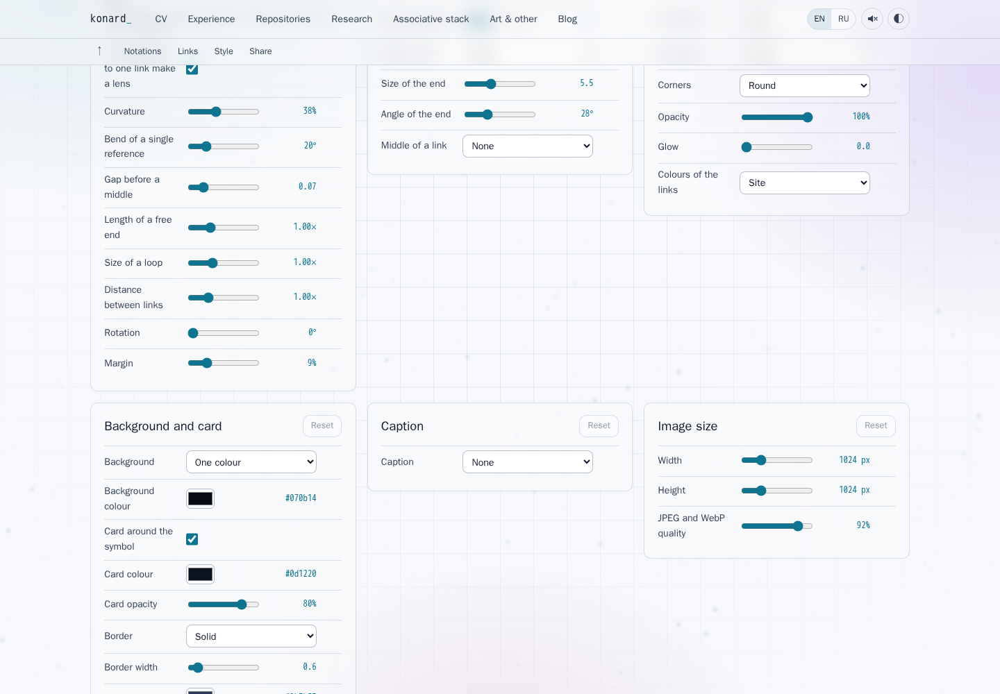 | 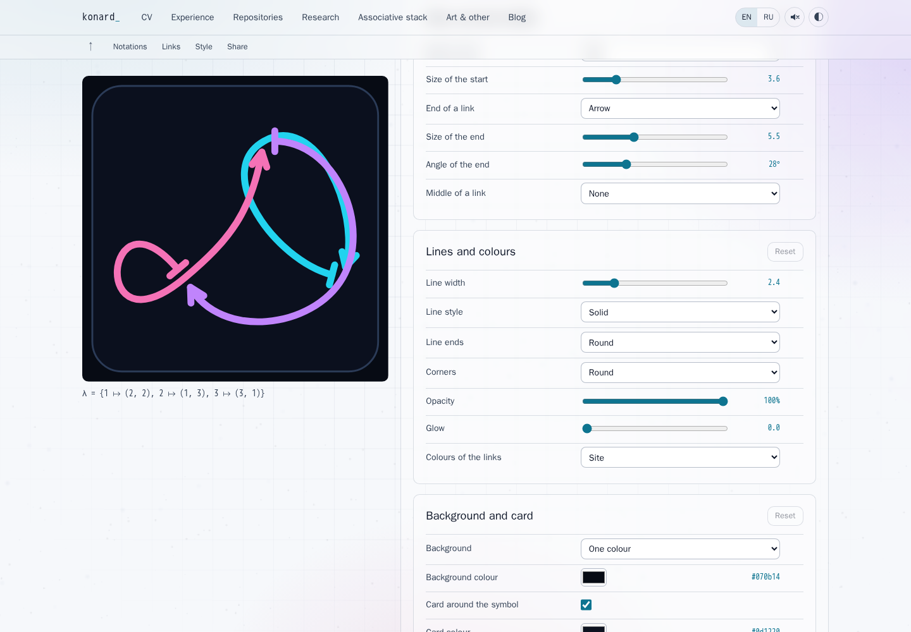 |

Further failing regression tests identified and then verified fixes for:

- **Partial parsing:** matching only valid fragments could silently discard an
  unfinished link; pairs with a wrong base or trailing text could also be accepted.
  Both parsers now consume the complete input and check every written base.
- **Collision scoring and applied turns:** crossing exemptions depended on link
  ordering, the search used a different angle penalty from its final score, and
  solved turns outside ±180° were clamped when applied. Scoring now uses the actual
  intersection and total turns; candidate turns stay in the editable range.
- **Shared theory notation:** a receiver's global L/R preference could change an
  image's theory caption. The image has its own explicit notation setting in the
  URL, independent of the receiving browser's preferences.
- **Page language:** rewriting image options removed an explicit `lang` from the
  URL. The address and share link now preserve it across edits and reloads;
  page and browser regression tests cover this existing site behavior.

## Browser evidence

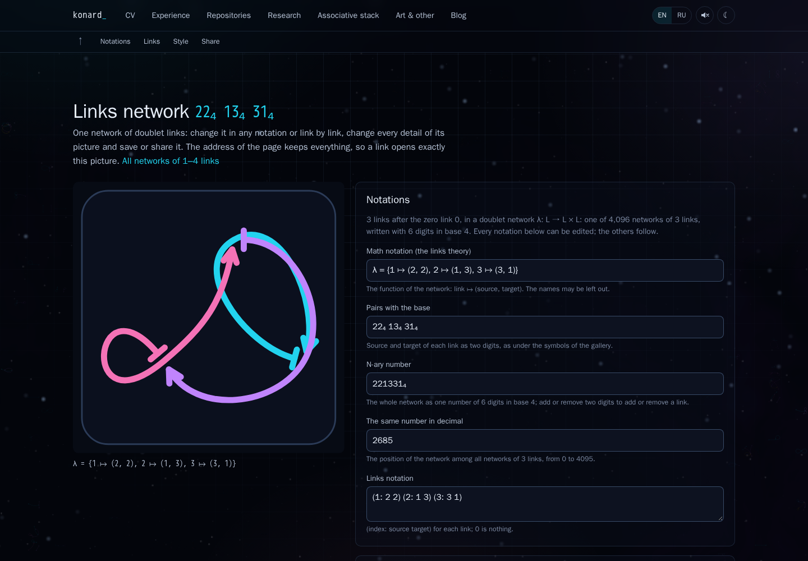

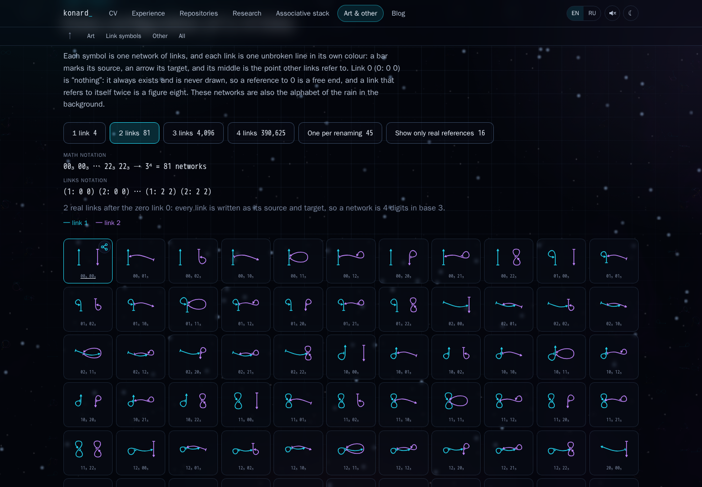

| Plain black, without a card | Transparent, without a card |
| --- | --- |
| 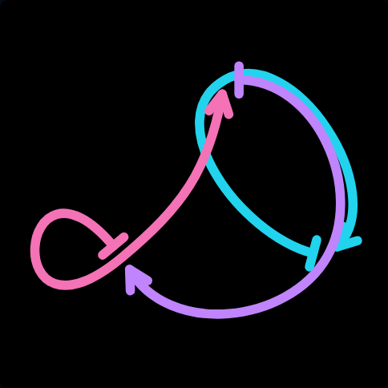 | 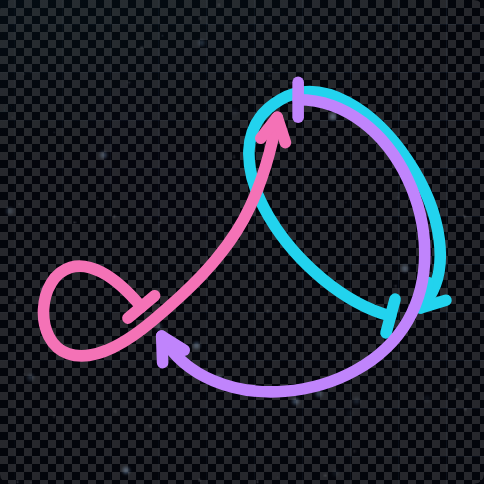 |

| Before automatic endpoint turns | After automatic endpoint turns |
| --- | --- |
| 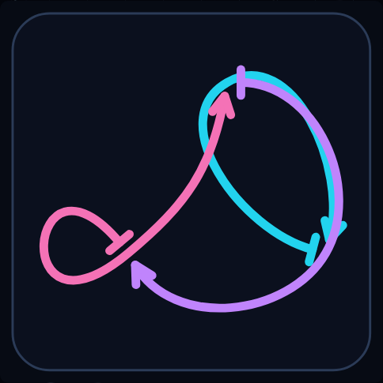 | 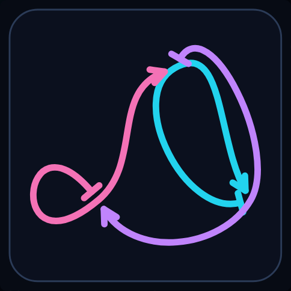 |

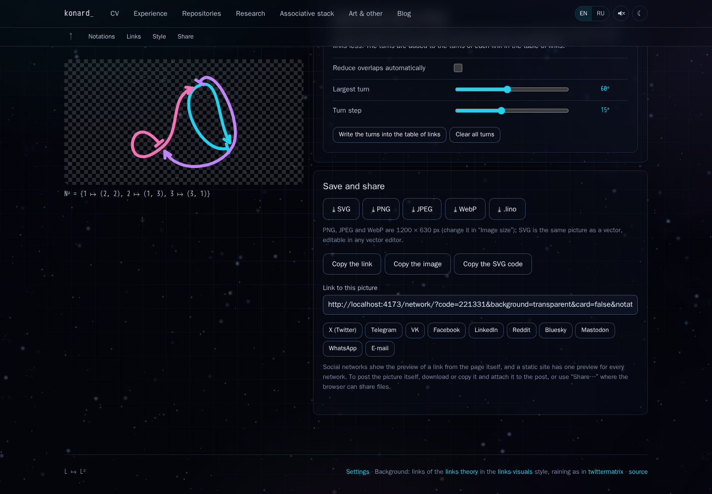

| Russian, nine links, 390 px phone | Light theme |
| --- | --- |
| 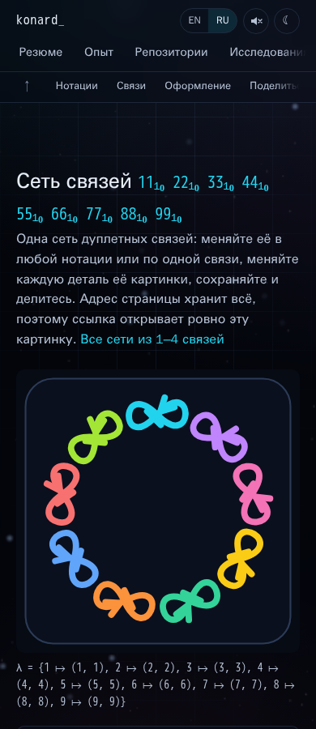 | 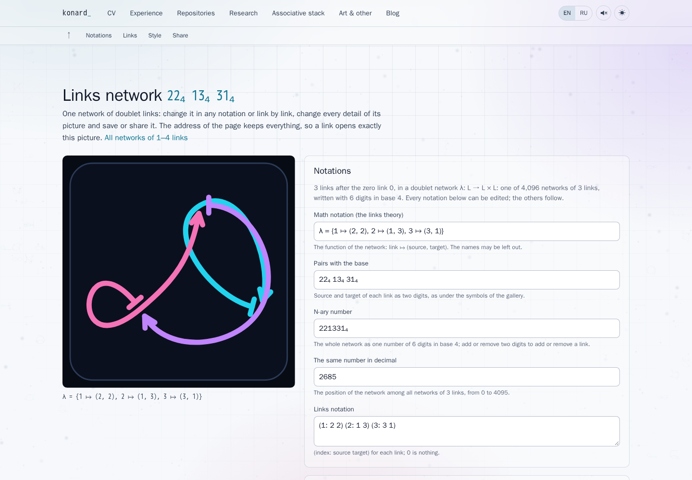 |

## Reproduce the checks

```sh
npm ci
npm run check
npm run test:ci -- --maxWorkers=1
npm run build
npx playwright install chromium
npm run test:network:browser
node experiments/issue-17-collisions.mjs
node experiments/issue-17-gallery.mjs
```

The browser suite starts and closes its own Vite preview by default. `BASE` can
select an existing server; `ENGINE=firefox` or `ENGINE=webkit` selects another
installed Playwright browser. `CAPTURE_DIR` saves review screenshots. It checks
360, 390, 768, 1280 and 1920 px widths in English and Russian, including the full
nine-link editor, with no document overflow or uncaught page errors. CI runs the
Chromium suite after building the site, before the existing CV PDF checks.

The solver experiment uses finite samples and all 720 three-link classes with
default options: 507 improved, 213 stayed the same and none worsened (about 17 s
locally). For `22 13 31`, the score fell from 11.25 to 0.64. The gallery experiment
compares all one-, two- and three-link networks and 512 evenly spaced four-link
samples with `origin/main`: all 4,693 default SVGs were byte-for-byte unchanged.
The score is a heuristic rather than a claim that every
geometric crossing can be removed. Some joins are intentional, and some networks
cannot be untangled by endpoint turns alone. Automatic solving remains opt-in.

Social services receive the complete editor URL. A static site's link preview
does not change with a query string; download/copy the actual picture and attach
it, or use the system share sheet on browsers that support files. Clipboard and
native sharing support depend on the browser and OS. Headless tests verify the
files and outbound links without publishing posts or opening an OS share sheet.

The complete browser suite passed in Chromium and Firefox. An optional WebKit
run lost its browser on the gallery before it reached the editor; the container
recorded an OOM kill and a peak at its 2.92 GiB limit. This is not recorded as a
passing WebKit run. The required CI browser suite uses Chromium.
