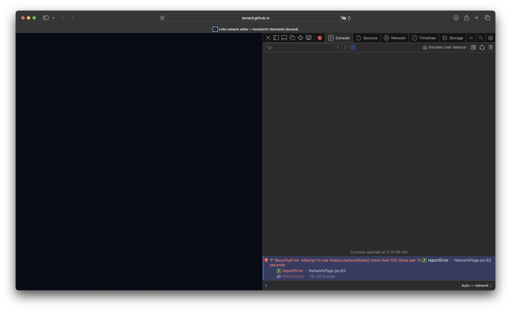
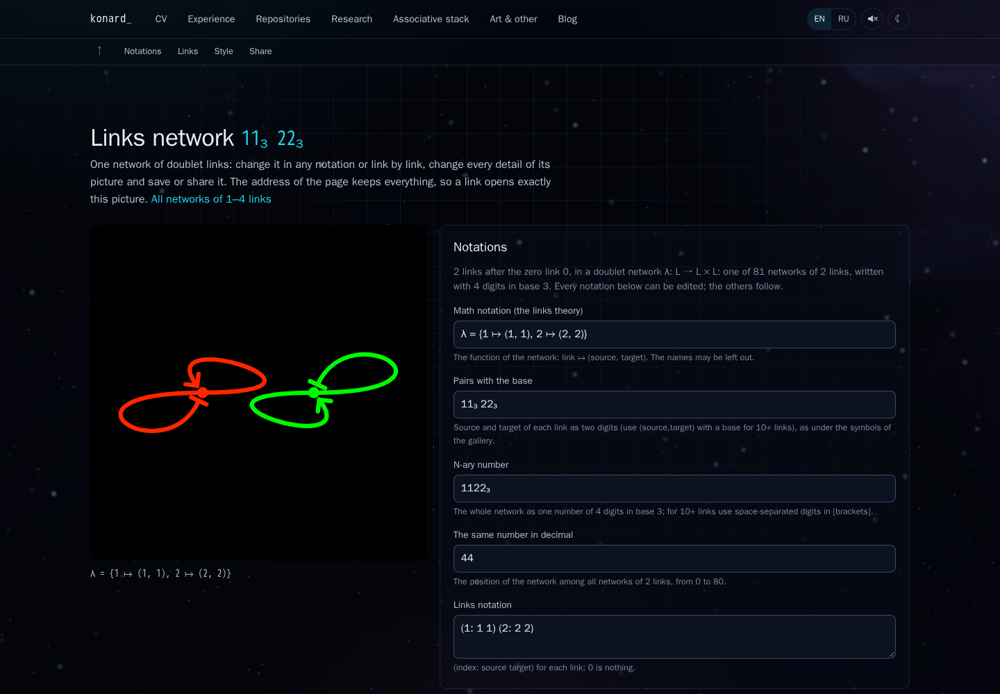
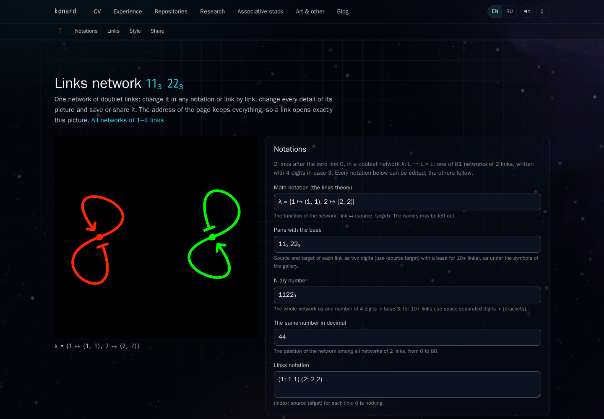
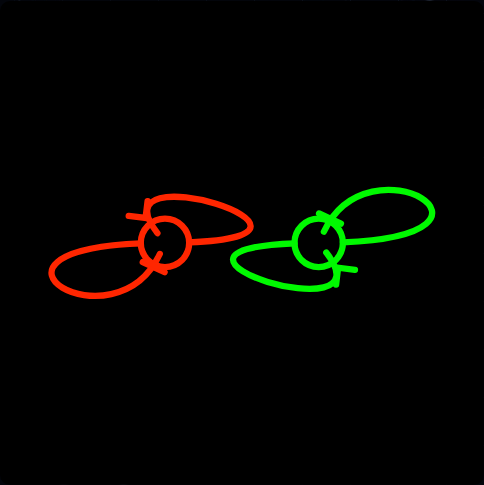
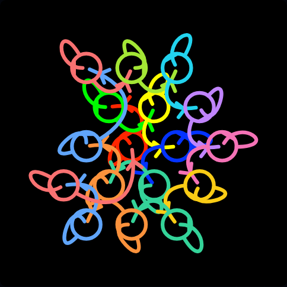
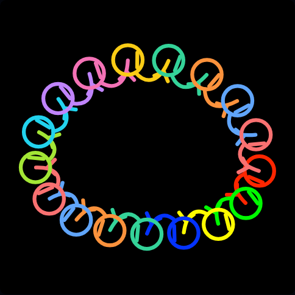
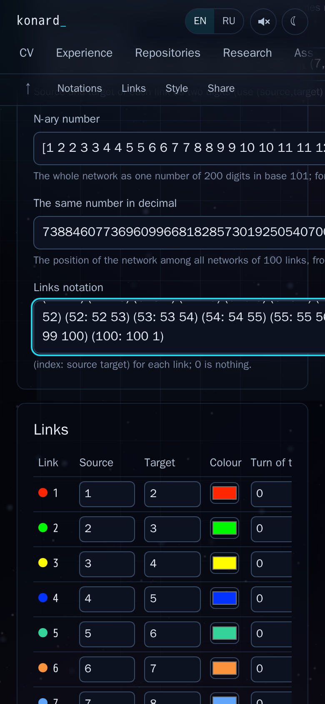
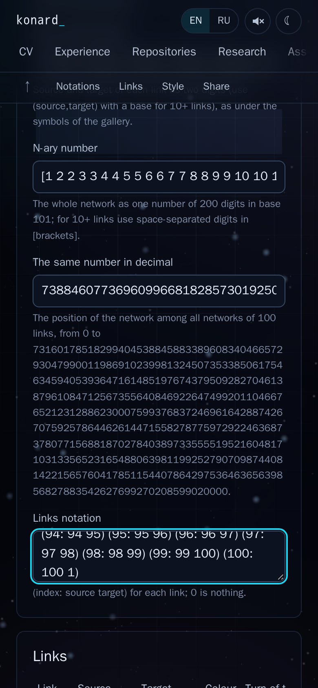

# Issue 19: reliable network editing and configurable geometry

[Issue #19](https://github.com/konard/konard.github.io/issues/19) · [PR #20](https://github.com/konard/konard.github.io/pull/20)

## Evidence and chronology

The original report, every issue comment, PR conversation comment, inline comment and review were retrieved through authenticated GitHub APIs. At intake all four comment/review collections were empty, and the issue had no sub-issues or dependencies. The unmodified API responses are in [data/](data/), alongside the related PR #18 and initial CI run metadata. The supplied GitHub attachment was downloaded with authentication, checked with `file` and inspected as a PNG: [reported screenshot](screenshots/reported.png).

All dates below are UTC on 2026-10-24. Test logs include execution timestamps rather than estimates.

| Event | Evidence |
| --- | --- |
| 19:35:24: issue created; 19:37:46: last issue edit at intake | `data/issue.json` |
| 19:38:36: initial branch CI started at `fa8af525b268acfe0a1ee16d1175e13c6888c4bf` | `data/initial-runs.json` |
| Investigation: downloaded screenshot identifies Safari's history quota exception; reproduced an uncaught history exception removing the editor | `logs/reproduction-browser.log`, `screenshots/before-history-error.png`, `experiments/issue-19-reproduce.mjs` |
| Failing regression tests establish URL flooding, lost clipboard activation and ignored self-loop geometry | `logs/reproduction-unit.log`, `logs/geometry-before.log`, `logs/share-before.log` |
| First fixes: debounce history, contain exceptions and call Clipboard API inside the gesture | Commit `fbda646`; `logs/history-clipboard-tests.log` |
| Sharing audit finds the same activation problem in Web Share | Commit `f3baf3e`; `logs/share-after.log` |
| Expanded geometry and layout tests pass; full test run has 676 passing tests | `logs/geometry-tests.log`, `logs/all-tests.log` |
| Browser screenshot review exposes large-number mobile field clipping; new assertion fails before CSS correction | `logs/mobile-overflow-before.log`, `screenshots/before-mobile-large.png` |
| WebKit touch regression exposes listener registration race; stream tracking also prevents unrelated events from ending a drag | `logs/webkit-touch-before.log`, `logs/early-touch-before.log`, `logs/mixed-input-before.log`, `logs/history-final.log` |
| Final control/API audit finds an ineffective spring-length control and single-digit assumptions in configuration helpers; both reproduced before correction | `logs/final-audit-before.log`, `logs/final-audit-after.log` |
| 20:10:13: final full unit run passes 682 tests across 34 files; production build and repository checks pass | `logs/all-tests-final.log`, `logs/build-final.log`, `logs/check-final.log` |
| 20:14:18: all 120 CV PDFs validated; dependency audit reports zero vulnerabilities | `logs/cv-final.log`, `logs/audit-final.log` |
| Final cross-browser, CI and review evidence | Browser result JSON and logs in this directory; CI evidence recorded with the final PR revision |

The experiment reproduces the browser's failure using an injected quota of ten writes, avoiding a long browser-specific stress test. The actual screenshot names the native Safari condition: more than 100 `replaceState` calls in ten seconds. The test intentionally does not assume that every browser uses that same threshold.

## Requirement inventory and verification map

| Requirement, including prose requests | Implementation | Verification |
| --- | --- | --- |
| Fix the blank editor; update URL after interaction ends; debounce repeated short releases | `useNetworkHistory`: live React preview/share URL, 400 ms trailing debounce after pointer/touch/key release, bounded exponential retries and exception containment | `network-history.test.jsx`; 120-event browser drag, repeated release, injected `SecurityError`, retry and after screenshot |
| Leaving/entering angles and curvature must work for self references | Separate loop departure/arrival directions use fixed angles and per-end turns; middle handles use tension | `geometry-19.test.js`: `11`, `10`, `01`, `11 22`, mixed reference cases; real-browser self-loop checks |
| Bend must affect loops or be unavailable in irrelevant contexts | Bend rotates a free/self-loop middle tangent; hidden only when every link has two external references | Geometry delta tests and conditional-control audit |
| Independent gaps at the source and target referenced middles | `startGap` and `endGap`; old `gap` bookmarks initialize both | Independent endpoint-distance assertions; URL round trips and compatibility test |
| Offset bars, arrows and other shapes; symmetric options at start/end/middle | All nine marker choices at all three positions; independent size, angle for pointed shapes, tangent/sideways offsets and rotation for directional shapes | Every marker/position combination, finite paths, geometry invariance and applicable-control range checks |
| Optional cut at own middle, useful with a ring; continuous by default | `middleGapStart`/`middleGapEnd` remove arc length independently from two cubic halves; exact de Casteljau subcurves | Cubic endpoint/tangent tests, two-subpath assertions, shared URL reload, ring screenshot |
| Defaults like both supplied URLs; leave default rotation unchanged | Fixed angles, target 47°, tension .33, bend 45°, .08 reference gaps, requested marker sizes/angles, middle dot, thin sharp lines, custom bright colours, black/no-card 2048², rotation 0° | Explicit default contract, both full supplied URLs in browser tests; gallery preset retains original shape |
| Circle default for 1–4; square, hex, dice, playing-card and other scalable patterns | Automatic circle through four, hex afterwards; explicit circle/square/hex/dice/cards/sunflower/force | Each pattern at 11 sizes from 1 to 40; hex at 100 and 1000; distinct deterministic middles; seven screenshots |
| Force placement adapted to links | Each middle is a particle; references are springs; 0 has no particle; self references enlarge collision radius; deterministic stopped D3 simulation | Actual references change positions; spacing parameters change output; repeat calls agree; physical-placement screenshot |
| Finite networks beyond nine links, throughout editing/sharing/export | Delimited multi-digit pair codes, bracketed N-ary digits, BigInt indices/counts, unlimited colour/turn lists, cycling palettes and linear-size large reference table | All notations at 10, 37 and 100 links; 17-link reload and 100-link touch UI; safe export filenames |
| Avoid ineffective settings; carefully audit other mechanics | Context-aware shape controls; marker-dependent angle/rotation visibility; existing background/card/caption conditions retained; large-number mobile grid corrected | Every geometry control has a visible applicable effect; no-op contexts asserted; bounds check on actual mobile input rectangles |
| Safari image copying; Chrome/Safari/Firefox desktop and mobile support | PNG promise supplied to `ClipboardItem`, synchronous `write`; capability-aware controls and download alternative; precomputed native share files with synchronous link fallback | Clipboard promise regression; trusted real-browser PNG writes; gesture-sharing component tests; three-engine desktop/touch suites and MIME/alpha download tests |
| Deep case study, all evidence, online research, library review, default-off diagnostics; upstream reporting where relevant | This report, source API data, before/after images, retained experiment scripts and logs; `network.debug` tracing | Documentation/source review; no new upstream defect found to report |
| One complete PR, all checks passing, reviewable evidence | Prepared branch only; preserved atomic history; browser matrix in CI, screenshots in PR, `Fixes #19` | Final PR status/checks and clean working tree |

## Root causes and solutions

### History exception and excessive writes

Previously each slider `input` changed style state, and the URL effect called `history.replaceState` immediately. Safari's quota exception escaped a React effect. The root disappeared, leaving a blank screen. The rendered shared URL and preview do not need a browser history write to update; they already derive from current state.

The fix waits until a continuous control is released, then requires 400 ms of quiet. A subsequent interaction cancels that timer. Pointer cancellation, touch cancellation, focus loss and window blur release the interaction too. Held range-adjustment keys postpone persistence until keyup. History writes preserve the current state object, pathname and hash. Exceptions trigger at most five increasing retries and never interrupt rendering. A newer edit replaces the retry with its own current query. Unmount cleans up listeners and timers. The shared `replaceAddress` helper also protects language switching, filtered pages and opening a shared site look from the same unhandled exception; their state changes still work when persistence fails.

An ordinary input-event debounce alone was rejected: holding a slider still for half a second before moving it again should not write while the user is touching it. Throttling also writes during a drag and does not meet the request. Catching the exception alone would conceal the excessive updates.

The [HTML history specification](https://html.spec.whatwg.org/multipage/nav-history-apis.html#shared-history-push/replace-state-steps) permits an implementation to reject excessive state updates. Thus the application must treat address persistence as fallible, irrespective of an engine's current quota. The screenshot and injected failure identify the app's unhandled write, without requiring speculation about graphics drivers or SVG rendering.

Enable diagnostic output with `localStorage.setItem('network.debug', 'true')`; reload if necessary. Successful saves and failed attempts include the query or exception name/message and retry count. Remove that key to restore the default silent behavior. No tracing is enabled for normal visitors.

The first WebKit touch run found one write during a held interaction (`logs/webkit-touch-before.log`). A focused event probe plus a mount-time regression established a race: controls could exist before passive-effect listeners were registered. Listeners now attach in a layout effect before paint. Another failing regression showed that an unrelated keyup or focus change could release a held pointer. The hook now tracks pointer, touch and keyboard streams independently. See `logs/early-touch-before.log`, `logs/mixed-input-before.log` and `logs/history-final.log`. Diagnostic mode also records start/end event types and remaining interaction streams.

### Ignored self-loop controls

The old loop branches constructed handles directly from the loop size and middle tangent. Fixed-angle values and tension were read only by branches that referenced another link. When both references were self/zero, the middle tangent also bypassed bend. This explains the reported no-op sliders without a numerical approximation hypothesis.

Self-reference departure and arrival now each rotate their own direction, relative to the gallery's established shape. The loop's middle handle follows curvature; a small positive minimum keeps its tangent defined at the zero end of the slider. Bend rotates the middle tangent in self/zero cases. Original `SHAPE` defaults still reproduce the gallery/rain; editor defaults are independent. Existing point-symmetry tests remain valid for the gallery shape.

Some controls are structurally irrelevant: source gap when every source is 0, loop size with no self references, free length with no zero references, and mirror lenses in fixed-angle mode. Those controls are hidden rather than presented as if they changed the image. Circle/dot rotation and bar angle are likewise hidden. Marker offsets and sizes remain available regardless of whether a reference is self, external or zero.

### Symmetric marker placement and cuts

Each marker is positioned from the actual endpoint or middle tangent. Positive tangent offset moves an endpoint marker inward; the middle follows its forward tangent. Sideways displacement and rotation are independent. Changing a marker does not change the underlying layout curves. Fitting can reserve more margin to keep an offset marker within the image, so an extreme offset may rescale the displayed curves.

Middle cuts are lengths in symbol units, independent of marker presence. They work with a ring, a displaced marker or no marker. Cubics are sampled to find the cut parameter, then subdivided exactly rather than approximated by a polygon. A cut that consumes a whole half omits that half. Zero cuts preserve the original single continuous path. No background-coloured patch is used, so transparent exports retain the cut.

### Scalable placement and notation

The renderer and editor originally rejected more than nine links because the shared code assumed one decimal digit per reference. Raising just the renderer limit would have corrupted notations, palettes, turns and saved URLs. Codes now use `source,target;source,target` after nine links. Pair captions use `(source,target)` with the base subscript, and N-ary numbers use decimal digit tokens in brackets. BigInt division/remainders handle indices in arbitrary bases. Old compact codes stay unchanged.

Square and hexagonal grids fill progressively; dice faces tile after six pips, playing-card columns tile after ten; a sunflower spiral supplies another unbounded construction. There is no application link-count ceiling. All computers still have finite time/memory and URL-size limits. The tests use bounded samples rather than allocating an unbounded network. Large reference tables use numeric inputs after 50 links, avoiding two n-option selects per row and quadratic DOM growth. This changes the input widget, not the supported network size.

The shared configuration helpers were audited too: references such as 10 must count as real references, exact large indices use BigInt, and random networks sample each reference independently instead of multiplying a random float by a total that can overflow. Exhaustive gallery counts retain their Number API for the bounded 1–4-link gallery; the editor uses exact BigInt counts. Spring length is hidden when there are no external reference springs.

The physical arrangement uses [D3 force simulation](https://d3js.org/d3-force/simulation), [link springs](https://d3js.org/d3-force/link), many-body repulsion and collision radii. Its timer is stopped, then advanced for 180 deterministic ticks. This makes shared URLs reproducible rather than animation-dependent. Repeated solver candidates reuse the physical placement; endpoint collision optimization computes only the changed curve instead of rebuilding every curve.

Alternatives considered: hand-written repulsion would duplicate stable spatial indexing and integration; a full interactive graph framework adds selection/dragging/animation features this static glyph editor does not need; CSS Grid alone cannot supply Bézier tangents, physical springs or export coordinates. D3 adds four small packages and is used only for physical placement. Fixed arrangements stay direct geometry with no simulation overhead. The existing experimental endpoint solver remains an approximate crossing reduction, not a guarantee of optimal planar embedding or marker collision avoidance.

### Clipboard, native sharing and image formats

The original `rasterize(...).then(copyImage)` crossed asynchronous image loading and `canvas.toBlob` before calling `navigator.clipboard.write`. Safari's transient activation no longer covered the call. The fix calls `write` inside the button handler and gives `ClipboardItem` a promise for the PNG blob. The preview and exported image still use the same SVG.

WebKit explicitly documents promise-valued clipboard entries and gesture requirements in its [Async Clipboard API article](https://webkit.org/blog/10855/async-clipboard-api/). The same async-activation limitation is already tracked as [WebKit bug 222262](https://bugs.webkit.org/show_bug.cgi?id=222262). This is an application integration error with a documented supported pattern, so a duplicate issue in an unrelated GitHub repository would provide no useful defect report.

The audit found another occurrence in native file sharing. PNG preparation now happens before the click when file sharing is supported, coalescing rapid edits with a 200 ms delay instead of rasterizing every intermediate drawing. The handler synchronously shares the current prepared file; if it is still preparing or failed, it synchronously shares the current link. Stale conversions are discarded. Image copying is disabled with a PNG-download explanation when the API/MIME capability is absent. Missing text-copy capability leaves a selectable share URL. Permissions/security restrictions can still reject a supported operation; the UI reports that rejection rather than claiming success.

Canvas implementations may silently return PNG for an unsupported requested encoder. Export now verifies the returned MIME type and directs the user to PNG instead of downloading a PNG labelled `.webp`. File names are sanitized and bounded so large-network codes do not exceed common filesystem filename limits.

## Reproduction and validation

The before capture can be reproduced against the parent build with `node experiments/issue-19-reproduce.mjs`. It injects history failure after ten calls, changes the slider fifteen times and saves the blank editor. Do not run it on the fixed build when preserving the original `before-*` evidence.

For current verification:

```sh
npm ci
npm run check
npm run test:ci -- --maxWorkers=1
npm run build
ENGINE=chromium npm run test:network:browser
ENGINE=chromium npm run test:network:issue19
ENGINE=firefox npm run test:network:browser
ENGINE=firefox npm run test:network:issue19
ENGINE=webkit npm run test:network:browser
ENGINE=webkit npm run test:network:issue19
```

Install matching Playwright browser binaries first. Browser suites start and close their own preview server/browser; `BASE` can target an existing preview. `CAPTURE_DIR` and `RESULT_DIR` choose artifact folders. CI runs the engines on separate Ubuntu runners and preserves screenshots/results even after a failure. Locally the engines run sequentially within the container's 2.92 GiB memory limit.

Playwright's Firefox, Chromium and WebKit engines exercise real browser implementations. Mobile checks use touch-enabled viewports (and mobile mode where supported); these are not physical iPhones, Android devices or branded Safari/Chrome release certification. Native operating-system share sheets are verified through gesture-sensitive component tests because automation cannot choose a real user's destination. Clipboard writes themselves are exercised in the browser.

The existing Chromium and Firefox suites also passed locally (`logs/chromium-regression.log`, `logs/firefox-regression.log`). The existing WebKit gallery run was deliberately stopped when its content process reached approximately 2.3 GiB RSS in this 2.92 GiB container; its resulting page-closed error is retained in `logs/webkit-regression.log`. The focused WebKit editor/clipboard/touch suite passed. The full gallery check is delegated to the larger CI runner, with its result required before PR completion.

## Visual evidence

Reported failure:



Reproduced before and the still-usable editor after a history exception:




Self loops and optional ring cuts/offset markers:




Example scalable arrangements:




The large-number mobile regression and corrected input layout:



