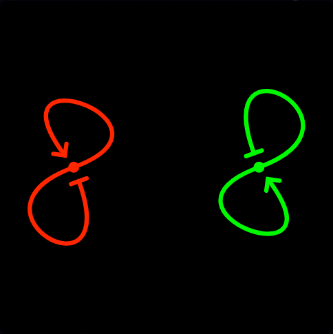
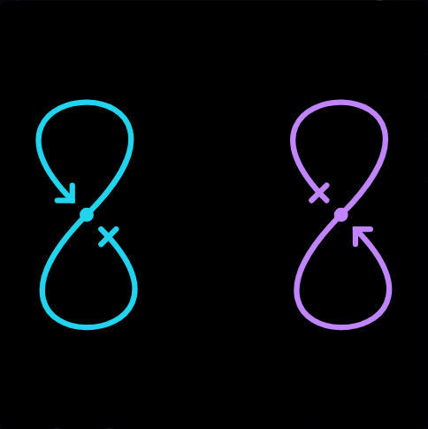
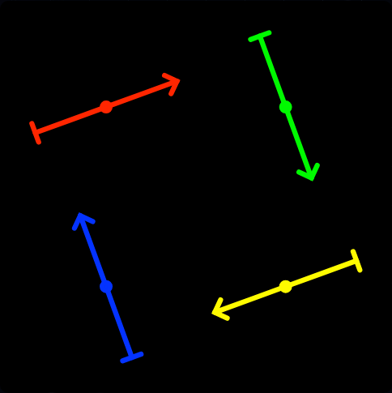
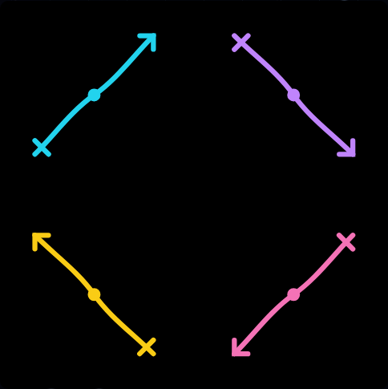

# Issue 21: editor defaults, bend, symmetry and source appearance

Issue: https://github.com/konard/konard.github.io/issues/21  
Implementation: https://github.com/konard/konard.github.io/pull/22

## Evidence and scope

The issue requests geometry changes only for the single-network editor. Gallery,
theory examples and background rain must retain their geometry. Colors and hover
behavior must agree across entry points. No issue comments, required sub-issues,
PR conversation comments, inline comments or reviews existed at initial collection;
the raw API responses are in `data/`. The two original Safari screenshots are
preserved at their downloaded resolution in `screenshots/reported-*.png` and were
verified as PNGs before visual inspection.

Previous geometry/editor work is recorded in PRs #18 and #20 (archived metadata in
`data/related-pr-*.json`) and the existing issue-17 and issue-19 case studies. This
study extends those implementations without removing notation editing, placements,
per-link turns, collision reduction, marker offsets/cuts, saved looks or exports.

## Sequence of events

- PR #18 introduced the editor, explicit fixed-angle geometry and shareable styles
  (merged 2026-10-24 18:01:55 UTC).
- PR #20 expanded loop controls and placements and stabilized browser testing
  (merged 2026-10-25 09:19:58 UTC). The editor retained unequal endpoint angles,
  saturated custom colors and a bend control that rotated free/self tangents.
- Issue #21 was opened at 10:17:32 UTC on 2026-10-25 and last edited at
  10:19:08 UTC. It supplied two carefully adjusted examples: two figure-eights
  and four free links. Their links encode non-default numeric settings but inherit
  omitted defaults. The screenshots also show bar markers displaced inward to
  make crosses.
- Prepared PR #22 started at `4066350` on 2026-10-25 10:21:02 UTC. Its initial CI
  run `40184420366` passed; `ci/initial-run.log` preserves the full output.
- At 10:24:53 UTC the new regression suite reproduced four behavior defects:
  unequal self-loop symmetry, anchor motion under bend, zero source offset and
  different default colors. The original log also records a fixture-path error,
  subsequently corrected to a repository-relative Node file path.
- At 10:25:21 UTC browser captures reproduced the red/green editor versus
  cyan/purple gallery and hover underline. The initial capture's init script
  reset the light preference on reload; corrected before captures use the
  unchanged parent build and retain the chosen theme.
- At 10:26:03 UTC the first 30 focused tests passed, including the unchanged
  gallery/rain hashes. Subsequent checks broaden symmetry and continuity coverage.
- The first after-browser run passed controls, sharing, themes and navigation,
  then exposed a test comparison error: DOM serialization expands self-closing
  SVG elements. The export check now parses the exported SVG before comparing
  its DOM to the preview. This was not an export defect.
- The full local unit run started at 10:27:38 UTC and passed all 693 tests in
  36 files after 134.05 seconds.
- Implementation commit `30e1517` was pushed at 10:30 UTC. Its CI run
  `40185061511` started at 10:30:32 UTC, after that commit, and tests the merge
  result with `main`. All three browser jobs passed the old and new suites;
  the complete workflow passed at 10:35:32 UTC, including the CV PDFs and Pages
  artifact. Its raw log, job metadata and all three browser artifacts are
  preserved under `ci/`.
- The new local browser suite passed Chromium 153.0.8010.12, Firefox 155.0 and
  WebKit 26.6, with no uncaught browser errors. Corrected before evidence was
  captured at 10:34 UTC from the unchanged parent source in an isolated directory.

## Requirement inventory and verification

| Requirement | Implementation | Verification evidence |
| --- | --- | --- |
| Carefully inspect both screenshots and supplied links | Preserve originals, audit numeric values and inherited defaults | Screenshot/settings audit below; browser script reads the actual issue URLs |
| Settings match links and vice versa | Retain explicit values; normalize and serialize new mode, colors and offsets through the existing schema | Both URLs checked against actual controls; edited controls shared and reloaded to identical SVG |
| Defaults close to the examples and gallery | 30°/30° ends, 40% curvature, 20° bend, equal 0.08 gaps, 2.5 source size/offset | Before/after images for self loops, free links, theory and connected examples |
| Bend should bend rather than simply rotate | Editor `bendMode=curve` anchors free ends, widens loop handles, separates endpoint axes from middle tangent | Tests compare anchors at bends 10° and 60° and require different curves |
| Cross-like starts | Inward source offset equals the bar half-length (2.5), sideways offset/rotation remain zero | Numeric centered/perpendicular bar test and screenshots |
| Strict symmetry when possible | Equal angles use the same directed loop rotation; free ends are point-symmetric | 33 sampled parameters per half, five angles × six bends, quarter-turn fitted free-link symmetry |
| Colors match what was clicked everywhere | Site palette by default; light-theme links encode `palette=print` in gallery/share and theory links | Computed browser strokes compared before/after navigation; theme-switch component regression |
| No hover underline on gallery configurations | Scoped `.symbols__card:hover` declaration | Browser computed decoration equals `none`, keyboard focus retained |
| Restrict geometry changes to the editor | Shared `SHAPE` defaults retain legacy bend; only `EDITOR_SHAPE` opts into curve mode | SHA-256 of 4,693 original SVGs, covering all 1–3-link networks plus 512 evenly spaced 4-link networks |
| Preserve all existing mechanics | Legacy bend choice and card preset retained; old explicit custom colors are recognized | Existing unit/browser suites plus all 4,181 networks of 1–3 links checked for finite, continuous editor curves |
| Deep case study, timeline, requirements, root causes, plans and online/library research | This report, plan, raw API data, external source snapshots, logs and reproducible scripts | `PLAN.md`, `data/`, `logs/`, `ci/`, `screenshots/` |
| Diagnostics if cause cannot be identified | Causes are reproduced and traced; existing default-off `network.debug` tracing remains available | Diagnostic instructions below; no speculative cause or upstream dependency defect |
| Report a relevant external defect if one exists | Investigation identifies local application geometry/default/CSS behavior | No new upstream issue is warranted; existing browser limitation remains documented in issue-19 |
| Single complete PR, local/CI checks, visual evidence and ready status | All work remains on prepared branch, PR #22 unmerged | Final verification, PR body, latest CI head SHA and clean worktree |

## Screenshot/settings audit

The supplied URLs already preserved all their **explicit** numeric values before
this fix. There was no evidence of a numeric parser or Safari rounding defect.

| Screenshot | Visible setting | URL or inherited value |
| --- | --- | --- |
| Two loops (`1122`) | Leaving / entering angles | `sourceAngle=24`, `targetAngle=40` |
| Two loops | Curvature / bend | `tension=0.4` (40%), `bulge=25` |
| Two loops | Source / target gaps | `startGap=0.09`, inherited `endGap=0.08` |
| Two loops | Loop size / spacing / rotation / margin | inherited 1× / 1× / 0° / 9% |
| Two loops | Start / size / inward offset | inherited bar / 2.5, explicit `startOffset=2.9` |
| Four free links (`00000000`) | Bend / margin | `bulge=19`, `padding=10` |
| Four free links | Free length / spacing / rotation | inherited 1× / 1× / 0° |
| Four free links | Start / size / inward / sideways / rotation | inherited bar / 2.5, `startOffset=2.5`, inherited 0 / 0° |
| Four free links | End / size / angle / offset | inherited arrow / 3.5 / 45° / 0 |

The visible numeric controls still match these values after the change. A canonical
URL may omit a value equal to the new defaults (for example tension 0.4 or offset
2.5); decoding restores the same value. Both directions are tested. Screenshots
are aesthetic references: their old red/green palette intentionally changes to the
clicked gallery palette, and the revised bend semantics intentionally change the
curve. They are not pixel-equality targets for the obsolete editor defaults.

## Root causes and solutions

### Rigid rotation disguised as bend

The former free/self branches rotated `d`, then derived endpoints and all handles
from that same vector. Changing bend therefore rotated the whole local drawing.
No single angle could both undo that rotation and improve different topologies.

`bendMode=curve` separates a free endpoint's axis from the middle tangent. Free
endpoints keep their positions; the middle handles create a shallow, symmetric S.
Self-loop axes keep the gallery's orientation, while bend changes handle width.
For a single external reference the chord still determines the basic axis, and
the middle tangent supplies its bend. Two external references already determine
the middle direction; bend and its mode are hidden when they cannot affect any
link. Rotation remains the explicit control for rotating the whole layout.

A legacy tangent-rotation choice is retained and serialized. The gallery-card look
sets it with the original `SHAPE` values. Merely changing a scalar default was
rejected because it cannot correct a control that rigidly rotates entire shapes.
Changing gallery geometry was excluded by the issue's explicit scope.

### Unequal loops and opposite endpoint-angle signs

The old defaults used source 30°, target 47°, curvature 33% and bend 45°. Even
with equal requested endpoint angles, the target self-loop applied the opposite
rotation sign from the source. The resulting two halves were not negatives of
one another about the middle.

The editor now uses equal 30° endpoints, 40% curvature and 20° bend. In curve mode,
equal endpoint angles rotate the directed source and target axes equally. Equal
gaps and turns therefore produce point-symmetric control polygons and curves.
Independent angles, gaps and hand turns intentionally allow asymmetry; topology
and intentionally different controls cannot always produce a symmetric network.

### T-shaped source instead of a cross

The bar was centered exactly at the curve endpoint because the default inward
offset was zero. Moving the bar inward by its half-length gives the short source
stem visible in the references. The default is now 2.5 for both size and offset;
all existing independent marker controls remain available. No gallery marker or
rain drawing is changed.

### Palette mismatch, including light mode

The editor defaulted to a saturated custom palette while `Glyph` used `COLORS`.
CSS darkened the first four gallery strokes in light mode. Sending only the code
could not capture that displayed palette.

The default editor uses the site palette. Both gallery card/share anchors and the
theory example anchor explicitly select the existing print palette in light mode.
`useResolvedTheme` listens to explicit and automatic system-theme changes, so the
URL reflects the current appearance before a normal click, new tab or context-menu
copy. The editor's SVG has explicit colors; recipient theme changes cannot alter
shared or exported colors. Old URLs with explicit `colors` and no `palette` still
select custom colors, as they did when custom was the default.

### Underline specificity

The global `a:hover` selector outranked `.symbols__card`'s base decoration. A
scoped `.symbols__card:hover` rule suppresses that underline. The share icon,
hover border and accessible focus ring are retained. Ordinary text links retain
their existing styling.

## External research and existing components

The [SVG 2 path specification](https://www.w3.org/TR/SVG2/paths.html) defines cubic
segments using two control points and describes reflected handles for smooth
joins. Our inference from this construction is that central inversion of all
control points gives exact point symmetry, while aligned middle handles give
continuous tangents. This is checked numerically rather than judged only by eye.

[D3's curve documentation](https://d3js.org/d3-shape/curve) describes interpolation
from point sequences. Its basis/bump/Catmull–Rom curves do not directly encode
this editor's self/zero/external-reference rules and endpoint marker tangents.
Replacing the existing glyph builder would expand the change into gallery/rain
geometry. D3 force placement remains unchanged.

[Bezier.js](https://pomax.github.io/bezierjs/) supplies splitting, projection,
length and intersection utilities. The repository already implements cubic
sampling/subdivision for its cuts; this issue requires anchored construction and
symmetry, so adding another geometry dependency would not remove the offending
local rules. No dependency or release-version change is needed for this private,
continuously deployed website.

The related [links-visuals marker implementation](https://github.com/konard/links-visuals/blob/main/js/markers.mjs)
uses an offset transverse source tick. Its source and README are archived in
`data/`; that confirms the intended cross-like appearance. It is a reference,
not a dependency causing this defect. Consequently there is no reproducible
external-library bug to report. Source HTML snapshots for the online research are
also retained in `data/` for reproducibility.

## Reproduction and validation

Use the repository's pinned Playwright 1.63 browsers. Playwright MCP is not exposed
in this session, so the existing Playwright Node framework exercises real engines.
Each suite closes its browser and preview server in a `finally` block.

```sh
npm ci
npx playwright install chromium firefox webkit
npm run check
npm run test:ci -- --maxWorkers=1
npm run build
ENGINE=chromium npm run test:network:issue21
ENGINE=firefox npm run test:network:issue21
ENGINE=webkit npm run test:network:issue21
```

The CI browser matrix also runs the existing editor/export and issue-19 suites
before the new issue-21 suite. `CAPTURE_DIR` and `RESULT_DIR` direct CI artifacts
outside source evidence. Tests are finite, use bounded samples, and the browser
suite has 15-second action limits inside the existing 15-minute CI job. Local
builds and browser engines are run sequentially to respect the container limit.

`experiments/issue-21-baseline.mjs` generated the original hash fixture before
implementation. Do not regenerate it from changed geometry when verifying
isolation. `BEFORE=1 node experiments/issue-21-browser.mjs` captures the unfixed
parent build, recording mismatches instead of asserting the fixed behavior.

For more diagnostics, run
`localStorage.setItem('network.debug', 'true')` in the browser console. Existing
history tracing records the complete serialized query, interactions and failures.
Delete that key to restore silent behavior. The query and saved SVG expose all
geometry inputs without enabling logging for normal visitors.

The observed before/after color data are in `data/*-before.json` and
`data/*-after.json`. Before the fix, both dark and light gallery entry points
opened red/green links, and the hovered card had `text-decoration: underline`.
After the fix, computed colors match in every engine: dark cyan/purple and light
teal/purple, with `text-decoration: none`. The original numbers in each supplied
URL match the actual controls in both builds; the defect was inherited defaults
and construction, rather than query parsing.

### Verification results

- `logs/reproducing-tests.log`: four behavioral failures before implementation.
- `logs/focused-tests.log`: 30 focused tests pass after implementation.
- `logs/unit.log`: all 693 tests in 36 files pass, including exhaustive small
  configurations, strict sampled symmetry and unchanged gallery SVG hashes.
- `logs/check-final.log`: ESLint, Prettier, line limits and secret checking pass.
- `logs/build.log`: production build passes.
- `logs/chromium-final.log`, `logs/firefox.log`, `logs/webkit.log`: all six
  issue-21 browser check groups pass; corresponding JSON records the engine
  version, actual colors and empty error arrays.
- `logs/{chromium,firefox,webkit}-existing.log` and
  `logs/{chromium,firefox,webkit}-issue19.log`: both pre-existing browser suites
  also pass locally in all three engines, sequentially. These cover every image
  format, clipboard writes, notation editing, collision reduction, seven
  placements, injected history errors, slider/touch gestures and 100-link mobile
  editing. `data/legacy/` retains their structured issue-19 results; the CI
  artifacts retain screenshots from all three suites.
- [Implementation CI run 40185061511](https://github.com/konard/konard.github.io/actions/runs/40185061511)
  passes at head `30e15178735dbf2f8a1726f4d78f73d9abceed9f`. In
  `ci/implementation-run.log`, lines 4400–4401 report the 36 files / 693 passing
  tests; lines 1059–1141, 1921–2003 and 3566–3648 record the three browser
  engines; line 5083 confirms the Pages artifact upload. The complete job
  conclusions and timestamps are in `ci/implementation-run.json`.

The default branch was fetched again after implementation; `f087846` is an
ancestor of the working branch, so no main-branch merge or conflict resolution
was needed. The subsequent evidence commit contains this report, original
images, raw research, local logs and downloaded CI evidence. Its own final CI
status is verified on PR #22 before marking it ready; generated evidence is
not recursively recommitted after every identical successful workflow.

The pre-existing 1,354-line registry utility still produces its documented
line-limit warning; it is not changed by this issue. Vite also warns about a
future native-config-loader change; current builds and browser suites pass.

## Visual comparison

Original default and corrected symmetric loops:




Four free links with the default source crosses:



