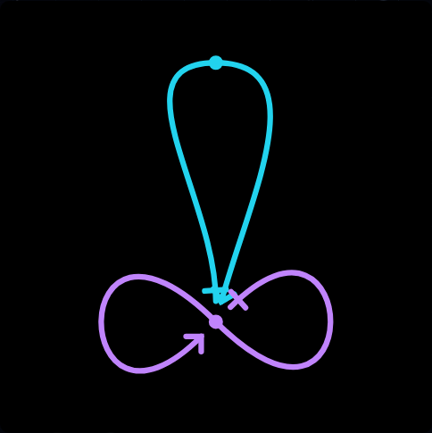
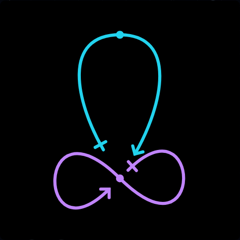
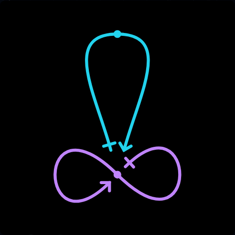
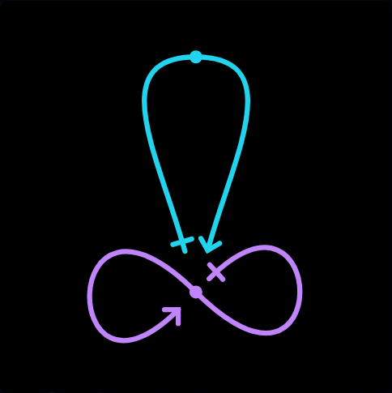
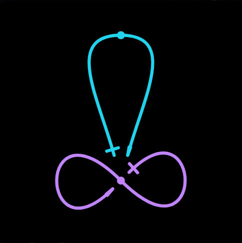
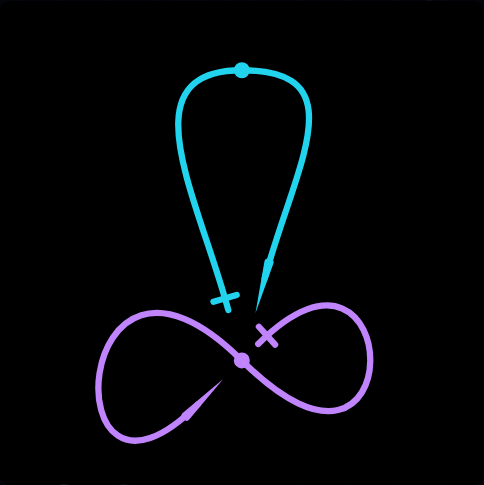
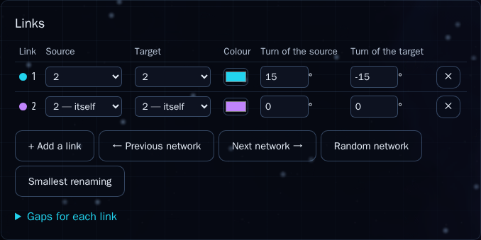
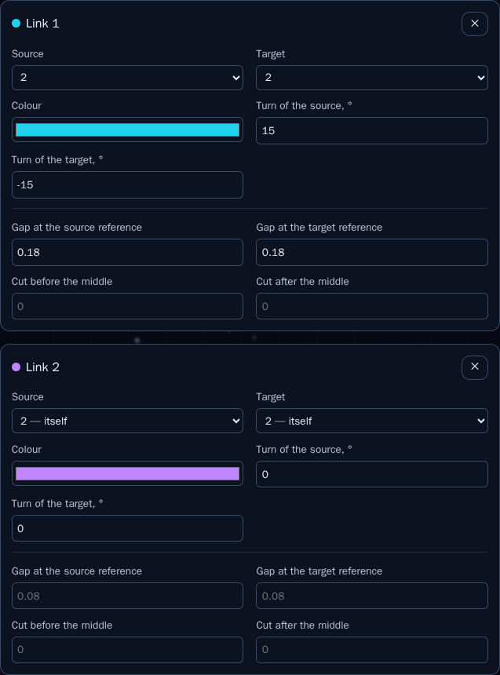
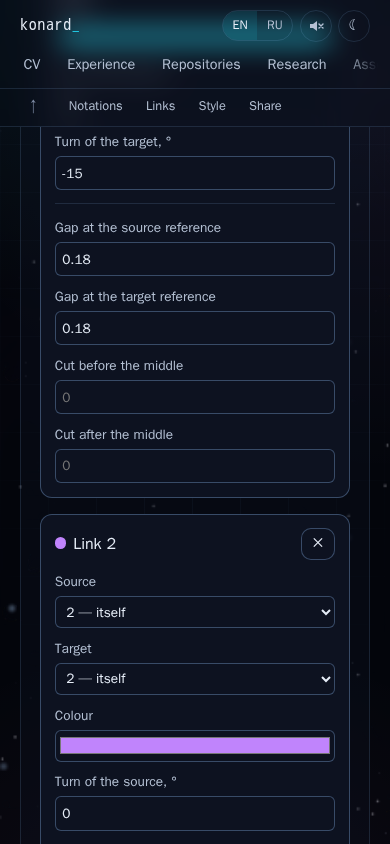
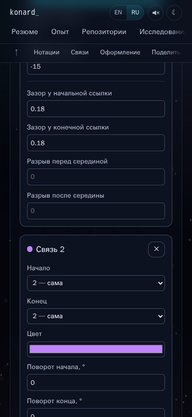

# Issue 25: automatic spacing, pointed arrows and per-link cards

Issue: [#25](https://github.com/konard/konard.github.io/issues/25). Implementation:
[PR #26](https://github.com/konard/konard.github.io/pull/26), branch
`issue-25-665823cdf9ad`. All times below are UTC on 2026-10-26.

## Report and evidence

The report supplied three screenshots and three configurations of `2222`:

1. Manual reference: `/network/?code=2222&rotation=90&turns=15+-15&gaps=0.18+0.18+%7E+%7E&lang=en`.
2. Automatic turns with manual gaps: `/network/?code=2222&rotation=90&solve=true&gaps=0.18+0.18+%7E+%7E&lang=en`.
3. Automatic mode without gaps: `/network/?code=2222&rotation=90&solve=true&lang=en`.

The last drawing collapsed onto the referenced middle. The first drawing was
useful as a target, but its arrow extended beyond the equally gapped start.
Very acute arrows also lost their point. Per-link controls were split between
a table and a collapsed gap section.

The complete issue body is preserved in [data/issue-25.json](data/issue-25.json).
The issue comments, child-issue list, PR conversation, inline comments and
reviews were fetched separately with pagination. All were empty at the initial
audit; no required sub-issues were listed. Raw snapshots are under [data](data/).
The three authenticated image downloads were checked with `file` before viewing:

- [Reported manual arrangement](screenshots/reported-manual.png)
- [Reported automatic mode with gaps](screenshots/reported-auto-gaps.png)
- [Reported automatic mode without gaps](screenshots/reported-auto.png)

Production screenshots were captured from the original source at `a80408d`
before implementation. The source-replacement regression script then ran the
new tests against that revision and restored the edited files in `finally`.
All five initial regression tests failed as expected, including the DOM card
test. See [reproduce-initial-tests.log](logs/reproduce-initial-tests.log). The unit test uses
`decode('22 22')`; compact `2222` belongs to the URL parser, not the pair decoder.
An earlier draft used the wrong decoder input and was corrected before the
archived reproduction run.
The final reproduction run is [reproduce-tests.log](logs/reproduce-tests.log):
the six issue regressions fail on the original source, while the zero-gap test
protects against a defect found during development and passes on that source.

## Sequence of events

| Time        | Event and evidence                                                                                                                                                                                                                                                                              |
| ----------- | ----------------------------------------------------------------------------------------------------------------------------------------------------------------------------------------------------------------------------------------------------------------------------------------------- |
| 05:53       | Latest related PR #24 finished its validation archive (`cf1e6ec`). It introduced inherited per-link gaps, curve-following markers and bounded gallery filters. Its complete description and commits are in [related-pr-24.json](data/related-pr-24.json).                                       |
| 07:49       | PR #24 merged into `main` (`bede391`), the base of this branch. Its gap solver and shared render path were reused.                                                                                                                                                                              |
| 11:39       | Issue #25 opened with the supplied URLs and screenshots.                                                                                                                                                                                                                                        |
| 20:34       | Last issue-body update at the initial audit.                                                                                                                                                                                                                                                    |
| 20:38–20:39 | Prepared branch/PR created (`a80408d`); full issue and all discussion types inventoried.                                                                                                                                                                                                        |
| 20:39–20:53 | Baseline run [40397527295](https://github.com/konard/konard.github.io/actions/runs/40397527295) passed. It validates the original source, not the fix. Metadata and complete logs are archived separately.                                                                                      |
| 20:40–20:44 | Downloaded and inspected supplied images, rendered before screenshots, traced geometry/scoring, and reproduced failures. Researched SVG paint rules and routing libraries.                                                                                                                      |
| 20:44–20:50 | Added painted-shape scoring, joint gap/angle search, independent arrow joins, compensation, and visible per-link cards. A dense 24-link regression exposed repeated full-pair rescoring; candidate fit caching and segment bounds removed that cost.                                            |
| 20:50–20:54 | First complete local run passed all 715 tests. Review found that the refinement stage needed to retain the preceding stage's gap rows; fixed that and added the manual target/diagnostic test.                                                                                                  |
| 20:54–20:57 | Browser raster tests caught a second acute-tip cause: rounded export coordinates can cross the nominal miter threshold. The limit now also measures exported arms. Pixel classification was corrected to include antialias coverage at narrow tips. Chromium then passed all issue regressions. |
| 21:05–21:07 | Review reproduced a zero-gap self-loop failure in the new compensation branch. A zero-length outward vector now falls back to the endpoint tangent. The focused 13-test suite passes, and geometry/editor changes were committed separately and pushed for CI.                                  |
| 21:07–21:12 | Source CI run 40401691502 passed: 717 unit tests, all three browser engines with the retained 4131-card load, production build and all 120 CV PDFs. Full logs and issue-specific CI captures are archived.                                                                                      |
| 21:09–21:17 | Installed the remaining pinned local browsers and verified Firefox and Linux WebKit. A bounded pixel probe isolated Linux WebKit antialias quantization at 5°; 2000-pixel sampling retains the same physical tolerance and passes. No application geometry workaround was added.                |

| 21:17–21:26 | Completed sequential browser compatibility runs, all 120 local CV PDFs, final lint/format/secret checks and the standalone 717-test local suite (exit 0). Archived the interrupted combined-command log separately. |

Later verification, exact commits and CI evidence are recorded in
[VALIDATION.md](VALIDATION.md). The work plan is [PLAN.md](PLAN.md).

## Requirements and implementation map

| Requirement from the issue                                                       | Cause / chosen implementation                                                                                                                                                                                                                                            | Verification                                                                                                                                   |
| -------------------------------------------------------------------------------- | ------------------------------------------------------------------------------------------------------------------------------------------------------------------------------------------------------------------------------------------------------------------------ | ---------------------------------------------------------------------------------------------------------------------------------------------- |
| Automatically discover gaps without hand-entered values                          | The old turn-first search could settle into a collapsed local minimum. Seed by gap search, optimize turns, then refine gaps from that drawing.                                                                                                                           | `issue-25.test.js`: both discovered reference gaps exceed the default; exact score improves; automatic browser fixtures.                       |
| Reduce overlap between all drawn shapes/paths, including near referenced middles | The old cost measured curve centerlines, ignored marker paint and exempted a radius around every middle. Editor scoring now includes visible cut curves, stroke width, marker outlines, filled interiors and sharp apex extensions without that blanket exemption.       | Marker/no-marker, width and clearance regressions; numerical fixtures in [solver.json](data/solver.json).                                      |
| Find spacing near configurable padding/margin                                    | Add **Space between strokes**, in 1/100 symbol units. Continuous segment-distance cost below the requested clearance gives gap search a gradient; small-change penalties prefer compact solutions. A finer second pass refines nearby candidates within original bounds. | `clearance` score and URL tests; 0/1/4/6 spacing experiment; original manual-bound and cut-budget tests.                                       |
| Preserve the supplied perfect configuration as a test                            | The manual URL is now a named fixture. At the default clearance, its cost is exactly `30 × 0.002 = 0.06`, entirely the existing turn preference; painted overlap is zero.                                                                                                | Dedicated manual-arrangement unit regression and before/after browser captures.                                                                |
| Configurable sharp or rounded arrows                                             | Arrow paths previously inherited line joins. Add **Arrow corners**: sharp, rounded, bevelled or follow line corners. Editor default is sharp, independent of shaft joins.                                                                                                | URL round-trip, exported SVG attributes and native raster tests with rounded shaft joins.                                                      |
| Acute arrows stay pointy                                                         | SVG miter-limit fallback can bevel acute corners; two-decimal coordinate rounding can also change the effective half-angle. Set a per-marker miter limit from both the requested angle and the actual exported arms.                                                     | Native SVG paint at 5°, 15° and 45° in the browser suite; SVG attribute regression.                                                            |
| Default shorter shaft / equal painted start and end extent                       | A miter extends beyond its vertex by `strokeWidth / (2 sin(halfAngle))`. Compensate the endpoint and its adjacent handle together, preserving the tangent and middle. The shared outward axis makes the mirrored lens ends align.                                        | Independent geometry formula and native pixel boundary comparison at three angles.                                                             |
| Optional legacy lengths                                                          | **Balance sharp arrow lengths** defaults on in the editor and can be switched off. Explicit marker offsets/across/rotation retain their intentional displacement. The original gallery/rain `SHAPE` defaults retain their geometry.                                      | False-value URL round-trip, legacy screenshot, existing gallery/theory geometry hashes and old geometry suites.                                |
| List of cards with every per-link input; no expandable per-link section          | Replace the references/color/turn table and separate gap disclosure with one visible card per link: source, target, color, two turns and four inherited gap/cut overrides. Preserve all add/remove/navigation/random/canonical actions.                                  | DOM editing/removal test; actual browser editing/share/reload/renumbering; desktop and English/Russian phone captures; existing editor suites. |
| Archive all available logs/data and produce a deep case study                    | Preserve report images, discussions, baseline/final drawings, numerical experiments, primary-source snapshots and local/CI logs in this folder.                                                                                                                          | This requirement map, chronology, research, raw evidence and validation record.                                                                |
| Diagnostics when investigation needs more information                            | Causes were reproduced locally. Add an optional **Solver diagnostics in console** switch, default off, with input options, link count, requested clearance, before/after score, turns and gaps.                                                                          | Console spy verifies silence by default and output only when requested.                                                                        |
| Research existing components and report proven external defects                  | Reviewed SVG standards and three routing/curve libraries below. These defects are local scoring/rendering/UI errors; no new external defect was established, so no speculative upstream issue was opened.                                                                | Primary sources and archived research; browser reproduction of standards-defined behavior.                                                     |
| Apply across the entire codebase in one PR                                       | Preview and SVG/raster exports already share `networkSvg`; rendering/scoring now share compensation and marker placement. Update old browser scripts for cards and include new regressions in the existing three-engine CI matrix.                                       | Exact preview/apply/share equality, existing real image downloads, full unit/browser suites and CI.                                            |

## Root causes and solution details

### Geometry being optimized differed from painted geometry

The old `pairCost` counted crossings and distances between samples of the shaft.
It considered anything within `MIDDLE = 0.14` of a link middle intentional.
This hid the reported collision precisely where an arrow/start had collapsed
onto a referenced middle. Neither arrow arms nor disks nor stroke radii were
included. Merely increasing the gap search range could not fix that objective.

The editor now creates bounded outlines from the same marker paths used for
SVG export, samples the same visible cubic pieces after middle cuts, and
converts image-unit paint widths/clearance to layout units using the drawing's
fit scale. Segment-to-segment distances detect close parallel strokes even
when their sampled vertices do not coincide. Filled-polygon containment covers
an outline entirely inside another filled marker. Null breaks preserve real
cuts instead of creating artificial chords across them.

Intentional marker-to-own-shaft attachment is excluded. Endpoint markers are
still tested against their opposite half, the other endpoint and their own
middle marker, and each link's full paint is tested against every other link.
Sharp apex extent is included conservatively. The same cost combines overlap,
clearance shortfall and the existing preference for fewer degrees of turn.

### Search order and bounded refinement

Coordinate descent is retained because the editor must remain deterministic
and interactive. It now searches gaps first, then angles, then gaps again;
the last stage starts from the previous result while retaining bounds and
change penalties relative to the user's original values. Candidate gaps cover
both directions around those values, followed by a smaller refinement radius.
Automatic middle cuts remain capped at 30% of their final fitted half length,
with existing larger manual cuts respected. Final exact refitted scoring can
reject a cached result that would worsen the displayed drawing.

An initial exact-refit implementation rescored every pair after each changed
fit. The retained 24-link scaling test exposed the regression. Paint candidates
now use a frozen scale within a stage, cache unchanged pair scores and segment
bounds, and perform an exact complete refit before returning. This is a search
heuristic, not a proof of the global optimum. A requested spacing can be
unattainable within the chosen angle/gap bounds. Its residual score is retained
instead of erasing lines or claiming an overlap-free result.

For the finite `2222` experiment with default clearance 1, the initial painted
score is about **7.4386**, and automatic mode reaches **0** without manual gaps.
The target-gap fixture starts at about **0.0531** and also reaches **0**.
The exact selected rows, timings and larger-clearance residuals are in
[solver.json](data/solver.json); these are measured values, not optimality claims.

### Stroke joins and painted length

The [SVG 2 painting specification](https://www.w3.org/TR/SVG2/painting.html)
defines round/miter/bevel joins and miter-limit fallback. The
[SVG strokes specification](https://www.w3.org/TR/svg-strokes/)
describes the angle-dependent miter ratio. For an arrow half-angle `a`, the
apex extends `w / (2 sin(a))` beyond its path vertex. Equal geometric gaps
therefore do not imply equal painted gaps.

The default compensation subtracts this tangent extension and restores the
nominal cap extent along the lens's common outward axis. Moving the endpoint
and adjacent control point together preserves the original endpoint tangent.
It operates after fitting, where widths and arrow sizes have the same units.
Rendering and scoring both call this shared operation before marker placement
and cuts. The gallery and rain keep the original `SHAPE` values; the editor
opts into the new defaults. Users can retain legacy lengths independently of
their arrow-corner choice, or restore inherited corner behavior too.

The browser test rasterizes the actual SVG into a canvas at 2000 pixels and
measures the cyan endpoints independently of the geometry helper, with a
two-pixel tolerance (one pixel in a 1000 × 1000 image). Antialias coverage
must count: a narrow tip's last pixel is partially covered, so testing only
full-intensity cyan falsely truncates its measured extent. Linux WebKit at
1000 pixels quantizes the 5° tip to a two-pixel discrepancy; at 2000 pixels
the difference is one pixel. The bounded [pixel probe](../../../experiments/issue-25-pixels.mjs)
and [raw coverage rows](data/webkit-pixels.json) preserve this distinction.
Chromium, Firefox and Linux WebKit pass the same normalized tolerance at
5°, 15° and 45°. CI additionally verifies macOS WebKit.

### Per-link editor organization

The prior table and gap disclosure described the same link in separate places.
Each card now groups all nine editable values under its numbered color heading.
Blank gap fields still inherit global values, shown as placeholders. Accessible
per-link names, source/target editing, removal semantics and renumbering are
retained. Small screens use a single input column; wider views use two.
For more than 50 links, numeric reference inputs retain the existing protection
against a quadratic number of select options.

## Research and alternatives

Primary sources were browsed during the investigation, and source snapshots
are preserved under [research](research/).

| Candidate                                                                                                        | Relevant capability                                                                                                                                                                       | Decision                                                                                                                                                                                                                                                                   |
| ---------------------------------------------------------------------------------------------------------------- | ----------------------------------------------------------------------------------------------------------------------------------------------------------------------------------------- | -------------------------------------------------------------------------------------------------------------------------------------------------------------------------------------------------------------------------------------------------------------------------- |
| [libavoid](https://www.adaptagrams.org/documentation/libavoid.html)                                              | Incremental object-avoiding connectors for diagram editors.                                                                                                                               | Strong option for a future obstacle router, but its connector model would replace the existing middle/tangent/lens semantics and require an integration layer. Current defects can be fixed inside the shared geometry.                                                    |
| [ELK.js](https://github.com/kieler/elkjs), [ELK routing options](https://eclipse.dev/elk/reference/options.html) | Graph placement and routing with configurable spacing; [ELK's libavoid adapter](https://eclipse.dev/elk/reference/algorithms/org-eclipse-elk-alg-libavoid.html) exposes obstacle routing. | Useful for general node-edge diagrams. These drawings are continuous two-half links whose own middles are reference targets, with custom end markers and per-link edits. Replacing placement/routing would risk existing layouts and still require painted marker scoring. |
| [Bezier.js](https://github.com/Pomax/bezierjs)                                                                   | Bézier length, splitting and curve operations.                                                                                                                                            | The project already has bounded curve trimming/arc-length placement and sampling. Reuse those operations and the current render path; no runtime dependency is needed for this fix.                                                                                        |
| Exhaustive joint search                                                                                          | Could find a discrete optimum for tiny examples.                                                                                                                                          | Candidate combinations grow exponentially with links, turns and four gaps. Retain bounded coordinate descent, compactness preferences and exact final verification.                                                                                                        |
| Increase gaps or force rounded joins                                                                             | Could mask one screenshot.                                                                                                                                                                | Does not fix marker-aware spacing, shared paint lengths, or preserve configurable sharp tips. Address the objective, paint rules and editor together.                                                                                                                      |

The known Playwright backdrop-capture issue from PR #24 is already documented
upstream; this PR does not duplicate it. No standards violation in SVG rendering
was found. The acute-tip failures followed documented miter fallback rules.

## Visual comparison

Automatic mode without manually entered gaps:




Supplied manual arrangement, with balanced sharp endpoints:




Acute arrow and per-link editor:








## Reproducing the investigation

After `npm ci` and `npx playwright install chromium firefox webkit`:

```sh
# Intentionally fails the new regressions against the original source, restores edits.
node experiments/issue-25-reproduce.mjs
# Numeric choices and exact before/after scores.
node experiments/issue-25-solver.mjs
# Actual production browser, pixels, screenshots and share/reload checks.
npm run build
npm run test:network:issue25
ENGINE=firefox npm run test:network:issue25
ENGINE=webkit npm run test:network:issue25
```

The reproduction script temporarily replaces tracked modified source files;
run it with no other tests/builds using those files. It preserves current
contents in memory and restores them even after expected test failures.
Browser experiments close both browser and preview server in `finally`.
Fixtures, loop counts, solver ranges and action timeouts are finite. No
unbounded stack/memory stress is required. On CI the existing 15-minute browser
job bound and preserved artifacts also cover the new suite.
