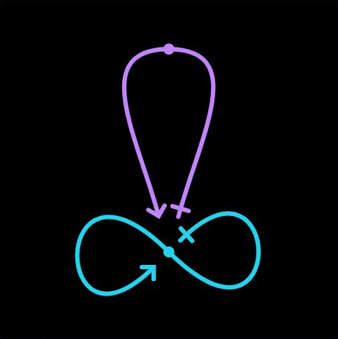
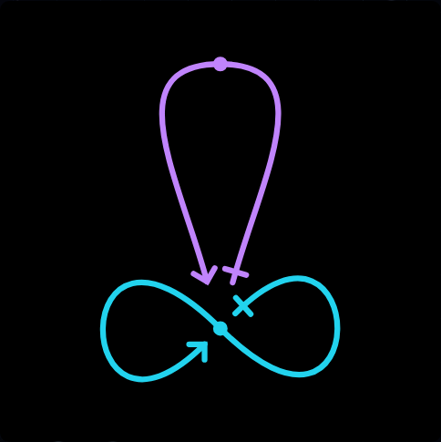
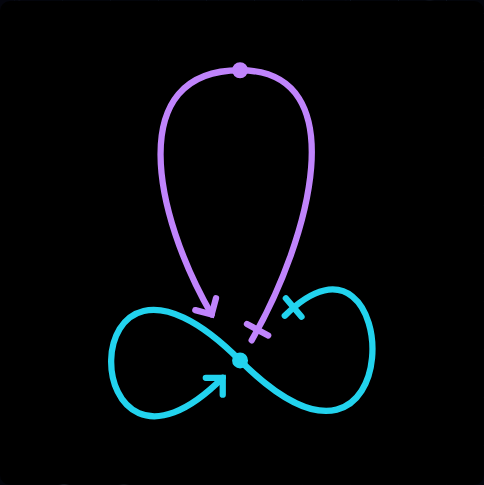
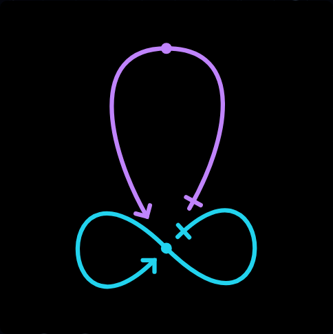
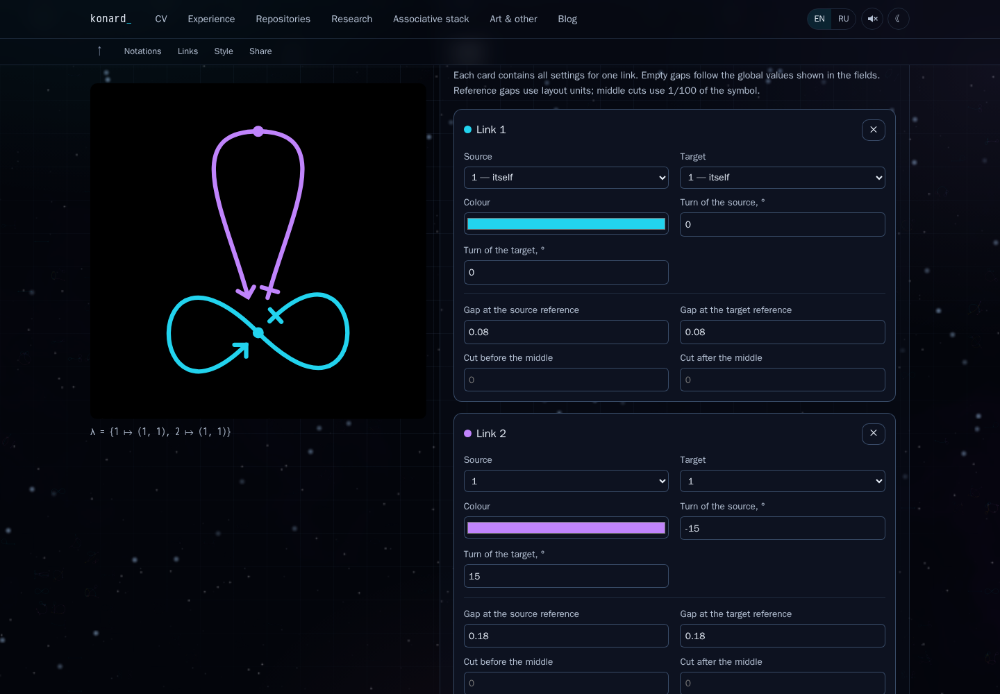
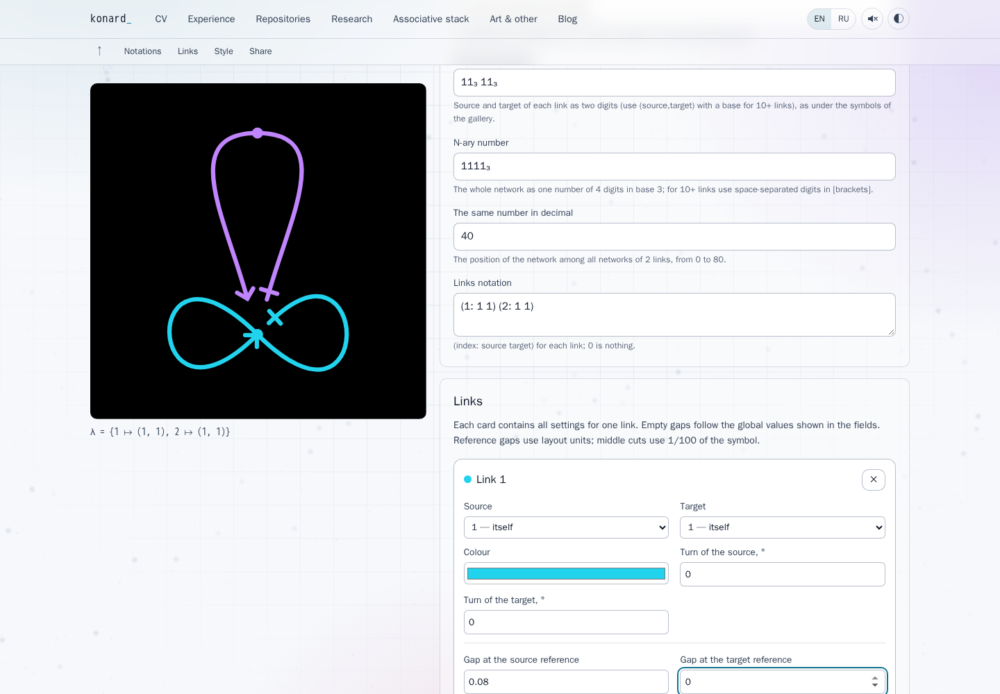

# Equal closed-link gaps, stable numeric editing and URL compatibility

[Issue 27](https://github.com/konard/konard.github.io/issues/27) · [PR 28](https://github.com/konard/konard.github.io/pull/28)

The target arrow of the self-closed link had a discontinuous paint correction. At equal reference gaps of **0.08**, the source and target painted distances from the link's own middle were **4.15 and 5.45** SVG units. The corrected distances are **4.15 and 4.15**. This is a geometry error in the application, reproduced independently of the browser renderer. Automatic spacing also treated closed halves as movable. Numeric editing had separate inherited-value and intermediate-text problems.

## Report, scope and timeline

The complete [issue](data/issue-27.json), [comments](data/issue-comments.json), [initial PR](data/pr-28-initial.json), [inline comments](data/pr-inline-comments.json), [reviews](data/pr-reviews.json), and [sub-issue response](data/sub-issues.json) are retained. At investigation start there were no comments, reviews or required sub-issues. The original downloaded images are [reference 1](data/reference-1.png) and [reference 2](data/reference-2.png); their file signatures were verified as PNG before viewing.

| UTC                  | Event and evidence                                                                                                                                                                                                                                                                                                                      |
| -------------------- | --------------------------------------------------------------------------------------------------------------------------------------------------------------------------------------------------------------------------------------------------------------------------------------------------------------------------------------- |
| 2026-10-24 → 25      | [PR 18](data/pr-18.json) merges on October 24 (18:01:55 UTC); [PR 20](data/pr-20.json) merges October 25 (09:19:58 UTC). They introduce the editor, URL schema and later independent endpoints/history protections.                                                                                                                     |
| 2026-10-25           | [PR 22](data/pr-22.json) separates editor geometry from gallery/rain geometry and handles older explicit custom-color URLs.                                                                                                                                                                                                             |
| 2026-10-26           | [PR 24](data/pr-24.json) adds per-link gaps and optional middle cuts; omitted entries inherit the global setting.                                                                                                                                                                                                                       |
| 2026-10-26 21:37:44  | [Issue 25](data/issue-25.json) / [PR 26](data/pr-26.json) balance sharp painted arrow tips, align equal lens gaps, improve the solver and group per-link controls. The full prior [session log](data/issue-25-session.log) is downloaded, and its original [CI/browser evidence](../issue-25/VALIDATION.md) remains in this repository. |
| 2026-10-27 19:45:26  | Issue 27 opens with two screenshots and a manual `1111` URL. The supplied closed-link gaps are `0.08 0.07`; the equal upper lens gaps are `0.18 0.18`. Updated at 19:49:39.                                                                                                                                                             |
| 19:52                | Prepared PR branch starts at `406a2b4`; default branch includes merged PR 26. [Initial CI metadata](data/ci-initial.json).                                                                                                                                                                                                              |
| 19:54–19:59          | Before renders, numeric probes and failing geometry/solver/serialization/keyboard tests isolate independent application causes.                                                                                                                                                                                                         |
| 19:59–20:07          | Geometry and keyboard fixes pass the full 727-test suite and Chromium/Firefox browser checks. Six historical URL schemas are extracted from Git and checked. An additional off-grid stepping test reproduces `0.075 → 0.085`, then is corrected to native valid-step behavior.                                                          |
| Following validation | Expanded regression tests, production builds, all browser engines, compatibility suites and PR CI are recorded in [VALIDATION.md](VALIDATION.md).                                                                                                                                                                                       |
| 20:31                | A final audit extends the native spinner test to an empty inherited field. Both a unit regression and an actual Playwright MCP click reproduce Down returning `0` instead of `0.07`. The follow-up supplies inheritance as an unsaved draft before native pointer stepping, and repeats validation.                                     |

Dates of older PRs above describe their development sequence; exact merged timestamps are preserved in their JSON snapshots. [Git's complete style-schema patch history](data/url-style-history.patch) and the [issue event timeline](data/issue-timeline.json) retain the underlying chronology.

## Requirement inventory and evidence

| Requirement in the report                                                          | Implementation and verification                                                                                                                                                                                                                                                                                                                                                                                                                        |
| ---------------------------------------------------------------------------------- | ------------------------------------------------------------------------------------------------------------------------------------------------------------------------------------------------------------------------------------------------------------------------------------------------------------------------------------------------------------------------------------------------------------------------------------------------------ |
| Exactly equal default painted gaps on the fully self-closed link                   | Tangent-based cap correction for self references in `glyph.js`; analytic equality at four rotations and four arrow angles in `src/links/issue-27.test.js`; independent native raster measurements in all browser engines.                                                                                                                                                                                                                              |
| Remove the sudden `0.07 → 0.08` jump                                               | No endpoint-average axis on self references. Six continuity samples around equality assert constant source extent and linear target movement; before/after measurements are retained.                                                                                                                                                                                                                                                                  |
| Preserve equal `0.18 0.18` upper lens boundaries from issue 25                     | Use the shared outward axis only for two references to the same other link. All issue-25 analytic and native raster tests remain enabled.                                                                                                                                                                                                                                                                                                              |
| Test the exact perfect arrangement                                                 | Fixed fixture: `1111`, rotation `-90`, turns `0 0,-15 15`, gaps `0.08 0.08,0.18 0.18`. Its overlap score is only the existing turn penalty, `30 × 0.002 = 0.06`. Final screenshot below. The original `0.08 0.07` URL also retains those explicit unequal settings.                                                                                                                                                                                    |
| Favor fully/partially self-closed halves during automatic spacing                  | Skip closed halves in turn search, reference-gap search, middle-cut search and final cut-budget trimming. Full and partial loop regressions check original turns, gaps and middle cuts. Open references still optimize and the exact applied/share/reloaded SVG matches the preview.                                                                                                                                                                   |
| Avoid explicit zero turn rows in URLs                                              | Serialize an all-default row as empty between commas; e.g. `turns=,-15 15`. Internal normalized styles and old parsers remain compatible. Trailing default rows were already omitted.                                                                                                                                                                                                                                                                  |
| Preserve every previous URL configuration                                          | Extract every historical style-schema revision, retain all keys/ranges/enums, test their values through canonical round trips, plus legacy `gap`, explicit colors, arbitrary rows and explicit zero gaps. Existing notation, large-index and public issue-19/21 URL browser suites remain enabled.                                                                                                                                                     |
| Upgrade URLs on arrival through browser history                                    | Existing debounced `replaceState` writes the shorter serialization after 400 ms. DOM/browser tests check the write, language, hash, unchanged SVG and reload. Existing history/back/forward/quota regressions stay enabled.                                                                                                                                                                                                                            |
| Up/down should use `0.01`, preserve `0.07`, avoid reset                            | Shared `NumberInput` / `numericKey`, inherited fallback, native `step` attributes, decimal rounding and off-grid snapping. Tests cover `0.07 ↔ 0.08`, blank inheritance, boundaries and native `stepUp/stepDown` input events. [Playwright MCP](data/mcp-browser.json) additionally verifies actual mouse clicks on the native Up/Down spinner.                                                                                                        |
| Audit all sliders, numeric fields and intuitive keys/shortcuts across the codebase | Only two range renderers and three numeric usages exist. Both range renderers use the shared handler; all numeric usages use `NumberInput`. All slider schemas (including conditional controls) are checked; browser tests exercise all eight navigation keys on 37 default network and 55 settings sliders per engine. Numeric fields keep text navigation and platform shortcuts, negative typing, select-all, deletion and Tab. More details below. |
| Download all related data/logs, deep analysis, online facts and alternatives       | This directory contains reports, screenshots, schema snapshots, prior session log, numerical data, failed/passing logs, research and source experiments. Existing previous-issue archives are linked rather than duplicated.                                                                                                                                                                                                                           |
| Diagnostics if causes are uncertain; report external defects if present            | The causes are reproduced in application code. Existing opt-in history and solver tracing remains available. No new dependency/browser defect was identified, so an unrelated upstream report would be misleading.                                                                                                                                                                                                                                     |
| Complete one PR without removed features or deferred work                          | Changes stay on the prepared PR branch; existing geometry, marker offsets/rotations, custom colors, placements, sharing, saved styles, downloads and gallery/rain hash tests remain. The PR retains `Fixes #27` and stays unmerged for review.                                                                                                                                                                                                         |

## Root cause 1: a lens correction applied to self references

`paintedCurve` compensates for the sharp miter extending beyond an arrow's path vertex. For an arrow half-angle θ and stroke width w, that extension is `w / (2 sin θ)`. The correction also accounts for the painted extent of a round/square shaft cap.

Issue 25 correctly required a common outward axis for the two ends of a lens referencing **another** link. The old implementation selected that axis by averaging both endpoint positions relative to the curve's middle. On a self-closed link the endpoints lie on opposite sides of their own middle. At equal gaps the average cancels and uses a fallback; immediately on either side it points in opposite directions. The cap term therefore changes sign. At width 1.3 this introduces a full-stroke-width jump of 1.3 SVG units.

The raw cubic endpoint movement is continuous. The incorrect paint correction is applied after construction, explaining why changing one hundredth looked disproportionately large. The issue is not a rounding or Safari paint problem.

The fix carries an explicit `sharedReference` fact from link construction through fitted curves and solver paint sampling. Only a lens with both ends referencing the same **other** link shares an outward axis. Each remaining endpoint uses its own outward tangent. Moving the endpoint and its adjacent Bézier control point together preserves its tangent, middle and curvature construction. Explicit marker displacement/rotation and the opt-out `balanceArrows=false` retain their previous behavior.

### Measurements

Distances are from the closed link's own middle to the shaft's painted cap or arrow's miter tip, in the normalized `100 × 100` SVG. They do not subtract the central dot radius. Source gap stays at 0.08; default start marker is the cross at offset 2.5.

| Target gap | Source before | Target before | Source after | Target after |
| ---------- | ------------- | ------------- | ------------ | ------------ |
| 0.06       | 4.15          | 2.95          | 4.15         | 2.95         |
| 0.07       | 4.15          | 3.55          | 4.15         | 3.55         |
| 0.08       | 4.15          | **5.45**      | 4.15         | **4.15**     |
| 0.09       | 4.15          | 6.05          | 4.15         | 4.75         |

Expected change for each 0.01 is 0.60 SVG units in this fixture, not 1.90. The [raw before](data/measure-before.json) and [raw after](data/measure-after.json) contain exact coordinates and solver outputs. Values `0.079999` and `0.080001` in that probe round to `0.080` under the existing three-decimal gap normalization; the regression additionally uses representable `0.079`, `0.080`, `0.081` samples.

Analytic equality is checked to nine decimal places for rotations −90°, 0°, 45°, 90° and arrow angles 5°, 15°, 45°, 85°. A separate browser canvas check rasterizes the exported SVG to 2000 pixels and samples nearest cyan pixels on opposite sides, excluding the middle dot/crossing shaft. The allowed difference is 0.12 SVG units for antialiasing, and each engine's actual values are in its JSON. Existing issue-25 browser tests independently guard the lens boundary.

## Root cause 2: the solver had no closed-half constraint

The turn optimizer and four gap dimensions previously considered every half of every link. Changing a closed loop could reduce the collision score, even though the loop was the reference shape the user wanted to preserve. In the baseline `1111` solve, the closed link's source gap grew to **0.218**, while its target remained inherited at 0.08. A zero collision score did not imply the intended arrangement.

The fix treats a reference to the link itself as a preserved half in every optimization phase. Reference 0 and references to other links keep their existing eligibility rules. The corresponding middle cut is also preserved, including the final cut-budget pass. This works for complete and partial self references, and for existing explicit angles, cuts and gap overrides.

After the fix, default `1111` preserves both closed halves and changes the open lens to source/target gaps **0.23 / 0.18**, with score 0. Its before score is approximately 8.24736. The manual symmetric `0.18 / 0.18`, `−15° / +15°` arrangement is separately verified. The heuristic still searches for overlap reduction rather than a particular aesthetic optimum, so it need not select exactly the manually chosen turns. It no longer damages the closed link to achieve its score. The opt-in experimental description now explains this preservation behavior in both languages.

## Root cause 3: inherited values and editable drafts

The old per-link gap input was blank when inheriting 0.08, with `0.08` only as a placeholder. Native stepping uses the actual input value, not its placeholder: blank can step from zero and Down can clamp to zero. Its `step="0.01"` was already present, so the evidence does **not** establish a missing step attribute or upstream browser defect. Explicit `0.07` must nevertheless remain stable under both keyboard and native stepping, and is tested.

The old turn input immediately converted an empty string to numeric zero. Clearing the field to type a negative number therefore restored `0` during editing. A controlled numeric component now keeps intermediate empty/minus/decimal drafts while valid values update state immediately. Blur restores an empty required turn/reference to its valid backing value; an empty gap remains an inherited override. Keyboard stepping from a blank gap starts at the inherited global value.

Native mouse stepping needs the same inheritance. The first implementation supplied it only to keyboard navigation; the expanded regression and actual MCP click still produced `0` from native Down on an empty inherited field. `pointerdown` now primes an empty inherited input with a draft of its effective value before the browser's spinner action. Focusing without editing does not save an explicit override, and blur restores the empty inherited display. An actual spinner change commits the new value normally. [Failing unit log](logs/native-inheritance-reproduction.log), [native click trace](logs/native-spinner-before-mcp.log), [passing regression](logs/native-inheritance-fixed.log).

`numericKey` supplies consistent small steps, ten-step PageUp/PageDown and Shift+Arrow behavior. Off-grid numbers snap to the next valid step from the minimum, matching native `stepUp/stepDown`; decimal output is rounded before updating React state and URLs. Clamps preserve field bounds.

The audit found all numeric render sites: four gaps per card, two turn fields per card and the integer reference field used above 50 links. Textual numeric notations intentionally remain text inputs for arbitrary-precision indices and complete network syntax. Both application range renderers (network style and global settings) share the same handler. Conditional sliders use those same renderers; their complete metadata is included in the helper tests.

Range keys: Up/Right increment, Down/Left decrement, Home/End go to bounds, PageUp/PageDown move ten steps, Shift+Arrow moves ten steps. Numeric text fields use Up/Down and page stepping; Left/Right/Home/End remain native caret navigation. Ctrl/Cmd/Alt combinations, selection, copy/paste/cut, undo/redo, Tab, delete, Enter and Escape are not intercepted by this handler. Browser tests explicitly exercise selection, deletion, negative typing, Home and Tab; platform shortcut passthrough is unit tested. Native editing remains browser/platform dependent, rather than reimplemented.

## Historical URL audit and canonical form

`experiments/issue-27-url-history.mjs` enumerates every pre-fix commit changing `style.js` or `style-geometry.js`, evaluates its schema in an ignored local archive and records six distinct revisions: `7be35e9`, `6d102ee`, `305a85e`, `30e1517`, `d2bd08a`, `a9001c9`. Field counts grow from 53 to 84. All keys, valid numeric ranges and enum values remain accepted. The [schema fixture](data/url-schema-history.json) makes the audit test independent of Git/network access in CI.

`src/links/url-history-27.test.js` tests historical minima, maxima, defaults, enum values and toggles through normalization and repeated serialization. Legacy `gap` still populates both reference gaps unless explicitly overridden. Older explicit `colors` still imply `palette=custom`. Empty list rows preserve link indices; explicit zero gap is different from inherited `~` and remains explicit.

Only list **serialization** changes. The original URL remains accepted:

```
/network/?code=1111&rotation=-90&turns=0+0%2C-15+15&gaps=0.08+0.07+%7E+%7E%2C0.18+0.18+%7E+%7E
```

Its shorter equivalent has decoded values `turns=,-15 15` and `gaps=0.08 0.07,0.18 0.18`. Commas retain empty positions; trailing inherited gap columns and trailing default rows add no information. The serializer preserves nontrailing `~`, explicit zeros and nondefault values. Parsers continue producing the same full normalized internal style, including saved styles.

The browser replaces the current history entry after the existing 400 ms quiet period, preserving language and hash. It does not append an extra navigation step on arrival. Existing Back/Forward handling, quota protection and immediate share/preview updates remain covered by their original tests. Old URLs with omitted settings use the application's defaults, as before; the historical format never encoded a release-specific snapshot of omitted defaults. This change preserves explicit configurations and applies the requested geometry correction to the editor. Gallery, theory and rain retain their historical geometry/hash fixtures.

## Research, alternatives and plan decisions

Primary sources were checked online on 2026-10-27; concise findings and URLs are retained in [research.json](data/research.json).

- [SVG 2 painting](https://www.w3.org/TR/SVG/painting.html#StrokeMiterlimitProperty) explains sharp join extension and cap geometry. That supports measuring the painted boundary, rather than comparing arrow path vertices alone.
- [HTML number input and stepping](https://html.spec.whatwg.org/multipage/input.html#dom-input-stepup) defines the number step default, step base and mismatch behavior. The application already supplies explicit fractional steps; inherited placeholders still need application-level handling.
- [WAI slider pattern](https://www.w3.org/WAI/ARIA/apg/patterns/slider/) documents arrows, bounds and optional page steps. [Spinbutton guidance](https://www.w3.org/WAI/ARIA/apg/patterns/spinbutton/) also emphasizes normal text editing. Native editable number fields retain caret Home/End behavior; sliders get bound shortcuts.
- [Radix Slider](https://www.radix-ui.com/primitives/docs/components/slider) supplies keyboard navigation, step and bounds with custom rendered parts. Replacing every native slider would add a dependency and alter styling/touch behavior for a fix that fits one shared handler. It would not resolve self-reference geometry or inherited per-link overrides.
- [React Aria NumberField](https://react-spectrum.adobe.com/react-aria/NumberField.html) provides a more complete numeric component, including formatting and increment/decrement controls. It is a reasonable alternative if localized numeric formatting becomes necessary. The current application keeps its established native decimal fields and adds a small shared draft/inheritance wrapper.

Other evaluated approaches: changing the default target gap to 0.07 would hide the discontinuity without fixing it; changing arrow joins to round would remove requested sharp tips; disabling arrow balancing globally would regress issue 25; freezing all links would prevent the experimental feature from solving open references; increasing solver passes cannot express the missing closed-half priority. A schema version pinning all past implicit defaults would be a separate behavior change and is unnecessary to accept every published explicit parameter.

The implementation plan therefore separated the causes: reproduce first, stabilize endpoint paint, constrain closed-half search, compact only URL serialization, unify numeric editing/keyboard behavior, then verify original and adjacent cases. [PLAN.md](PLAN.md) tracks those steps.

## Diagnostics and reproducibility

Existing opt-in diagnostics remain sufficient now that each cause is reproduced:

```js
localStorage.setItem('network.debug', 'true'); // interaction/history events
// In a source experiment:
solveCollisions(links, shape, { adjustGaps: true, debug: true });
```

Both are off by default. The measurement experiment prints complete coordinates and solver decisions; the browser experiment logs each slider ID so a failure identifies its control. No unresolved cause requires new always-on logging.

Run from the repository root after `npm ci`:

```sh
npm run check
npm run test:ci -- --maxWorkers=1
npm run build
npx playwright install chromium firefox webkit
node experiments/issue-27-measure.mjs
node experiments/issue-27-url-history.mjs
npm run test:network:issue27
ENGINE=firefox npm run test:network:issue27
ENGINE=webkit npm run test:network:issue27
```

Run memory-heavy commands sequentially in this 2.92 GiB container. Browser fixtures and raster sizes are finite; browser action limits are 15 seconds and CI jobs have existing finite limits. Each browser closes in `finally`. Set `CAPTURE_DIR` and `RESULT_DIR` to preserve a new run outside committed evidence. The baseline script captures the **current** production build; to reproduce before evidence, run it against parent `406a2b4` in a separate checkout/build. Do not overwrite the archived before images with a fixed build.

Initial failing tests: [geometry/solver/serialization](logs/reproduce-tests.log), [keyboard](logs/reproduce-keyboard-tests.log), [off-grid stepping](logs/off-grid-reproduction.log). The latter also records a test-fixture path-loading error corrected before the final run. The first schema archive attempt exceeded Node's default synchronous subprocess output buffer; the retained experiment uses a bounded 16 MiB archive buffer. This was tooling overhead, not an application defect.

No tests need GitHub access. The repeatable browser suites use the Playwright API; a final interactive verification also uses Playwright MCP after its tools became discoverable during the session. The browser matrix runs the new suite after the existing editor and issue-19/21/23/25 suites, retaining JSON and screenshots as CI artifacts. [VALIDATION.md](VALIDATION.md) records final results and limits.

## Visual evidence

Equal closed gaps before and after, with the upper lens kept at `0.18 / 0.18` and turns `−15° / +15°`:

| Before                                                         | After                                                              |
| -------------------------------------------------------------- | ------------------------------------------------------------------ |
|  |  |

Automatic spacing before and after (the closed link is now preserved):

| Before                                                       | After                                                                  |
| ------------------------------------------------------------ | ---------------------------------------------------------------------- |
|  |  |

Final editor with individual gaps:



Native Down from an empty field inheriting `0.08`, using actual mouse clicks:

| Before: resets to 0                                                        | After: steps to 0.07                                                              |
| -------------------------------------------------------------------------- | --------------------------------------------------------------------------------- |
|  |  |
