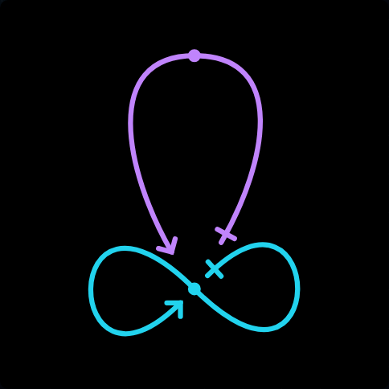
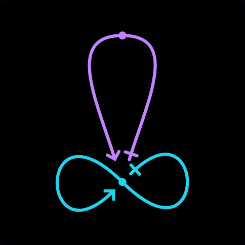
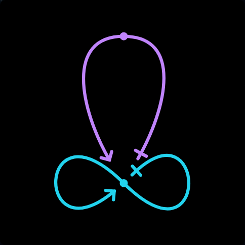
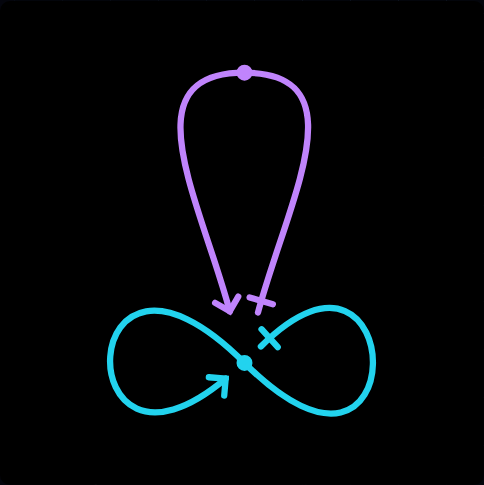
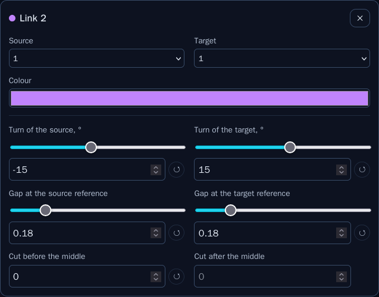
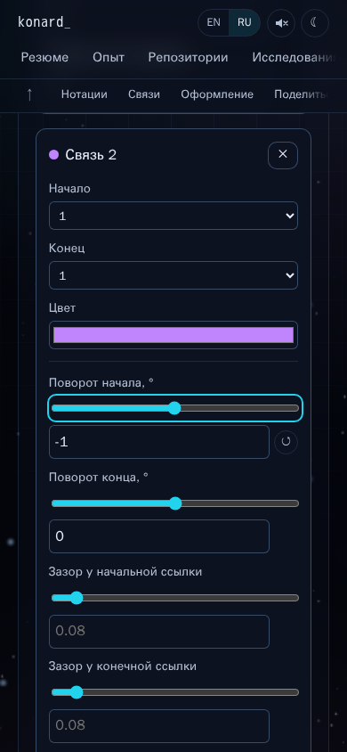

# Issue 29: paired controls and intentional automatic spacing

[Issue 29](https://github.com/konard/konard.github.io/issues/29) follows [issue 27](../issue-27/README.md). The earlier change preserved self-closed halves and corrected painted endpoint gaps. It still optimized open endpoints independently, could erase valid manual turns, and exposed per-link turns as numeric text fields rather than the requested sliders. This change addresses those causes in [PR 30](https://github.com/konard/konard.github.io/pull/30).

The complete acceptance inventory is in [REQUIREMENTS.md](REQUIREMENTS.md), including the inherited issue chain. [VALIDATION.md](VALIDATION.md) links the tests, raw results and retained limitations. All supplied screenshots were downloaded, checked as PNG files and inspected before implementation; originals are in [reports](reports/).

## Timeline and collected evidence

Times below are UTC. GitHub reports, comments and reviews are archived without truncating their bodies.

| Event                                                                                                          | Evidence and consequence                                                                                                                                                                                                        |
| -------------------------------------------------------------------------------------------------------------- | ------------------------------------------------------------------------------------------------------------------------------------------------------------------------------------------------------------------------------- |
| October 17–24: PRs 2–18 establish the site, deployment, data, CVs, settings and editor                         | [Merged PR metadata](reports/merged-prs.json); full issue bodies and all three PR comment types are in `reports/issue-*-issue.json` and `reports/pr-*-*.json`. Existing case studies retain their original research and assets. |
| October 25–26: PRs 20–26 add history safety, editor geometry, painted spacing, acute arrows and per-link cards | [Issue 19](../issue-19/README.md), [issue 21](../issue-21/README.md), [issue 23](../issue-23/README.md), [issue 25](../issue-25/README.md). Their browser suites remain enabled.                                                |
| October 27, 21:07: PR 28 merges the issue-27 fixes                                                             | [PR 28](reports/pr-28-pr.json), [complete previous session log](reports/issue-27-session.log), downloaded with authenticated `gh gist view`.                                                                                    |
| October 28, 07:16:59: issue 29 opens with four example URLs and four screenshots                               | [Full issue](reports/issue-full.json), [event timeline](reports/timeline.json), `reports/reference-1.png` through `reference-4.png`.                                                                                            |
| October 28, 08:02: PR 30 and baseline workflow start                                                           | [PR snapshot](reports/pr-30-pr.json), [baseline CI metadata](reports/ci-before.json), [baseline log](logs/ci-before-40653948554.log). Passing CI at `d0c2849` did not cover the new requirements.                               |
| Investigation: reproduce before changing application code                                                      | [Failing tests](logs/reproduction.log), [baseline measurements](data/measure-before.json), [before images](screenshots/before-auto.png). Default gaps were `0.23 / 0.18`; the valid ±15° example was changed to `0 / 0`.        |
| Implementation: paired controls, preservation guard, coupled search                                            | Atomic UI commit `a10e666`, new solver and browser regressions. The plan is retained in [PLAN.md](PLAN.md).                                                                                                                     |
| Verification: unit suite, existing browser suites, new cross-browser checks, build and CVs                     | [Validation record](VALIDATION.md), raw logs and JSON under this directory; current-head workflow status is linked in PR 30.                                                                                                    |

Issues 29 and 27 have no registered GitHub sub-issues, and their archived issue comments are empty. The prose dependency chain was followed through issues 25, 23, 21, 19, 17, 15, 13, 11, 9, 7, 5, 3 and 1. Merged PRs 2–28 and PR 30 were read, including conversation comments, inline comments and reviews separately. The inherited recovery requests on PRs 8 and 18 were already completed by their later sessions; their comments and evidence remain available. Earlier large data/session archives are retained in the original case studies rather than copied again. No new human feedback was present on PR 30 during implementation.

## Root cause: numeric fields could not provide slider navigation

`NetworkEditor` rendered turn fields beside references and color, while `NetworkGaps` rendered paired gaps below a separator. Turns used native number inputs with a five-degree step. The shared keyboard handler correctly left Left/Right as text caret navigation for numeric text fields. Consequently, adding more interception to that input would have broken the numeric editing behavior required by issue 27.

`LinkSetting` now renders a native range for each turn and reference gap, with the existing exact numeric editor alongside it. Turns occupy one source/target row below the separator, followed by reference gaps and middle cuts. The color field spans its own row so it cannot offset the turn pair. Every geometry setting has an independent reset: turns return to zero; gaps and cuts return to inheritance. Reference-gap sliders cover `0…1`, with `0.01` steps. Their numeric companions retain three-decimal precision, blank inheritance, native spinner behavior and editable negative drafts where valid.

The native ranges reuse `numericKey`: arrows change one step, Shift+Arrow and PageUp/PageDown change ten, and Home/End select bounds. Turns cover `−180…180°` in one-degree steps. Ctrl/Cmd/Alt shortcuts and numeric text caret navigation remain native. EN/RU labels distinguish each link and its numeric companion. At narrow widths the paired controls follow the existing stacked card layout; a 390px Russian viewport has no horizontal overflow.

During implementation the old negative-number editing test caught an intermediate regression: clearing a required turn immediately saved zero. The range wrapper now leaves that empty value as a numeric editing draft. A new test initially selected both a global control and a per-link control by visible text; unique link-prefixed accessible names resolved the ambiguity. Both failures and the passing full run are retained.

## Root cause: satisfaction and angular preference were mixed

`overlapCost` includes both actual painted collisions and a small angular penalty (`0.002 × sum(abs(turns))`). The old solver could reduce the latter by straightening a hand-arranged drawing even when it already met the requested painted clearance. In the reported ±15° case it removed both intentional turns and widened a reference gap.

The solver now checks painted collision cost separately from the angular preference before searching. If the input satisfies the clearance, it returns the original turns and gap overrides exactly. This includes explicit zeros and inherited nulls. The four reported manual URLs are checked through the preview, Apply, serialization and reload; their SVG strings remain identical. This rule takes priority over cosmetic improvements, as requested.

## Root cause: independent descent cannot express paired symmetry

The previous search could resolve an overlap by widening one reference gap, then had no collision incentive to restore the pair. A zero-collision result with `0.23 / 0.18` gaps therefore passed existing tests. It did not express the requested shared circumference or uniform spacing preference.

The new bounded joint phase detects both ends referencing the same fully self-closed link. It searches mirrored turn pairs and equal reference gaps while preserving the closed halves. It reuses the existing layout, painted collision sampler and gap-score cache. Collision satisfaction takes priority. Among equally feasible candidates, it minimizes measured distance from the requested clearance and variation between three painted spaces: each reference end to the closed link, and the two ends to each other. A small angular movement preference breaks remaining ties. The whole refitted drawing is checked before acceptance, so a cached candidate cannot make its exact score worse.

The default angular resolution is now one degree in both the schema and solver API. Search bounds remain relative to the original user settings throughout joint search, gap descent and turn descent; a regression guards against accumulating multiple allowed turn ranges. Existing coarse-step settings still work. Gap search uses bounded hundredths followed by a local thousandth refinement, matching existing storage precision. The fallback solver continues to handle other graphs and partial self references.

For the default `1111` fixture, the result is **−13° / +13° with gaps 0.16 / 0.16**. The raw attachment radii are equal, the painted forward shaft cap and arrow miter land within `0.001` SVG units on the same horizontal boundary at rotation −90°, and the closed link is unchanged. The same pair search works with the reversed `2222` indexing.

| Measurement                                       | Before            | After                 |
| ------------------------------------------------- | ----------------- | --------------------- |
| Open reference turns                              | `0 / 0°`          | `−13 / +13°`          |
| Open reference gaps                               | `0.23 / 0.18`     | `0.16 / 0.16`         |
| Default total score, including angular preference | `0` after solving | `0.052` after solving |
| Default actual painted collision cost             | `0` after solving | `0` after solving     |
| Manual `0 5,−15 15` preserved                     | No                | Yes, exactly          |

The higher total after-score is intentional: the valid angled pair has a nonzero angular penalty, while actual collisions are zero. Comparing only that total across the two algorithms would miss the new requirement. The three measured after-spaces are approximately `1.026`, `3.246`, `1.306` SVG units at requested clearance `1`; painted marker shapes are asymmetric, so equal gap parameters do not imply every nearest painted distance is identical. Uniformity is an optimization preference within symmetry, bounds and collision constraints, not a claim of globally equal distances for arbitrary drawings. The formerly excessive space between the open ends is reduced to about `1.306` units. [Complete measurements](data/measure-after.json).

Automatic spacing remains **experimental, opt-in and off by default**. It is a finite heuristic, not a proof of an optimal drawing for every network. User marker offsets and rotations remain meaningful: alignment compares the painted shaft cap and arrow apex rather than moving the deliberately offset cross marker back to the endpoint.

## Research and alternatives

Primary sources were consulted online on October 28, 2026:

- The [WAI slider pattern](https://www.w3.org/WAI/ARIA/apg/patterns/slider/) defines arrow increments, Home/End bounds and optional page increments. Native range inputs plus the existing shared handler provide these behaviors without replacing numeric text editing.
- [Radix Slider](https://www.radix-ui.com/primitives/docs/components/slider) offers controlled sliders, keyboard and touch support. It is a reasonable component alternative, but adding it would duplicate the existing range controls and would not handle application-specific null inheritance or solve geometry.
- [SVG 2 stroke painting](https://www.w3.org/TR/SVG2/painting.html#StrokeShape) specifies painted caps and joins. This supports checking actual shaft/marker boundaries, including the miter extension, rather than treating the path vertex as the arrow tip.
- [D3 force simulation](https://d3js.org/d3-force) provides node-based physical simulation. The application already uses it for force placement. Our inference is that replacing this endpoint search with node forces would not directly encode stroked marker clearances or preserved self-closed halves; the existing geometry/cache is the smaller fit.

Other considered approaches: increasing independent-search passes cannot express a missing symmetry preference; removing angular penalties alone would still let unsatisfied cases choose unequal gaps; always snapping to ±15° would overwrite valid ±5°/±10° examples and ignore custom bounds; changing the inherited global gap would alter unrelated links; rounding arrow joins would undo the sharp tips requested earlier. A general global optimizer would add complexity without a demonstrated need for these bounded examples. The chosen plan separates satisfaction, coupled preference and general fallback.

All observed causes are local application behavior. No new defect in a dependency was established, so no speculative upstream issue was filed. The earlier, separate [Playwright screenshot report](https://github.com/microsoft/playwright/issues/43646) remains documented in issue 23; native macOS WebKit CI retains the compositor check.

## Diagnostics and reproduction

Existing history tracing and solver diagnostics remain off by default:

```js
localStorage.setItem('network.debug', 'true');
solveCollisions(links, shape, { adjustGaps: true, debug: true });
```

The solver trace now includes painted collision cost and whether the original configuration was already satisfied. No always-on logging is needed because the causes have executable reproductions.

```sh
npm ci
npm run check
npm run test:ci -- --maxWorkers=1
npm run build
npx playwright install chromium firefox webkit
node experiments/issue-29-measure.mjs
npm run test:network:issue29
ENGINE=firefox npm run test:network:issue29
ENGINE=webkit npm run test:network:issue29
npm run build:cv
```

Run heavy commands sequentially under the 2.92 GiB container limit. Inputs, gallery batches, raster sizes and CI jobs are bounded; browser actions have a 15-second limit and browsers/servers close in `finally`. Use `CAPTURE_DIR` and `RESULT_DIR` to keep subsequent browser runs separate from committed evidence. `bash experiments/issue-29-before.sh` recreates the before measurements and screenshots from `d0c2849` in an isolated Git archive without changing the current branch or fixed production build. The underlying `issue-29-baseline.mjs` captures whichever production build it is run against; running it directly against fixed code would overwrite the problem evidence.

The first reproduction log includes a signed-zero assertion (`0` versus `−0`) in its symmetry test. That assertion was corrected to compare the sum of the angles; the independent unequal-gap measurement establishes the baseline symmetry defect. Missing ranges, default resolution and manual-layout mutation have independent failing assertions in the same log. Tooling/fixture failures are not represented as application defects.

## Visual evidence

Default automatic spacing:

| Before                                                           | After                                                                     |
| ---------------------------------------------------------------- | ------------------------------------------------------------------------- |
|  |  |

Reported valid manual ±15° arrangement with automatic spacing enabled:

| Before                                                | After                                                            |
| ----------------------------------------------------- | ---------------------------------------------------------------- |
|  |  |

Paired turn/reference sliders and independent resets:




