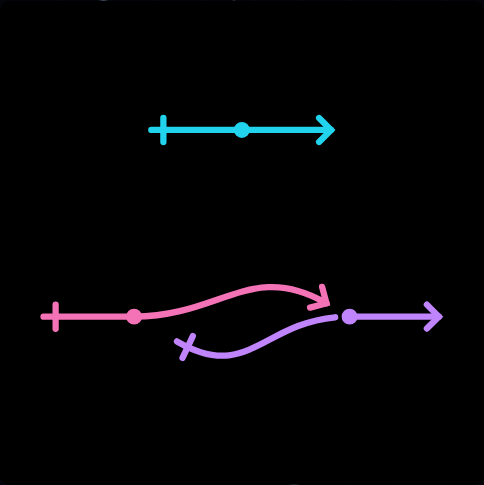
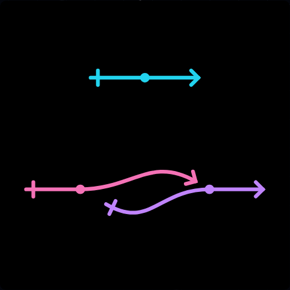

# Issue 35: preserve continuous link middles

[Issue](https://github.com/konard/konard.github.io/issues/35) ·
[Pull request](https://github.com/konard/konard.github.io/pull/36)

## Requirements and investigation

The complete issue asks to fix the unintended middle break at
`/network/?code=003002&solve=true` and add regression tests. There were no issue
comments, required sub-issues, PR conversation comments, inline comments or
reviews at the initial audit. The original [reported image](screenshots/reported.png)
was downloaded with authenticated GitHub access, validated as PNG and inspected.

The purple link had two SVG subpaths despite zero configured middle cuts.
The rendering code correctly rendered the solver's output: the cause was the
independent `solveMiddleRange=4` default in the editor and `middleRange=4` default
in the solver. Enabling automatic reference spacing implicitly allowed it to
create cuts of up to four image units. The general cut-adjustment stage used
that allowance before searching turns, so this network acquired a break before
link 2's middle.

Both defaults are now zero. Existing global/per-link cuts remain unchanged by
default. A positive explicit `solveMiddleRange` still enables automatic cuts,
and is retained in shared URLs. The field's English/Russian hint explains this
choice. Reference-gap adjustment, turning, diagnostics and explicit-cut rendering
remain available.

Changing the SVG renderer to hide cuts would also hide intentional user settings.
Removing cut adjustment entirely would remove an existing feature. Making its
default zero fixes the reported implicit behavior while preserving explicit use.
Previously shared URLs that omitted this setting receive the corrected default;
URLs that explicitly specify a positive value retain that behavior.

## Reproduction and regression coverage

The tests were added and run against the original implementation before editing
the defaults. [Unit/DOM reproduction](logs/regression-before.log) records six
failures. The exact-URL DOM test fails because one link contains two `M` commands.
[Native Chromium reproduction](logs/browser-before.log) independently records
subpath counts `[1, 2, 1]`, with the [before screenshot](screenshots/chromium-before-reported.png)
captured before the assertion. This matches the report.

| Requirement | Implementation and verification |
| --- | --- |
| Zero configured middle cuts keep the line continuous under automatic spacing | Zero defaults in `style.js` and `collisions.js`; unit tests exercise both entry points and require one subpath/two cubics per link; DOM test opens the exact reported URL. |
| Add tests preventing recurrence | `src/links/issue-35.test.js`, `src/pages/network-35.test.jsx`, and `experiments/issue-35-browser.mjs`; the browser suite runs in the existing Chromium/Firefox/WebKit CI matrix. |
| Preserve existing intentional behavior | Tests retain global cuts, per-link cuts, explicit zero overrides, explicit automatic cuts, reference-gap improvement, exact Apply/share/reload output and real SVG downloads. |

Run the focused checks with:

```bash
npx vitest run src/links/issue-35.test.js src/pages/network-35.test.jsx
npm run build
npm run test:network:issue35
ENGINE=firefox npm run test:network:issue35
ENGINE=webkit npm run test:network:issue35
```

The native browser test samples twelve painted pixels along the purple incoming
curve, 0.5–6 SVG units before its middle. It also checks path continuity,
unchanged zero settings, exact Apply/share/reload equality and an actual SVG
download. Explicit automatic cuts and manual per-link overrides are checked
separately. Each run closes its browser and preview server in `finally`; its
JSON report is saved in `data/`. The automated native checks use the repository's
existing Node Playwright/Vite framework.

## Visual evidence

| Before | After |
| --- | --- |
|  |  |

## Validation

All **871 unit/DOM tests in 64 files pass**, including the six new tests; see
[complete results](logs/unit.log) and [focused results](logs/regression-after.log).
The new native suite passes in Chromium 156, Firefox 157 and WebKit 27.2, with
no page errors; the complete reports in `data/` include path counts, native
transform coordinates and all twelve purple raster samples.

The pixel check initially exposed different root `getCTM()` viewport scaling in
Firefox. The test now reads the exported group's native transform independently
of CSS layout, and checks that each sample lies inside the image before asserting
its paint. This change affects the test only. All three engines use the same
coordinates and assertions.

The production build, ESLint, Prettier, file limits, secret scan, Python compilation
and Ruff, shellcheck and dependency audit pass locally. The package is a private
website with no package-release workflow, so no release-version change is needed.
All [120 CV PDFs](logs/cv.log) print locally with the existing page-count,
text-layer and reading-order checks. The complete sequential local compatibility
exit statuses are saved in [the summary](logs/compat-summary.log).

A final Playwright MCP check opens the exact reported URL in Chromium 155 and
confirms all three paths have one subpath, all three cut fields are zero, and
the preview is visible. The [MCP report](data/mcp-after.json) and
[settled screenshot](screenshots/mcp-after-reported.png) preserve this independent
check with reduced motion after inspecting the visible SVG. The browser and
preview server were closed after verification.

The [complete implementation CI run](https://github.com/konard/konard.github.io/actions/runs/40928515827)
passes for commit `4f1b165e08c49ed817ae6273c301d088c1c426a1`, created
2026-10-29 at 18:11:54 UTC and completed at 18:24:34 UTC. All three browser
jobs include the new regression and all existing suites, including native
compositor checks. Unit/DOM tests, production build, CV PDFs, workflow/tooling
checks, documentation, dependency/security scans and the final pipeline gate
pass. Deployment is deliberately skipped for pull requests. The saved
[CI summary](data/implementation-ci.json) records job outcomes and the new
regression step in each browser job. Final-head status is recorded on PR 36.

All six existing compatibility suites (`browser`, `issue19`, `issue21`,
`issue25`, `issue27`, `issue29`) pass locally in Chromium and Firefox. In local
Linux WebKit, `issue19`, `issue25` and `issue29` pass. Two suites time out
waiting for a stable gallery hover: `network-e2e.mjs:53` (10 seconds) and
`issue-21-browser.mjs:92` (15 seconds). The exact failures are preserved in
[the general suite log](logs/compat-webkit-browser.log) and
[the issue 21 log](logs/compat-webkit-issue21.log). Both suites pass on macOS CI.
The [issue 27 log](logs/compat-webkit-issue27.log) also records a 15-second
`locator.press` timeout at line 208 on the unrelated `setting-grid-size`
background slider; its geometry, URL and numeric-editing checks pass before
the keyboard audit stalls. This suite also passes on macOS CI.
The unchanged gallery renders through `Glyph` and does not call the modified
solver or editor style code. These Linux-only symptoms are consistent with the
documented [WebKit r2370 backdrop-filter regression](https://github.com/microsoft/playwright/issues/43426),
the revision installed by Playwright 1.64.1 here. They are not counted as local
passes; no assertion, timeout or product behavior was changed to conceal them.
The issue 35 regression passes in local WebKit and macOS WebKit CI.
