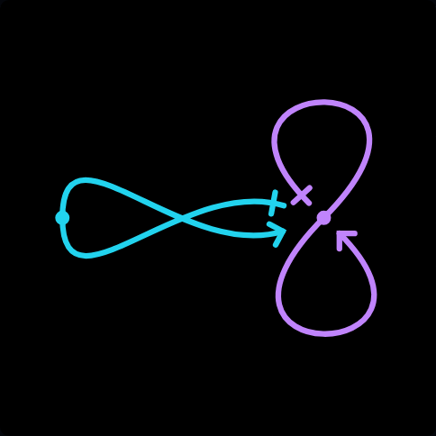
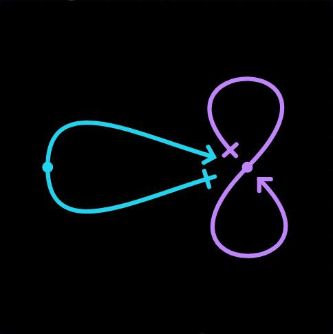
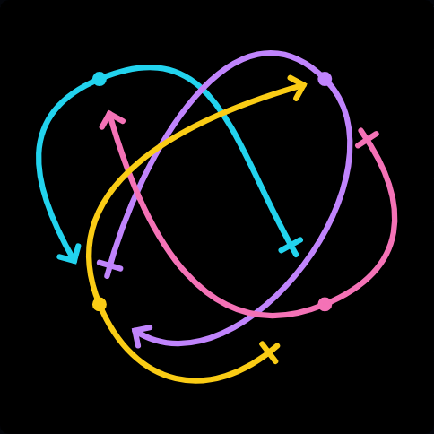
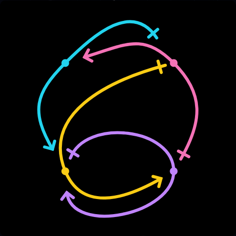
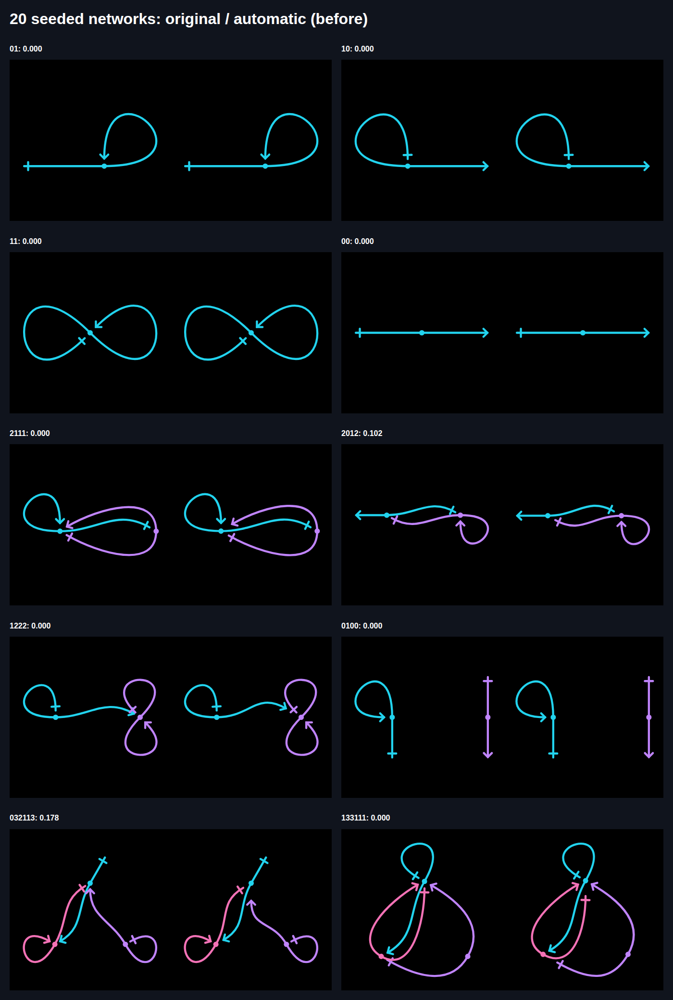
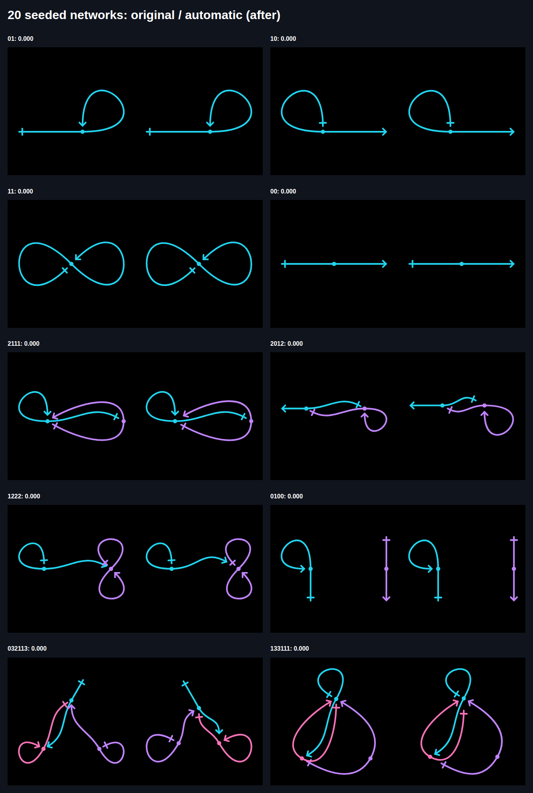
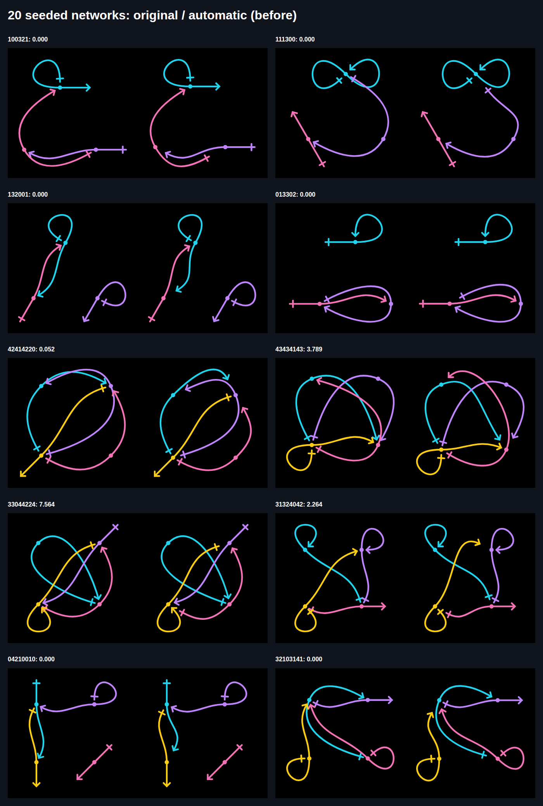
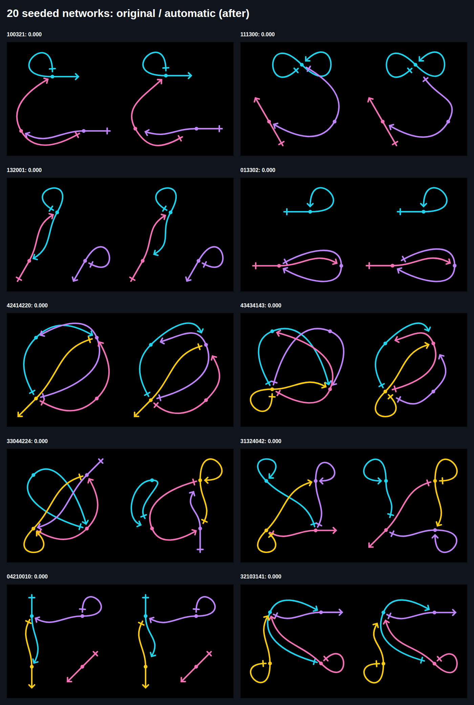

# Issue 37: reliable automatic spacing and slider focus

[Issue](https://github.com/konard/konard.github.io/issues/37) ·
[Pull request](https://github.com/konard/konard.github.io/pull/38) ·
[Requirements](REQUIREMENTS.md) · [Solution options and plans](SOLUTION-PLAN.md) · [Work plan](PLAN.md)

The report combines two geometry problems, a repeat keyboard failure, and a
request to inspect a reproducible sample rather than tune only the reported
network. Source data, experiments and failed checks are retained alongside final
evidence. The solution preserves the doublet drawing grammar and existing
manual controls.

## Reproduction and root causes

1. Open `/network/?code=2222&solve=true`. The old paired-reference search selected
   turns `[47,-47]` with equal `.16` reference gaps. Its collision total excluded
   the movement penalty and was zero, despite one proper crossing between its
   own two shafts. Pair scoring compared different links and markers against
   shafts; it never compared a link's two shafts against each other. The old
   symmetric search could therefore prefer a folded lens. An independent dense
   intersection check fails on this exact result before the implementation fix.
2. Open `/network/?code=34442132&solve=true`. Changing endpoint angles cannot
   reliably uncross the fixed cyclic order of four link middles. An initial
   bounded permutation experiment found a collision-free `1 3 2 4` order. The
   search now includes circular order when the user chooses Automatic placement.
3. Inspect the unchanged seeded sample. Networks `2012`, `032113`, `42414220`,
   `43434143`, `33044224` and `31324042` exposed further residual spacing defects. A wide
   drawing fits at a smaller scale, but marker sizes remain in image units;
   closed-loop endpoint clearance can then fail even though those closed halves
   must retain their controls. Compacting the automatic placement resolves that
   fitting conflict. It does not erase shafts or move a closed half's turns or
   gaps. Explicit arrangements keep their settings.
4. Click a slider, then press Left/Right on the page keyboard. Existing key
   handlers worked when the input already had focus, and older browser tests
   used `locator.press()`, which focuses the target itself. They could not catch
   pointer-focus failures. The new tests dispatch pointer input without focus,
   and real-browser tests use mouse click followed by `page.keyboard.press()`.
   Linux WebKit's ordinary click already focused in the baseline probe; that is
   not evidence about macOS Safari. A focus-policy shim suppresses only the
   native mouse focus default to reproduce the missing app guarantee.
5. Wider searching can occupy the main thread. The production editor now runs
   it in a cancellable module worker. Changing geometry terminates obsolete
   work, and keyed results cannot replace a newer drawing. Pending status and
   disabled image exports prevent downloading an unfinished preview. Worker
   failure is surfaced, and synchronous non-browser renderers retain a fallback.
6. Self review caught a manual-Apply race: changing the palette during a worker
   search could be overwritten by its original style snapshot. A failing test
   reproduces the palette reverting from `pastel` to `site`; Apply now merges
   geometry into the current style. Unit and native-browser checks cover edits
   made while the worker is pending (`logs/apply-style-before.log`).

The baseline failing tests are in `logs/regression-before.log`,
`logs/random-regressions-before.log` and `logs/focus-regression-before.log`.
Additional traces record unsuccessful defaults, force-placement and exact-cache
experiments; these are evidence of investigation, not the final algorithm.

## Algorithm and default decisions

- Score painted halves against each other outside their intentional own-middle
  attachment region, along with the existing painted marker and inter-link costs.
- Keep symmetric paired-reference search, but explore coarse angles then refine
  the winning neighborhood on the user's original step grid. Individual descent
  also uses coarse exploration and local refinement for painted networks with
  at least three links.
- Keep final acceptance based on the full refitted geometry. Cached candidate
  scoring remains an acceleration, never the reported final cost.
- Give angular movement and extra gap size tiny tie-breaking weights so minor
  movement preferences do not outweigh requested clearance.
- If a small Automatic layout still has collisions, enumerate circular orders
  with the first link fixed, and spacing factors `1, .85, .7, .55`. There are at
  most 24 candidates for four links. Probe each cheaply before refining the
  promising candidates. Stop once the measured clearance is satisfied.
- Persist chosen order and spacing through Apply, style normalization, shared
  URLs, preview and image exports. An explicit circular order locks layout
  search; adding/removing a link clears obsolete order IDs.
- Automatic spacing remains off by default. The default turn search expands
  from 60° to 180°. Gap range remains `.20`, editable/solver step remains 1°,
  and automatic middle cuts remain zero. The proposed `.05` gap range leaves
  insufficient room for the verified symmetric `1111`/`2222` solutions, so copying
  all three suggested settings globally would regress them. Internal 13° coarse
  exploration captures the performance benefit while preserving one-degree
  refinement. Explicit query settings retain their meaning.

Final measured collision cost, excluding angular tie-breaking:

| Drawing | Default `.20 / 180 / 1` | Narrow `.05` gap range |
| --- | ---: | ---: |
| `2222` | 0 | 0.368723 |
| `1111` | 0 | 0.103524 |
| `34442132` | 0 | 0 with the suggested 13° step |

The complete controls, returned layouts, costs and timings are retained in
[`measure-after.json`](data/measure-after.json). Explicit narrow bounds remain
available; the solver reports their residual instead of silently widening them.

## Research and alternatives

Primary sources were checked on 2026-10-29; concise facts and decisions are
archived in [research.json](data/research.json).

| Source/component | What it contributes | Decision |
| --- | --- | --- |
| [W3C slider pattern](https://www.w3.org/WAI/ARIA/apg/patterns/slider/) | Defines arrow increments/decrements and focus/keyboard behavior | Keep native range controls and explicitly establish pointer focus |
| [WebKit report 299087](https://bugs.webkit.org/show_bug.cgi?id=299087) | Describes Safari range clicks without focus, with an explicit-focus workaround | App-level focus fix and native macOS WebKit CI; do not claim Linux reproduces Safari's platform policy |
| [ELK Layered](https://eclipse.dev/elk/reference/algorithms/org-eclipse-elk-layered.html) | Supports self loops, ports, multi edges, and crossing reduction through ordering | Use ordering as a search variable; a new layered router would require translating the existing continuous doublet geometry |
| [Graphviz overlap](https://www.graphviz.org/docs/attrs/overlap/) | Offers node-overlap removal including Prism | Node separation alone does not score painted self-crossings or marker clearance |
| [Graphviz neato](https://www.graphviz.org/docs/layouts/neato/) / existing d3-force | Spring-based node arrangements | Existing physical placement is retained; force probes produced worse results for these fixed-size markers |

No new runtime library was needed. Exact refitting of every trial was also
measured; its cost increased search time without removing fixed-order or
closed-loop fitting constraints, so exact verification stays at stage boundaries.

## Evidence and reproduction commands

Run from the repository root after `npm ci`:

```sh
npm run test:ci
npm run check
npm run build
node experiments/issue-37-measure.mjs
node experiments/issue-37-scan.mjs
node experiments/issue-37-sheet.mjs
npm run test:network:issue37
ENGINE=firefox npm run test:network:issue37
ENGINE=webkit npm run test:network:issue37
```

The random generator has seed `0x37c0de`, four examples each for one/two links
and six each for three/four links. No sample was replaced after inspecting it.
`data/random-before.json` is the old implementation; `random-after.json` is the
final implementation. Their HTML sheets show original geometry on the left and
automatic spacing on the right. Scores from different scorer versions are not
an independent comparison: the old scorer omitted self-crossings. Dense tests
and rendered inspection supply that independent evidence.

[The visual review](VISUAL-REVIEW.md) records an observation for every sampled
network and identifies all six additional spacing defects. A Playwright MCP
inspection also confirmed the four-link result and click-then-arrow focus; its
render is retained as `screenshots/mcp-after-34442132.png`.

The native browser regression checks the two reported examples plus all 20
seeded examples, zero displayed residuals, continuous paths, exact Apply/share
round trips, actual SVG download, native dragging, click-then-key focus,
platform-focus suppression, worker responsiveness/cancellation, mobile overflow
and Russian labels. Existing browser suites continue checking number-field text
editing, manual URLs, symmetric clearance, clipboard, downloads, history and
legacy gallery behavior. Chromium, Firefox and macOS WebKit run it in CI.

Local Linux WebKitGTK stopped delivering animation frames on the settings page,
blocking Playwright's pre-click stability wait. The first failure is preserved
in `data/webkit-gtk-stall.json` and `logs/webkit-gtk-stall.log`. Disabling glass
blur did not resolve it. The isolated `issue-37-webkit-settings.mjs` probe shows
the document remains visible, two requested animation frames do not arrive in
one second, but a native mouse click focuses the slider and ArrowRight changes
`.50` to `.55`. A further native-pointer experiment passed focus in all four
control contexts, but stalled on the following drag setup; its failure is in
`data/webkit-gtk-drag.json`. Another full GTK attempt was stopped before exceeding
the container memory limit. These incomplete local runs are not counted as
passing browser suites. Default styling remains in place. The full regression
uses ordinary actionability-checked clicks and runs WebKit on macOS in CI, as do
the existing browser suites.

Local verification passed the full 903-test unit suite. After adding the compact
spread-bound regression, a further focused run passed all 30 solver/worker tests.
The final concurrent-style fix passed all 21 page/worker tests, including its
new failing-then-passing regression. All 12 Python attribution tests, 120 CV PDF
checks and the activity-indicator/mobile browser suite also passed locally.
Lint, formatting, file limits, secret scanning, dependency audit, documentation
validation and the production build passed. The complete new browser suite passed
in Chromium and Firefox, and all eight existing editor suites passed in both
engines.
CI repeats the complete current unit suite and browser matrix on the PR merge
result; its current-head status is the final integration gate.

### Reported networks

Before and after, in order:






### All 20 seeded networks






## Practical limits

The 20 fixed random examples and both reported networks are acceptance evidence,
not a proof of planar drawing for every topology or arbitrary user constraints.
The search is deterministic and bounded. Larger networks retain their existing
arrangement/search path, and explicit placement, narrow bounds or custom marker
sizes can make zero overlap unattainable. The editor continues showing measured
residuals rather than describing every constrained drawing as perfect. No
required item from the report is deferred to another issue or pull request.
