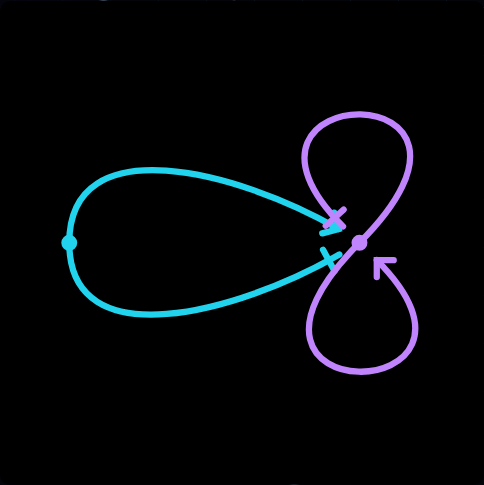
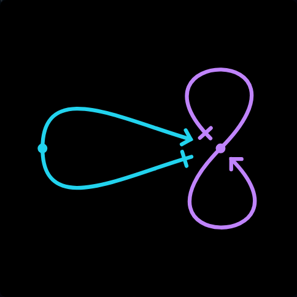
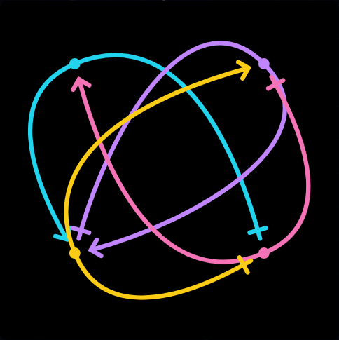
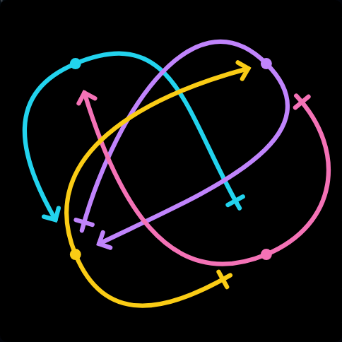
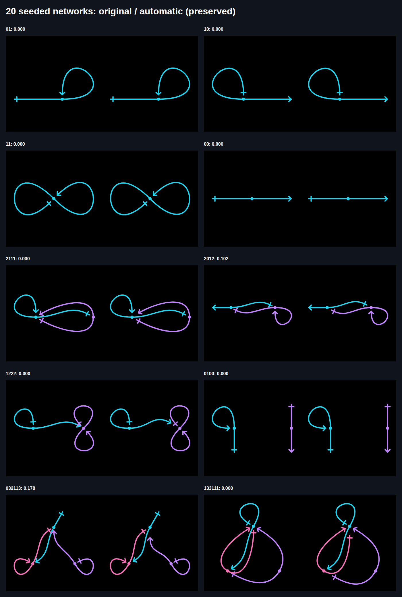
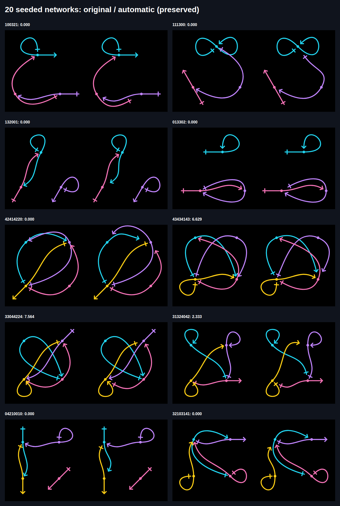

# Issue 37: local spacing with fixed link positions

[Issue](https://github.com/konard/konard.github.io/issues/37) ·
[Pull request](https://github.com/konard/konard.github.io/pull/38) ·
[Requirements](REQUIREMENTS.md) · [Alternatives](SOLUTION-PLAN.md) · [Work plan](PLAN.md)

The current solution adjusts reference bends and gaps while preserving link
identity, colors, order, layout settings and actual rendered middle coordinates.
This follows the owner's [October 30 feedback](https://github.com/konard/konard.github.io/pull/38#issuecomment-6521354738),
which rejects the earlier permutation/compaction solution. Existing crossings
may remain when removing them would require rearranging the drawing. They are
measured and displayed, never hidden by changing topology, colors or cuts.

## Reproduction and root causes

1. `/network/?code=2222&solve=true` previously selected `[47,-47]` turns with
   `.16` reference gaps and reported zero collision cost. An independent dense
   check finds a proper crossing between its own reference shafts. The objective
   compared different links and markers against shafts, but omitted a link's
   own two shafts. Scoring those painted halves prevents the folded lens. The
   intentional middle attachment remains exempt. Closed halves stay unchanged.
2. `/network/?code=34442132&solve=true` exposes crossings in the original cyclic
   placement. The prior revision reordered the links to `1 3 2 4` and compacted
   their placement. That lowered the score but violated the requirement to keep
   the network's appearance. `logs/placement-regression-before.log` records six
   failures in the unchanged 22-network preservation suite before removal of
   that search. `screenshots/chromium-rejected-34442132.png` records the rejected
   result. The global layout search and renderer override have been removed;
   Apply accepts only turns, gaps and the original rendering frame.
3. Preserving layout parameters alone is insufficient. The renderer normally
   fits the entire curve collection into the image again after endpoint edits.
   This changed actual middle coordinates by up to 6.42 units in a 100-unit image
   in the sample, despite unchanged order/spread (`logs/position-probe.log`). The
   solver now captures the original scale/translation before searching and uses
   it throughout scoring and rendering. Preview, Apply, URL serialization and
   SVG/raster export carry that frame. Tests compare actual middle coordinates
   and every closed-half control point, rather than only layout settings.
   Deliberate geometry/topology edits clear the frame; color edits retain it.
4. Slider key handlers already worked with focus. Earlier browser tests called
   `locator.press()`, which focuses its target and masked the reported failure.
   Controls now establish focus on pointer down and again on completed click.
   The latter matters on macOS WebKit, whose native mouse action can clear
   pointer-established focus. No default pointer action is cancelled, preserving
   dragging. Tests click, then send arrows through the page keyboard. A shim
   suppresses native mouse focus and blurs between pointer down and click;
   macOS WebKit CI verifies the actual platform. Historical failures are retained
   in `logs/click-focus-before.log` and `logs/click-focus-macos-ci.log`.
5. Search runs in a cancellable module worker to keep the page responsive.
   Geometry changes terminate stale jobs; keyed results cannot replace a newer
   drawing. Pending/error status and gated image exports prevent saving an
   unfinished result. Apply merges spacing into current style so concurrent
   palette edits survive. Unit/browser regressions cover this race, cancellation,
   worker failure, native dragging, mobile overflow and both page languages.

Original scorer/focus reproductions remain in `logs/regression-before.log`,
`logs/random-regressions-before.log` and `logs/focus-regression-before.log`.
Revision reproductions and results have separate names; historical evidence is
retained without presenting the rejected implementation as the final solution.

## Bounded local search and defaults

- Automatic spacing stays experimental and off by default. When enabled, it
  preserves every chosen placement, including Automatic, circular, grids,
  physical forces, manual circular order, rotation, spread and aspect ratio.
- The default angular search is now **30 degrees from each original reference**,
  with one-degree refinement. A bounded comparison of 15/30/60/180 degrees is
  retained in `data/local-adjustments.json`. Thirty degrees handles the nearby
  solutions that fifteen misses, without the previous default's large bends.
  Explicit larger ranges remain available as a deliberate user choice.
- Keep `.20` reference-gap range: `.05` prevents the measured symmetric
  `1111`/`2222` solutions from reaching their required clearance. The exact
  suggested URL (`solveGapRange=.05&solveRange=180&solveStep=13`) is still tested
  at fixed positions and within its own bounds. Internal coarse exploration uses
  multiples of the selected step, followed by refinement on that same grid.
- Preserve satisfied manual drawings exactly, closed halves, explicit cuts and
  original bounds throughout all search stages. Automatic middle cuts default
  to zero. The two references of a lens keep symmetric turns, equal gaps and
  equal radii. Tiny movement/gap penalties break ties without outweighing
  painted clearance.
- Score and finally accept the complete drawing in its original frame. Cached
  candidate scores accelerate descent; full scoring determines the returned
  result. A residual is preferable to forbidden layout movement.

`data/measure-preserved.json` contains the reported examples, exact proposed
settings, controls, costs and timings. `data/random-preserved.json` contains all
20 unchanged seeded examples. The four-link residual reflects existing
inter-link crossings; some random examples retain marker/closed-half clearance
conflicts at their fixed positions. [The visual review](VISUAL-REVIEW.md) records
all individual outcomes. Zero residual is not an acceptance condition overriding
the owner's explicit preservation requirement.

## Research and rejected alternatives

Primary-source facts and decisions are in [research.json](data/research.json).
The original investigation was October 29; preservation constraints were
revisited October 30.

| Source/component | Relevant fact | Decision |
| --- | --- | --- |
| [W3C slider pattern](https://www.w3.org/WAI/ARIA/apg/patterns/slider/) | Arrows increment/decrement a focused slider | Retain native range controls and explicitly establish focus |
| [WebKit 299087](https://bugs.webkit.org/show_bug.cgi?id=299087) | Safari range clicks can omit focus | Verify click-then-page-key input on macOS WebKit |
| [yFiles incremental layout](https://docs.yworks.com/yfiles-html/dguide/layout-incremental_layout/) | Existing coordinates and fixed elements preserve the user's mental map | Treat middles as hard invariants; no automatic arrangement replacement |
| [Graphviz pin](https://www.graphviz.org/docs/attrs/pin/) | Pinned input positions may still move through overlap removal/aspect-ratio processing | Lock the final fitting transform too; logical placement alone is insufficient |
| [Graphviz overlap](https://www.graphviz.org/docs/attrs/overlap/) | Prism and related overlap removal adjust node positions | Incompatible with the latest requirement; do not use them automatically |
| [ELK Layered](https://eclipse.dev/elk/reference/algorithms/org-eclipse-elk-layered.html) | Ordering/crossing reduction and ports are available | Reordering violates the requirement; replacing continuous doublet geometry is unnecessary |
| [Graphviz neato](https://www.graphviz.org/docs/layouts/neato/) / existing d3-force | Force-based placement optimizes node arrangement | Keep existing explicitly selected physical placement; never substitute it to clear overlaps |

No new runtime dependency is needed. The earlier bounded permutation/compaction
search demonstrably lowered overlap scores, but was rejected because it moved
links. Exact refitting of every trial was also investigated; it cannot preserve
image coordinates. The selected solution limits edits to reference geometry and
uses the renderer's existing transformation with a serialized fixed frame.

## Reproduction and validation

After `npm ci`, run sequentially within the container memory limit:

```sh
npm run test:ci
npm run check
npm run build
PHASE=preserved node experiments/issue-37-measure.mjs
PHASE=preserved node experiments/issue-37-scan.mjs
PHASE=preserved node experiments/issue-37-sheet.mjs
node experiments/issue-37-position-probe.mjs
npm run test:network:issue37
ENGINE=firefox npm run test:network:issue37
```

The generator's fixed seed is `0x37c0de`: four examples each for one/two links,
then six each for three/four links, without result-based replacement. The
preserved contact sheets place original and automatic drawings side by side.
`random-before.*` records the original implementation; `random-after.*` and the
older `*-after-34442132.png` record the rejected global search. Use only the
`preserved` evidence for the current implementation.

The updated browser regression compares actual middle coordinates and colors
before/after solving in all 22 networks, checks nonincreasing measured scores,
continuous paths, exact Apply/share/SVG output, explicit suggested settings and
manual arrangements. It also checks native mouse/keyboard/drag input, worker
responsiveness, concurrent style edits, mobile width and Russian labels. The
existing eight editor suites retain number-field editing, historical URLs,
closed-loop symmetry, clipboard, history, downloads and gallery coverage.
Chromium, Firefox and **macOS WebKit** run the complete matrix in CI.

No Playwright MCP tool was available during this revision, so it uses the
repository's existing Playwright harness and installed native browsers. Local
Linux WebKitGTK previously stalled on animation-frame delivery and exceeded
safe memory headroom on retries; those incomplete runs are retained as local
limitations, not passing Safari evidence. The existing macOS CI job provides
full WebKit verification without weakening its ordinary click checks.

### Current visual evidence

The original positions and final local adjustments:






All twenty unchanged examples, original left and locally adjusted right:




## Scope and limits

The sample is reproducible acceptance evidence, not a proof that every topology
admits zero crossings with fixed link centers and closed halves. No graph
reordering, color reassignment, arbitrary translation/rescaling, or default
middle cutting is used to hide a residual. Explicit manual geometry controls
remain available. Final current-head CI, feedback refresh and clean-worktree
checks are recorded in PR 38; the pull request stays unmerged.
