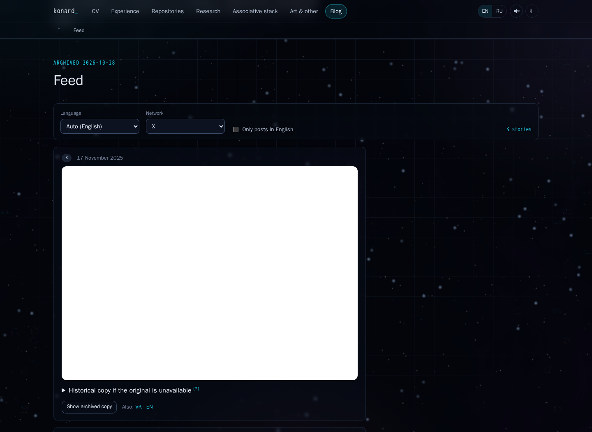
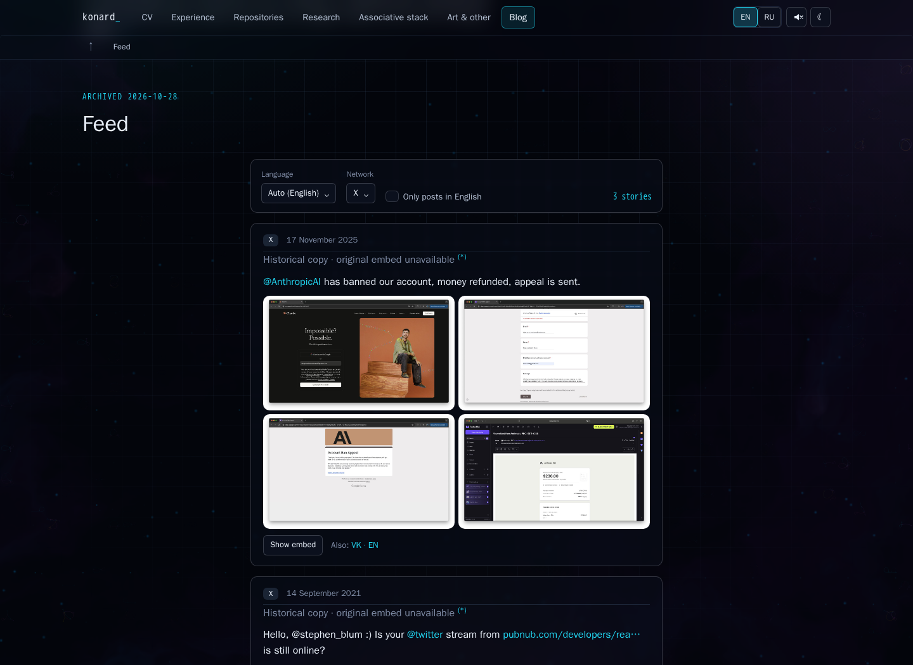
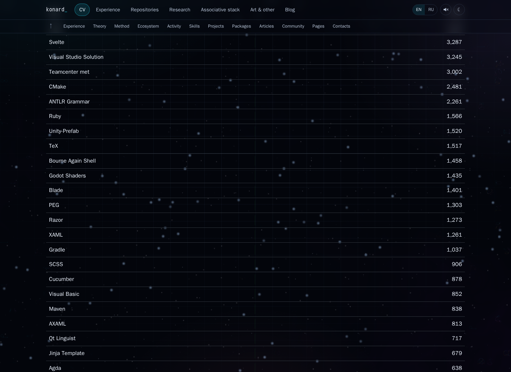
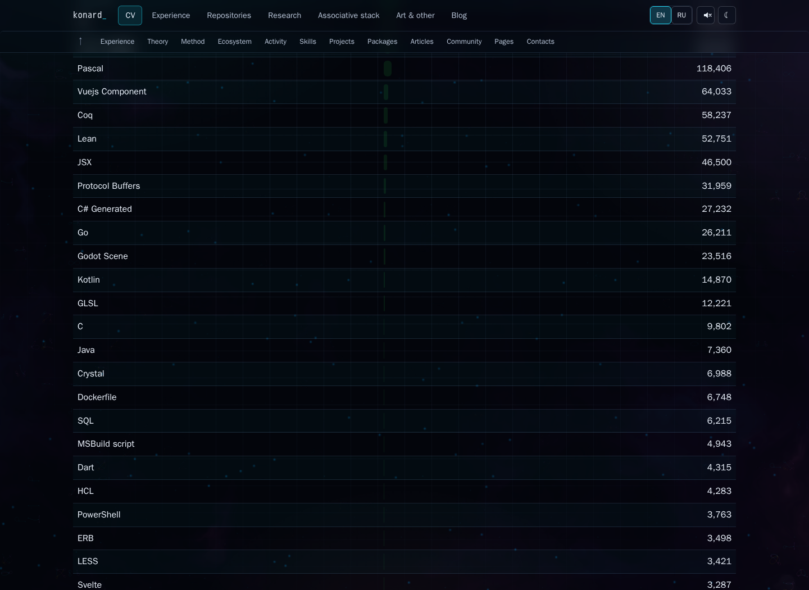
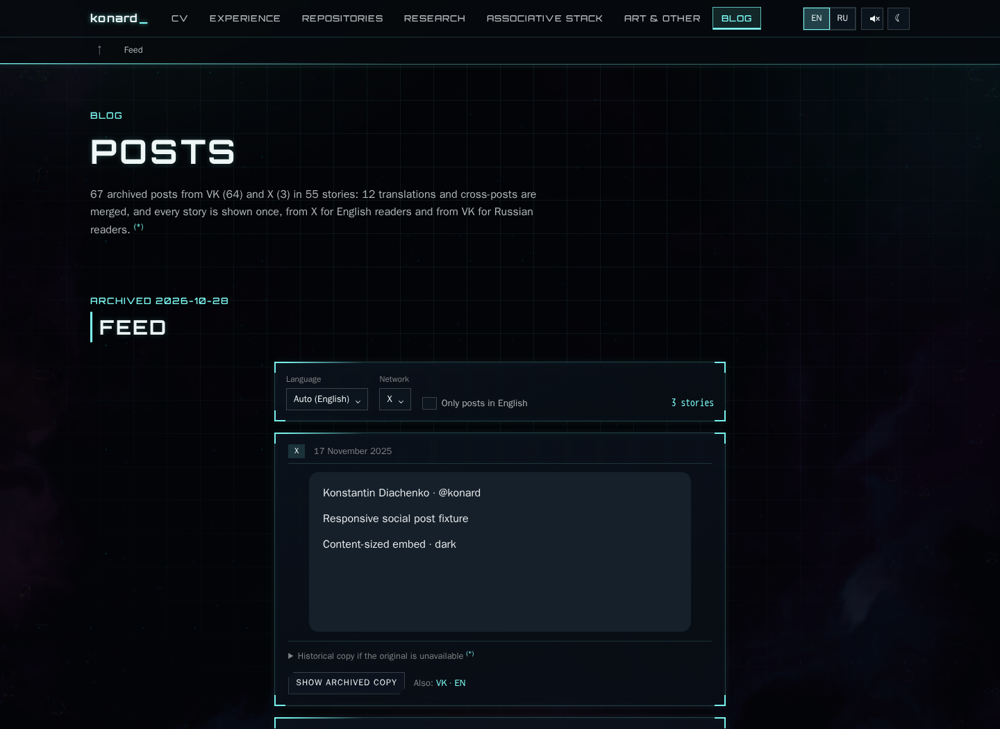
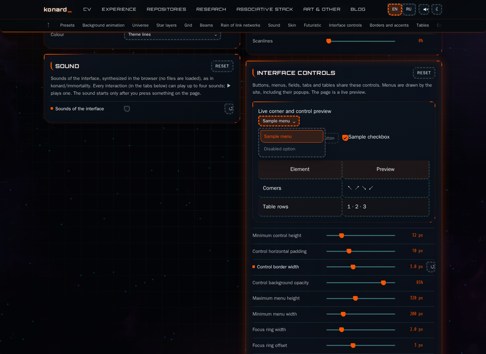
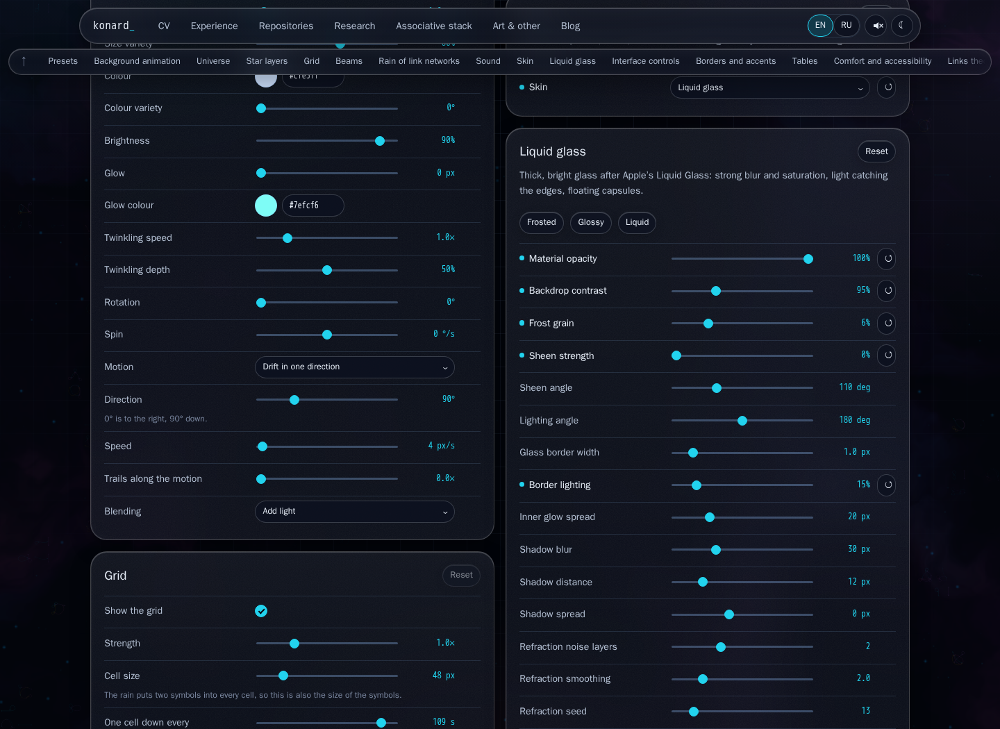

# Issue 39: configurable UI, surfaces and social posts

Issue: [#39](https://github.com/konard/konard.github.io/issues/39). Implementation: [PR #40](https://github.com/konard/konard.github.io/pull/40). Research date: 2026-10-30.

## Evidence and scope

The complete [issue snapshot](data/issue.json), [initial PR snapshot](data/pr-initial.json), [reported settings image](data/reported-defaults.jpg), [initial failing tests](data/initial-regressions.log) and before/after screenshots are preserved here. The issue and PR initially had no comments or reviews and named no required sub-issues. Earlier merged PRs #38, #36, #34 and #32 supplied the editor, indicator and CI conventions. Their functionality is retained and their browser suites remain in CI.

The image in the issue shows settings values, rather than a screenshot of the broken blog. It specifies twinkle **1.9**, zoom **0.55**, star size **0.5**, star color **#00c7fc** and sound **on**. Those five defaults are applied exactly. Existing visitor overrides remain authoritative. Futuristic scanlines now default to zero for readability; visitors can still enable them.

The [subsequent review and screenshot audit](VISUAL-REVIEW.md) covers the owner's theme/frame feedback: merge current main, remove the white iframe canvas, connect default corner strokes and highlight gradients, and retain manual frame customization. It includes a separate failing baseline, final render measurements and refreshed screenshots. The merge retains issue 41's straight-turn implementation and its automated browser suite.

## Complete requirement and solution inventory

| Requirement | Root cause / alternatives considered | Chosen solution and verification |
| --- | --- | --- |
| Collapse every language below 1,000 lines as Other | One row per language created a long table. Dropping small languages would corrupt the total. | Keep languages at exactly 1,000 visible; aggregate smaller counts, retain a collapsed language breakdown, repository attribution and unchanged totals. Boundary fixture includes 1, 999, 1,000 and 2,000. |
| Remove the numerical-indicator notice at page tops | Shared Layout inserted the same notice on every page. | Remove only that notice. Keep the footer source section, dated records and individual source marks. DOM regression checks both sides. |
| Research proper social iframe embedding and improve blog | Direct embed URLs plus a 520px minimum height could surround a small X post with empty space. Cross-origin contents cannot safely be measured by our page. | Official provider loaders own their height protocol. X uses createTweet with responsive host, maximum 550px and theme/language options; Telegram uses its post script; VK uses Widgets.Post only with a valid export hash. Blog cards and filters share a centered 650px column, media retains its aspect ratio, and failed posts show the archive. Unit tests, browser fixtures, live provider probe and before/after images cover the result. |
| Set the pictured new defaults | Defaults differed from the supplied JSON screenshot. | Apply the exact five pictured values, preserve stored overrides and the existing reset/preset/import/share flow. Regression asserts exact values. |
| Own all UI elements and fully configure buttons, dropdowns, tables, etc. | Native select and color popups escaped the skin; controls had scattered fixed radii, padding and borders. | Site-owned Select popup and hex/swatch/RGB ColorInput; owned numeric step buttons preserve decimal snapping and inherited values; styled semantic buttons, text/number fields, checkbox and range tracks/thumbs; shared geometry, fill, focus, disabled, hover, motion, accent and table tokens. Replace every select on settings, CV, blog, repositories and editor. Live preview includes buttons, a disabled control, menu, checkbox, slider and table. Browser asserts no native select remains. |
| Apply all relevant immortality quality practices | A visual resemblance alone does not provide keyboard behavior, storage safety or bounded effects. | Audit settings, Select, SettingsPanel, Frame, DataTable, styles and existing site equivalents. Applicability matrix below maps each pattern to implementation or an existing feature; no wholesale upstream copy or unrelated dashboard functionality is required. |
| Expand futuristic borders, accents and good defaults | Narrow ranges and fixed accent geometry limited configuration. | Cut and bracket lengths 0–128px, border 0–12px, glow 0–4×, frame intensity 0–100%, accent length 0–480px and offset 0–128px; shared strip width 0–16px and custom primary/secondary colors. Retain all palettes, frames and per-corner shape previews. |
| No separate transparent surface; opacity affects all styles; optimize 100% transparency | Texture highlights used fixed alpha; a separate transparent enum duplicated an opacity state. | Remove enum and migrate old saved/imported/shared settings to solid + opacity zero before first paint. Every futuristic texture multiplies its alpha by opacity. Glass and liquid have corresponding uniform opacity. The zero path sets background:none, no shadow/backdrop filter and removes the refraction SVG. Independently adjustable frame lines remain decoration, identical for every surface at zero. Browser checks every surface at 0, .5 and 1, plus glass/liquid zero. |
| Use t3code rounded UI and performance practices | Independently hard-coded radii and unbounded visual work reduce consistency. | Shared panel/control corner tokens, visible focus, disabled states, mobile 44px targets and minimum 16px input text. Keep print outside screen-only tokens. Menus subscribe to global events only while open; provider loading is near-viewport; existing offscreen panel freezing remains last in CSS. |
| Fully configure Apple-inspired glass, including matte/glossy/liquid presets and borders | Blur and saturation alone do not distinguish the requested materials. | Deterministic Frosted / Glossy / Liquid optical bundles; opacity, blur, tint and tint strength, saturation, brightness, contrast, grain, sheen strength/angle/motion, highlight, lighting angle, border width/light/edge, inner depth/spread, shadow blur/distance/spread, and refraction scale/detail/octaves/smoothing/seed are configurable. Existing radius, pills and chromatic controls remain. Explicit/system reduced transparency provides an opaque fallback. Unsupported browsers skip refraction. |
| Futuristic defaults must have no round UI; every corner configurable with previews | Buttons, navigation, media, swatches, range thumbs and tables inherited rounded rules. | All site HTML UI becomes angular in futuristic defaults. Eight independent radius controls (four panel + four control corners) use -1 for skin inheritance, 0 for square or a positive pixel value. Live preview and existing custom-frame corner tiles show the result; browser checks all visible UI, then all eight computed values and persistence. Miniature preset artwork deliberately depicts the other skins. |
| Research additional facts, existing components and solution plans; collect data; finish in one PR | Need a reviewable account rather than an unexplained visual patch. | This case study, research references, original evidence, repeatable experiments and CI evidence accompany the implementation in PR #40. No separate framework package is introduced: the issue describes that as future work. |

## Research and design decisions

### Immortality applicability audit

The audit pins [konard/immortality at 16a6172](https://github.com/konard/immortality/tree/16a6172c38fc120133485f805c49d980b9850bc4). These are quality patterns, not a requirement to transplant every life-expectancy dashboard feature.

| Upstream pattern | Application here |
| --- | --- |
| settings.ts: one typed axis inventory, constrained ranges, palettes and independent material geometry | Existing schema/normalizer is extended; UI and optical fields participate in reset, import, export, randomization, persistence and sharing. |
| settings.ts: preserve motion/audio comfort when changing looks | Existing COMFORT policy retained, now includes transparency preference. Optical-only presets preserve every comfort and corner choice. |
| Select.tsx: owned combobox, typeahead, Home/End/Page keys, Escape, outside dismissal and viewport placement | Select owns a portalled popup, active descendant and disabled-option behavior. Escape cancels; Enter/Space/Tab and Alt+Up commit. Popup scrolling never scrolls the document. |
| SettingsPanel.tsx: labeled controls, reset, preview, current-value output, grouped settings and reference attribution | Existing bilingual schema-driven settings, individual/group reset, changed indicators and saved presets retained; new fields and live previews use the same flow. |
| Frame.tsx: material separate from frame geometry; pointer tracking without React renders | Surface opacity does not erase decorative frame lines. Existing CSS/generated frames avoid per-pointer React state; no new pointer tracking is needed for static presets. |
| styles.css: avoid persistent transform/isolation that breaks backdrop sampling; bound blur and stop invisible work | Existing bounded panel behavior retained. Zero opacity and reduced transparency disable filters; refraction unmounts; grain is one small static tile updated on settings changes. |
| DataTable.tsx: real tables with headers and readable values as a chart alternative | Native semantic tables remain; only presentation is owned. Other aggregates retain detail; chart/data attribution is unchanged. |
| Responsive layouts, focus, reduced motion, safe storage, performance-bounded random looks | Existing implementations retained; mobile targets, forced-color checkbox/focus styles, opaque material fallback and browser checks extend coverage. |
| Research attribution and modular reusable components | Pinned source references below, separate schema/UI/material/embed modules and reusable regression helpers. |

Dashboard-specific gauges, clock rails, scientific chart choices, startup narratives, cursor effects and extra vignette animations are feature examples, not general quality requirements. Adding them would obscure this site's existing content. Existing canvas backgrounds, sounds, frame geometry and presets already cover the corresponding customization categories.

### Rounded controls and optical materials

[t3code button primitives](https://github.com/pingdotgg/t3code/blob/6575ce32508bd7908444241f3719aa33aaf77f90/apps/web/src/components/ui/button.tsx) and its shared stylesheet were inspected for radius tokens, inset geometry, focus, disabled states and touch targets. The implementation adopts shared tokens and screen-only styling, preserving CV print geometry. It does not import t3code's application dependencies.

[Apple's material guidance](https://developer.apple.com/design/human-interface-guidelines/materials) favors clear hierarchy, legibility, restrained glass on controls, and adaptation to reduced transparency. [WWDC's Liquid Glass introduction](https://developer.apple.com/videos/play/wwdc2025/219/) provides the optical reference. These are visual inspirations: CSS does not reproduce the native system renderer. The default remains restrained glass; Frosted adds blur and static grain, Glossy emphasizes a directional highlight with less blur, and Liquid adds the existing supported refraction path. Manual extreme values can reduce contrast, so presets and reset provide predictable starting points. Browser/device refraction support remains conditional rather than an accuracy claim about every GPU.

The grain prototype initially used repeating radial gradients. Screenshot review showed rings rather than frost. It was replaced by a tiled 128px static grayscale noise image, with alpha proportional to grain and material opacity; zero grain/opacity yields no image.

Replacing operating-system controls must preserve their capabilities. The number field therefore keeps owned pointer step buttons alongside decimal-safe keyboard editing. The color field keeps precise hex entry and an owned RGB chooser with pointer and keyboard sliders, outside dismissal, Escape focus restoration and a viewport-clamped popup. A rendered-text measurement caught and fixed an intermediate mobile grid placement that clipped the hex value. Safari's button focus policy is handled explicitly when opening menus, and optional audio import failures cannot produce uncaught page errors. The [CI investigation](CI-INVESTIGATION.md) records the evidence, original errors and regression tests.

### Social embed contract

[X's official instructions](https://help.x.com/en/using-x/how-to-embed-a-post) point to the [publishing tool](https://publish.x.com). Inspection of the official widgets.js confirms that the provider owns responsive iframe sizing. We use its createTweet factory rather than attempting to inspect a cross-origin body. The old developer.x.com embed documentation redirects to a generic overview and was not treated as precise API evidence.

[Telegram's post widget](https://core.telegram.org/widgets/post) supports public group/channel posts. Its official script validates both message origin and iframe source before resizing. A private/personal conversation is not made embeddable by constructing a URL. VK's documentation could not be fetched here, so the [official OpenAPI script](https://vk.com/js/api/openapi.js?169) was inspected directly: Widgets.Post receives host, owner, post, hash and options and delegates sizing to its constructor. The site's existing valid-export-hash policy remains. The archive does not currently contain Telegram channel posts or VK export hashes, so these entries remain readable archives; valid fixtures exercise both official contracts without inventing provider credentials.

Each embed generation owns a separate host. Theme/language changes cannot let a late old request clear the current widget. Scripts are shared, failed/stalled script loads can retry, observers/timers are cleaned up, and a 12-second rendering deadline exposes the archive. Provider network access is deferred until within 400px of the viewport. `?debugEmbeds=1` enables optional loading/ready/fallback diagnostics; logging is off by default.

The live X probe on 2026-10-30 returned HTTP 200 for the official loader and rendered a 550×552px content-sized post; [response data](data/live-social.json) and a [live screenshot](screenshots/live-blog.png) are preserved. The deterministic short-post fixture independently verifies that a 230px post never inherits the former 520px minimum.

Provider outages, deleted posts and regional restrictions cannot be repaired in site CSS. Deterministic browser fixtures verify sizing and transitions; the separate live probe records actual provider responses without mistaking them for application failures.

### Component alternatives

| Alternative | Assessment |
| --- | --- |
| Native select/color popup | Small and accessible by default, but OS-rendered popup appearance cannot satisfy complete ownership. Keep semantic HTML inputs/buttons and own the visual popup/color field. |
| [Base UI Select](https://base-ui.com/react/components/select) | Strong unstyled focus/portal model used by t3code. Good future framework option; adding its entire behavior layer for a small select-only API would enlarge this change. |
| [Radix Select](https://www.radix-ui.com/primitives/docs/components/select) | Also provides portal, keyboard and accessible primitives. Same dependency/adapter tradeoff; keep the existing lightweight React setup and cover the owned control with tests. |
| [WAI-ARIA APG select-only combobox](https://www.w3.org/WAI/ARIA/apg/patterns/combobox/examples/combobox-select-only/) | Behavioral reference for the owned implementation. Its examples still require browser/assistive-technology testing; automated checks here are not a claim of universal screen-reader certification. |
| [Arwes](https://github.com/arwes/arwes) | Relevant visual vocabulary; current repository says it is no longer maintained and describes React 18 limitations. Retain the site's generated frame system rather than add an unsuitable dependency to React 19. |
| New configurable UI framework package | The present implementation establishes shared primitives/tokens inside this app. A separate public framework is explicitly a later project in the issue. |

## Reproduction and verification

Before changing behavior, four regressions failed for the oversized language table, repeated notice, old defaults and transparent enum. The [red log](data/initial-regressions.log) preserves this. The blog's original fixed-height state and source table are shown below.

| Before | After |
| --- | --- |
|  |  |
|  |  |







Run the same checks with:

```sh
npm ci
npm run check
npm run test:ci
npm run build
npm run build:cv
npm run test:ui:issue39
node experiments/issue-39-mobile-color.mjs
ENGINE=firefox CAPTURE_DIR=browser-results/issue39-firefox npm run test:ui:issue39
ENGINE=webkit CAPTURE_DIR=browser-results/issue39-webkit npm run test:ui:issue39
```

`experiments/issue-39-browser.mjs` checks owned menu selection/cancellation/typeahead, disabled choices, default square UI, all eight independent corner values, persistence, borders/table tokens, every surface opacity, optical presets, opaque preference, provider height/archive/retry, desktop/mobile overflow and menu bounds. Its deterministic X fixture is labeled as a fixture in the image. It records computed-style measurements in `screenshots/chromium-verification.json`; browser CI preserves each engine's artifact separately. The inherited network suites verify that control replacement preserves editor layouts, rendering, solving, export and keyboard behavior. Unit tests also cover delayed-generation races, Telegram/VK arguments, script timeouts/retries, invalid color drafts and pointer/keyboard RGB selection, numeric stepping and saved-setting migration.

Local and CI results are recorded in [VALIDATION.md](VALIDATION.md). No package version bump is needed: this repository is a private website and has no package release workflow.
