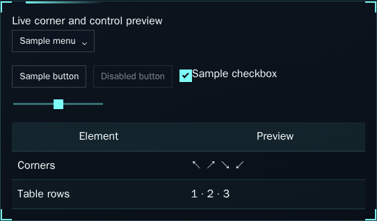
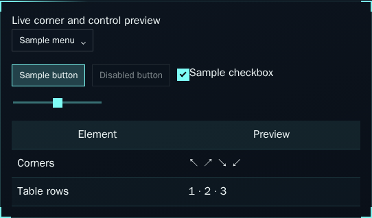
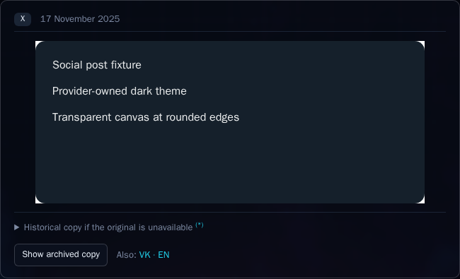
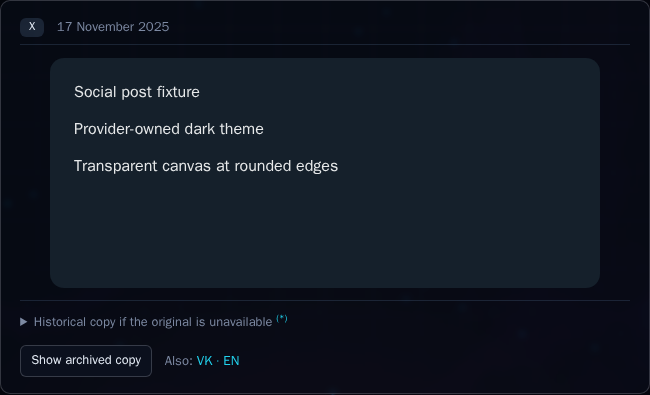

# PR 40 follow-up: theme and frame alignment

Feedback: [2026-10-30 review comment](https://github.com/konard/konard.github.io/pull/40#issuecomment-6530675413).

## Acceptance checklist

- Merge current `main` without losing either issue 39 or issue 41's implementation and browser coverage.
- Inspect every existing screenshot, with full-size checks of social posts, futuristic controls, custom corners, all glass materials and mobile controls.
- Remove the unintended white iframe canvas in dark mode. Preserve provider-supported dark/light themes, responsive sizing and readable archive fallback.
- Join the default futuristic highlight gradient to its corner stroke, with matching thickness and a shared coordinate system. Keep manual offsets, thickness, custom corners and frame choices configurable.
- Capture failing render assertions and before images, then rerun against the fix, inspect final screenshots, and preserve evidence here.
- Run complete unit tests, production build, local checks, browser regressions and all CI checks against the final pushed revision. Leave PR 40 unmerged and ready.

## Root causes and research

The [CSS Color Adjustment specification](https://www.w3.org/TR/css-color-adjust-1/#color-scheme-effect) explains why a transparent embedded document can acquire an opaque canvas when its root color scheme differs from its embedding element. The site declares `color-scheme: dark`; the X widget paints its own dark post inside a document with a light/default canvas scheme. The old live screenshot shows white outside the post's rounded edges. Set the embedding iframe's scheme to `normal` so that the provider's explicit theme and transparent canvas can work together. This is scoped to social embeds; site controls retain their chosen scheme.

[X's embedding instructions](https://help.x.com/en/using-x/how-to-embed-a-post) refer to the provider publishing tool. [Telegram's widget configuration](https://core.telegram.org/widgets/post) exposes dark theme and accent options. The existing factories already pass resolved dark/light themes to X and Telegram. The new regression must render both themes and change theme while the widget is mounted. Provider-owned content retains its own supported visual design; the site must not invent undocumented recoloring parameters or apply a color inversion filter to photos.

The old futuristic accent starts at bracket length + cut size + 6px even for the default square bracket frame, leaving a 20px gap. Its 3px thickness also differs from the 2px bright corner stroke. Backgrounds default to padding-box coordinates while the CSS border uses the outer border box. Generic UI border declarations additionally override some frame edges, and the material rule for extra panels overrides custom frames' zero-width border. These should all use the same frame geometry and material tokens.

## Screenshot audit

Reviewed the complete existing contact sheet and full-size social, futuristic, custom-corner, mobile settings and Frosted/Glossy/Liquid examples. Original before images and the intentionally clipped intermediate color-field image remain historical evidence. Custom dashed borders and asymmetric rounded examples demonstrate explicit user choices; they are not defaults. The old provider fixture has a hard-coded dark background and was captured after cycling through all futuristic textures, so it does not accurately demonstrate a default theme. Refresh final images with theme-aware fixtures and explicit default settings. Preserve the earlier live image as `screenshots/review/before-live-blog.png` for comparison.

## Implementation and reproducing tests

The merge commit `ee8aa4a` preserves both CI scripts and both browser steps. One inherited issue-41 test still dispatched a native `change` event after issue 39 replaced native selects ([initial merged-suite failure](data/visual-review/merge-tests.log), lines 18–29). It now uses the same owned-menu helper as the other editor tests; all three issue-41 component tests pass.

The new [`issue-39-visual-review.mjs`](../../../experiments/issue-39-visual-review.mjs) harness runs after the existing UI suite in `npm run test:ui:issue39`, in the existing Chromium/Firefox/macOS-WebKit CI matrix. It renders provider-like transparent iframe documents in dark/light mode, changes theme while mounted, samples the actual composited corner pixel, measures frame geometry, compares nested panel edges and checks all nine frame variants with explicit manual offsets/thickness. It also verifies that generated custom frames have no extra CSS border on groups, previews or preset buttons.

Run `python3 experiments/issue-39-visual-before.py` with no other dev server using the checkout to reproduce the pre-fix version. This bounded probe temporarily reads the eight affected source files from `ee8aa4a` and always restores current source in `finally`. The baseline exits nonzero with **six render failures**: [log](data/visual-review/visual-red.log), [measurements](data/visual-review/chromium-before.json). It leaves the Git index untouched.

The generic input selector had an additional specificity trap: its `:not()` attributes raised the specificity of the entire `:is()` list, allowing control borders to override preset panel frames. Using `:where()` for those exclusions keeps the existing input targets while letting panel border tokens win. Main and nested panels now share frame edge color, border width and border-box coordinates. Explicitly chosen dashed borders, corner shapes, offsets and thickness still work; stored preferences remain authoritative.

| Measurement | Before | After |
| --- | --- | --- |
| Dark iframe top-left pixel | opaque white, `[255,255,255,255]` | page canvas, `[6,10,19,255]` |
| Embedding iframe scheme | inherits dark/light | `normal`, provider controls its content theme |
| Default bracket end / highlight start | 16px / 36px (20px gap) | 16px / 16px |
| Default corner / highlight thickness | 2px / 3px | 2px / 2px |
| Frame coordinate system | padding box, inset by CSS border | border box, shared with CSS border |
| Custom-frame preset CSS border | unintended 1px | 0px; generated edges remain configurable |

[Final Chromium measurements](data/visual-review/chromium-after.json) record the default geometry, both theme edges, all nine manual configurations and custom border widths. Deterministic fixtures are labeled in their visible content. The separate live probe uses the real official X loader and records availability instead of pretending that a provider refusal is success.

## Visual comparisons

| Before: default highlight gap | After: connected stroke and gradient |
| --- | --- |
|  |  |

| Before: white iframe corner | After: transparent canvas in dark mode |
| --- | --- |
|  |  |

The [light fixture](screenshots/review/after-embed-light.png), [default dark controls](screenshots/review/after-defaults-dark.png) and [default light controls](screenshots/review/after-defaults-light.png) are separate captures. The earlier live provider image is preserved as [before-live-blog.png](screenshots/review/before-live-blog.png).

The live official X loader returned a 550×552px widget in **both dark and light themes** at 18:56 UTC, with `color-scheme: normal` on the embedding iframe. Both captures were opened at full size: [dark](screenshots/live-blog.png), [light](screenshots/review/after-live-blog-light.png), [requests and measurements](data/live-social.json). The white corner canvas is gone; the post's provider-owned media and dark/light content remain intact.

Final screenshot audit (every PNG in this case study was reviewed in the contact sheet; the listed critical states were also opened at full size):

| Captures | Finding |
| --- | --- |
| `before-blog`, `before-settings`, `before-source-lines`, `intermediate-mobile-color-clipping`, `review/before-*` | Historical failure evidence, clearly named as before/intermediate; retained for comparison. |
| `after-blog`, `after-blog-widget`, `live-blog`, light/dark embed and live-review captures | Correct theme, content-sized widgets, archive fallback and readable source controls. The widget fixture now follows the theme and explicitly resets the default frame/surface. |
| `after-futuristic`, `after-settings`, `review/after-defaults*`, `review/after-frame` | Square defaults, continuous 2px corner/highlight join and consistent nested border tint. |
| `after-corner-preview`, `after-color-chooser` | Deliberately asymmetric corners, orange accent and dashed borders; owned menu and chooser stay within the viewport. These are explicit customization examples. |
| All six `after-material-{frosted,glossy,liquid}[-light]` | Correct light/dark palette, readable controls, separate optical materials and consistent border geometry. |
| `after-number-controls`, `after-mobile-{settings,blog,network,number-controls,color-chooser,home}` | Controls, popup bounds and labels fit; full color value is visible; no document overflow. Mobile settings show the connected default frame. |
| `after-source-lines` | Small languages grouped into Other, visible attribution and preserved details. |

Chromium and Firefox passed the complete desktop/mobile suite and the added render checks. Playwright MCP independently navigated the settings page, checked default frame coordinates, captured the browser and closed it; the reusable stdio probe is `experiments/issue-39-mcp-review.mjs` (installed MCP 0.0.83). Linux WebKit was not stressed again; the configured macOS runner verifies that engine in CI.
