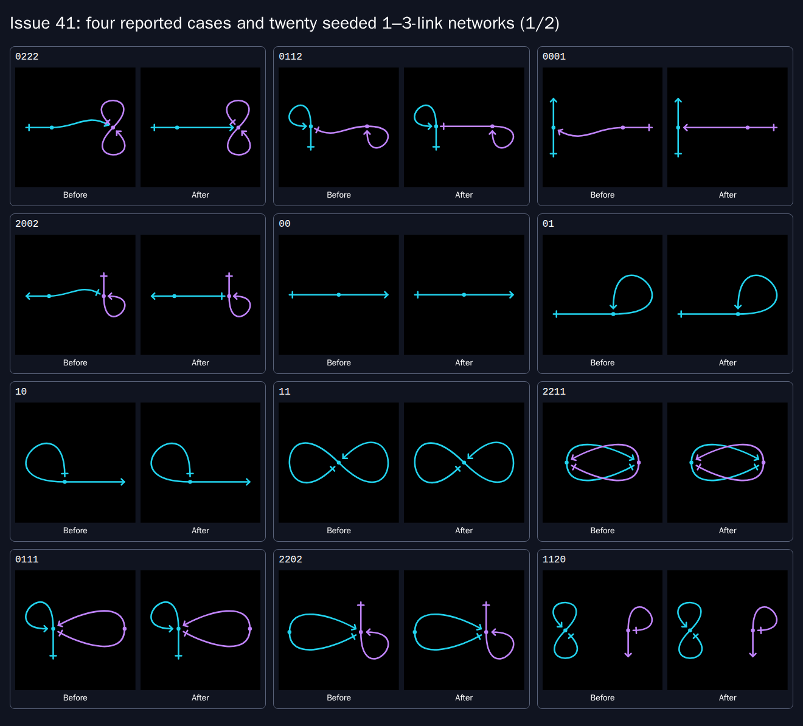
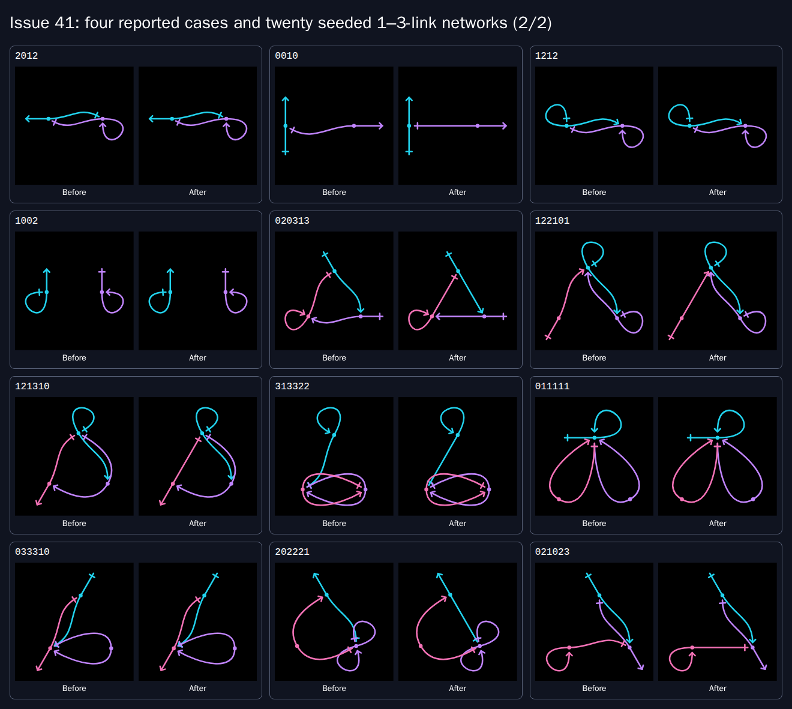

# Issue 41: simpler default reference turns

The four reported networks now open with exactly the same geometry as the
owner's manually corrected links. Aligned references use straight shafts by
default. Their resolved turns appear in the existing controls and feed the
preview, spacing worker, Apply, shared links and image exports.

This addresses [issue 41](https://github.com/konard/konard.github.io/issues/41)
in [PR 42](https://github.com/konard/konard.github.io/pull/42). The complete
[requirement inventory](REQUIREMENTS.md) maps each request to its implementation
and evidence. [PLAN.md](PLAN.md) tracks completion.

## Evidence and timeline

All times are UTC on 30 October 2026 unless stated otherwise.

| Time | Event and evidence |
| --- | --- |
| 29 October | PR 36 introduced continuous middles. Its geometry is inherited by the current renderer. |
| 12:42:32 | [PR 38](https://github.com/konard/konard.github.io/pull/38) merged local spacing with fixed positions, self-crossing checks and background solving. See `data/pr-38.json`. |
| 13:10:19 | Issue 41 opened with unnecessary bending in default networks. |
| 13:18:10 | Latest issue edit supplied four corrections and requested twenty more cases, preservation of previous good behavior, and this case study. |
| 13:39:27 | Draft PR 42 created on the prepared issue branch. |
| 13:39:31 | Initial CI run 41065058961 started on `df3567f`; it passed. Its complete log is preserved in `logs/ci-initial.log`. |
| Investigation | Archived the issue, every issue/PR comment endpoint, reviews, sub-issues and recent related PRs. Initial feedback and sub-issue arrays were empty. Reproduced all four examples with failing tests and Chromium screenshots before implementing the correction. |
| Implementation | Compared unrestricted straightening with reciprocal-route preservation; retained existing reciprocal curves after the measured overlap regressions below. Added shared default inference, explicit-zero preservation and topology-aware control resets. |
| Verification | Captured default/manual equality, twenty unchanged seeded samples, mobile editing, Apply/share and real SVG downloads. Local and current-head CI results are recorded below and in the final validation metadata. |

The API responses are in [data/](data/), including the complete issue body and
the three distinct PR feedback endpoints. Local commands and CI output are in
[logs/](logs/). Intermediate failures are retained as investigation evidence;
files with `draft`, `candidate` or `before` in their names describe earlier states.

## Reproduction and root cause

On the parent implementation, open `/network/?code=0222`. The first link's free
half and middle already follow the chord toward link 2, but its target approach
is still rotated by the nominal 30° angle. Adding `&turns=0+-30` cancels that
rotation and makes the reference straight. The other three supplied examples
exercise the opposite end and references next to a self-closed half:

| Code | Expected editable turns |
| --- | --- |
| `0222` | `0 -30` |
| `0112` | `0 0,-30 0` |
| `0001` | `0 0,0 -30` |
| `2002` | `-30 0` |

`glyph.linkCurve` already chooses a middle tangent using the reference chord.
The editor's fixed endpoint angles independently add 30° in `approach`.
Previously `style.linkTurns` supplied zero for every unspecified turn, so the
nominal angle remained even when a straight reference was feasible. This is a
default-selection defect in this repository, with no external library defect.

The reproducing run in `logs/regression-before.log` failed all four supplied
geometry comparisons, applicable random samples, a straight through-link and
the explicit-zero distinction. The baseline screenshots and
`data/chromium-before.json` preserve the actual picture and controls.

Two secondary consequences needed explicit handling. Normalization used to
discard an all-zero turn list, conflating a deliberate manual choice with an
unspecified default. Also, individual turn resets assumed zero. With inferred
defaults, these would change a shared/applied drawing or reset a field to the
wrong value. A nonempty zero list now survives normalization and sharing;
individual reset buttons use the current topology's resolved default. A blank
numeric editing draft continues to preserve the current turn. Reference edits
and removals recompute defaults while explicit turn lists retain their values.

## Solution and scope

`glyph.defaultTurns` uses the existing layout and endpoint directions. For each
non-self reference it checks that the chord follows the link's middle tangent,
then returns the ordinary integer turn that aligns the endpoint with that
chord. No separate solver or alternate geometry is introduced. It applies to
either end, a reference beside a closed half, and collinear through-links.

The rule preserves deliberate angle/bend settings, lens geometry, self-closed
halves and reciprocal routes. Straightening both sides of a reciprocal pair
collapses two shafts onto the same chord. A finite
[experiment](../../../experiments/issue-41-reciprocal.mjs) compared all eligible
ends, only the first reciprocal direction, and keeping reciprocal curves.
For `2012` the respective existing overlap scores were 33.013, 6.906 and 0.881;
for `1212` they were 35.260, 8.795 and 0.800. Preserving those curves meets the
request to retain previous good behavior. Full results are in
`data/reciprocal-experiment.json`; the rejected candidate's browser and geometry
measurements are retained separately.

All production `shapeOfStyle` and `linkTurns` consumers now pass the actual
links. The renderer, editor controls and worker therefore resolve the same
starting turns. The count-only overload retains zero defaults for existing
geometry callers without topology. Legacy gallery/rain glyphs retain their
deliberate mirrored, bulged appearance; the inherited historical digest checks
that path. No placement, gap configuration, middle-cut rule, collision scoring
or automatic gap-reduction implementation changed.

The existing solver may still change a default turn while reducing marker
collisions. Existing fixed-position crossings or marker clearances are not
claimed to vanish. `data/measurements.json` separates default geometry from the
optional spacing result and records every configured gap. The scorer includes
a tiny turn regularizer, so a 30° correction adds `0.00003` even to an otherwise
clear drawing; that is not a painted collision.

## Twenty additional cases and visual review

The sample generator uses seed `0x41c0de` and samples without replacement: all
four one-link networks, eight two-link networks and eight three-link networks.
The sample is fixed before reviewing results; difficult cases are retained.

| Links | Codes | Review |
| --- | --- | --- |
| 1 | `00`, `01`, `10`, `11` | Free segments and self loops retain their original geometry. |
| 2 | `2211`, `0111`, `2202`, `1120`, `2012`, `0010`, `1212`, `1002` | Simplify eligible single references; preserve reciprocal routes and loops. |
| 3 | `020313`, `122101`, `121310`, `313322`, `011111`, `033310`, `202221`, `021023` | Apply the same rule at either end, preserving link order, colors, middles and closed halves. Existing crossings remain the spacing solver's responsibility. |

These comparison sheets include the four reported networks first, followed by
all twenty additional samples. Each card shows the parent default on the left
and the corrected default on the right. Every individual native screenshot is
also committed in [screenshots/](screenshots/).





Raw SVG, path data, controls, browser versions and page errors are preserved in
`data/chromium-before.json`, `data/chromium-after.json` and
`data/firefox-after.json`. Exact SVG equality verifies all four requested manual
arrangements, default sharing, Apply, applied sharing and the actual downloaded
SVG. Mobile screenshots verify a 390px viewport without horizontal overflow.

## Alternatives and external research

Primary documentation was consulted on 30 October 2026; findings and decisions
are archived in [data/research.json](data/research.json).

| Component | Relevant capability | Decision |
| --- | --- | --- |
| [ELK Layered](https://eclipse.dev/elk/reference/algorithms/org-eclipse-elk-layered.html) | Straight, orthogonal and spline routing with port constraints and edge-straightening options | Confirms straightness can be a separate objective. A replacement layout engine would unnecessarily change established link geometry and positions. |
| [yFiles OrthogonalEdgeRouter](https://docs.yworks.com/yfiles/doc/developers-guide/orthogonal_edge_router.html) | Routes between fixed nodes with few changes in direction and independent spacing controls | Supports separating routing simplicity from clearance. Orthogonal segments do not match the continuous doublet geometry. |
| Existing `glyph`, `style`, `d3-force` and gap reducer | Shared geometry, stable placement, editable turns and painted-shape spacing already implemented | Reuse these components; no added dependency. |

A code-specific special case for the four URLs would miss other topologies and
placements. Making every reference straight would collapse reciprocal routes
and spoil lenses. Altering all nominal angles would change intentional manual
settings and gallery glyphs. The chosen rule checks geometric feasibility at
the shared default boundary. The reproducible root cause provides sufficient
evidence; existing opt-in `solveDebug` diagnostics remain off by default.

## Verification and reproduction commands

The focused tests cover the four requested turns, twenty fixed samples, every
one- to three-link topology (4,181 networks), eight placement modes with rotated
and reordered coordinates, explicit/manual turns, defaults after reference
edits, numeric drafts and resets. Exhaustive assertions preserve raw middles,
every free/self half and configured gaps. Existing integration tests now pass
the same topology to their solver and renderer instead of mixing count-only
zero turns with inferred turns.

The separate exhaustive painted-collision audit found 141 previously clear
default drawings among all 4,181 topologies. Every one remains clear after
straightening, excluding the scorer's turn regularizer. See
`data/perfect-audit.json` and `logs/perfect-audit.log`.

```sh
npm ci
npx vitest run src/links/issue-41.test.js src/pages/network-41.test.jsx
npm run test:ci
npm run check
npm run build
npm run test:network:issue41
ENGINE=firefox npm run test:network:issue41
node experiments/issue-41-measure.mjs
node experiments/issue-41-reciprocal.mjs
node experiments/issue-41-perfect.mjs
node experiments/issue-41-sheet.mjs
bash experiments/issue-41-regressions.sh chromium firefox
```

Use `CAPTURE_DIR` and `RESULT_DIR` to keep subsequent browser results outside
the committed historical evidence. `PHASE=before` records a baseline against a
parent build without requiring default/manual equality. The bounded audit and
measurements run sequentially; they do not stress the host's stack or memory.
The browser harness always closes its browser and preview server.

CI runs the new browser contract on Chromium/Linux, Firefox/Linux and
WebKit/macOS alongside all inherited editor suites, including the full
4,131-card gallery load. Unit tests, static/tooling checks, build, PDFs and link
checks remain enabled. This private site's package has no automatic versioned
release workflow, so no release version change is needed.

Final validation status is recorded in `data/validation.json` and linked CI
metadata/logs. PR 42 remains unmerged for review.
