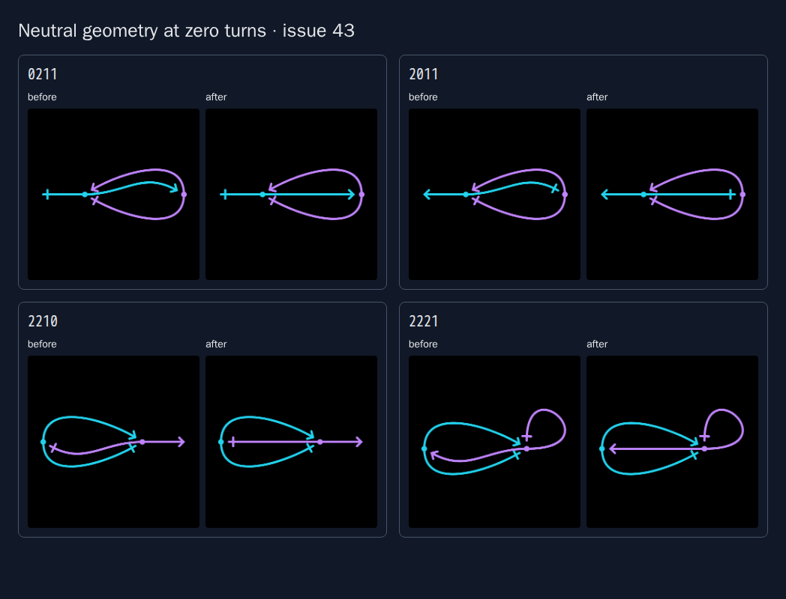

# Issue 43: neutral geometry and complete network navigation

This case study addresses [issue 43](https://github.com/konard/konard.github.io/issues/43)
in [PR 44](https://github.com/konard/konard.github.io/pull/44). A zero turn now
means the simplest neutral reference route. Next traverses networks across
link counts, and Random real network samples networks without open ends.

[REQUIREMENTS.md](REQUIREMENTS.md) maps every request, including inherited
constraints from issue 41, to implementation and verification. [PLAN.md](PLAN.md)
tracks the work. There are no required sub-issues in the archived API response.

## Timeline and evidence

All times are UTC on 30 October 2026.

| Time | Event |
| --- | --- |
| 13:10:19 | Issue 41 requested simpler defaults, four reference examples and twenty additional small networks. |
| 14:02:37 | Commit `95f58fd` in PR 42 introduced topology-dependent compensating turns. Its case study and successful CI did not prove that zero itself had the requested meaning. |
| 18:34:21 | PR 42 merged. The complete issue, PR details, comments, reviews and original session log are archived in `data/` and `logs/pr-42-session.log`. |
| 19:17:20 | Issue 43 clarified zero-turn semantics, supplied four missed cases, and requested cross-size navigation, real-network sampling and a complete investigation. |
| 19:18:45 | Prepared PR 44 branch starts at `aeab9d5`, inheriting the merged implementation. |
| Investigation | Archived issue 43, issue comments, required sub-issues, PR conversation, inline comments and reviews separately. Reviewed preceding issue 41, PR 42 and recent related PRs. |
| 19:21 | Added minimal regression tests before changing production code: all 26 tests failed for the reported geometry, size transitions and absent real-network action. See `logs/regression-before.log`. |
| 19:22 | Captured native Chromium before screenshots and a bounded census of all 4,181 one-to-three-link networks. The baseline has 365 drawings with no scored painted collisions, after excluding turn regularization. |
| 19:23 | The first geometry/navigation implementation passed all 26 new regression tests. The complete census preserved all 365 previously clear drawings. |
| 19:29 | The full draft suite caught a seeded-random compatibility change (`src/pages/pages.test.jsx:297`). Restored small-network scalar sampling and limited endpoint sampling to totals outside the safe integer range. See `logs/unit-tests-draft.log`. |
| 19:33 | Chromium verified all 28 drawings, navigation through three boundaries, real sampling through ten links, sharing, native editing, worker Apply, SVG export and mobile overflow. |
| 19:38 | A second complete suite isolated the editor's independent-endpoint sequence (`src/pages/network.test.jsx:61`; 1,005 other tests passed). Preserved that existing action while reusing `randomCode` for real networks. See `logs/unit-tests-candidate-2.log`. |
| 19:39 | Playwright MCP independently verified eight zero/default drawings, native keyboard/reset, unchanged explicit gaps, size traversal, deterministic real sampling and desktop/mobile layouts. No console errors; browser closed afterward. |
| 19:46 | The complete final unit suite passed: 1,006 tests in 72 files. ESLint, Prettier, file limits, secret checks, Python compilation, Ruff, ShellCheck and production build also passed. One earlier SIGTERM-interrupted run is explicitly excluded from verification. |
| 19:47 | Committed and pushed implementation `43b93fb`. The final review found no new issue/PR feedback; `origin/main` is included in the branch. |
| 20:01:06 | Implementation CI completed successfully on `43b93fb`: all three native browser engines, all unit tests, static/security/tooling/docs checks, production build, 120 CV PDFs and the pipeline gate. Full logs and browser artifacts are archived here. Deployment is intentionally skipped for pull requests. |
| 20:04 | All 23 complete local browser contracts finished with exit 0: twelve Chromium and eleven Firefox suites. All 120 local CV PDFs passed. Browser/server processes closed; final feedback endpoints were empty. Evidence-only archival changes follow the verified implementation commit. |
| Verification | Local checks, real browser contracts, full CI and review results are recorded below and in archived validation metadata. |

Raw API responses, full initial CI logs and preceding execution logs are
committed here. Logs with `before`, `draft` or `candidate` describe intermediate
states and are retained as evidence, including unsuccessful tests.

## Reproduction and root causes

Open `/network/?code=0211`, `2011`, `2210` or `2221` on the parent revision.
Each has an unnecessary bend at a reference that can be straight. The preceding
`defaultTurns` helper used compensating integer turns only for selected aligned
ends and excluded every reciprocal reference. These examples refer back through
a lens or a self-closed half, so the exclusion missed valid straight routes.
For the earlier four examples, the geometry looked correct but the controls
showed ±30°, and explicitly setting zero reverted the unwanted bend.

The actual geometric cause is in `glyph.approach`: fixed source/target angles
rotate the reference away from a chord even when that chord already follows
the link's middle tangent. Correcting the value in editor state cannot define
neutral geometry consistently. It also makes count-only callers disagree with
callers that pass topology.

The navigation defect is separate. `NetworkEditor.stepped` used modulo arithmetic
within `(N+1)^(2N)`, so `11` wrapped to `00` and `2222` wrapped to `0000` forever.
Finally, the editor exposed only unrestricted random sampling even though the
shared configurations module already supported `{ real: true }`.

## Implementation and alternatives

The reference direction now checks geometric alignment directly: if the unit
chord follows the middle tangent in curve mode, its neutral approach follows
that chord. The nominal global 30° setting becomes the neutral baseline on
that reference; changing the global angle changes its direction relative to
the baseline, and a per-link turn is applied afterward. Noncollinear routes
and lenses retain their approach construction. The rule contains no network
codes, link-count limit or blanket reciprocal-reference exclusion.

`linkTurns` always supplies zero for unspecified turns. The old inferred-turn
helper is removed. Explicit zero therefore gives the same drawing as omitted
turns. Editor resets, direct geometry, rendering, collision workers, Apply,
sharing and downloads all consume the same geometry. Existing numeric turn
values remain user-controlled deviations from the new neutral direction, as
requested; old bookmarks that deliberately supplied compensation can clear
their turns to adopt the corrected neutral drawing.

The rule leaves middle positions, free/self-reference halves, gap settings,
colors and the gap reducer's implementation alone. Gallery/rain geometry uses
the existing legacy bend mode and retains its byte-for-byte digest checks.
The previous issue 41 tests and browser review callbacks now assert zero-turn
semantics; its committed historical reports remain unchanged.

Next/Previous use exact BigInt indices and carry or borrow across link counts.
Previous clamps at the first network, `00`. Multiple steps cross boundaries
without loss of precision, including 9/10/25-link tests. Random real network
reuses the existing sampler with `{ real: true }`, preserves the current link
count and samples from 1..N without retrying until a valid network appears.
The ordinary random action remains available. Sampling switches to endpoint
digits whenever the total exceeds JavaScript's safe integer range, including
nine links; smaller-network seeded behavior remains compatible.
The ordinary editor action retains its established independent-endpoint
sequence; the gallery and real-network action retain their existing shared
code-index sequence for safe totals. Regression tests cover both consumers.

| Problem | Alternatives considered | Selected plan and reason |
| --- | --- | --- |
| Neutral turns (R1–R3, R10) | Extend the old compensating-turn heuristic; move every middle; replace the renderer with a graph-routing engine. | Define neutral endpoint geometry in the shared curve constructor, remove inferred turns, then verify explicit zero, manual deltas, preserved middles/loops and all consumers. Compensation repeats the rejected semantics; replacing placement or routing changes established drawings unnecessarily. |
| Complete traversal (R4) | Keep wrapping; special-case only the reported one/two-link boundaries; use floating-point cumulative indices. | Carry/borrow exact indices across each size's count with BigInt, then test full small traversal, reverse traversal and large boundaries. The same rule handles every finite size. |
| Real random action (R5) | Retry unrestricted samples until no zero remains; rewrite zeros after sampling; build another random generator. | Reuse the existing real-reference sampler and expose an editor action. Test bounds, endpoint independence beyond safe totals, current link count and ordinary-sampler compatibility. |
| Investigation and verification (R6–R9, R11) | Rely on the former green CI or on selected screenshots alone. | Preserve API data and original logs, establish failing tests before implementation, research primary sources, compare actual parent geometry, then run inherited contracts and current-head CI. Add debug output or upstream reports only if the evidence warrants them. |

Primary sources were consulted online; findings and decisions are in
[data/research.json](data/research.json):

- [SVG 2 paths](https://www.w3.org/TR/SVG/paths.html) define cubic control points.
  Inference: aligning the endpoint controls with an already aligned middle
  tangent produces a straight reference without a state-level compensation.
- [ELK routing](https://eclipse.dev/elk/reference/options/org-eclipse-elk-edgeRouting.html)
  and its [layered layout overview](https://eclipse.dev/elk/blog/posts/2025/25-08-21-layered.html)
  distinguish routing from node placement. A replacement layout engine would
  need adapters for doublet middles, self loops and marker semantics; reusing
  the existing cubic geometry is smaller and preserves placement.
- [D3 random distributions](https://d3js.org/d3-random) support uniform integer
  ranges and supplied random sources. The repository already has the needed
  real-reference sampler, so a new random library would add no capability.

The root causes are local and reproducible. No external defect was established,
so there is no upstream issue to file. The inherited Linux WebKit limitation is
already tracked by [Playwright issue 43426](https://github.com/microsoft/playwright/issues/43426)
and handled by the existing macOS browser job. Existing opt-in `solveDebug`
diagnostics remain off by default; no speculative tracing is necessary.

## Visual and automated verification

The baseline and corrected native screenshots are in [screenshots/](screenshots/).
The comparison shows all four newly reported cases, with the parent default on
the left and neutral geometry on the right.



The four newly reported cases and all four preceding examples are captured,
plus the same twenty seeded 1–3-link networks used for issue 41. The browser
harness records controls, SVG, browser versions and page errors. It checks
zero/default equality, sharing, native editing/reset, size transitions, random
real sampling, worker spacing, Apply, a real SVG download and mobile overflow.
The independent [MCP review](data/mcp-review.json) records native interactions;
[desktop](screenshots/mcp-desktop.png) shows the new action beside zero turns,
and [mobile](screenshots/mcp-mobile.png) confirms the final narrow layout.

The finite census compares the actual parent geometry, loaded from the fixed
parent commit, with the new geometry. It checks every middle and free/self
half, finite continuous curves, the previous four manual arrangements and all
365 previously clear networks. The census never exhaustively enumerates large
networks. Larger-network tests use finite samples through 25 links and eight
placements. Experiments remain in `experiments/` for reuse.

| Verification | Result and evidence |
| --- | --- |
| Complete unit/integration suite | **1,006 tests in 72 files passed**; [full log](logs/unit-tests-final.log). |
| Static, formatting and source tooling | ESLint, Prettier, file limits, secret checks, Python compilation, Ruff and ShellCheck passed; [static log](logs/check-final.log), [tooling log](logs/tooling-final.log). |
| Production and CV builds | Production build and **all 120 CV PDFs** passed; [build log](logs/build-final.log), [PDF log](logs/cv-pdfs.log). Dependency audit found zero vulnerabilities in [its log](logs/dependency-audit.log). |
| Bounded parent comparison | All 4,181 small topologies, 12,512 free/self halves, 12,454 middles and all 365 clear drawings passed; [audit](data/audit-after.json). |
| Independent browser review | Native keyboard/reset, unchanged gaps, navigation, real sampling and mobile layout passed without console errors; [MCP report](data/mcp-review.json). |
| Complete local browser contracts | **23 suites passed**: twelve Chromium and eleven Firefox, including all inherited editor contracts. [Exit summary](logs/browser-regressions.log), individual `logs/browser-*.log` files and [JSON reports](data/local/) preserve results. Local compositor probes used a finite 1,215-card load within the container memory budget. |
| Native CI browsers | Chromium 156.0.8078.4, Firefox 157.0 and macOS WebKit 27.2 passed the complete inherited contracts and all 28 issue-43 drawings per engine. Their JSON reports are in [data/ci/](data/ci/) and all issue-43 captures in [screenshots/ci/](screenshots/ci/). The gallery compositor test verified the full 4,131-card scenario in every engine. |
| Implementation CI | [Run 41118124455](https://github.com/konard/konard.github.io/actions/runs/41118124455) passed on implementation commit `43b93fb`; [job metadata](data/ci-implementation.json), [complete log](logs/ci-implementation-41118124455.log). Browser artifact metadata records GitHub's tested merge commit; the run metadata associates it with the branch head. |

The evidence archive is a separate commit after the implementation so complete
logs and native CI captures can be preserved without rewriting history. Its
current-head CI is verified again before PR 44 is marked ready; the PR links
that final run. No production changes are made in the evidence commit.
[Validation metadata](data/validation.json) consolidates the measured results.
There are no external blockers or deferred issue requirements.

```sh
npm ci
npx vitest run src/links/issue-43.test.js src/pages/network-43.test.jsx
node experiments/issue-43-audit.mjs
npm run test:ci
npm run check
python scripts/check-python.py
ruff check .
ruff format --check .
git ls-files -z '*.sh' '.husky/*' ':(exclude)dev/log/**' ':(exclude)docs/**' | xargs -0 shellcheck
npm run build
npm run test:network:issue43
ENGINE=firefox npm run test:network:issue43
bash experiments/issue-43-regressions.sh chromium firefox
```

`PHASE=before` captures evidence against a parent build. Use `CAPTURE_DIR` and
`RESULT_DIR` for new captures outside the historical evidence. Browser harnesses
close their browser and server in `finally`. CI runs the new browser contract
in Chromium, Firefox and WebKit alongside the existing editor contracts. The
site has no versioned automatic release workflow; no package version bump is
required for this Pages change. PR 44 remains unmerged for review.
