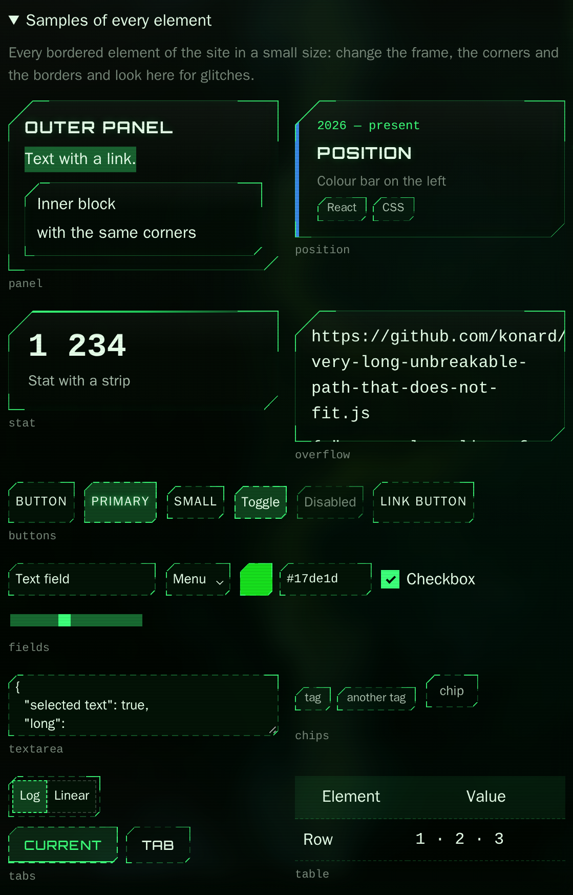

# Case study: issue #45 — the Matrix universe look as the default, one frame for every bordered element, and colour palettes

- Issue: https://github.com/konard/konard.github.io/issues/45 (created 2026-10-31T11:38:02Z, no comments)
- Pull request: https://github.com/konard/konard.github.io/pull/46
- Builds on: [issue #15](../issue-15/README.md) (the futuristic skin and its custom frame) and
  [issue #39](../issue-39/README.md) (the settings page)
- Data: [`data/issue.json`](data/issue.json) (the full issue), [`data/matrix-universe.json`](data/matrix-universe.json)
  (the look given in the issue), [`data/pr-initial.json`](data/pr-initial.json) (the pull request as it was opened)

## 1. The issue

The issue gives a full settings JSON ([`data/matrix-universe.json`](data/matrix-universe.json)) and says "That is
defaults." Then, in short:

> We also need to double check that outer panels, inner blocks and buttons and other bordered elements have the same
> each side border configuration we have for outer panels.
>
> Also not all border configurations correctly slice content inside the block if it does not fit, and not all of
> configuration correctly handle transparent background, selection and so on. That is visible on settings page, so we
> should have more configuration.
>
> It is also important to have more configuration for width of highlight on top, more configuration about width of
> borders on corners and on sides separately.
>
> Also it should be possible to configure layout of border corners (by default on top), but they should cover
> highlights on the left side for positions and so on.
>
> Double check also where we can add more configuration and also make this preset even more perfect to eye.
>
> Meaning we should catch glitches and fix them […] for that we should be able to render small samples of each UI/UX
> elements and so on.
>
> For color configuration we should have ability to select palettes of colors, not only use sliders to select colors,
> for user to select best neon and pastel colors and so on. So it fast and easy to use.
>
> We need to collect data related about the issue to this repository […] deep case study analysis (also make sure to
> search online for additional facts and data), list of each and all requirements […] propose possible solutions and
> solution plans for each requirement (we should also check known existing components/libraries […]).

## 2. Requirements

| # | Requirement (from the issue) | Solution | Evidence |
| --- | --- | --- | --- |
| R1 | The given JSON is the default look; a preset named "Matrix universe" | `src/settings/schema.defaults.js` overrides the defaults with the JSON. `src/settings/presets.js` has "Matrix universe" (the defaults) and "Glass universe" (the old defaults, so nothing is lost) | `settings.test.js`: "uses the look of issue #45 as the defaults, so that look saves as no changes"; `presets.test.js`: "keeps the defaults before issue #45 as the Glass universe…" |
| R2 | Outer panels, inner blocks, buttons and other bordered elements have the same per-side and per-corner frame | `src/skins.frames.js` draws the custom frame on `PANELS` (32 selectors), `BLOCKS` (panels in panels, list items) and `CONTROLS` (buttons, fields, chips, tags, selects, menus). Each group has its own corner scale: `corner.blockScale` (0.6) and `corner.controlScale` (0.35) | `skins.issue-45.test.jsx`: "frames outer panels, inner blocks and controls", "scales the corners down…", "cuts the controls by the frame…"; screenshot [after/samples/dark/custom.png](screenshots/after/samples/dark/custom.png) |
| R2a | The old look of blocks and controls is still possible | `corner.blocks` = frame / line, `corner.controls` = frame / border | "can draw inner blocks with a plain line instead"; [after/samples/dark/border-controls.png](screenshots/after/samples/dark/border-controls.png) |
| R3 | Content that does not fit is cut at the frame | `ui.overflow` = clip (default) / visible: `overflow: clip` on every panel except those with a tooltip, plus `clip-path` on every panel of the futuristic skin | "cuts the content that does not fit at the frame of every panel"; the "overflow" sample |
| R4 | Transparent backgrounds and selection | `ui.selection` = accent / accent2 / system and `ui.selectionOpacity`. The colour chooser and the menu stay readable with a fully transparent surface | "selects text in the accent unless the system colour is chosen"; [after/samples/dark/transparent.png](screenshots/after/samples/dark/transparent.png) |
| R5 | Width of the top highlight | `future.accentWidth` (−1 = automatic), `future.accentMax` (longest share of the panel), `future.accentStyle` (solid / center / glow). The stat strip uses `height`, so its width setting works | "sizes the accent strip…", "draws the strip of a stat along its top…" |
| R6 | Widths of corners and sides, set separately | `corner.{tl,tr,br,bl}Width` and `corner.{top,right,bottom,left}Width` (−1 = the frame width), plus `corner.edgeStyle` (solid / dashed / dotted). "Make all corners like this one" also copies the width | "has a width for every side and every corner…", "puts a chosen width on <html>…", "copies the line width of the corner too" |
| R7 | The corner layer, on top by default, covering the left colour bar of positions | `corner.layer` = top (default) / below. On top, the frame is drawn by a `::after` overlay (`pointer-events: none`) above the content, so the bar of `.position` is cut by the corner | "draws the frame above the content by default…"; `experiments/issue-45-positions.mjs` checks that this moves no positioned element on 11 pages; [after/zoom/position.png](screenshots/after/zoom/position.png) |
| R8 | Find more places for configuration and make the preset better to the eye | R2a and R4–R7 add 20 settings. Glitches found with the samples are fixed (see section 4) | sections 4 and 5 |
| R9 | Small samples of every element to catch glitches | `src/pages/UiSamples.jsx` on the settings page: panel, inner block, position, stat, overflow, buttons, fields, select, colour, textarea, chips, tags, segmented control, tabs, table | `pages/issue-45.test.jsx`: "renders a small sample of every bordered element…"; `experiments/issue-45-samples.mjs` |
| R10 | Palettes of neon and pastel colours, not only sliders | `src/components/colorPalettes.js` holds Neon (10), Pastel (10) and Matrix (8) groups, shown in every colour chooser (`ColorInput`) as named buttons | `ColorInput.test.jsx`: "offers palettes…", "keeps every palette colour a valid, unique hex value"; [after/picker/default-chooser.png](screenshots/after/picker/default-chooser.png) |
| R11 | Collect the data, write a deep case study with online research and existing libraries | this file, `data/`, `screenshots/` | — |
| R12 | Everything in one pull request | pull request #46 | — |

## 3. Research: existing libraries and platform features

| Option | What it offers | Why it is or is not used |
| --- | --- | --- |
| [Arwes](https://github.com/arwes/arwes) (MIT, about 7.5k stars, still alpha on the `next` branch) | Sci-fi React framework. `@arwes/frames` draws SVG frames (`createFrameOctagonSettings`, `…Corners…`, `…Kranox…`, `…Lines…`, `…Underline…`, `…Nefrex…`) and has `styleFrameClipOctagon` / `styleFrameClipKranox` clip-path helpers | The site's frame names (octagon, kranox, lines, underline, corners) already follow Arwes. An SVG frame for every button and field would add a DOM node and a resize observer per element. Our frame is pure CSS (clip-path polygon plus background layers), so it scales to hundreds of controls |
| [augmented-ui](https://augmented-ui.com/docs/) (BSD-2-Clause) | `data-augmented-ui="tl-clip br-clip border"` cuts corners with clip-path. Per-side border widths `--aug-border-top/right/bottom/left` override `--aug-border-all` | Closest prior art for R2 and R6. Its docs say nested augmented elements need a reset layer. We solve the same problem with a block scale and a `[data-frame-root]` reset (section 4). We do not use it, because our frame has per-corner shapes, line styles and an accent strip it does not have, and it is driven by settings attributes on `<html>` |
| CSS [`corner-shape`](https://developer.mozilla.org/en-US/docs/Web/CSS/corner-shape) (`bevel`, `notch`, `scoop`, `squircle`, `superellipse()`) | Native cut and notched corners that also shape the border and the shadow | MDN: "Experimental… not Baseline because it does not work in some of the most widely-used browsers". The clip-path frame stays. `corner-shape` is a later option behind `@supports` |
| CSS `border-image` | Nine-slice frames from an image or gradient | It cannot give each corner its own shape and size from settings, and it does not clip the content. Not used |
| [`overflow: clip`](https://developer.mozilla.org/en-US/docs/Web/CSS/overflow) | Like `hidden`, but the box is not a scroll container, so it does not break `position: sticky` or scroll anchoring | Used for R3, because `hidden` would turn every panel into a scroll container |
| [`::selection`](https://developer.mozilla.org/en-US/docs/Web/CSS/::selection) | Only `color`, `background-color`, text decorations and `text-shadow` apply; background images are ignored. MDN asks to keep the contrast | R4 uses `background-color: color-mix(…accent… var(--ui-selection-opacity))` and keeps the text colour. "System" restores the browser colours |
| Named colour lists: [Wikipedia "List of colors: N–Z"](https://en.wikipedia.org/wiki/List_of_colors:_N%E2%80%93Z), [A–F](https://en.wikipedia.org/wiki/List_of_colors:_A%E2%80%93F), [htmlcolorcodes.com](https://htmlcolorcodes.com/colors/) (for example [Neon pink #FF10F0](https://htmlcolorcodes.com/colors/neon-pink/)) | Named neon and pastel colours | Sources of the palettes (R10). There is no official standard: sources disagree (neon green is #39FF14 on Wikipedia and #0FFF50 on htmlcolorcodes; [Pastel (color)](https://en.wikipedia.org/wiki/Pastel_(color)) says "There are no official listing of colors' hex codes"). Every value in `colorPalettes.js` is marked W (Wikipedia), H (htmlcolorcodes) or C (CSS named colour) |
| "Digital rain" greens #00FF41, #008F11, #003B00, #0D0208 | Common in design palettes (for example [colorpickercode.com](https://www.colorpickercode.com/color-palette/dark-mode-palettes/matrix-digital/)) | No authoritative source ties them to the film. They are used as a "Matrix" group next to the greens of the issue's JSON (#17de1d, #00ff66) |

### Palette values and sources

| Group | Colours |
| --- | --- |
| Neon | Neon green #39ff14 (W), Electric lime #ccff00 (W), Bright yellow #ffea00 (H), Neon orange #ff5f1f (H), Neon red #ff3131 (H), Neon pink #ff10f0 (H), Electric purple #bf00ff (W), Neon blue #1f51ff (H), Electric blue #7df9ff (H), Cyan #00ffff (C, H) |
| Pastel | Pastel green #c1e1c1 (H), Mint green #98fb98 (H, C `palegreen`), Pastel yellow #fffaa0 (H), Pastel orange #fac898 (H), Pastel red #faa0a0 (H), Pastel pink #f8c8dc (H), Pastel purple #c3b1e1 (H), Periwinkle #ccccff (W, H), Pastel blue #a7c7e7 (H), Celeste #b2ffff (W) |
| Matrix | #00ff41, #00ff66 (issue's rain glow), #17de1d (issue's star colour), #1d873f, #008f11, #003b00, #0d0208, #d1ffd6 |

## 4. Glitches found with the samples, and their root causes

Each one has a test that failed before the fix.

1. **Controls had square dashed boxes inside framed panels** ([before](screenshots/before/samples/dark/custom.png),
   [after](screenshots/after/samples/dark/custom.png)). The custom frame was only generated for outer panels. Fix: the
   `BLOCKS` and `CONTROLS` rules in `src/skins.frames.js`, each with its own corner scale.
2. **Colour swatches turned into the control fill.** The `ui.css` control rules (specificity 0,3,0) set the `background`
   shorthand, which reset the swatch colour of `.palettes__chip`. Fix: the swatch is a child `<i class="swatch">`, so no
   control background can paint over it.
3. **The stat accent strip ignored its size.** `.stat::before` is a horizontal strip, but the size went to `width`. Fix:
   `height: var(--ui-accent-size)`.
4. **Selected text was system blue on the green look** ([before](screenshots/before/samples/dark/custom.png)). Fix:
   `ui.selection`.
5. **The left colour bar of a position ran through the cut corner** ([before](screenshots/before/zoom/position.png),
   [after](screenshots/after/zoom/position.png)). The frame was a background of the panel, below its children. Fix:
   `corner.layer`. On top, the frame is a `::after` overlay; the panel then leaves it out of its own background
   (`--fx-frame-under`). `experiments/issue-45-positions.mjs` compares every absolutely positioned element with both
   layers on 11 pages. Only the animated cosmos layers differ, because of time, so they are skipped.
6. **The samples of outer panels looked like inner blocks.** The samples sit inside `.settings__group`, which is a panel,
   so the "panel in a panel" rule gave them the block scale, and `corner.blocks = line` took their frame away. Fix:
   `INNER` in `src/skins.frames.js`. Inside a `[data-frame-root]` element only panels inside that element count. A
   first attempt with `:not(:has([data-frame-root]))` was wrong: it also dropped panels that are siblings of the marker,
   and the jsdom test caught that.
7. **Long content spilled over the frame** (the "overflow" sample). Fix: R3.
8. **A frame setting restyled the page slowly, and the WebKit job of CI ran out of its 15 minutes** (run 41226028436,
   the slider step of `npm run test:network:issue27`: 113 s on `main`, 324–473 s on this branch before the fix).
   A setting writes an attribute or a variable on `<html>`, so every element computes its style again. There were two
   causes, found one after the other.

   **First cause: selectors that could not be filed.**
   - `experiments/issue-45-style-cost.mjs` times that restyle with one sheet or one rule off at a time. The frame
     rules were most of the extra cost.
   - `experiments/issue-45-selector-stats.mjs` reads the selector statistics of a Chromium trace
     (`disabled-by-default-blink.debug`).
   - Every chosen shape and line had a rule `:root[attribute] :where(<44 framed selectors>)`. A list inside one
     `:where()` cannot be filed under a class or a tag, so the browser tried each of these rules on every element.
     When the attribute was not set, it also walked every ancestor up to the root.
   - Fix: the shape and line rules set unitless numbers on the root only (the generated
     `src/skins.frames.corners.css`), and every other frame rule names one element per selector.
   - Measured on `/settings/` in Chromium, over three restyles:

     | Selectors                         | Before        | After       |
     | --------------------------------- | ------------- | ----------- |
     | Frame selectors, time in matching | 420–479 ms    | 34–36 ms    |
     | All selectors, time in matching   | 755–870 ms    | 234–246 ms  |

   **Second cause: long inherited custom properties (WebKit only).** Chromium and Firefox became fast, but WebKit did
   not: the temporary diagnostic step of CI (`experiments/issue-45-webkit-diagnose.mjs`, run 41240352259 on macOS) timed
   one restyle of `/settings/` at 1680 ms with the Matrix look on the branch, against 337 ms for the same look on
   `main`. Turning the rain, the nebula or the scanlines off changed nothing; the Glass look (no custom frame) took
   234 ms.
   - WebKit compares the inherited custom properties of each element whose style it recomputes. An unregistered value
     that uses `var()` is kept as its tokens, so the comparison costs as much as the tokens. The root held the lengths of
     three scales as formulas, and all ~1800 elements of the page paid for them.
   - `experiments/issue-45-custom-props-micro.mjs` shows it on 1000 plain `div`s in WebKit (one restyle):

     | Inherited custom properties of the root       | Restyle  |
     | --------------------------------------------- | -------- |
     | none, or 300 plain values                     | 6–10 ms  |
     | 20 plain values of 200 tokens                 | 5–8 ms   |
     | 20 values of 20 tokens with `var()`           | ~48 ms   |
     | 20 values of 200 tokens with `var()`          | ~370 ms  |
     | 300 values `calc(var(--n) * 1px)`             | ~34 ms   |
     | the same, registered as `<length>`            | ~13 ms   |
     | 300 values of 20 tokens, `inherits: false`    | ~12 ms   |

     `experiments/issue-45-typed-props-micro.mjs` adds that typed `<color>` and `<image>` values are as cheap, and that
     a polygon of each framed element is cheap when it does not inherit to its children.
     `experiments/issue-45-image-none-syntax.mjs` checks that Chromium, Firefox and WebKit accept `<image> | none` and
     that `inherit` on `::after` copies a property that does not inherit.
   - Fix (in `src/skins.frames.js`, registrations in the generated `src/skins.frames.properties.css`):
     - the numbers of the shapes and lines, and the size of each scale, stay on the root (`syntax: '*'`,
       `inherits: false`);
     - the lengths of each scale are `<length>`, the line colour is `<color>` and the line images are
       `<image> | none`, so the root computes each once to a single value;
     - each framed element computes its own outline and layers (`--fx-el-clip`, `--fx-el-img`, `--fx-el-size`,
       `--fx-el-pos`, not inherited); the corner layer copies them to its `::after` with `inherit`.
   - `experiments/issue-45-css-variants.mjs` times the restyle with parts of the generated sheets left out. Local
     headless WebKit on Linux, median of 5 restyles of `/settings/`:

     | Sheets                                            | Restyle   |
     | ------------------------------------------------- | --------- |
     | `main`                                            | ~85 ms    |
     | first fix only (inherited formulas)               | ~900 ms   |
     | both fixes                                        | 285–310 ms |
     | both fixes, without the registrations             | ~1770 ms  |
     | no custom frame at all                            | ~173 ms   |

     On macOS in CI the restyle went from 1680 ms to 378 ms (section 7, item 4). The page has 1794 elements on the
     branch, against 1353 on `main` with its default look and 1558 with the Matrix look.

   - What is left: the custom frame still adds about 100 ms to a restyle in local WebKit and about 170 ms on macOS.
     `experiments/issue-45-ab-sheets.mjs` times sets of the generated sheets in turns (A, B, A, B…), so a busy machine
     slows them alike; the noise is about ±20 ms. Without the frame a restyle took 177–204 ms, with it 277–340 ms.
     Leaving out the rules of the controls saved about 25 ms; making the 388 lengths not inherited (which breaks the
     drawing, a probe only) about 50 ms; leaving out the outline and layers of the elements, or the corner layer,
     nothing measurable. `experiments/issue-45-inherited-count-micro.mjs` shows the floor: 500 plain inherited
     `<length>` values on the root cost about 26 ms on 1800 elements, whether or not an element declares a property of
     its own. Every length is read by the framed elements, so they stay inherited.
   - A rejected variant: one set of unitless numbers on the root, multiplied by the scale on each element, inherits a
     third of the lengths but was slower (390 ms against 340 ms in the same A/B run): each element then works out
     its own lengths.
   - Two more probes changed nothing beyond the noise:
     - Dropping `--fx-scale`, which only tells the checks the scale of an element: 269 ms with it, 298 ms without
       (`experiments/issue-45-ab-sheets.mjs`, 3 pairs).
     - `content-visibility: auto` on the settings groups and the samples: 254–330 ms with it, 268–321 ms without
       (`EXTRA_CSS` of `experiments/issue-45-restyle-once.mjs`). WebKit still restyles the sections off screen.

     The rest of the cost belongs to the Matrix look and to the larger page, so the WebKit job got a longer limit
     (section 7, item 6).
   - `experiments/issue-45-frame-pixels.mjs` shot the element samples in 17 looks (every shape and line, widths,
     dashed and dotted edges, the corner layer below, line-only blocks) before and after. The shots are the same
     except about 19 anti-aliased pixels in the round and scoop shots.
   - Test: `src/skins.frames.restyle.test.js`. It checks that:
     - the shape and line rules are on the root only;
     - every framed element is named in its own `:where()` or selector;
     - the points and layer sizes of every shape at every corner compute to the old geometry;
     - every root value of the frame that uses `var()` is typed or does not inherit, except two short ones, and
       what a framed element draws does not inherit.

     The first two checks failed before the first fix; the last three failed before the second.

## 5. Settings added

| Section | Settings |
| --- | --- |
| Corners | `corner.{tl,tr,br,bl}Width`, `corner.{top,right,bottom,left}Width`, `corner.edgeStyle`, `corner.layer`, `corner.blocks`, `corner.blockScale`, `corner.controls`, `corner.controlScale` |
| Futuristic skin | `future.accentWidth`, `future.accentMax`, `future.accentStyle` |
| Interface | `ui.selection`, `ui.selectionOpacity`, `ui.overflow` |

Widths of −1 follow the skin: `applySettings` (`src/settings/apply.js`) removes the CSS variable, so the stylesheet
fallback applies.

Size: the generated frame CSS is now three files: `src/skins.frames.css` (84.3 KB, 7.5 KB gzipped),
`src/skins.frames.corners.css` (27.3 KB, 2.5 KB gzipped) and `src/skins.frames.properties.css` (42.8 KB, 2.1 KB
gzipped). Before, it was one file of 24.9 KB. The frame now covers blocks and controls in their own scales, and section
7 explains the split.

## 6. Validation

- Unit tests: `src/skins.issue-45.test.jsx` (14 tests), `src/components/ColorInput.test.jsx`,
  `src/pages/issue-45.test.jsx`, `src/settings/settings.test.js`, `src/settings/presets.test.js`, and the existing
  skins and applied-settings tests. These check, for example, that every non-default choice has a CSS rule and every
  range is read by the CSS.
- Browser experiments (need `npm run build` and `npx vite preview --port 4173`):
  - `experiments/issue-45-samples.mjs <dir> [name=json …]` screenshots the samples in several looks and checks for
    glitches;
  - `experiments/issue-45-zoom.mjs` takes close looks at single elements;
  - `experiments/issue-45-picker.mjs` checks that the colour chooser stays in view and that choosing a palette colour
    sets the value;
  - `experiments/issue-45-positions.mjs` checks that the corner layer moves nothing;
  - `experiments/issue-45-computed.mjs` prints computed styles.
- Browser check in CI: `npm run test:ui:issue45` (`experiments/issue-45-browser.mjs`) runs in Chromium, Firefox and
  WebKit (the `ENGINE` of the browser matrix). It starts its own Vite server and makes 16 checks:
  - the corner scale is 1 for an outer panel, 0.6 for an inner block and 0.35 for a control;
  - a panel, an inner block, a button and a text field are each cut by the frame;
  - a panel clips content that does not fit;
  - the colour chooser stays in view, shows the neon, pastel and matrix palettes, and sets the value from a palette
    colour;
  - with `corner.blocks: line` and `corner.controls: border`, the outer panels keep the frame and the inner blocks
    and controls lose it;
  - with the corner layer on top, the frame is drawn over a position;
  - switching the corner layer moves no positioned element;
  - no page error occurs.

  It saves screenshots and a `<engine>-verification.json` in `CAPTURE_DIR`. All three engines pass locally.
- Local headless WebKit on Linux runs no animation frames on the site; `main` behaves the same.
  `experiments/issue-45-frame-rate.mjs` counts 0 frames in 5 s there, against 301 in Chromium.
  `experiments/issue-45-webkit-raf.mjs` shows that frames do run on a blank page.
  Playwright waits for an animation frame to judge whether an element is stable. The check therefore:
  - takes clipped page screenshots instead of element screenshots;
  - makes forced clicks;
  - opens a fresh browser for every page, because one WebKit browser stalled on its third page
    (`experiments/issue-45-webkit-load.mjs`).

  CI runs WebKit on macOS.
- The browser checks of issue #39 failed in CI after the defaults changed.
  - `experiments/issue-39-browser.mjs:95` expected the skin `glass` and got `futuristic`
    (log: `gh run view 41222362161 --log-failed`).
  - Run locally, `experiments/issue-39-visual-review.mjs` reported 14 defects. Examples: "Default accent must join the
    corner stroke without a gap", "panels must share the default border width", "manual accent thickness must remain
    effective".
  - The root cause is that both checks were written for the old defaults. They now start from that look, the "Glass
    universe" preset: `PREVIOUS_DEFAULTS` saved as its difference from `DEFAULTS`.
  - Both then pass unchanged, so none of the 14 defects was a regression of the frames. The new default look is checked
    by `npm run test:ui:issue45`.
- Screenshots:
  - before: [`screenshots/before`](screenshots/before);
  - after: [`screenshots/after`](screenshots/after), with samples for the custom, lines, plain, below, border-controls,
    transparent, glass and default looks, and the light theme.

## 7. The WebKit job of CI ran out of time

After the Matrix universe look became the default, the `network-browsers (webkit, macos-15-intel)` job hit its
15-minute limit. On `main` it already took about 12 minutes. The slow step was the issue #27 audit, which presses eight
navigation keys on every slider of the settings page. Every key press changes `<html>`, so every element of the page
computes its style again.

Local WebKitGTK often closes the page of `/settings/` with the futuristic skin ("Target page, context or browser has been
closed"), so every WebKit number below comes from the macOS runner of CI. The local WebKit numbers of glitch 8 in
section 4 come from the restyles timed before the page closed. Chromium served as a local proxy.

1. **Selector lists.** Every chosen corner shape and line had a rule `:root[attribute] :where(<44 framed selectors>)`. A
   browser cannot file a list inside one `:where()` under a class or a tag, so it tries that rule on every element. Fix
   (bac60db): the shapes and lines declare numbers on the root only, and every framed selector is its own `:where()`.
   CI was still too slow after this.
2. **Measuring it.** `experiments/issue-45-webkit-diagnose.mjs` opens `/settings/` with one variant of the look at a
   time. `restyleMs` is the median time to set a variable on `<html>` and read a box (style and layout). `keyMs` is the
   median time of one slider key press, as the audit presses it. A temporary step ran it in the WebKit job, on the
   branch and on `main` (run 41240352259, 1794 elements on the page):

   | Checkout and look | restyleMs | keyMs |
   | --- | --- | --- |
   | branch, Matrix (default, custom frame) | 1680 | 2323 |
   | branch, Matrix with corner brackets instead of the custom frame | 409 | 448 |
   | branch, Glass universe | 234 | 560 |
   | branch, Matrix without rain, nebula, grid lines, scanlines or with a gradient surface | 2024–2661 | — |
   | `main`, defaults (Glass) | 135 | 330 |
   | `main`, Matrix look | 337 | 580 |

   So the custom frame alone cost about 1.3 s per restyle. Turning the rain, the nebula and the scanlines off did not
   help. In local Chromium the same page took about 190 ms per restyle, against 33 ms on `main`. The problem was there
   too, but much smaller.
3. **Root cause.** Every framed element declared 49 custom properties of its own:
   `calc()` of `var()`, a polygon of 36 points, and the sizes and positions of 20 background layers. That way each element
   could use its own scale. `experiments/issue-45-custom-props-micro.mjs` and
   `experiments/issue-45-typed-props-micro.mjs` show the mechanism. WebKit compares every inherited custom property of
   every element when the root restyles. An unregistered value that contains `var()` costs as much as its tokens. A
   registered typed value, or one that is not inherited, costs one computed value.
4. **Fix** (5efe065):
   - The root computes the lengths of each scale once, as lengths registered with `@property`:
     - outer panels: `--fxp-*`;
     - inner blocks: `--fxb-*`;
     - controls: `--fxc-*`.
   - Colours are registered as `<color>`, and the line images as `<image> | none`.
   - The numbers of the shapes and lines are registered as not inherited.
   - A framed element draws its outline and layers from the lengths of its scale, in properties that do not inherit
     (`--fx-el-*`). The `::after` corner layer copies them with `inherit`.
   - The registrations are generated into `src/skins.frames.properties.css`.
   - `src/skins.frames.restyle.test.js` fails on the previous commit.

   A simpler version, which only moved the lengths of the three scales to the root unregistered, cut the Chromium
   restyle from about 190 ms to about 165 ms. The registered version cut it further, so it was kept. With the
   diagnostic script in local Chromium it now takes 106 ms (75 ms with the Glass look, 33 ms on `main`).

   Results on the branch in CI WebKit (run 41241859169):

   | Look | restyleMs before | restyleMs after | keyMs after |
   | --- | --- | --- | --- |
   | Matrix (default, custom frame) | 1680 | 378 | 443 |
   | Matrix with corner brackets | 409 | 206 | 419 |
   | Glass universe | 234 | 191 | 444 |
   | `main` Matrix look, for comparison | 337 | 272 | 403 |

   The custom frame no longer dominates: a restyle with it costs about 100 ms more than the Matrix look on `main`,
   which has 236 fewer elements on the page. The `keyMs` column did not match the audit, though (see item 6). It times
   three sliders only, and its numbers are the same on the branch and on `main`.
5. `experiments/issue-45-sheet-cost.mjs` times a restyle in Chromium with each stylesheet switched off, then with each
   rule switched off. Its numbers did not point at one sheet: switching off any sheet, even a font sheet with one
   rule, saved about 20 ms out of 140 ms. Deleting a single rule through CSSOM made the restyle slower. So the cost was
   not in one rule. The per-element custom properties of item 3 were found with the variants of the diagnostic script
   and with the micro tests instead.
6. **The time limit.** The CI run of cb025c1 had a temporary limit of 45 minutes and measured the whole job
   (run 41243894083):

   | WebKit job | `main` (run 41189168209, eeb905a) | branch after the fix |
   | --- | --- | --- |
   | whole job | 11 min 55 s | 16 min 45 s |
   | issue #27 step | 1 min 53 s | 5 min 0 s |
   | settings sliders audited | 93 | 111 |
   | audit of the settings sliders | 102 s | 288 s |
   | median time per settings slider (8 keys) | 1.02 s | 2.54 s |
   | issue #45 step (new) | — | 16 s |

   Each settings slider costs about 2.5 times as much as on `main`, close to the ratio of the restyle times of the
   default looks (378 ms against 107 ms). Most of that is the Matrix look itself, which the issue asks for as the
   default: on `main` the same look restyles in 272 ms against 107 ms for the Glass look. The rest comes from the
   frame on blocks and controls and from the 236 extra elements on the page.

   So the 15 minutes no longer fit. The WebKit job now takes its limit from the matrix: 25 minutes for WebKit on
   macOS, 15 minutes as before for Chromium and Firefox. `src/workflow.test.js` checks that every matrix entry has a
   limit. The Chromium job took 11 min 7 s and the Firefox job 7 min 13 s in the same run.
