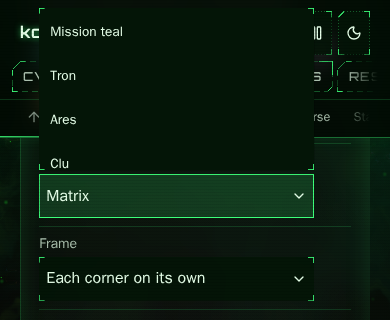
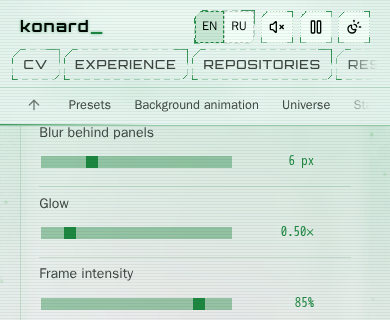
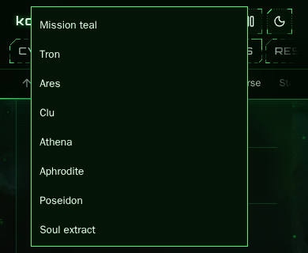

# Issue 54: framework migration draft and parity study

Work: [issue 54](https://github.com/konard/konard.github.io/issues/54),
[PR 55](https://github.com/konard/konard.github.io/pull/55).
Research dates: 2026-11-05–06. Baseline site: `f169665` (main).
Framework snapshots: `27d580f4bac4ebb4e70de3f78671153c2ef5dab9` from
PR 213 (now merged), with ui-i18n/ui-convert/ui-devmode from merged PR 214 at
`e37935ea195fca55cb2ee6a5d2c1723858cd7f81`. Each archive has its own audited
revision in the manifest. The initial snapshot was `f72e97f`.

The draft integrates framework settings validation/defaults/differences,
select rendering and behavior, floating color-picker positioning, translation
catalogs, palette tokens, the official notation parser, and the DOM inspector.
The original rich settings panel, transparent frames, network geometry and
optical/audio backends remain necessary compatibility implementations.
**Full upstream support for every reusable feature is still blocked by the
gaps reported below. This is not a completed replacement of all site UI.**

## Complete requirement inventory

The issue body is preserved in `data/issue-54.json`. It has no comments or
required child issues. All three PR feedback channels were read: conversation
comments, inline review comments and submitted reviews; none contained feedback
at the initial audit. Upstream issue 66 is related design guidance based on an
older site revision; its full body and comments are preserved separately.

| Original requirement | Considered solution and executed plan | Verification / status |
| --- | --- | --- |
| Fully draft migration to link-foundation/ui | Install a reproducible source snapshot; integrate current supported APIs; retain explicit adapters at unsupported boundaries | Eleven pinned packages; `src/ui/framework.test.js`; production build and browser migration smoke |
| Double-check similar or close rendering | Freeze old settings/looks, capture before and after using identical seeded browser inputs, compare themes, sizes, pages and presets | `renderings.mjs`, committed representative screenshots and comparison data |
| More polished behavior wins | Preserve the existing rich previews, frames, live editing and geometry; adopt framework controls, collision-safe placement and inspector where usable | Existing feature/browser suites plus migration checks; no blanket replacement with less capable widgets |
| Report every framework missing feature or bug blocking full use | Reproduce actual failures and compare source APIs with current contracts; file grouped, actionable upstream reports | Reports 209–212, exact report bodies retained here |
| Draft with workarounds at the same time | Compatibility schema projection, control events/styles, legacy storage/CSS boundary and source archives; initial browser transforms were removed after upstream fixes | Public-contract tests, palette/default fixtures, production inspector and keyboard checks |
| Ensure all reusable features are fully supported upstream, making this site's UI as short as possible | Prefer framework engines; identify APIs required to remove each remaining generic backend; propose provider/schema extension points | **Blocked:** the current upstream release cannot express the complete control/panel/frame/network/material contracts. Reports alone do not satisfy this criterion |
| Collect all data in docs/case-studies/issue-54 | Preserve issue/feedback/source metadata, frozen schemas/looks/palettes, upstream reports, verification records and screenshots | This directory and its relative links; source archives and manifest are under `vendor/link-ui` |
| Deep analysis, online facts, existing components/libraries, solutions and plans for every requirement | Inspect current framework code and recent related PRs; consult primary npm, Vite, WAI and Floating UI documentation; compare alternatives below | Source links and reasoning below; plans per requirement and per remaining backend |
| Execute in this single PR until every criterion is addressed | Keep the draft, adapters, tests, evidence and findings together in PR 55; retain positive closing reference | PR remains unmerged; the full-support criterion above must remain explicitly unfinished |

## What moved into the framework

| Area | Framework implementation | Consumer boundary that remains |
| --- | --- | --- |
| 608 settings in 20 sections | `ui-settings` readSchema/defaults/merge/diff, strict primitive/continuous clamp policies and shared-look comfort metadata | Existing metadata projection, historical color casing and transparent-surface migration |
| Select controls throughout settings/editor | `ui-components/controls` mountControls, official LiNo behavior machine, external label/list names, disabled clicks, Tab/page keys, pointer focus, bounded popup and ui-dom/store | React event/localized label/skin bridge; the earlier local interaction and menu-sizing handlers are removed |
| Color picker position and channel parsing | `ui-components/overlays.positionFloating`, controls.parseHex | Preserve live hex drafts, RGB sliders and named palettes; observers exist only while open |
| Static English/Russian messages | `ui-i18n` readCatalogs/createLocalizer/message; 809 entries in each locale catalog (808 extracted messages plus the options-list accessible name) | Lazy bilingual getters keep CV exports, stable keys and existing language switch compatible. Dynamic domain messages and external data retain their existing representation |
| Twelve palettes, dark and light | `ui-tokens` readTokens/resolveTokens/toCss over `src/ui/palettes.lino` | One RGB-channel CSS bridge preserves alpha compositing and existing surfaces exactly |
| Links Notation network input | `ui-core.parseLinks`, backed by official links-notation | Numeric network semantic validation, comma compatibility and historical adjacent-pair line separation; other mathematical/base representations are domain code |
| Optional development UI | `ui-devmode/foreign` over the whole React document | Lazy URL/hotkey activation; PR 214 supplies browser imports/assets, so the converter alias and asset transform are deleted |
| Number parsing and number/range keys | `ui-components/controls.readNumber` with clamp normalization and `nextValue` with directional snapping | Preserve the polished native input/draft presentation, native text navigation and ten-step Page keys |

No new general-purpose widget library was introduced alongside the framework.
The archives contain upstream code and license files; they are not a local
reimplementation under the framework's name. Node-only generation keeps the
catalog and token sources usable by build tools, CV export and browser code.
The site retains its existing React entry points and all ten real page URLs.

## Upstream reports and deletion gates

| Report | Evidence and workaround | What must happen before deleting the consumer implementation |
| --- | --- | --- |
| [209: package publication](https://github.com/link-foundation/ui/issues/209) | npm E404 for the workspace package; siblings are 0.0.0. Ship immutable local npm archives with manifest hashes | Publish coordinated, versioned packages and test installation/build in an external consumer |
| [210: controls and settings](https://github.com/link-foundation/ui/issues/210) | Initial snapshot fails disabled-click, Tab/page and sizing contracts; rich settings has 349 conditional fields. PR 213 now implements controls/panel/codec/coercion hooks; this draft adopts its select and strict-normalization APIs | Complete upstream CI and consumer parity for the rich panel/editors/paint hooks before deleting their remaining implementations; see the follow-up analysis below |
| [211: rendering and materials](https://github.com/link-foundation/ui/issues/211) | Network geometry/export/solver and independently configurable transparent frames cannot be represented by current APIs | Introduce geometry/export/solver providers and per-corner/edge/state/level schemas with fit/material hooks; match the existing geometry and visual contracts |
| [212: browser packaging](https://github.com/link-foundation/ui/issues/212) | Initial imports/assets broke production; PR 214 supplies browser entry points and statically analyzable assets | Adopted without the consumer alias/transform; production build and inspector smoke verify this boundary. Package publication remains separate (209) |

Exact report bodies: `upstream-packaging.md`, `upstream-controls.md`,
`upstream-rendering.md`, `upstream-browser.md`. These reports describe reusable
requirements without copying site implementations into the upstream project.

Remaining generic code is deliberately inventoried, rather than hidden behind
the word “adapter”:

| Remaining consumer code | Remaining replacement boundary | Follow-through plan |
| --- | --- | --- |
| `SettingsPage`, previews, section placement, preset UI | PR 213 now supplies localization and panel hooks; actual site frame previews still depend on unsupported frame/material backends | Preserve the existing polished presentation until providers and complete consumer parity permit deleting it (210/211) |
| `NumberInput`, color editor | Continuous parsing and directional arithmetic are shared. Upstream supplies translated labels and RGB editors; native input/draft presentation and the existing named-palette popup differ | Preserve the polished presentation; share additional rendering when its presentation contracts match (210) |
| `settings/notation`, `apply`, before-paint script and storage bridge | Strict primitive policy is adopted; new codec/paint hooks still need integration with historical formats, corner inheritance and derived material values | Share the rendering projection once report 211's provider/schema contract exists; preserve old storage/share URLs and comfort choices (210/211) |
| `skins.frames*`, frame CSS generator, fit rules, refraction/noise/material surfaces | Four independent corners/edges, many element levels/states, transparent masks and optical layers | Framework schema/provider implementation plus the existing frame tests at every level and state (211) |
| `links` geometry, marker placement, collision solver, SVG/raster export, history UI | Continuous self-referential cubics, nine markers, independently editable turns/gaps, pinned solutions and exact preview/export parity | Implement provider hooks and migrate one backend at a time against existing editor/browser suites (211) |
| Sound bus/player and event governor | Configurable room/tone/reverb, non-repeating random selection, live gain/pan/humanization and current patches | Extend framework audio contracts; preserve no-autoplay, suspension and existing fake-audio tests (211) |
| Shader/canvas backgrounds, chart tooltip and chart-specific renderers | Existing artwork/interaction and accessible data renderers do not all have equivalent framework primitives | Keep domain data/artwork; upstream reusable governor/material/anchoring primitives before replacing generic pieces (211) |

The site's repository contains no license grant permitting transplantation of
its implementation upstream. Related upstream issue 66 explicitly calls for
an owner licensing decision before copying code. This migration neither picks
a license for the owner nor copies unlicensed source to another repository.
New upstream implementations or owner-authorized contributions are needed to
meet the full-support criterion; preserving functionality here is not proof
that upstream already supports it.

## Alternatives and primary-source research

The npm documentation permits local file dependencies and notes the installation
requirements for them. Immutable packed archives avoid depending on a live
monorepo layout while publication is unavailable. All eleven package digests
are tested, and npm's lockfile supplies integrity checks during installation.
[npm package.json documentation](https://docs.npmjs.com/cli/configuring-npm/package-json/).

Using native HTML select would reduce event code, but would lose the site's
configurable framed popup and styling. The framework select is the chosen
shared implementation. Its keyboard behavior was compared with WAI's
select-only combobox example, which describes committing on Tab and retaining
the previous selection on Escape. Existing regression tests protect those
behaviors; these tests do not constitute a screen-reader certification.
[WAI example](https://www.w3.org/WAI/ARIA/apg/patterns/combobox/examples/combobox-select-only/).

Floating UI already underlies the framework's controls. Its autoUpdate utility
handles scroll/resize anchoring and requires cleanup when an overlay closes.
The color picker now calls the framework positioner only while mounted, removing
its hand-written resize/scroll position calculation. Adding another popover
dependency would duplicate an existing framework facility.
[Floating UI autoUpdate](https://floating-ui.com/docs/autoupdate).

Vite statically analyzes the standard new URL pattern for asset bundling. The
upstream globalThis.URL variant is not recognized in the observed production
build. The initial draft used a two-file transform and converter alias. PR 214
now provides the browser-safe imports and standard asset expressions upstream;
both consumer workarounds are deleted, with the source archives unmodified.
[Vite static assets](https://vite.dev/guide/assets.html#new-url-url-import-meta-url).

The existing React 19 host already supports the site's data-heavy content and
CV generators. Replacing it wholesale before frame/panel/network parity would
increase risk without eliminating the unsupported backends. A framework-owned
island for each select, shared settings engines and a foreign-DOM inspector
provide actual framework behavior now. CodeMirror/Monaco, ECharts and Mermaid
are optional framework adapters for other use cases; adding them would not
solve these frame, storage or network geometry requirements. The current D3
and official Links Notation dependencies remain useful for domain rendering
and notation rather than a second competing UI stack.

## Verification protocol and limitations

Baseline artifacts were recorded before replacement in their own commit.
`src/settings/contracts.test.js` freezes saved JSON, shared-look comfort and
recovery, new share links, before-paint behavior and network URLs.
`src/ui/framework.test.js` checks every original rule/default, complete palette
CSS, generated locale data and source archive hashes. Existing select/color
tests check disabled options, keyboard navigation, focus, drafts and palettes.

`npm run test:ui:migration` runs the production integration smoke in each CI
browser job: legacy JSON, menu bounds, Tab commit and persistence, English/Russian
switching, historical/indented notation with malformed-record rejection,
mobile overflow, and opening/closing/reopening the real lazy inspector.
The repository's existing editor, geometry, slider, frame, export and CV
coverage remains in the workflow; it must pass on the final PR commit.

Rendering samples use frozen default/calm/fast presets, light/dark themes,
1280×800 and 390×844 viewports, and home/settings/network/art routes. Randomness
is seeded, motion disabled, fonts awaited and remote content blocked in both
phases. Each sample starts a fresh browser to bound canvas/GPU memory. Pixel
differences are evidence for review, not an excuse to replace more polished
features. Representative before/after PNGs are in `screenshots/`.

An initial Linux WebKit matrix probe was killed under this container's 2.92 GiB
memory limit when browser and other work overlapped. It is not recorded as a
pass. Subsequent local browser work runs sequentially; CI's macOS WebKit job
provides the platform-specific editor/frame coverage. No timeout or memory
budget was raised to conceal this limitation.

The comparison discovered an actual draft regression: palette CSS omitted
all RGB channels because a closing-brace replacement ignored the generated
trailing newline. That failure removed neon frames. The corrected generator
now has a complete 24-palette fixture comparison. The committed final
screenshots were regenerated after that correction.

The latest Chromium matrix contains 47 exact matches among 48 paired captures
at pixelmatch threshold 0.1 (antialias differences excluded). The remaining
default/dark/mobile/art capture differs by 5,954 pixels (1.8088%), entirely in
the top navigation at x=16–377, y=49–79. Titles/headings remain identical,
with no horizontal overflow or page errors. These are viewport
samples, not full-page screenshots of all 608 controls. Direct Playwright MCP
checks additionally cover the opened select, Tab commit, composite reference
labels, the mobile RGB/palette chooser and the live inspector. Before/after
menu bounds were identical. The comparison summaries record control counts;
framework hidden form inputs increase DOM control counts without adding visible
fields. See `data/chromium-comparison.json` and `screenshots/`.
The bounded `navigation-capture.mjs` probe reproduces both scroll positions
on the original production build: scrollLeft 473 once and 322 twice in three
cold loads. All three migrated loads produce 322; waiting another second does
not change either result. The navigation's unchanged mount effect centers
before awaiting web fonts, so font-load ordering is a likely explanation,
rather than a proven regression from the new select. Raw differences remain
in the comparison; `data/navigation-capture.json` and the before/after
`navigation-art-*.png` screenshots retain the evidence.

A separate 390×320 probe found that a long palette menu extended above the
screen (y=-144.22, height=320). The initial adapter capped height to available
space and observed viewport resizing; the adopted upstream select now owns
both behaviors, deleting that workaround. The same anchor yields y=8 with
the entire menu in view. The migration smoke fails before the original
fix and checks both the short viewport and resizing an open menu afterward.
See `screenshots/draft-landscape-menu-before.png` and
`screenshots/draft-landscape-menu-after.png`; report 210 includes this evidence.
The latest upstream-owned result is
.

Firefox's paired production matrix has 47 exact viewport matches and one
114-pixel difference (0.0346% of a 390×844 viewport), confined to the right
edge of the mobile top navigation (x=352–377, y=50–80). All 48 cases retain
their headings/titles, fit the viewport and have no page errors. See
`data/firefox-comparison.json`; this small difference is recorded, not discarded.

`audit-messages.mjs` expands catalog calls and compares syntax trees with main:
52 files changed only for catalog extraction preserve their original logic and
exact text in both languages. The five mixed behavioral files receive focused
diff review and tests. `data/source-line-counts.json` records selected consumer
files, including added compatibility modules. Select and color positioning
shrink, but the draft does not claim a net repository reduction: catalogs,
source archives, adapters and regression evidence are real additions.

## CI investigation of the first integration draft

[Run 42110736077](https://github.com/konard/konard.github.io/actions/runs/42110736077)
started at 21:13:57 UTC on the actual integration commit `8f357ec`, later than
the passing baseline run on `86ce022`. It exposed real browser failures; it
was cancelled after identifying the failures, then its failed job logs were
downloaded for investigation. It is not counted as passing.
The individual job logs are archived in `data/ci-42110736077.tar.gz`, with
exact filenames/line numbers and excerpts in `data/ci-failures-8f357ec.json`.

| Failure evidence | Root cause and correction | Regression coverage |
| --- | --- | --- |
| Chromium log 602: gradient missing; Chromium 639 / WebKit 459: six distinct layouts instead of seven | Native framework events bypass React's discrete event flush. Commit the React callback with flushSync at this integration boundary | Existing production editor and seven-placement browser checks |
| All engines' issue-25 check: four controls reported out of bounds | The old selector counts new hidden form inputs and misses custom-element comboboxes. Inspect visible input types and role=combobox instead, preserving and broadening the layout assertion | Existing English/Russian mobile card checks |
| Firefox log 1293: palette click yields #17de1d instead of #ff10f0 | The async floating position can move the chooser during a forced click. Keep it measurable but invisible until the first positioning callback, then focus its first slider | ColorInput positioning regression plus the existing real palette-click browser test |
| Focused label regression: 0, — void | String(array) inserts commas between React text fragments. Join the flattened text children instead | Select composite-label regression and direct browser checks |

React documents flushSync for third-party integrations that must expose an
updated DOM before a native callback returns; its cost makes a narrow event
boundary preferable to applying it to general settings updates.
[React flushSync](https://react.dev/reference/react-dom/flushSync).
Floating UI returns coordinates asynchronously and requires measurable initial
layout. Initial fixed positioning and visibility gating keep the chooser's
geometry stable until coordinates are ready.
[Floating UI computePosition](https://floating-ui.com/docs/computeposition).

## CI investigation of the browser-verified draft

[Run 42115569978](https://github.com/konard/konard.github.io/actions/runs/42115569978)
started at 21:45:52 UTC on `b38f528`, after that commit was pushed. All three
browser jobs passed, including every existing editor/frame/palette suite and
the new production migration smoke. The subsequent unit job passed 1,245 tests
and failed five. Full workflow and unit logs are archived in
`data/ci-42115569978.tar.gz`; `data/ci-failures-b38f528.json` records exact
source lines and focused reproduction commands.

| Failing existing contract | Root cause and correction | Verification |
| --- | --- | --- |
| CV Style and Russian Blog Language labels | A generic framework label and in-place hidden options pollute implicit label text. Derive the button name from its actual host label, remove the unused generic label, and give each list a separate localized name | Existing CV/Blog tests pass; added Select test checks unique label lookup and distinct list naming |
| Conditional My colour field | The hidden listbox inherits the selected option's text as its name, creating a duplicate label match with the actual field | Remove that label reference and use Options: Colour; the existing conditional-settings test passes |
| One open color chooser at a time | Positioning now focuses the first slider asynchronously, allowing two synthetic opens before either focuses | Focus the trigger immediately before opening, preserving the existing single-chooser rule; existing slider-ID regression passes |
| SVG-only interface | The draft adapter used a character glyph for its chevron | Restore the existing Lucide SVG shape as a CSS mask, preserving its upstream license notice; existing icon scan passes |

The exact five failing tests pass after these corrections. The control and
framework fixture check passes all 17 tests. Before/after chevron screenshots
are `screenshots/draft-chevron-before.png` and `screenshots/after-chevron.png`.
Final current-commit CI, including the complete unit suite and CV export, must
still pass before reporting the draft's implementation as verified.

A real Chromium forced-colors probe additionally found a masked icon contrast
regression: the pseudo-element's text was black but its forced background
became white, hiding the SVG on the white button. Using ButtonText for the
mask in forced colors and preserving that background fixes it in light and
dark high-contrast schemes. A new Chromium migration smoke assertion fails before this change; `draft-forced-colors-before.png` and
`after-forced-colors.png` preserve visual evidence. Other button colors continue
to use the system's forced colors.

## CI dependency installation investigation

[Run 42123506812](https://github.com/konard/konard.github.io/actions/runs/42123506812)
started at 22:40:43 UTC on `7975333`. Chromium passed the complete browser job.
Firefox reached its existing 15-minute limit during OS dependency installation;
no Firefox tests ran. The archived job log and exact lines are in
`data/ci-42123506812.tar.gz` and `data/ci-firefox-install-7975333.json`.
Line 437 requests 48.8 MB, lines 453/458 retry slow Azure downloads, and line 466
records cancellation at 22:57:08. This is an installation failure, not a pass.

GitHub's runner-image maintainers track the same slow-transfer problem in
[runner-images issue 14823](https://github.com/actions/runner-images/issues/14823).
Their [APT configuration](https://github.com/actions/runner-images/blob/main/images/ubuntu/scripts/build/configure-apt-sources.sh)
puts Azure first, followed by the standard Ubuntu archive and security endpoints.
Both browser-install steps (the browser matrix and CV PDF generation) now remove
only the Azure entry on Linux, keeping those standard fallbacks. macOS installation
and every test/job timeout remain unchanged. The existing real CI installation
and complete browser suites verify the correction on a fresh runner; YAML parsing,
Bash syntax checking and ShellCheck validate both steps locally. The original
runner issue, comments and its October 27 status screenshot are archived here;
the screenshot records that incident's status rather than today's service health.

## CI interaction timing investigation

The same run's completed WebKit job failed two existing assertions, while its
frame/palette and production migration checks passed. The complete workflow,
WebKit job and Firefox installation logs are all in `data/ci-42123506812.tar.gz`.
The run concluded cancelled and skipped the dependent unit/build/PDF job; none
of those skipped checks is treated as passing.

| Evidence in `webkit-42123506812.log` | Investigation and correction | Regression |
| --- | --- | --- |
| Line 462: one URL write during a held slider | A due debounce callback can run before React commits the native pointer listener's state update. Track the active gesture synchronously and guard the write itself, retaining debounced persistence after release | `network-history.test.jsx`: advance an already-due timer before React commits the pointer press; fails before and passes after |
| Line 828: frame intervals include 514 ms against the existing 500 ms limit | The adapter also patches every unchanged select on each parent render. Synchronize framework properties only when they change; keep label derivation and callbacks current independently. This removes measured redundant work, but does not establish the cause of the particular WebKit frame delay | `Select.test.jsx`: unchanged DOM with a new parent callback, then selecting invokes only that latest callback. Existing WebKit responsiveness assertion remains unchanged and must pass in current-commit CI |

`interaction-performance.mjs` bounds its real-browser probe to eight edits on
one page. Chromium measured 800 DOM mutations across 23 unchanged selects
before the correction and zero afterward; `data/select-mutations.json` retains
both results. Elapsed times varied and do not demonstrate a speedup. This probe
is diagnostic; the existing real worker/slider browser tests remain the CI gate.
The 23 focused select/color/framework/history tests pass after both changes.
`data/local-verification.json` preserves both minimal failing reproductions.
Existing opt-in `network.debug` tracing also records a deferred due callback;
tracing remains off by default.

## CI workflow-ordering investigation

[Run 42129275767](https://github.com/konard/konard.github.io/actions/runs/42129275767)
started at 23:26:37 UTC on `865f7ba`. All three browser jobs passed, including
the held-input history and unchanged 500 ms responsiveness assertions. Firefox
installed its browser dependencies in 23 seconds after the mirror correction.
The complete unit suite passed 1,252 tests and failed one workflow-ordering test;
the dependent build, CV PDFs and Pages artifact were skipped, not verified.

`unit-42129275767.log` lines 543–545 identify `workflow.test.js:45`: the test
compared an entire `run` block with the Chromium install command. The mirror
prelude changed that block into a multiline script, making the command appear
absent (index -1). Match an exact trimmed command line within each step instead,
preserving build → browser installation → PDF printing → artifact upload order
and explicitly checking that the production build exists. The focused workflow
suite reproduces the failure before this correction; all 18 tests pass afterward.
Full workflow/unit logs
are in `data/ci-42129275767.tar.gz`; `data/ci-workflow-865f7ba.json` records the
counts, exact failure lines and correction. Current-commit CI remains the gate.

## Follow-up adoption of upstream PR 213

At the earlier upstream check PR 213 contained only its initial placeholder.
At 23:56:20 UTC on November 5 it published revision `2efd7e2`, implementing
select/editor/panel and settings-engine contracts without copying consumer code.
Main still points to `f72e97f`; the new implementation is a draft, not a release.
The first follow-up archive pin adopted that new source rather than retaining
workarounds for features that upstream has implemented.

The select uses official external-label/list-label and menu dimension properties.
Its local disabled-click, Tab/page, pointer focus, outside-dismissal and viewport
handlers are deleted. React still adapts localized host labels, native-shaped
events, sound cues and the existing skin. Framework strict primitive and continuous
clamp policies replace the manual primitive filter; only historical color casing
and the transparent-surface migration remain at that import boundary.
All 18 focused select/storage/framework tests pass, including the unchanged-DOM
regression. The production build and all six Chromium migration checks pass.
The final expanded focused run passes all 61 select/color/number/settings/
framework/history cases. At this historical revision directional numeric stepping was a failing upstream
deletion gate: `0.075` stepped upward by `0.01` yields `0.09`, versus the
preserved consumer result `0.08`. Generated panel chrome and stepper names also
need translation hooks before replacing the English/Russian presentation.
The [upstream follow-up](https://github.com/link-foundation/ui/issues/210#issuecomment-6673053842)
and `upstream-controls-followup.md` preserve these remaining contracts;
`upstream-contracts.mjs` reproduces the numeric gap with a single finite input.

That historical upstream implementation was not fully verified:
[its browser run](https://github.com/link-foundation/ui/actions/runs/42133114748)
reports 513 passed, 21 skipped and six failed (three cases in each browser).
The archived log identifies stale End-key expectations (lines 1228–1232), an
unavailable offset editor in the settings preview (1302–1318), and 40-pixel new
steppers against a 44-pixel touch requirement (1356–1361). These failures do not
exercise the site's retained number/panel editors, but they prevent claiming
complete upstream panel/editor parity. Swift and one Windows Deno job also fail;
their status is recorded separately from this consumer's checks.
`data/upstream-pr-213.json` records the source/API/status analysis;
`data/upstream-pr-213-ui-ci.tar.gz` preserves the complete browser log.
Independent frame, geometry/export/solver, optical material and audio APIs remain
missing in report 211. The following updates supersede the initial control and
browser-packaging gaps, without completing full upstream support.

## Subsequent upstream control and browser fixes

At `cf2c89e`, PR 213 fixes the six recorded browser failures, the Swift vocabulary
and Windows Deno issue. Its full checks pass (60 success, 11 explicit skips),
including the [browser run](https://github.com/link-foundation/ui/actions/runs/42136219816).
The archived earlier failures remain historical evidence, not current failures.
At `4564597`, it adds directional stepping, translated number/color labels,
configurable panel messages with live locale changes, and grouped RGB channel
editors. The new APIs directly address the previous consumer follow-up.

At that snapshot the site delegates number/range key arithmetic to `nextValue` with
`snapping: 'directional'`; the `0.075` → `0.08` regression passes. Native text
navigation and the site's ten-step Page keys remain intact. At that snapshot continuous parsing cannot be delegated: public `readNumber('0.075', {step: 0.01})`
returns `0.08` for both draft and commit, even with directional snapping.
The site preserves continuous finite typed values and treats step as an
increment. At this historical revision `upstream-contracts.mjs` prints both
finite contracts; `STRICT=1` fails on the typed-value policy. The later
`27d580f` adoption below resolves that policy. The new consumer regression checks
`0.075` and clearing to `null`. The [follow-up report](https://github.com/link-foundation/ui/issues/210#issuecomment-6673550166)
and `upstream-controls-continuous.md` identify the exact implementation boundary.
The richer named-palette popup and actual frame previews remain in place;
localization and RGB support are no longer claimed missing upstream.

PR 214 at `e37935e` supplies browser-only converter/i18n entry points, standard
static asset references and a browser asset loader. Its three unmodified
packages are pinned alongside PR 213's eight control/settings packages, with
individual revisions, source permalinks and SHA-256 checks. Both the converter
alias and the Vite asset transform are deleted. The external consumer production
build and all six Chromium smoke checks pass, including real inspector assets,
close and hotkey reopen, without either workaround.
The [consumer confirmation](https://github.com/link-foundation/ui/issues/212#issuecomment-6673588779)
is preserved in `upstream-browser-followup.md`. The current render is
`screenshots/after-upstream-browser-inspector.png`.

The expanded focused run passes 64 tests in nine files. These checks verify the
adopted contracts; they do not claim every new upstream panel feature has been
migrated or every upstream job has finished at its latest revision. Remaining
full-support blockers after the adoption below are package publication, independent
frame/material, geometry/export/solver and audio APIs. The draft remains unmerged.

## WebKit navigation-readiness investigation

Run [42136628107](https://github.com/konard/konard.github.io/actions/runs/42136628107)
tests `81a3170` (created 00:24:48Z, finished 00:48:36Z on November 6), before
the newer control/browser adoption. Chromium and Firefox pass every browser
group. WebKit's gallery-to-editor color comparison fails with an empty path
list instead of two colors (`ci-42136628107.log`, lines 12467–12482).
The complete log is preserved in `data/ci-42136628107.tar.gz` and metadata in
`data/ci-42136628107.json`.

`navigation-readiness.mjs` reproduces the ordering with a finite 400ms delayed
editor bootstrap: the loaded URL initially has zero paths, then two after
waiting for the SVG paths to attach. This models asynchronous rendering rather
than changing production code. Both gallery and theory navigation assertions
now wait for their actual geometry before reading colors. Equality assertions
and the original 15-second timeout remain unchanged. Attachment is sufficient
for computed stroke reads, including vertical paths whose zero-width fill
bounds do not satisfy Playwright's visibility test.

## Continuous typed numbers and scrolled menus

PR 213 at `27d580f` introduces the explicit `normalization: 'clamp'` policy.
The site adopts that public `readNumber` API for continuous typing while keeping
its native input, drafts and pointer steps. The finite contract probe now passes
both typed `0.075` and directional `0.08`; the focused component regression also
verifies clearing an inherited override to `null`. The earlier quantization
report remains historical evidence, not an outstanding typed-number gap.

The same upstream revision shifts sized menus on both axes when their anchors
leave the viewport. Before adoption, open the palette menu at 390×320 and scroll
600 pixels: its top becomes -384.21875 and the menu disappears. The new production
smoke fails at its viewport-bounds assertion on `4564597`, then passes with the
unmodified `27d580f` package. The after geometry, public API results and full
before failure are recorded in `data/upstream-continuous-scroll.json`.

| Before scrolling fix | Upstream scrolling fix |
| --- | --- |
|  |  |

The production build, 64 focused tests in nine files and seven Chromium migration
checks pass on this snapshot. All original CI feature suites still run; the
full-support acceptance criterion remains unfinished for the separate backends.

## External rendering and publication blockers

A fresh read of upstream report 211 found its independent implementation attempt
[failed before creating its branch](https://github.com/link-foundation/ui/issues/211#issuecomment-6672139775).
GitHub rejected five pushes between 23:22:34Z and 23:23:08Z on November 5 with
`fatal error in commit_refs_rules`; no rendering implementation or pull request
was produced. A read-only matching-refs check at 01:08Z on November 6 still finds
no `issue-211` branch. The public failure comment and evidence are preserved in
`data/upstream-rendering-blocker.json`. This consumer branch cannot complete or
verify absent upstream frame/material/network/audio providers. Its working
implementations remain in place. Report 209 is also open; a fresh registry check
still returns E404 for `@link-foundation/ui-settings`. Neither reports nor passing
consumer checks complete these acceptance criteria.

## Current-head WebKit CI restart

The restart points to [run 42149266019](https://github.com/konard/konard.github.io/actions/runs/42149266019),
created November 6 at 02:16:28 UTC for `0f6238a`, the actual branch head.
The preceding `433338f` run passed. The latest main is already an ancestor;
there is no pending conflict or missing merge. All issue comments and all three
PR feedback channels were refreshed; there are no new implementation requests.

The downloaded complete log is `logs/deploy-42149266019.log.gz`. Its original
line numbers identify two distinct failures:

- Lines 11290–11302: the headed WebKit gallery's extra `page.screenshot` times
  out after reporting “waiting for fonts to load”, before its native display
  capture and blurred/sharp pixel comparison. All 4,131 cards have loaded and
  all bounded-surface/scroll samples have already passed. The call log alone
  does not prove why the screenshot internals stopped responding. Playwright
  has a [related Linux font-wait report](https://github.com/microsoft/playwright/issues/42986),
  but that is not proof of an identical macOS defect.
- Lines 11597 and 13117: the 30-minute WebKit job is cancelled during issue 37;
  `test` is consequently skipped and `pipeline-status` correctly fails the
  current head. The unchanged keyboard audit passed, but took 1,086 seconds
  against 587 seconds in the preceding successful run. Its serial placement
  consumed most of the whole browser job. Per-step timestamps from both runs
  are preserved in `data/ci-webkit-restart.json`.

The gallery now goes directly to the existing native compositor capture in
headed/display mode, retaining headless API screenshots and every pixel/CSS
assertion. This removes the redundant API snapshot that could prevent the
real compositor assertion from running. No font-readiness bypass is enabled.
The unchanged WebKit keyboard suite has a separate macOS matrix entry; all
other WebKit suites run in the editor entry. Every original suite still runs
exactly once per supported engine, including Chromium-only indicators. Both
entries retain the 30-minute timeout. Unique suite-aware concurrency and
artifact names prevent mutual cancellation and upload collisions. The gate
still requires the complete matrix to succeed.

`src/browser-matrix.test.js` evaluates the actual workflow conditions and
verifies exact coverage, independent keyboard execution, timeout, evidence
upload and concurrency/artifact names. Four cases fail against the original
workflow and all six pass after the correction. The display regression models
the observed throwing screenshot API and confirms native pixels are still
captured; the headless regression confirms API screenshots remain enabled.
Together with workflow/policy tests, all 49 focused tests pass. Before/after
logs are in `logs/browser-matrix-{before,after}.log`.

A sequential local Chromium run against the production build passed the
complete issue 23 script using native Xvfb screenshots and a bounded 1,215-card
sample, including all three skins, actual blur pixels, repeated scrolling,
geometry, sharing and the mobile editor. See `logs/chromium-gallery-restart.log`
and `data/chromium-gallery-restart.json`. The original 4,131-card runs remain
CI's responsibility. No product UI changed in this restart.

Review also found that the catalog-only audit still included NumberInput after
its intentional upstream parsing adoption. It now lists that component with
the other explicit behavior changes; its dedicated component tests verify the
parsing contract. All **52** remaining catalog-only files match their original
AST and exact bilingual text (`logs/catalog-audit-restart.log`). The earlier
53-file count predates that parsing adoption. The GitHub PR diff endpoint now
returns HTTP 406 because the accumulated diff exceeds 20,000 lines; local
`git diff origin/main...HEAD` and the AST audit provide the review fallback.

A fresh upstream check confirms PRs 213 and 214 are merged. This does not
publish their packages: `@link-foundation/ui-settings` still returns npm E404.
There is still no `issue-211` implementation branch and report 211 remains
open. `data/upstream-restart-status.json` records the new merged SHAs. The
independent frame/material/network/audio acceptance criterion remains
unfinished; this CI correction cannot supply those absent upstream APIs.
