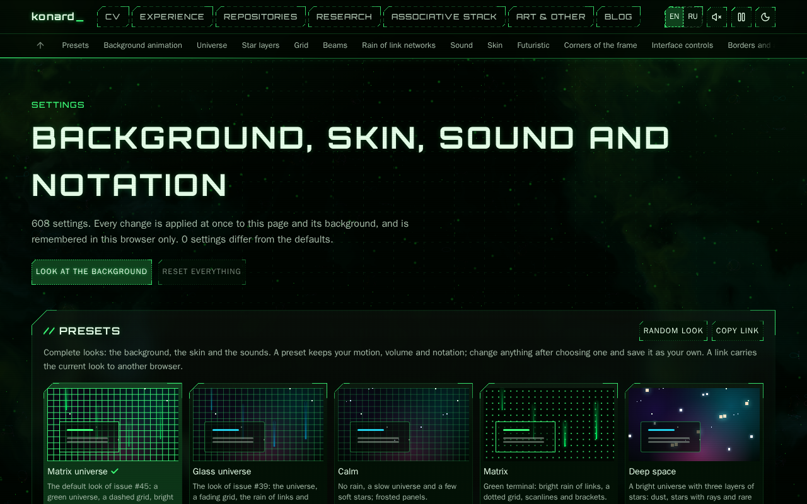
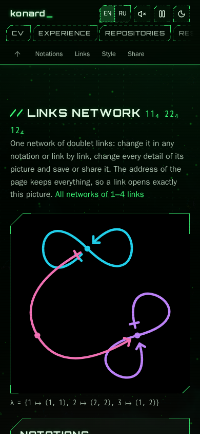

# November 20 published-package migration

[Issue 54](https://github.com/konard/konard.github.io/issues/54) and the [November 20 owner feedback](https://github.com/konard/konard.github.io/pull/55#issuecomment-7048299794) require a site-wide draft using the published framework, preservation of the experience, at least 90% exact visual agreement, and full upstream support for reusable UI. Issue 54 has no linked child issues. The [work plan](PLAN.md) tracks both the draft and the upstream requirement. The [earlier case study](README.md) preserves the first migration, regression investigations, and upstream requests.

## Requirements and evidence

| Requirement                                                                                       | Implementation and verification                                                                                                                                                                                                                                                                                                                                                                                                                        |
| ------------------------------------------------------------------------------------------------- | ------------------------------------------------------------------------------------------------------------------------------------------------------------------------------------------------------------------------------------------------------------------------------------------------------------------------------------------------------------------------------------------------------------------------------------------------------ |
| Draft the whole migration in PR 55 and use the npm releases                                       | Removed eleven vendored archives and their generator. `package.json` pins six direct dependencies: `ui-components@0.1.1`, `ui-core@0.1.3`, and `ui-settings`, `ui-tokens`, `ui-i18n` and `ui-devmode` at `0.1.0`. The lockfile resolves all eleven framework packages from npm with SHA-512 integrity. A clean `npm ci`, the registry contract test and the production build verify the published entry points, including worker and inspector assets. |
| Apply the migration everywhere in the code and docs                                               | Reviewed all ten production entry points and their shared layout, controls, i18n, palette, settings, effects, charts, embeds and network modules. The production migration smoke navigates through the existing public entry points. The main README links to this case study. Historical bundling instructions are recorded with their original revision.                                                                                             |
| Preserve the UI and favor small, evidence-backed refinements                                      | Retained the short-viewport select correction, native text navigation and rich previews from the earlier draft. The unchanged design uses the same colors, typography, frame geometry, chart data and site content. The browser migration suite exercises menu scrolling, keyboard, touch, forced colors, settings storage, bilingual labels and the inspector.                                                                                        |
| At least 90% exactly the same, with manual inspection of large differences                        | The [capture and pixel-comparison protocol](#visual-verification) uses all ten routes, three saved looks, both themes and two viewport sizes. The strict measure counts identical RGBA values. Differences beyond 0.5% of a capture are candidates for manual inspection. Browser suites also verify interactive behavior.                                                                                                                             |
| Shorten the site UI and make associative-network rendering and editors reusable                   | The draft adopts shared count, code, rank, naming classes, gallery enumeration, edit operations and formatters, the worker lifecycle, the browser raster encoder and seven share links. Relative to the preceding draft, the release migration deletes 280 net lines of production code in `src`. Full removal of the remaining general implementations is blocked by [the released contracts below](#released-contracts-and-workarounds).             |
| Report all observed framework bugs and missing features and use working alternatives in the draft | Reproduced released-package behavior, compared the completed upstream PRs against the site, and filed six follow-up reports with acceptance tests. The [contract probe](data/released-contracts.json) records parser, provider, share, embed and icon results. The compatibility implementations and their existing regressions remain active.                                                                                                         |
| Preserve issue data, research alternatives and verify CI                                          | Issue and PR feedback, the exact upstream reports, method, screenshots and test evidence are collected here. [PR 55 checks](https://github.com/konard/konard.github.io/pull/55/checks) report the current pull request revision. The [CI archive](README.md#ci-investigation-of-the-first-integration-draft) explains prior failures and regressions.                                                                                                  |
| Finish every acceptance criterion in the existing PR                                              | The full-upstream criterion remains open. The PR preserves the positive closing reference to #54 and stays a draft and unmerged. The upstream gaps are visible individually in the table below.                                                                                                                                                                                                                                                        |

The two latest upstream reviews rechecked requests 221–235 and their published packages. The initial registry failure is resolved. The related [upstream migration roadmap](https://github.com/link-foundation/ui/issues/66) asks for an owner licensing decision before copying code from this site, which has no repository license. The [November 20 roadmap update](https://github.com/link-foundation/ui/issues/66#issuecomment-7053358098) gives upstream reproducible behavior and test criteria for independent implementations.

## Released contracts and workarounds

| Area                                                                                                                                                                                                                | Released behavior and adoption decision                                                                                                                                                                                                                                                                                                                                                                        | Remaining replacement and verification                                                                                                                                                                                                                                                                                                                |
| ------------------------------------------------------------------------------------------------------------------------------------------------------------------------------------------------------------------- | -------------------------------------------------------------------------------------------------------------------------------------------------------------------------------------------------------------------------------------------------------------------------------------------------------------------------------------------------------------------------------------------------------------- | ----------------------------------------------------------------------------------------------------------------------------------------------------------------------------------------------------------------------------------------------------------------------------------------------------------------------------------------------------- |
| Settings controls, localization and palette tokens                                                                                                                                                                  | Keep the adopted settings validator, schema/default/diff engines, select, numeric parsing and key stepping, floating positioner, i18n catalogs, token resolver and foreign DOM inspector. The existing settings projection retains 608 fields and the build regenerates 24 palette variants and 809 strings per locale.                                                                                        | Preserve historical JSON and Links Notation, pinned comfort values and native input drafts. The settings and framework tests check exact schemas, palettes and locale keys.                                                                                                                                                                           |
| Settings panel and quick preferences ([#231](https://github.com/link-foundation/ui/pull/247), [#233](https://github.com/link-foundation/ui/pull/251))                                                               | The new panels expose basic tabs and fields. Full adoption would move sections when fields appear and replace existing labels, previews and preference semantics. The released switch cycles three saved motion values, while site users flip the effective value.                                                                                                                                             | [Upstream #276](https://github.com/link-foundation/ui/issues/276) specifies stable column estimates, host slots, before-paint projection, reduced-motion switch behavior and saved-look formats. Keep the existing panel and appearance application and exercise the saved-look/browser regressions.                                                  |
| Sound, governor and five background layers ([#222](https://github.com/link-foundation/ui/pull/236), [#223](https://github.com/link-foundation/ui/pull/237), [#224](https://github.com/link-foundation/ui/pull/239)) | The released sound bus fixes the gain downstream of the compressor/reverb and owns the output node. The frame governor owns scheduling. Its internal quality watcher has no public export. Released star sprites, random streams and rain cadence differ from the saved looks and shared grid coordinates.                                                                                                     | [Upstream #275](https://github.com/link-foundation/ui/issues/275) specifies configurable audio graphs, watcher export, separate random/sprite/phase hooks and equivalent batched cadence. Keep the current effect engine, patch definitions, keyboard feedback and no-autoplay behavior. Verify existing settings, audio and paused-background tests. |
| Independent frames and optical materials ([#225](https://github.com/link-foundation/ui/pull/240), [#226](https://github.com/link-foundation/ui/pull/241))                                                           | Framework frame spans and material styles implement independent layers. The host still needs geometry/style CSS for its existing pseudo-element surfaces and visibility callbacks, plus configurable textures, color and lighting equations.                                                                                                                                                                   | [Upstream #275](https://github.com/link-foundation/ui/issues/275) includes per-level/corner/edge/state/fit, combined skins, transparent surfaces and reduced transparency. Keep the frame and material pipeline and verify desktop/mobile in the current mounts and gallery.                                                                          |
| Network configurations and text editing ([#229](https://github.com/link-foundation/ui/pull/244), [#230](https://github.com/link-foundation/ui/pull/245))                                                            | Adopt the pure code, count, rank, rename, enumeration, decimal and editing primitives. The official notation parser is still used through the site’s compatibility boundary.                                                                                                                                                                                                                                   | [Upstream #272](https://github.com/link-foundation/ui/issues/272) reproduces one extra nesting accepted and seven formerly valid notations rejected. Keep support for historical separators, large digits, associative labels and both locale errors. Verify unit and editor-history suites.                                                          |
| Doublet renderer, layouts and the editor ([#227](https://github.com/link-foundation/ui/pull/242), [#230](https://github.com/link-foundation/ui/pull/245), [#256](https://github.com/link-foundation/ui/issues/256)) | Shared raster encoding consumes the same prepared SVG as the preview and SVG download. The shared target templates handle Telegram, VK, Facebook, LinkedIn, Reddit, Bluesky and WhatsApp. The site keeps its X and Mastodon endpoints and full email body. Published providers lack joins and fitted force tuning, consistent glyph/per-link color hooks, localized shares and complete URL gesture semantics. | [Upstream #273](https://github.com/link-foundation/ui/issues/273) specifies common preview/export/glyph geometry, hosts and localization, frontend focus and URL transaction behavior. Keep the existing renderers, gestures and share controls and check actual rectangular downloads and URL round trips.                                           |
| Painted collision solver ([#228](https://github.com/link-foundation/ui/issues/228), [transport PR 243](https://github.com/link-foundation/ui/pull/243))                                                             | The normal browser entry uses the released cancellable worker contract and Vite's worker URL. Its worker receives the current painted scorer and solver from the site. The published default providers expose only `geometry` and `svg`.                                                                                                                                                                       | [Upstream #271](https://github.com/link-foundation/ui/issues/271) specifies a default painted solver, tries turns before gaps and returns the same fitted frame. Retain the tested scorer, search, cancellation, no-Worker fallback and Apply behavior.                                                                                               |
| Scrolling layout and charts ([#232](https://github.com/link-foundation/ui/pull/248), [#233](https://github.com/link-foundation/ui/pull/251))                                                                        | Framework chart layouts cover the chart families. The site needs domain formatting, data tables, the shared overlay above clipped frames and its existing scroll containers, fades and anchor focus.                                                                                                                                                                                                           | [Upstream #276](https://github.com/link-foundation/ui/issues/276) specifies host attachment, accessible relationships, chart focus/tooltip placement and existing chart and mobile layout verification. Preserve domain data, the current D3 renderers and shared navigation.                                                                         |
| Provider embeds and icons ([#234](https://github.com/link-foundation/ui/pull/252), [#235](https://github.com/link-foundation/ui/pull/254))                                                                          | The site now uses the released retryable, deduplicated script loader. Its official-provider renderers retain sizing and archive fallback. The released Telegram adapter fixes the iframe at `600px` and reports ready on load, and the generated brand module includes GitHub only.                                                                                                                            | [Upstream #274](https://github.com/link-foundation/ui/issues/274) specifies provider-based readiness, responsive options for Telegram/X/VK, archive slots and selective icon builds. Keep the provider renderers and existing single-icon imports.                                                                                                    |

The exact text sent upstream is in [release-reports](release-reports/).

## Alternatives and sources

- Use exact registry versions and the lockfile, which records the tarball URLs
  and their integrity. Retain the previous source archives in Git history for
  reproduction of the November 9 audit. [npm lockfile](https://docs.npmjs.com/files/package-lock.json/), [npm ci](https://docs.npmjs.com/cli/commands/npm-ci/).
- Use the released worker contract with a Vite module-worker entry. The
  production browser target includes browsers that implement structured cloning.
  The existing no-Worker rendering path evaluates the same local solver.
  A renderer-only provider supplies a drawing after turns are known and cannot
  find the turns itself. [Vite build targets](https://vite.dev/config/build-options#build-target), [MDN structuredClone](https://developer.mozilla.org/en-US/docs/Web/API/Window/structuredClone), [upstream solver transport](https://github.com/link-foundation/ui/pull/243).
- Use the released raster encoder with the site's prepared SVG, explicit quality
  and JPEG background color. The site's maximum is 4096 × 4096, within the
  encoder's 16,777,216-pixel default. Browsers may fall back to PNG when asked
  for an unsupported canvas type, so the encoder verifies the output MIME type
  and the site retains its PNG suggestion. [Canvas toBlob](https://developer.mozilla.org/en-US/docs/Web/API/HTMLCanvasElement/toBlob).
- Keep provider-managed sizing and archived fallbacks while adopting shared
  script loading. A fixed iframe height cannot accommodate arbitrary posts, and
  the iframe load event cannot establish that the post is available. [Telegram post widget](https://core.telegram.org/widgets/post), [MDN iframe load/error behavior](https://developer.mozilla.org/en-US/docs/Web/HTML/Reference/Elements/iframe#error_and_load_event_behavior).
- Keep native React host elements and the earlier framework select and floating
  positioner integrations. The earlier research compares native select, Floating
  UI, framework DOM islands and wholesale replacement with a second widget stack.
  [Earlier alternatives](README.md#alternatives-and-primary-source-research).

## Visual verification

The baseline is main at `f169665ce794aa13cde471797473acfdb69c051e`. Compare
production builds at 1280 × 800 and 390 × 844, in English, with three preexisting
looks and light/dark themes. The capture uses the same seeded random sequence and
fixed time for each build, with animation paused and external resource requests
blocked. Counts are per browser. The scripts additionally compare page titles,
main headings, runtime errors and new horizontal overflow.

```sh
npm ci
npm run build
node experiments/framework-migration/released-contracts.mjs
# Serve baseline and migrated build/ directories on 4174 and 4173.
for engine in chromium firefox; do
  PHASE=baseline BASE=http://127.0.0.1:4174 ENGINE="$engine" node experiments/framework-migration/renderings.mjs
  PHASE=after BASE=http://127.0.0.1:4173 ENGINE="$engine" node experiments/framework-migration/renderings.mjs
  ENGINE="$engine" node experiments/framework-migration/compare.mjs
done
```

Build the baseline from the pinned revision using its own checkout. Exact agreement
is pixel-weighted across the 120 captures. The per-capture JSON also records
every pixelmatch result at threshold 0.1 with anti-alias detection.
Dynamic states, downloads and provider fallback use the browser tests in
addition to these still captures.

| UI                    | Original                                                                         | Published-package draft                                                      |
| --------------------- | -------------------------------------------------------------------------------- | ---------------------------------------------------------------------------- |
| Desktop settings      |     |     |
| Mobile network editor |  |  |

| Browser                                           | Captures | Exact pixels | Identical captures | Least exact capture |
| ------------------------------------------------- | -------: | -----------: | -----------------: | ------------------: |
| [Chromium](data/release-chromium-comparison.json) |      120 |     99.9639% |                 92 |            97.8172% |
| [Firefox](data/release-firefox-comparison.json)   |      120 |     99.9969% |                 95 |            99.7047% |

Four Chromium captures differed by more than 0.5% of exact pixels. Manual
inspection of Art, Associative Stack and both Research themes found the visible
changes within the horizontal navigation strip, at y=49–79. The current route
appears nearer the center when centering runs with the final font metrics.
The [original](screenshots/release-before-chromium-largest-change.png) and
[draft](screenshots/release-after-chromium-largest-change.png) Art captures
show the same 5,954 different pixels as the earlier audit. That audit reproduced
both scroll positions on the original build. The release comparison includes
these differences. [Prior investigation](README.md#verification-protocol-and-limitations).

## Functional verification

- `npm ci` installed the registry dependencies from the committed lockfile.
  `npm run build` verified the static entry points and built the worker as a
  separate production asset. `npm run check` passed the lint, format, file-size
  and secret checks.
- Focused Vitest runs passed 25 registry, settings and input tests, 186 network,
  editor and worker tests, and 6 export and social widget tests. The final
  targeted run passed the share, cancellation and edit-during-Apply regressions.
  The share test checks target order, the X and Mastodon domains and the Unicode
  email body.
- `node experiments/framework-migration/audit-messages.mjs` compared the
  original syntax trees and exact English/Russian text of 51 catalog-only
  files. The raster migration touches the share component’s logic and the same
  audit verifies that its message keys match the preceding checked draft.
- On the production network page, open `/network/?code=2211&solve=true`. The
  shipped worker reduced the overlap score from 5.8 to 0.0. Apply stored turns
  and the fitted frame in the URL without adding cuts. PNG, JPEG and WebP
  downloads generated actual raster files at 256 × 384.
- The Chromium migration smoke passed all seven checks, including forced
  colors, a short landscape select, legacy settings and the production
  inspector. The network editor suite checked gallery navigation, two-way
  editing, an identical SVG from the shared URL, and SVG, PNG, JPEG, WebP and
  LiNo downloads. The worker suite independently recorded eight solved cases
  with zero final overlap. [Smoke results](data/release-chromium-smoke.json),
  [worker results](data/release-chromium-solver.json).

### WebKit settings readiness

The review run on `6965e6d` passed the WebKit editor, export, solver and
appearance checks. The settings smoke took an immediate count of the accessible
English `Motion` combobox and received zero during the initial React mount.
Chromium and Firefox happened to see the control immediately. The WebKit gate
reported `0 !== 1` at `smoke.mjs:43` before testing settings interactions.
[CI job](https://github.com/konard/konard.github.io/actions/runs/44838853274/job/136642431372),
[complete run log](data/ci-44838853274.log.gz), lines 11617–11639.

`node experiments/framework-migration/navigation-readiness.mjs` reproduces the
ordering with a 400 ms delayed settings bootstrap. The old immediate count got
zero and the wait for the visible, named control got one. The smoke now waits
for that exact role and accessible name in both languages before testing
keyboard and persistence. Its viewport assertions exercise the same menus.
[Reproduction data](data/release-navigation-readiness.json).

The constrained Linux GTK headless run mounted the combobox but stalled on
scrolling through the settings page. The pixel matrix uses Chromium and Firefox.
The WebKit interaction checks run on the macOS CI runner.
