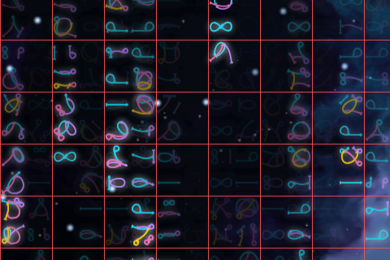
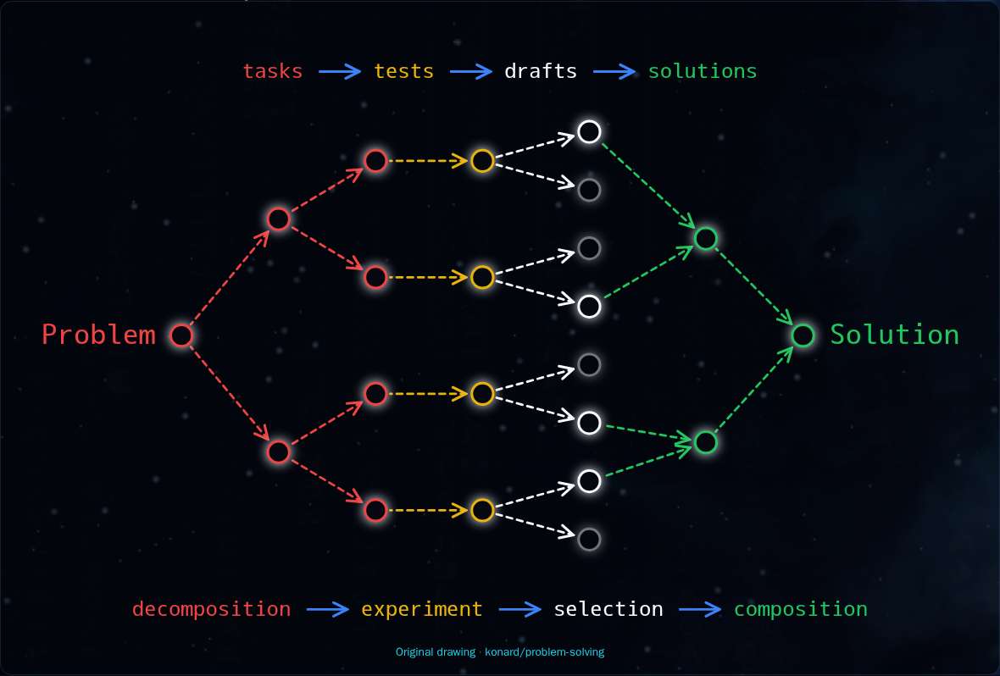
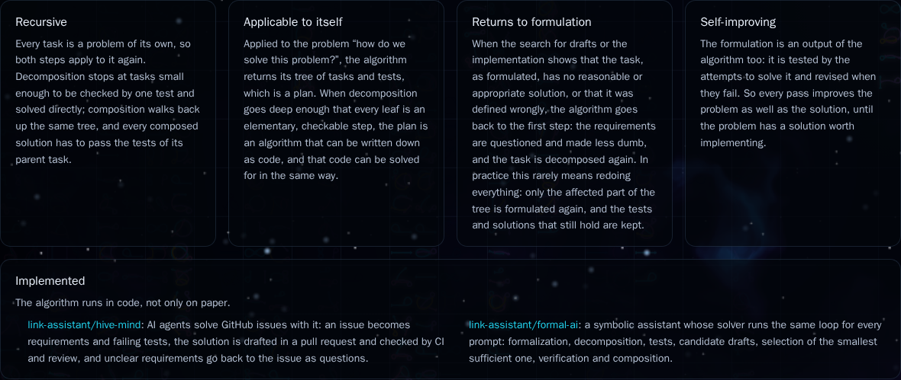
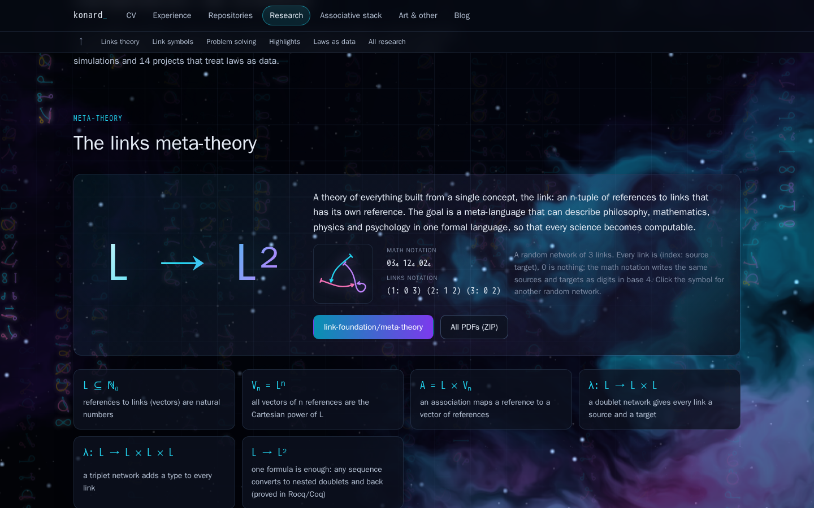
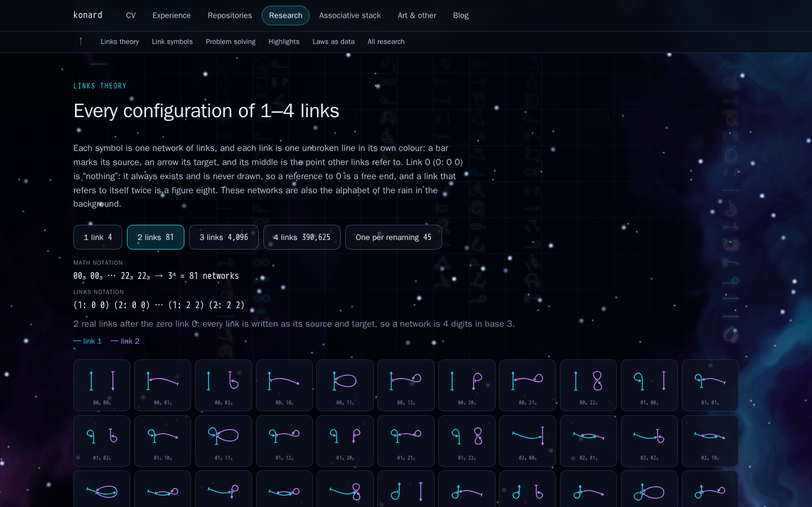
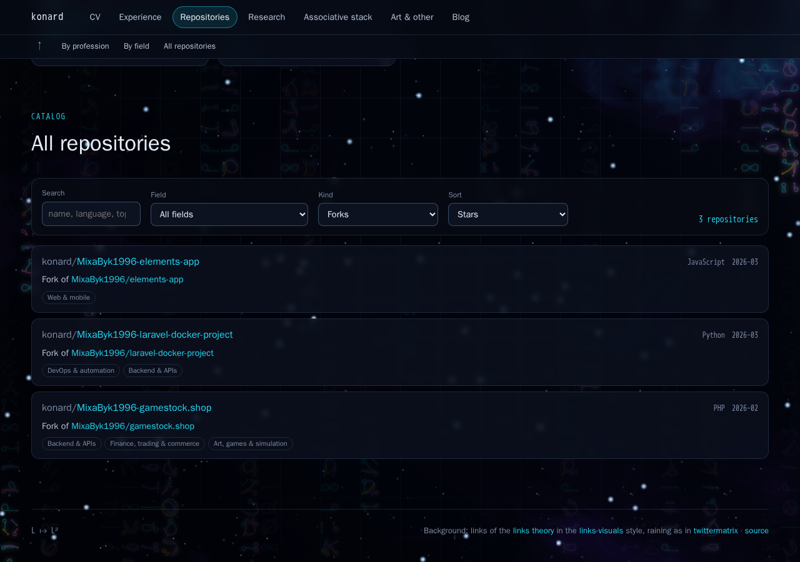
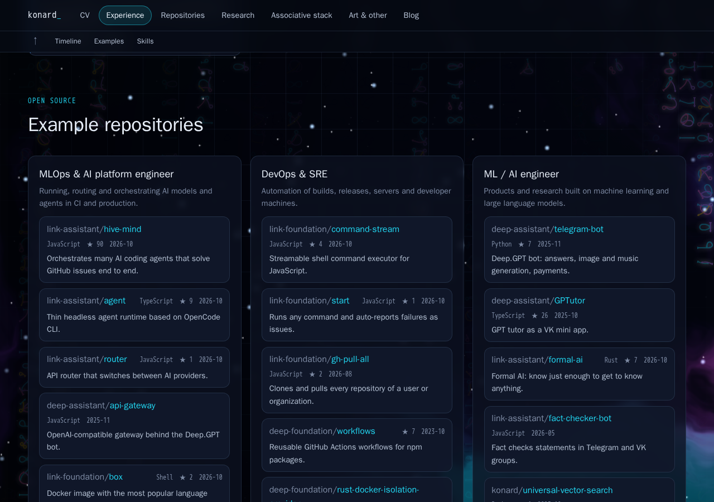

# Case study: issue #9 — link networks on the grid, problem solving diagram, network gallery and a cleaner ecosystem

- Issue: https://github.com/konard/konard.github.io/issues/9
- Pull request: https://github.com/konard/konard.github.io/pull/10
- Builds on: [issue #7](../issue-7/README.md) (repositories by field, roles, research and links visuals)
- Data snapshot date: 2026-10-21 (repository health), 2026-10-19 (repositories and registries of issue #7)

## 1. The issue

The issue (created 2026-10-21T08:15:10Z, no comments) is copied in full to [`data/issue.json`](data/issue.json); its
ten screenshots are in [`images/`](images). In short:

> Generated links networks as symbols must be aligned by the grid, in this case we should fit exactly two columns of
> symbols per grid cell/column. ([img1](images/img1-afc5449e-3177-4369-a926-033b81bd97b8.png))
>
> Animated SVG of Unversal Problem Solving has problems with display of symbols, for example there is no visible `S`
> in `Solution`. Decompostion has overlap with arrow (link). We should double check everything is perfectly aligned in
> all places. ([img2](images/img2-0eb56fe5-5559-460a-b75c-43198928b4d5.png))
>
> `After the original drawing by konard. Dimmed drafts are the experiments that did not pass their tests.` that is too
> verbose, we should just give link to original drawing and original idea repository.
>
> We also should explain that this recursive algorithm, which can be applied to itself allows to produce a plan, or
> even in algorithm if decomposition is deep enough […] once we understand that during solution implementation or
> solution search we need to change definition of a task, we go back to first stage and redo everything recursively,
> in real life it is rarely means redoing everything from scratch […] So it includes `making requirements less dumb`
> […] we have actual implementation of this algorithm in the code at github.com/link-assistant/hive-mind, as well as
> in github.com/link-assistant/formal-ai.
>
> By clicking at links network in such sections we should be able to show random links network as per possible
> configurations, with math and links notation of links network. We should clearly state with small font what is math
> notation, and what is links notation. ([img4](images/img4-38f1debb-c3cf-4d3f-bce1-2f5b7dc4539a.png))
>
> Also visual of the links network itself is wrong. […] the line continuity cannot be ever broken in the middle of a
> link. […] different colors for each link […] The links that starts in itself and ends in itself must be symmetrical
> […] closer to symmetrical 8, not one sided eyeglasses. ([img5](images/img5-119b2b3e-a43a-452c-a3ce-1aac565c68eb.png),
> [img6](images/img6-40841ca2-417e-4e81-845d-107881f64200.png),
> [img7](images/img7-7c12de56-9d3a-4c48-b105-4d542c1d42d9.png)) We struggled alot to make it right at blueprint of
> github.com/konard/links-visuals, here we should do even better.
>
> We should preserve 0 as nothing or link from nothing and to nothing. […] 00 - (just a link floating), 10 - (self
> starting link), 01 - (self ending link), 11 - (self referencing twice) […] For 2, 3 and 4 real link we have lots of
> possibilities missing. ([img8](images/img8-f25f0754-9c9c-4718-b083-fd5cd96d803e.png),
> [img9](images/img9-7c7f5049-0acf-4fac-ae90-178b63e3cb9c.jpg))
>
> In open-source ecosystem view we should not show organizations like: EfficiencyParadigm, Qvinciy, Gls-full,
> links-games, open-online-tools, Svetozar-Technologies, meteor-shuttler […] filter automatically empty repositories
> like https://github.com/konard/TheAnime […] exclude something the looks like broken forks -
> https://github.com/konard/slava (we should detect such).
>
> `copies of client projects kept for history` it looks like I have stolen some private repository, as in really
> maximum we can have is public forks, and we should not present information about private repositories even if we
> have them. ([img10](images/img10-dc1f673e-455f-40c2-a25d-30374b1f4c6b.png))
>
> In menu we should have first CV, and after that Experience, and after that Repositories.
>
> In experience `all` we should also show all the repositories listed.
>
> Also Data-scientist should be instead of `Researcher` or just use `Scientist`.
>
> `Every configuration of 1–4 links` should also go to research, not just art and other. And we should show formula.
> […] for 1 link we use binary numbers from 00 to 11 (00_2, 10_2, 01_2, 11_2) […] (1: 0 0) is 00_2, (1: 1 0) is 10_2
> […] 2 links […] 00_3 00_3 to 22_3 22_3 […] all of them must be drawable. For 3 links […] 00_4 00_4 00_4 to 33_4
> 33_4 33_4 […]
>
> We need to download all logs and data related about the issue […] deep case study analysis […] If there is not
> enough data to find actual root cause, add debug output and verbose mode […] If issue related to any other
> repository/project, where we can report issues on GitHub, please do so. […] double check to fully apply requirements
> to entire codebase […]

## 2. Folder contents

| Path | What it is |
| --- | --- |
| [`data/issue.json`](data/issue.json) | The issue as returned by `gh issue view 9 --json`. |
| [`images/`](images) | The ten screenshots of the issue (img1–img10), downloaded with an authenticated `curl`. |
| [`data/konard-TheAnime.json`](data/konard-TheAnime.json), [`data/konard-TheAnime-contents.json`](data/konard-TheAnime-contents.json) | The repository and its top-level files: a 7,048-byte `LICENSE` and a 61-byte `README.md`, 2 commits. |
| [`data/konard-slava.json`](data/konard-slava.json), [`data/konard-slava-commits.json`](data/konard-slava-commits.json) | The repository (created 2025-11-09T07:16:40Z) and its commits: the root commit "Initial commit" is by `ideav` at 07:06:18Z, ten minutes before the repository existed; `ideav/slava` answers 404. |
| [`data/repository-health.json`](data/repository-health.json) | For each of the 735 collected repositories: disk usage, top-level files with sizes, number of commits, the root commit (date and GitHub login, never an e-mail) and, for copies, whether the original is public (the name of a non-public original is not recorded). Collected by [`experiments/collect-repository-health.cjs`](../../../experiments/collect-repository-health.cjs). |
| [`data/repository-health-rules.txt`](data/repository-health-rules.txt) | Debug output of [`experiments/repository-health-rules.cjs`](../../../experiments/repository-health-rules.cjs): every repository the rules hide, grouped by reason (copies of non-public projects are only counted). |
| [`data/psd-old-overlaps.txt`](data/psd-old-overlaps.txt) | Debug output of [`experiments/psd-old-overlaps.mjs`](../../../experiments/psd-old-overlaps.mjs): the measured overlaps of the old problem solving diagram. |
| [`data/count-networks.txt`](data/count-networks.txt) | Output of [`experiments/count-networks.mjs`](../../../experiments/count-networks.mjs): networks and renaming classes of 1–4 links, by brute force and by the formulas. |
| [`screenshots/`](screenshots) | The site after the changes (1440 px wide). |

## 3. Timeline

| When (UTC) | What |
| --- | --- |
| 2026-10-19/20 | Issue #7 is solved in PR #8: the rain of link symbols, the problem solving SVG, the "Every configuration of 1–4 links" gallery on the Art page and the Repositories page with "client copies". |
| 2026-10-21 08:15 | Issue #9 is opened with ten screenshots of that result. |
| 09:24 | `579e962` — the issue, its screenshots and the TheAnime/slava evidence are collected. |
| 09:52 | `ca30116` — networks are encoded with the zero link and every link is drawn as one continuous coloured line. |
| 10:45 | `f3316cb` — the rain is aligned to the grid, two symbols per cell; `3f4334c` — the gallery of every network with labelled math and links notations moves into Research too, the meta-theory symbol shows a random network on click; `9ce9b9f` — the menu is ordered CV, Experience, Repositories. |
| 12:02 | `4c00c30` — the problem solving diagram is laid out from measured text widths; caption shortened; the algorithm is explained. |
| 12:48 | `bcabcaf` — hidden organizations, empty repositories and broken forks; no client copies; Experience "All" lists every repository; Researcher → Scientist. |
| later | This case study with its debug output. |

## 4. Requirements, solutions and evidence

| # | Requirement | Solution | Verified by |
| --- | --- | --- | --- |
| 1 | Rain symbols aligned to the grid, exactly two columns per grid cell | [`src/visuals/rain.js`](../../../src/visuals/rain.js): a symbol is half a 64 px grid cell wide, columns start at the grid lines (`columnsFor`), and the rain itself drives the grid drift (`onDrift`) so they move together | `visuals.test.jsx` › "rain of link networks (issue #9)" (4 tests); [screenshot](screenshots/after-rain-on-grid-debug.png) |
| 2 | No visible `S` in `Solution`; `decomposition` overlaps its arrow; everything perfectly aligned | [`ProblemSolvingDiagram.jsx`](../../../src/components/ProblemSolvingDiagram.jsx): every label gets a fixed width (`textLength`), nodes and arrows are placed from those widths, both rows are centred | "keeps every label inside the drawing and clear of other labels, nodes and arrows", "centres both rows and puts every flow arrow at the same distance from its words"; [screenshot](screenshots/after-problem-solving-diagram.png) |
| 3 | Caption: only a link to the original drawing and the original repository | The caption is "After the original drawing · konard/problem-solving" | "only links the original drawing and the original repository in the caption" |
| 4 | Explain recursion, self-application (plan → algorithm), going back to the formulation as self-improvement, "making requirements less dumb", the implementations in hive-mind and formal-ai; every word precise | The method notes in [`profile.js`](../../../src/data/profile.js) shown by [`ProblemSolving.jsx`](../../../src/components/ProblemSolving.jsx) on the home and Research pages | `pages.test.jsx`; [screenshot](screenshots/after-problem-solving-notes.png) |
| 5 | Clicking a links network shows a random network, with labelled math and links notations in small font | [`MetaTheory.jsx`](../../../src/components/MetaTheory.jsx) (`NetworkExample`) | "labels the math and the links notation and shows a random network on click"; [screenshot](screenshots/after-meta-theory-random-network.png) |
| 6 | A link is never broken in the middle, each link has its own colour | [`src/links/glyph.js`](../../../src/links/glyph.js): each link is one chain of cubic Bézier segments with shared tangents, from a bar at the source through its own middle to an arrow at the target, in one of four colours | "every link is one unbroken line with matching tangents in its middle, in its own colour", "ends touch the middles they refer to, references to 0 stay free" |
| 7 | Self-references symmetric: (1: 1 1) is a symmetric 8, also inside a larger network | Self loops are mirrored around the middle (`LOOP`); (1: 1 1) is a point-symmetric figure eight | "(1: 1 1) is a point-symmetric figure eight around its middle", "a double self-reference inside a network stays symmetric too" |
| 8 | 0 is nothing; one link has 00, 10, 01, 11; N links are all codes from 0…0 to N…N in base N + 1; all must be drawable | [`src/links/configurations.js`](../../../src/links/configurations.js): a network of N links is 2N digits in base N + 1, digit 0 being the zero link; (N + 1)^(2N) networks: 4, 81, 4,096, 390,625 | "networks with the zero link (issue #9)" (6 tests), "every network is drawable and stays inside the box"; [`data/count-networks.txt`](data/count-networks.txt) |
| 9 | The gallery also on Research, with the formula and base subscripts (00₂ … 11₂, 00₃ 00₃ … 22₃ 22₃, …) | [`NetworkGallery.jsx`](../../../src/components/NetworkGallery.jsx) shared by the Research and Art pages: the formula (N + 1)^(2N), every code in counting order page by page (243 at a time) or one per renaming class | "draws all (N + 1)^(2N) networks of N links page by page, with base subscripts", "can show one network per renaming class", "shows the gallery of every network of 1–4 links"; [screenshot](screenshots/after-network-gallery.png) |
| 10 | Hide the seven organizations | `HIDDEN_OWNERS` in [`scripts/repositories.cjs`](../../../scripts/repositories.cjs); their repositories, owners, projects and packages leave every number | "organizations of no value to a visitor are hidden everywhere", "packages of forks, mirrors and hidden repositories are not counted" |
| 11 | Filter empty repositories automatically (konard/TheAnime) | `isEmptyRepository`: no files, or only README/LICENSE/.gitignore-like files with a README under 1 KiB | "a repository with only a short README and a license is empty (konard/TheAnime)" |
| 12 | Detect broken forks (konard/slava) | `isBrokenFork`: a personal repository whose root commit is by another person (not a bot or tool) and older than the repository, without a public original | "history started by another person before the repository existed is a broken fork (konard/slava)" |
| 13 | No "copies of client projects"; at most public forks; nothing about private repositories | Copies are shown only when their original is public, as "Forks" with "Fork of owner/name"; copies of non-public projects are left out of every number and every page | "nothing is shown about copies of projects that are not public", "the website shows exactly the repositories that pass the rules"; [screenshot](screenshots/after-repositories-kinds.png), [screenshot](screenshots/after-repositories-forks.png) |
| 14 | Menu: CV, Experience, Repositories | [`src/pages/pages.js`](../../../src/pages/pages.js) | "every page has a title, a summary and a symbol of links, in the order CV, Experience, Repositories…" |
| 15 | Experience "All" shows all the listed repositories | [`ExperiencePage.jsx`](../../../src/pages/ExperiencePage.jsx): without a role every profession is shown with every picked repository (no limit of 6) | "shows every example repository of every profession without a role"; [screenshot](screenshots/after-experience-all-examples.png) |
| 16 | `Researcher` → `Scientist` | Role and profession are named "Scientist" ([`profile.js`](../../../src/data/profile.js), [`fields.js`](../../../src/data/fields.js)) | "names the research role Scientist" |
| 17 | Case study with data, timeline, root causes, solutions, online research | This document | — |
| 18 | Debug output and verbose mode where the root cause is not clear | `collect-repository-health.cjs --verbose`, `repository-health-rules.cjs`, `psd-old-overlaps.mjs`, `count-networks.mjs`, `contact-sheet.mjs` (section 7) | — |
| 19 | Report issues to other repositories where relevant | Checked; nothing to report (section 6) | — |
| 20 | Apply every requirement to the entire codebase | All curated lists (fields, art, featured projects, registries) were checked against the shown repositories; the new symbol codes are used for every page symbol; the gallery component is shared by Research and Art | "the website shows exactly the repositories that pass the rules", "every featured project exists in the generated GitHub data", "every field has a description and professions point to original repositories", "lists art projects and uncategorized repositories" |

## 5. Root causes

**Rain off the grid.** The old rain used 34 px columns while the CSS background grid has 64 px cells, and the grid
drifted on its own CSS animation (`grid-drift`, 24 s) independently of the canvas. Symbols and grid lines could never
line up and slid apart over time. Now a column is 32 px (half a cell), columns start at x = 0 of the grid, and the
drift of the grid is set by the same animation loop that moves the canvas.

**Hidden `S` and the overlapping arrow.** Words were placed at hand-picked offsets with an estimated width. Measuring
the old drawing ([`data/psd-old-overlaps.txt`](data/psd-old-overlaps.txt)) shows that "Solution" spanned x = 825.6–960
while the final node spans 819–841, so the `S` was painted behind the node, and "decomposition" ended at x = 281.9
while its arrow started at x = 280. The fix removes the guesswork: every label has a fixed `textLength`, so its width
does not depend on the font that loaded, and nodes and arrows are computed from those widths. A test checks that no
label touches another label, node or arrow.

**Broken and one-sided links.** The renderer of issue #7 drew a link as "a dot with two halves". The source half and
the target half were separate strokes that met at a dot in the middle, so every link looked split there
(img5–img7). A half that pointed back to its own link was a teardrop petal on one side, so a double self-reference
looked like one-sided "eyeglasses". Links also shared one colour. Now each link is one path: bar → own middle →
arrow, built from cubic Bézier segments whose tangents match where they meet. Each link has its own colour. A
self-reference is a loop mirrored around the middle, so (1: 1 1) is ∞.

**Missing networks.** The old generator (`scripts/build-glyphs.mjs`, now removed) had no zero link: references
could only point to the 1–4 links themselves. It also kept one configuration per class, giving 1 + 10 + 129 + 2,836
symbols. So "a link from nothing to nothing" (00) and most networks of the issue could not occur.
With the zero link, N real links have 2N references, each one of N + 1 values. That gives (N + 1)^(2N) networks:
4, 81, 4,096 and 390,625. Grouping networks that differ only by renaming links 1…N (0 stays fixed) leaves 4, 45, 720
and 16,900 classes by Burnside's lemma. Brute force in [`data/count-networks.txt`](data/count-networks.txt) gives the
same numbers. The gallery shows every network page by page, because 390,625 symbols cannot be drawn at once.

**Organizations, empty repositories and broken forks on the site.** The collection of issue #7 took every non-fork
public repository of the user and of every organization they had committed to. It had no notion of value for a
visitor. GitHub's `isFork` is false for a repository whose history was pushed rather than forked. That is what
happened with konard/slava; konard/sbt, for example, has 49 commits by another person against 5 by konard. So such
repositories counted as original work. The fix collects health facts for every repository (size, files, root commit,
upstream visibility) and hides them by explicit rules:

| Reason | Repositories |
| --- | --- |
| hidden organization | 32 |
| empty | 63 |
| broken fork | 26 |
| copy of a project that is not public | 86 |
| deleted since the collection | 1 |

The full list, with names except for the non-public copies, is in
[`data/repository-health-rules.txt`](data/repository-health-rules.txt). Only 3 copies of public projects remain,
shown as forks. Their originals are MixaByk1996's elements-app, laravel-docker-project and gamestock.shop.

**"Client copies" wording.** Repositories copied from other people were labelled "copies of client projects kept for
history" and counted (89) on the Repositories page. That presented private work as a feature. Now only forks of
public projects are shown, and nothing about non-public originals is stored. The collector records just
`{ "public": false }`, with no name.

**Experience "All" showed few repositories.** Without a role, the page showed 6 examples per profession
(`slice(0, 6)`). Now it shows every picked repository of every profession (13 professions, 114 repositories).

The site before and after:

| | Before | After |
| --- | --- | --- |
| Original repositories | 525 in 15 organizations | 434 (146 personal, 288 in 8 organizations) |
| Copies | 89 "client copies" | 3 forks of public projects |
| Mirrors | 96 | 88 |
| Stars | 993 | 982 |
| Languages | 73 | 66 |
| npm packages | 222 | 220 (Homebrew card gone: its only tap was in a hidden organization) |

## 6. External issues

The issue asks to report problems to other repositories when they are the cause. The candidate was
[konard/links-visuals](https://github.com/konard/links-visuals), the blueprint the issue refers to. Its `grid.html` and
`blueprint.html` already draw every link as a single SVG path with its own colour (`getLinkColor`). The defects of
img5–img7 came from this site's own renderer (`src/links/glyph.js` of issue #7), not from links-visuals code. They are
fixed here. links-visuals is an interactive editor and does not enumerate or encode networks, so the zero-link encoding
does not apply to it. No other external project is involved, so no issue was filed.

## 7. Debug tools

| Tool | What it prints |
| --- | --- |
| `node experiments/collect-repository-health.cjs [out] --verbose` | Every repository with its root commit author and date, upstream visibility (`<- (not public)` without a name), retries and split batches when GitHub answers 502. |
| `node experiments/repository-health-rules.cjs` | Every hidden repository grouped by reason; copies of non-public projects only as a count. |
| `npm run build:data` | Totals and `not shown: 63 empty, 32 hidden organization, 26 broken fork, 86 original is not public, 1 deleted`. |
| `node experiments/psd-old-overlaps.mjs` | Measured spans of the old diagram labels against nodes and arrows. |
| `node experiments/count-networks.mjs` | Networks and classes of 1–4 links by brute force and by formula, with the first codes. |
| `node experiments/contact-sheet.mjs` | A PNG sheet of all symbols of a size, to look at every network at once. |

## 8. Online research and existing components

| Source | Used for |
| --- | --- |
| [konard/links-visuals](https://github.com/konard/links-visuals) | The look of a link: a bar at the source, the middle, an arrow at the target, one colour per link, curves with continuous tangents ("The Continuity of Splines" by Freya Holmér, credited in its README). |
| [konard/twittermatrix](https://github.com/konard/twittermatrix) | The digital rain mechanics: one symbol per column per step and a fading trail. |
| [Burnside's lemma](https://en.wikipedia.org/wiki/Burnside%27s_lemma) | Counting networks up to renaming links (the "one per class" view of the gallery). |
| [Cubic Bézier curves](https://developer.mozilla.org/en-US/docs/Web/SVG/Tutorial/Paths) | Smooth links drawn as SVG paths and as `Path2D` in the rain canvas. |
| [SVG `textLength` / `lengthAdjust`](https://docs.w3cub.com/svg/reference/attribute/textlength) | Fixed label widths that do not depend on which font is loaded. |
| [konard/problem-solving](https://github.com/konard/problem-solving) | The original idea and drawing of the universal problem solving algorithm. |
| [link-assistant/hive-mind](https://github.com/link-assistant/hive-mind), [link-assistant/formal-ai](https://github.com/link-assistant/formal-ai) | Implementations of the algorithm that the method notes link to. |
| Musk's five-step engineering process, first step "make your requirements less dumb" ([CleanTechnica](https://cleantechnica.com/2021/08/16/elon-musk-reveals-his-5-step-engineering-protocol/), from the 2021 Everyday Astronaut Starbase interview) | The step that sends the solver back to the formulation of the task. |

No library was added. Drawing 390,625 different networks needs a geometry that is specific to doublet links. Generic
graph layout libraries (Cytoscape, d3-force, GoJS, considered in the links-visuals history) draw edges between nodes.
They cannot draw links that point to the middles of other links, and they cannot draw self-references that pass
through their own middle.

## 9. Screenshots

| | |
| --- | --- |
| Rain on the grid (debug grid on) |  |
| Problem solving diagram |  |
| Problem solving notes |  |
| Random network with labelled notations |  |
| Gallery of every network |  |
| Repositories by kind |  |
| Forks of public projects |  |
| Experience, All |  |

## 10. Refreshing the data

```sh
node experiments/collect-repositories.cjs            # public, non-fork repositories (issue #7)
node experiments/collect-repository-health.cjs --verbose
node experiments/repository-health-rules.cjs > docs/case-studies/issue-9/data/repository-health-rules.txt
npm run build:data
npm run test:ci                                       # checks the committed data matches the rules
```
